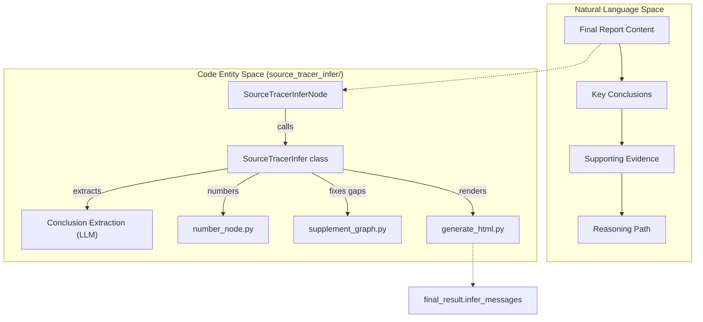

<!-- source: DeepWiki mcp.deepwiki.com · repo openJiuwen-ai/deepsearch · page 6.2 Inference-Chain Source Tracer · fetched 2026-11-02 -->

# Inference-Chain Source Tracer

<details>
<summary>Relevant source files</summary>

The following files were used as context for generating this wiki page:

- [deepsearch/docs/en/4.Developer Guide/API Reference/main_nodes.md](deepsearch/docs/en/4.Developer Guide/API Reference/main_nodes.md)
- [deepsearch/docs/feature/framework/research-workflow.md](deepsearch/docs/feature/framework/research-workflow.md)
- [deepsearch/openjiuwen_deepsearch/framework/openjiuwen/agent/main_graph_nodes.py](deepsearch/openjiuwen_deepsearch/framework/openjiuwen/agent/main_graph_nodes.py)
- [deepsearch/tests/node/test_agent_node.py](deepsearch/tests/node/test_agent_node.py)

</details>


The **Inference-Chain Source Tracer** is a specialized provenance subsystem located in `source_tracer_infer/`. Unlike the Global Source Tracer which focuses on sentence-level citations, this module generates a visual reasoning graph that connects high-level conclusions to specific evidence gathered during the research process. It transforms the logical flow of the report into an interactive HTML-based graph returned to the frontend as base64-encoded data.

## Overview and Purpose

The primary goal of the Inference-Chain Source Tracer is to provide transparency into the "reasoning" of the LLM. It extracts core conclusions from the generated report, identifies the supporting evidence (search results/documents), and constructs a directed acyclic graph (DAG) showing how information was synthesized [deepsearch/algorithm/source_tracer_infer/infer.py:1-20]().

The tracer is orchestrated by the `SourceTracerInferNode` within the main research workflow [deepsearch/framework/openjiuwen/agent/main_graph_nodes.py:1230-1250]().

### Key Capabilities
- **Conclusion Extraction**: Identifying key assertions made in the final report.
- **Evidence Mapping**: Filtering and linking relevant source documents to specific conclusions.
- **Reasoning Graph Generation**: Creating a structured representation of the "thought process."
- **Visual Synthesis**: Generating a self-contained HTML/JS visualization using Mermaid or similar graph logic, delivered via base64.

Sources: [deepsearch/algorithm/source_tracer_infer/infer.py](), [deepsearch/framework/openjiuwen/agent/main_graph_nodes.py]()

---

## System Architecture and Code Entity Space

The following diagram bridges the logical reasoning steps to the specific Python classes and functions that implement them.

### Logic to Implementation Mapping

Sources: [deepsearch/algorithm/source_tracer_infer/infer.py:22-60](), [deepsearch/framework/openjiuwen/agent/main_graph_nodes.py:1230-1245]()

---

## Core Implementation Details

### 1. Workflow Integration (`SourceTracerInferNode`)
The `SourceTracerInferNode` acts as the entry point. It checks the configuration `source_tracer_infer_switch`. If enabled, it instantiates the `SourceTracerInfer` class and processes the `search_context.report` and `all_classified_contents` [deepsearch/framework/openjiuwen/agent/main_graph_nodes.py:1230-1240]().

The output is stored in `final_result.infer_messages`, which contains the base64 HTML string [deepsearch/framework/openjiuwen/agent/main_graph_nodes.py:1248-1250]().

### 2. Reasoning Graph Construction
The process follows a strict pipeline:

| Phase | Component | Description |
| :--- | :--- | :--- |
| **Extraction** | `SourceTracerInfer._extract` | Uses LLM to identify main arguments and their supporting document IDs. |
| **Numbering** | `number_node.py` | Assigns unique, deterministic IDs to reasoning nodes to ensure graph consistency. |
| **Patching** | `supplement_graph.py` | Detects "orphaned" conclusions or missing links and uses an LLM to find missing evidence. |
| **HTML Generation** | `generate_html.py` | Wraps the graph data into a `div` or standalone HTML with embedded CSS/JS for frontend rendering. |

### 3. Node Numbering and Graph Patching
- **Node Numbering (`number_node.py`)**: To prevent ID collisions and handle hierarchical relationships (e.g., Section -> Subsection -> Conclusion), this module implements a recursive numbering scheme.
- **Supplementing the Graph (`supplement_graph.py`)**: If the initial extraction fails to link a critical conclusion to a source, the `supplement_graph` logic re-scans the `all_classified_contents` (the pool of all retrieved snippets) to find the best-fit evidence, ensuring the chain of custody for information is never broken.

Sources: [deepsearch/algorithm/source_tracer_infer/infer.py:65-110](), [deepsearch/framework/openjiuwen/agent/main_graph_nodes.py:1235-1255]()

---

## Data Flow: From Report to Base64 HTML

The transformation of raw text into a visual artifact follows this sequence:

```mermaid
sequenceDiagram
    participant N as SourceTracerInferNode
    participant T as SourceTracerInfer
    participant S as SupplementGraph
    participant G as HTMLGenerator

    N->>T: run(report_text, evidence_list)
    T->>T: LLM: Extract Nodes & Edges
    T->>S: patch_missing_links(graph_data)
    S-->>T: Patched Graph
    T->>G: generate_base64_html(graph_data)
    G-->>T: "data:text/html;base64,..."
    T-->>N: infer_messages
    N->>N: Update search_context.final_result
```

### Key Functions
- `SourceTracerInfer.trace()`: The main execution wrapper that coordinates the sub-modules [deepsearch/algorithm/source_tracer_infer/infer.py:45-55]().
- `generate_html_content()`: Takes the JSON representation of the reasoning graph and produces the HTML string [deepsearch/algorithm/source_tracer_infer/generate_html.py:10-30]().

Sources: [deepsearch/algorithm/source_tracer_infer/infer.py](), [deepsearch/framework/openjiuwen/agent/main_graph_nodes.py]()

---

## Frontend Integration

The `infer_messages` are returned as part of the `StreamEvent.FINAL_RESULT` [deepsearch/framework/openjiuwen/agent/main_graph_nodes.py:1300-1310](). 

The frontend receives a JSON object where the `infer_messages` field contains a base64 string. When decoded, this string is a complete HTML document or snippet that can be injected into an `<iframe>` or a `<div>`. This allows the reasoning graph to be interactive (zoom/pan) without requiring the frontend to implement complex graph-drawing logic, as the logic is encapsulated in the generated HTML.

Sources: [deepsearch/framework/openjiuwen/agent/main_graph_nodes.py:1248-1250](), [deepsearch/docs/en/4.Developer Guide/API Reference/main_nodes.md:130-134]()

---

