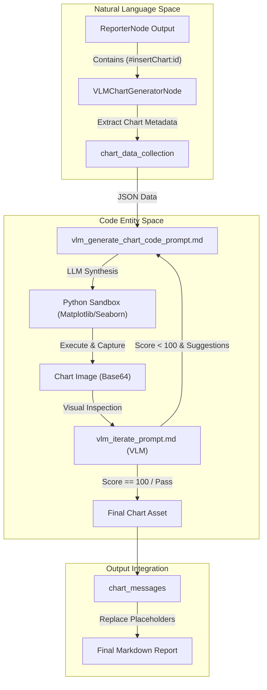
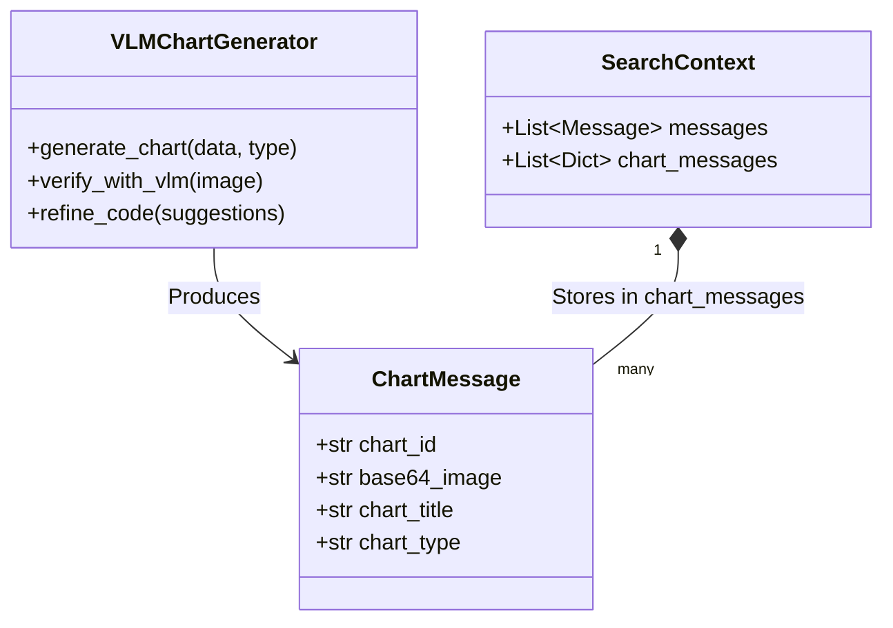

<!-- source: DeepWiki mcp.deepwiki.com · repo openJiuwen-ai/deepsearch · page 7 Chart Generation (VLM Pipeline) · fetched 2026-11-02 -->

# Chart Generation (VLM Pipeline)

Relevant source files

The following files were used as context for generating this wiki page:

- [deepsearch/openjiuwen_deepsearch/algorithm/prompts/vlm_generate_chart_code_prompt.md](deepsearch/openjiuwen_deepsearch/algorithm/prompts/vlm_generate_chart_code_prompt.md)
- [deepsearch/openjiuwen_deepsearch/algorithm/prompts/vlm_iterate_prompt.md](deepsearch/openjiuwen_deepsearch/algorithm/prompts/vlm_iterate_prompt.md)
- [deepsearch/openjiuwen_deepsearch/framework/openjiuwen/agent/main_graph_nodes.py](deepsearch/openjiuwen_deepsearch/framework/openjiuwen/agent/main_graph_nodes.py)

The Chart Generation system in DeepSearch is a Vision-Language Model (VLM) powered pipeline designed to transform structured data into high-quality, professional visualizations. Unlike simple template-based rendering, this pipeline uses a "Generate-Execute-Verify-Refine" loop. It synthesizes Python code, executes it in a secure sandbox, and uses a VLM to visually inspect the resulting image for aesthetic or structural issues, iterating until the chart meets quality standards.

## System Architecture

The chart generation process is managed by the `VLMChartGeneratorNode` within the main research workflow [deepsearch/openjiuwen_deepsearch/framework/openjiuwen/agent/main_graph_nodes.py:31-31](). It coordinates data collection, code generation, and iterative refinement.

### Logical Data Flow
The following diagram illustrates the transition from the "Natural Language Space" (research findings) to the "Code Entity Space" (Python execution and VLM evaluation).

**Chart Generation Pipeline Flow**

**Sources:** [deepsearch/openjiuwen_deepsearch/framework/openjiuwen/agent/main_graph_nodes.py:1260-1285](), [deepsearch/openjiuwen_deepsearch/algorithm/prompts/vlm_generate_chart_code_prompt.md:5-26](), [deepsearch/openjiuwen_deepsearch/algorithm/prompts/vlm_iterate_prompt.md:5-13]()

---

## Key Components and Implementation

### 1. Placeholder Identification and Data Collection
The process begins after the `ReporterNode` generates the report text. The system scans for figure placeholders using the format `(#insertChart:id)` [deepsearch/openjiuwen_deepsearch/framework/openjiuwen/agent/main_graph_nodes.py:1260-1262](). For each placeholder, the system retrieves:
*   **Chart Title**: The intended name of the visualization.
*   **Chart Description**: The narrative purpose (e.g., "Comparison of revenue growth").
*   **Chart Type**: The requested format (line, bar, pie, etc.).
*   **Chart Data**: The structured JSON data extracted from the research evidence.

**Sources:** [deepsearch/openjiuwen_deepsearch/algorithm/prompts/vlm_iterate_prompt.md:17-20]()

### 2. Python Code Generation (LLM)
The system uses the `vlm_generate_chart_code_prompt.md` to guide an LLM in writing Python code. 

**Key Constraints for Generation:**
*   **Style Preset**: Must use a specific color palette (`#F1B656`, `#397FC7`, etc.) and Seaborn styles [deepsearch/openjiuwen_deepsearch/algorithm/prompts/vlm_generate_chart_code_prompt.md:60-65]().
*   **Data Integrity**: If the `chart_data` is incomplete or ambiguous, the LLM is instructed to return `"NO CODE"` [deepsearch/openjiuwen_deepsearch/algorithm/prompts/vlm_generate_chart_code_prompt.md:89-89]().
*   **Layout Standards**: No subplots, no visible titles (titles are handled by Markdown), and mandatory legends for multi-category charts [deepsearch/openjiuwen_deepsearch/algorithm/prompts/vlm_generate_chart_code_prompt.md:91-111]().

**Sources:** [deepsearch/openjiuwen_deepsearch/algorithm/prompts/vlm_generate_chart_code_prompt.md:38-112]()

### 3. Sandbox Execution
The generated Python code is executed in a controlled environment. The sandbox:
1.  Sets the Matplotlib backend to `Agg` for non-interactive rendering [deepsearch/openjiuwen_deepsearch/algorithm/prompts/vlm_generate_chart_code_prompt.md:47-47]().
2.  Captures the output of the plotting functions.
3.  Converts the resulting figure into a Base64-encoded image string for the VLM to inspect.

### 4. VLM Iterative Refinement
This is the "Quality Gate" of the pipeline. The VLM evaluates the generated image using the `vlm_iterate_prompt.md`.

**Scoring and Evaluation:**
The VLM calculates a score starting from 100, deducting points based on a prioritized checklist:

| Priority | Issue Category | Deduction | Example Fail Condition |
| :--- | :--- | :--- | :--- |
| **Critical** | Generation Failure | -100 | Blank chart or insufficient data points [deepsearch/openjiuwen_deepsearch/algorithm/prompts/vlm_iterate_prompt.md:44-50]() |
| **P0** | Accuracy | -20 | Data mismatch or text-text overlap [deepsearch/openjiuwen_deepsearch/algorithm/prompts/vlm_iterate_prompt.md:52-61]() |
| **P1** | Readability | -15 | Text cut off at boundaries or font < 9pt [deepsearch/openjiuwen_deepsearch/algorithm/prompts/vlm_iterate_prompt.md:63-72]() |
| **P2** | Layout | -10 | Legend obscures content or unnecessary subplots [deepsearch/openjiuwen_deepsearch/algorithm/prompts/vlm_iterate_prompt.md:74-82]() |

If the score is less than 100, the VLM provides "code-actionable" suggestions (e.g., "increase DPI to 300" or "rotate x-axis labels by 45 degrees") [deepsearch/openjiuwen_deepsearch/algorithm/prompts/vlm_iterate_prompt.md:113-120](). The pipeline then loops back to the LLM to modify the code.

**Sources:** [deepsearch/openjiuwen_deepsearch/algorithm/prompts/vlm_iterate_prompt.md:31-98]()

---

## Data Structures and Output

### chart_messages format
The results of the chart generation are stored in the `chart_messages` field of the `SearchContext`. This allows the frontend to render the images alongside the report text.

**Code Entity Relationship**

**Sources:** [deepsearch/openjiuwen_deepsearch/framework/openjiuwen/agent/search_context.py:100-100](), [deepsearch/openjiuwen_deepsearch/framework/openjiuwen/agent/main_graph_nodes.py:1270-1285]()

### Final Integration
Once the VLM passes a chart (score 100), the image is finalized. The `ReporterNode` or a post-processing step ensures that the `(#insertChart:id)` placeholders in the Markdown are associated with the correct Base64 data in the `chart_messages` list for final delivery to the user [deepsearch/openjiuwen_deepsearch/framework/openjiuwen/agent/main_graph_nodes.py:1280-1288]().

**Sources:** [deepsearch/openjiuwen_deepsearch/framework/openjiuwen/agent/main_graph_nodes.py:1260-1285]()

---

