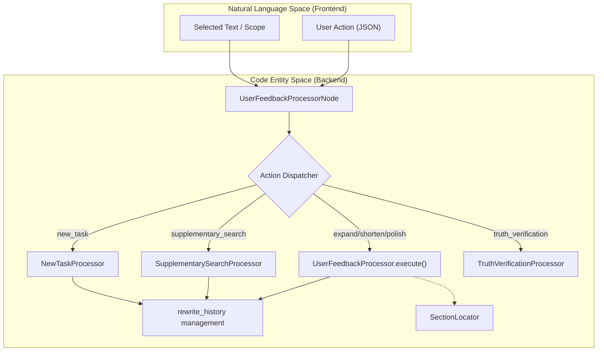
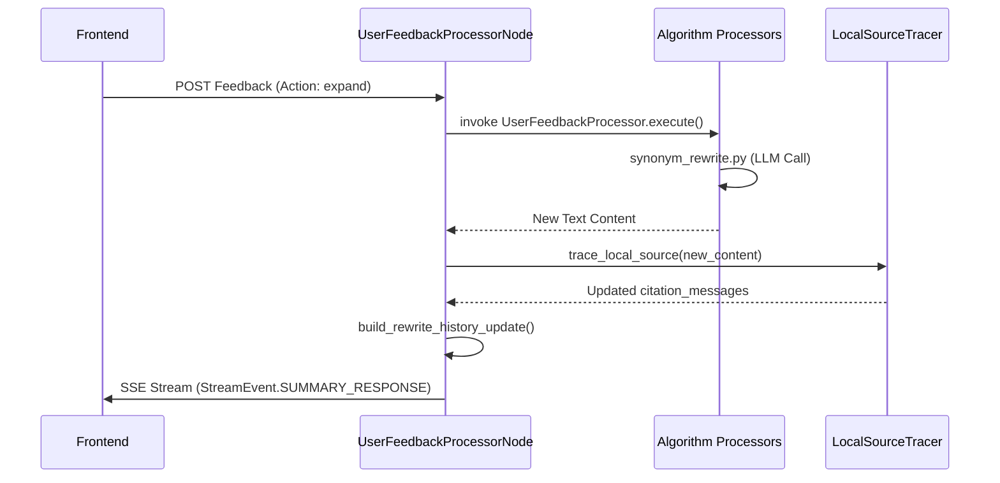

<!-- source: DeepWiki mcp.deepwiki.com · repo openJiuwen-ai/deepsearch · page 8 User Feedback Processor · fetched 2026-11-02 -->

# User Feedback Processor

Relevant source files

The following files were used as context for generating this wiki page:

- [deepsearch/docs/en/4.Developer Guide/API Reference/main_nodes.md](deepsearch/docs/en/4.Developer Guide/API Reference/main_nodes.md)
- [deepsearch/docs/feature/framework/research-workflow.md](deepsearch/docs/feature/framework/research-workflow.md)
- [deepsearch/openjiuwen_deepsearch/framework/openjiuwen/agent/main_graph_nodes.py](deepsearch/openjiuwen_deepsearch/framework/openjiuwen/agent/main_graph_nodes.py)
- [deepsearch/tests/node/test_agent_node.py](deepsearch/tests/node/test_agent_node.py)

The **User Feedback Processor** is a post-generation interactive system that allows users to refine, expand, or verify the generated report through localized editing actions. It enables a human-in-the-loop (HITL) refinement cycle where specific sections of the report can be modified without regenerating the entire document.

## System Overview and Workflow

The system is orchestrated by the `UserFeedbackProcessorNode`, which acts as a bridge between the frontend interactive requests and the specialized algorithmic processors.

### UserFeedbackProcessorNode Workflow Loop
The node manages a stateful loop that persists until the user sends a `finish` command or the maximum interaction limit is reached.

1.  **Initial Snapshot**: Upon first entry, the node sends a full `final_result` snapshot to the frontend, marked by `search_context.feedback_snapshot_sent` [deepsearch/openjiuwen_deepsearch/framework/openjiuwen/agent/main_graph_nodes.py:1115-1117]().
2.  **Action Dispatching**: It reads JSON feedback containing an `action` (e.g., `expand`, `polish`, `truth_verification`) and a `rewrite_scope` [deepsearch/openjiuwen_deepsearch/framework/openjiuwen/agent/main_graph_nodes.py:1117-1118]().
3.  **Local Source Tracing**: For actions that modify content (`expand`, `new_task`, etc.), the system runs a diff-aware local source tracer to maintain citation integrity [deepsearch/openjiuwen_deepsearch/framework/openjiuwen/agent/main_graph_nodes.py:1123-1125]().
4.  **History Management**: Updates `search_context.rewrite_history` to track changes for potential synchronization or undo operations [deepsearch/openjiuwen_deepsearch/framework/openjiuwen/agent/main_graph_nodes.py:1124-1125]().

### Action Dispatch Table

| Action | Code Entity | Description |
| :--- | :--- | :--- |
| `expand` / `shorten` / `polish` | `UserFeedbackProcessor` | LLM-based localized text rewriting. |
| `supplementary_search` | `supplementary_search.py` | Performs new searches to fill information gaps in selected text. |
| `new_task` | `new_task_processor.py` | Executes a brand new sub-task and integrates it into the report. |
| `truth_verification` | `truth_verification.py` | Read-only action to verify facts in the selected text. |
| `sync` | `main_graph_nodes.py` | Synchronizes the frontend report body with the backend state. |
| `finish` | `main_graph_nodes.py` | Exits the feedback loop and routes to `EndNode`. |

**Sources:** [deepsearch/openjiuwen_deepsearch/framework/openjiuwen/agent/main_graph_nodes.py:108-128](), [deepsearch/openjiuwen_deepsearch/framework/openjiuwen/agent/main_graph_nodes.py:65-67]()

## Architecture Diagrams

### Feedback Interaction Logic
This diagram illustrates how Natural Language Space (User Intent) is mapped to Code Entity Space (Processors).

**Sources:** [deepsearch/openjiuwen_deepsearch/framework/openjiuwen/agent/main_graph_nodes.py:1108-1128](), [deepsearch/openjiuwen_deepsearch/algorithm/user_feedback_processor/user_feedback_processor.py:65-67]()

### Data Flow and State Management
The following diagram tracks how `SearchContext` is updated during a feedback cycle.

**Sources:** [deepsearch/openjiuwen_deepsearch/framework/openjiuwen/agent/main_graph_nodes.py:1112-1128](), [deepsearch/openjiuwen_deepsearch/algorithm/user_feedback_processor/history.py:68-71]()

## Key Components

### UserFeedbackProcessor
The core class responsible for orchestrating the rewrite logic. It uses `synonym_rewrite.py` to prompt LLMs for localized changes while maintaining the original style and language.
*   **Key Function**: `execute()` handles the logic for `expand`, `shorten`, and `polish` actions.
*   **Source**: [deepsearch/openjiuwen_deepsearch/algorithm/user_feedback_processor/user_feedback_processor.py:65-67]()

### Section Locator
Used to map user-selected text offsets back to the specific sections within the report's `Outline` and `response_content`.
*   **Code Entity**: `SectionLocator`
*   **Source**: [deepsearch/openjiuwen_deepsearch/algorithm/user_feedback_processor/user_feedback_processor.py:118-120]()

### Supplementary Search and New Task
*   **Supplementary Search**: Invokes the `collector_function` to find additional information based on the `selected_text` and `rewrite_scope` (either `selected_only` or `selected_and_related`) [deepsearch/openjiuwen_deepsearch/framework/openjiuwen/agent/main_graph_nodes.py:1119-1120]().
*   **New Task**: Handles requests that require significant structural additions to the report, effectively running a mini-research cycle for the new content [deepsearch/openjiuwen_deepsearch/framework/openjiuwen/agent/main_graph_nodes.py:1123-1125]().

### Truth Verification
A specialized read-only processor (`truth_verification.py`) that checks the factual accuracy of a selected span.
*   It returns a JSON verification result in the `SUMMARY_RESPONSE` stream event [deepsearch/openjiuwen_deepsearch/framework/openjiuwen/agent/main_graph_nodes.py:1120-1121]().
*   It does **not** update `final_result.response_content` or `rewrite_history` [deepsearch/openjiuwen_deepsearch/framework/openjiuwen/agent/main_graph_nodes.py:1120-1121]().

### History and Synchronization
The system maintains a history of edits to ensure consistency between the backend model and the frontend view.
*   **Rewrite History**: Managed via `build_rewrite_history_update` and `build_current_outline_update` [deepsearch/openjiuwen_deepsearch/algorithm/user_feedback_processor/history.py:68-71]().
*   **Sync Action**: A lightweight acknowledgement that synchronizes the report body. It only creates a history record if the content has actually changed and keeps only the latest 10 records [deepsearch/openjiuwen_deepsearch/framework/openjiuwen/agent/main_graph_nodes.py:1121-1127]().

## Implementation Details

### Local Source Tracing
When content is rewritten, `LocalSourceTracer` (in `local_source_trace.py`) ensures that:
1.  Unchanged spans retain their original citation IDs.
2.  Newly generated content is scanned for evidence and assigned new citations.
3.  The reference list at the end of the report is updated accordingly.
*   **Source**: [deepsearch/openjiuwen_deepsearch/framework/openjiuwen/agent/main_graph_nodes.py:1123-1125]()

### Constraints and Limits
*   **Max Interactions**: The loop is governed by `user_feedback_processor_max_interactions`, which applies to all actions except `sync` [deepsearch/openjiuwen_deepsearch/framework/openjiuwen/agent/main_graph_nodes.py:1127]().
*   **Retry Logic**: Like other nodes, the processor supports retries for LLM failures during the rewrite process.

**Sources:**
- `deepsearch/openjiuwen_deepsearch/framework/openjiuwen/agent/main_graph_nodes.py`
- `deepsearch/openjiuwen_deepsearch/algorithm/user_feedback_processor/user_feedback_processor.py`
- `deepsearch/openjiuwen_deepsearch/algorithm/user_feedback_processor/history.py`
- `deepsearch/docs/en/4.Developer Guide/API Reference/main_nodes.md`
- `deepsearch/docs/feature/framework/research-workflow.md`

---

