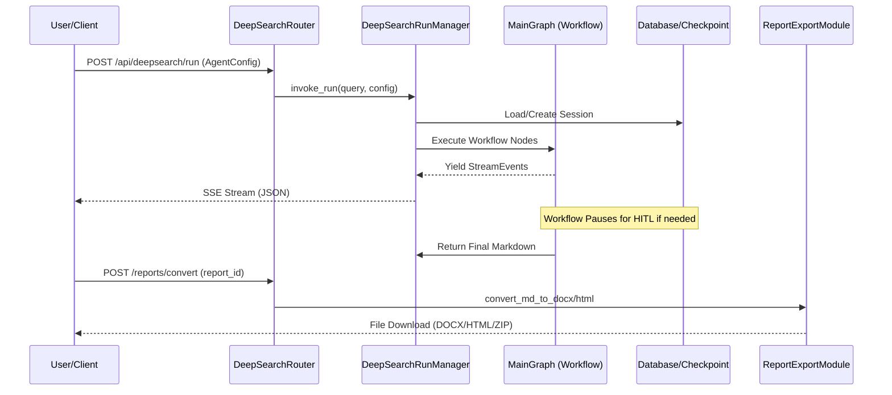

<!-- source: DeepWiki mcp.deepwiki.com · repo openJiuwen-ai/deepsearch · page 9 Server API and Backend Services · fetched 2026-11-02 -->

# Server API and Backend Services

<details>
<summary>Relevant source files</summary>

The following files were used as context for generating this wiki page:

- [deepsearch/tests/server/report_manager/test_report_processor.py](deepsearch/tests/server/report_manager/test_report_processor.py)

</details>


The **DeepSearch** backend is a FastAPI-based service layer that orchestrates multi-agent research workflows, manages persistent storage for conversations and knowledge bases, and provides robust report export capabilities. It serves as the bridge between the frontend (Studio/SDK) and the underlying `agent-core` framework.

### System Architecture Overview

The server layer is organized into functional modules handling request routing, long-running workflow management, and asynchronous document processing. It utilizes a repository pattern to abstract database operations and a manager pattern for complex operations like report generation and research execution.

#### Backend Entity Mapping
The following diagram maps high-level backend responsibilities to their primary implementation classes and modules within the codebase.

"Backend Entity Mapping"
```mermaid
graph TD
    subgraph "API_Layer"
        ["FastAPI_App"] -- "routes" --> ["DeepSearchRouter"]
        ["FastAPI_App"] -- "routes" --> ["KBRouter"]
        ["FastAPI_App"] -- "routes" --> ["ReportRouter"]
    end

    subgraph "Service_Logic"
        ["DeepSearchRouter"] --> ["DeepSearchRunManager"]
        ["KBRouter"] --> ["KBService"]
        ["ReportRouter"] --> ["ReportExportModule"]
    end

    subgraph "Persistence_&_State"
        ["DeepSearchRunManager"] -- "checkpoints" --> ["BaseCheckpointSaver"]
        ["KBService"] -- "vectors" --> ["Milvus/VectorStore"]
        ["Service_Logic"] -- "metadata" --> ["SQLAlchemy_Repositories"]
    end

    ["DeepSearchRunManager"] -- "executes" --> ["MainGraph"]
```
Sources: [deepsearch/server/main.py:1-120](), [deepsearch/server/router/deepsearch_run.py:1-50](), [deepsearch/server/router/kb.py:1-60]()

---

### Core Subsystems

The backend is divided into five primary subsystems, each detailed in its respective child page.

#### 1. FastAPI Application Runtime
The server entry point initializes the FastAPI application, configures CORS for cross-origin requests from the Studio, and manages the application lifecycle. During `lifespan_func`, the system initializes the `Runner`, creates database tables via `db_sync`, and sets up the global cancel bus.
*   **Key Components**: `FastAPI`, `uvicorn`, `lifespan_func`, `Checkpointer`.
*   For details, see [FastAPI Application Runtime](#9.1).

#### 2. DeepSearch Run API and Streaming
This subsystem handles the `/api/deepsearch/run` endpoint, which triggers the research workflow. It supports Server-Sent Events (SSE) to stream real-time updates (e.g., `thought`, `logs`, `answer`) to the client. It also manages Human-in-the-Loop (HITL) interruptions, allowing users to provide feedback on outlines or clarify queries.
*   **Key Components**: `DeepSearchRunManager`, `AgentConfig`, `StreamEvent`.
*   For details, see [DeepSearch Run API and Streaming](#9.2).

#### 3. Report Export and Rendering
The export module converts generated Markdown reports into professional formats including HTML and DOCX. It handles complex rendering tasks such as converting Mermaid diagrams to high-resolution PNGs, formatting LaTeX mathematics, and packaging all assets into a ZIP bundle.
*   **Key Components**: `html_export.py`, `docx_export.py`, `mermaid_renderer.py`, `report_bundle.py`.
*   For details, see [Report Export: HTML, DOCX, and Mermaid Rendering](#9.3).

#### 4. Knowledge Base (KB) Management
The KB subsystem provides endpoints for CRUD operations on private knowledge bases. It orchestrates a document processing pipeline that parses files, generates embeddings, and indexes them in a vector database (e.g., Milvus). It supports multi-instance deployments using Object Storage (OBS) for shared file access.
*   **Key Components**: `KBRouter`, `NativeKnowledgeBaseConfig`, `Milvus`, `OBS`.
*   For details, see [Knowledge Base Management and Local Retrieval](#9.4).

#### 5. Persistence and Configuration
DeepSearch uses SQLAlchemy to support both SQLite (local) and MySQL (production) databases. The persistence layer stores conversation history, agent states (checkpoints), and API keys (encrypted). Configuration is managed via a Pydantic `Settings` model driven by `.env` variables.
*   **Key Components**: `SQLAlchemy`, `Repository`, `security_utils.py`, `Settings`.
*   For details, see [Persistence, Storage, and Configuration](#9.5).

---

### Data Flow and Request Lifecycle

The following diagram illustrates how a research request flows through the server subsystems, from the initial API call to the final report export.

"Request Lifecycle and Data Flow"

Sources: [deepsearch/server/router/deepsearch_run.py:75-150](), [deepsearch/server/router/report.py:20-80](), [deepsearch/tests/server/report_manager/test_report_processor.py:67-88]()

### Key API Endpoint Summary

| Endpoint | Method | Description | Primary File |
| :--- | :--- | :--- | :--- |
| `/api/deepsearch/run` | POST | Starts or resumes a research workflow with SSE streaming. | `deepsearch/server/router/deepsearch_run.py` |
| `/api/kb/upload` | POST | Uploads and processes documents for a knowledge base. | `deepsearch/server/router/kb.py` |
| `/reports/convert` | POST | Converts Markdown to DOCX/HTML/ZIP formats. | `deepsearch/server/router/report.py` |
| `/api/space/config` | GET/POST | Manages workspace-specific LLM and tool configurations. | `deepsearch/server/router/space.py` |

Sources: [deepsearch/server/main.py:85-110](), [deepsearch/server/router/deepsearch_run.py:35-45](), [deepsearch/server/router/kb.py:40-55]()

---

