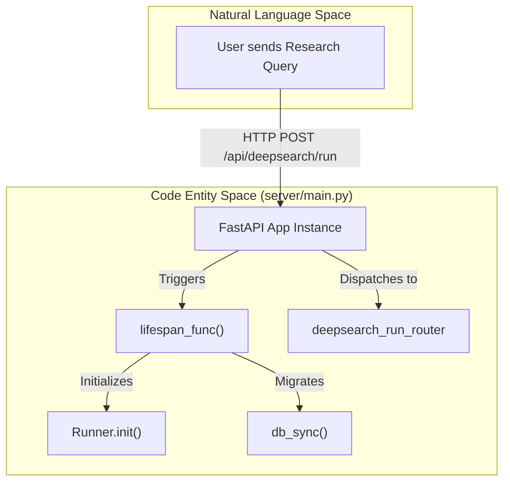
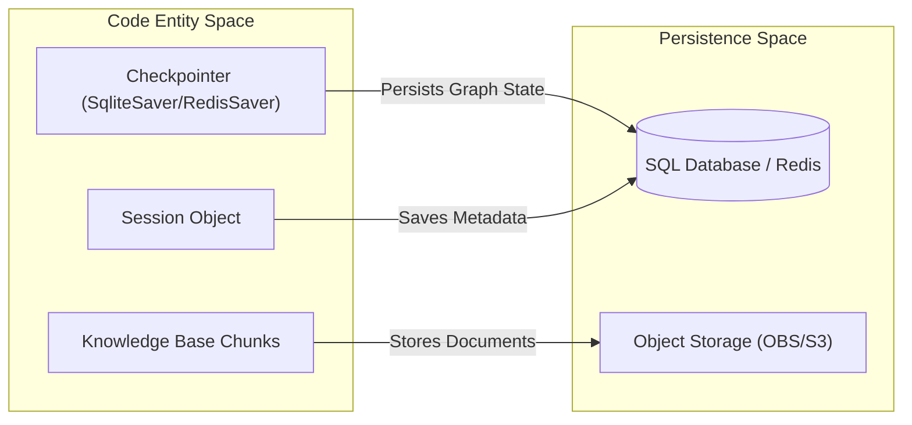

<!-- source: DeepWiki mcp.deepwiki.com · repo openJiuwen-ai/deepsearch · page 9.1 FastAPI Application Runtime · fetched 2026-11-02 -->

# FastAPI Application Runtime

Relevant source files

The following files were used as context for generating this wiki page:

- [deepsearch/tests/server/report_manager/test_report_processor.py](deepsearch/tests/server/report_manager/test_report_processor.py)

This page details the initialization, configuration, and execution lifecycle of the DeepSearch FastAPI application. The runtime environment is responsible for orchestrating the multi-agent workflows, managing persistent state, and providing the REST API interface for both the Studio frontend and the DeepSearch SDK.

## Server Lifecycle and Application Setup

 The application entry point is `server/main.py`, which initializes the FastAPI instance and manages the system lifecycle through a `lifespan` function.

### Initialization Sequence
When the server starts, the `lifespan_func` executes the following critical setup steps:
1.  **Runner Initialization**: Initializes the `Runner` instance, which acts as the primary orchestrator for agent execution [server/main.py:53-53]().
2.  **Cancel Bus Setup**: Starts the `cancel_bus`, a mechanism used to signal and handle workflow interruptions [server/main.py:54-54]().
3.  **Database Synchronization**: 
    *   Creates all necessary database tables via SQLAlchemy [server/main.py:55-55]().
    *   Executes `db_sync()`, which handles schema migrations and ensures the database state matches the current models [server/main.py:56-56]().
4.  **Resource Cleanup**: Upon shutdown, the lifespan function ensures that the `cancel_bus` is stopped and the `Runner` is properly closed to prevent memory leaks or orphaned processes [server/main.py:59-60]().

### Middleware and Routing
The application incorporates standard web service middleware and modular routing:
*   **CORS Middleware**: Configured to allow cross-origin requests, essential for the Studio frontend to communicate with the backend [server/main.py:38-46]().
*   **Request Logging**: A custom `logging_middleware` intercepts requests to provide observability into API calls [server/main.py:49-49]().
*   **Router Registration**: The app aggregates functionality from multiple modules, including `deepsearch_run_router`, `kb_router`, and `report_convert_router` [server/main.py:65-67]().

| Component | Responsibility | Source |
| :--- | :--- | :--- |
| `Runner` | Core workflow execution engine | [server/main.py:53]() |
| `cancel_bus` | Asynchronous interruption handling | [server/main.py:54]() |
| `db_sync` | Database schema migration and alignment | [server/main.py:56]() |
| `uvicorn` | ASGI server implementation | [server/main.py:84]() |

**Sources:**
- `server/main.py:38-84`

---

## Uvicorn Configuration and Deployment

The server is launched using `uvicorn` with parameters derived from the system environment settings.

### Runtime Parameters
The configuration is managed via a `Settings` object, which reads from `.env` files:
*   **Host and Port**: Defaults to `HOST` and `BACKEND_PORT` defined in the settings [server/main.py:84-84]().
*   **Concurrency**: The number of workers is determined by `WORKER_NUM`. By default, the system runs in a single-worker mode to maintain consistency for in-memory checkpointers, though it supports scaling for distributed setups [server/main.py:84-84]().

### System-Level Flow: Start to Request
The following diagram illustrates the transition from the "Natural Language Space" (User Intent) to the "Code Entity Space" (FastAPI Runtime).

**Diagram: Application Boot and Request Flow**

**Sources:**
- `server/main.py:30-84`

---

## Checkpointer and State Management

DeepSearch maintains the state of multi-agent workflows (graphs) using checkpointers. The type of checkpointer used determines the persistence and scalability of the system.

### Checkpointer Types
The system supports three primary checkpointer implementations:
1.  **In-Memory**: Used for development or single-session instances. State is lost if the server restarts.
2.  **Persistence (SQLAlchemy)**: Stores agent state in the configured relational database (SQLite/MySQL). This allows workflows to survive server restarts and supports the "Resume" functionality for Human-in-the-Loop (HITL) interactions.
3.  **Redis**: Recommended for production environments with multiple `WORKER_NUM` instances, providing a shared state store across distributed workers.

### Data Persistence Architecture
The following diagram bridges the "Persistence Space" to the "Code Entity Space".

**Diagram: State Persistence and Database Mapping**

**Sources:**
- `server/main.py:53-56`
- `deepsearch/tests/server/report_manager/test_report_processor.py:28-28` (referencing report bundle persistence)

---

## Request Handling and Middleware

Every request entering the FastAPI runtime passes through a standardized processing pipeline.

### Logging Middleware
The `logging_middleware` captures metadata for every incoming request. This is crucial for debugging complex agent interactions where the timing and payload of the API call are needed to reconstruct the failure state.

### Report Export and Conversion
The runtime provides specialized endpoints for converting research results into various formats. This involves the `report_export` module, which handles:
*   **Markdown to HTML**: Using `convert_md_to_html` [deepsearch/tests/server/report_manager/test_report_processor.py:70-70]().
*   **Markdown to DOCX**: Using `convert_md_to_docx` [deepsearch/tests/server/report_manager/test_report_processor.py:87-87]().
*   **Mermaid Rendering**: Preprocessing Mermaid code via `preprocess_mermaid_code` before rendering it into images for the final report [deepsearch/tests/server/report_manager/test_report_processor.py:123-126]().

| Function | Role | Source |
| :--- | :--- | :--- |
| `preprocess_markdown_text` | Strips internal citation markers like `[checked_citation:id]` | [deepsearch/tests/server/report_manager/test_report_processor.py:147-147]() |
| `wrap_html_tables` | Ensures tables are centered and responsive in HTML output | [deepsearch/tests/server/report_manager/test_report_processor.py:162-162]() |
| `set_global_styles` | Applies typography and spacing (e.g., 1.15 line spacing) to Word docs | [deepsearch/tests/server/report_manager/test_report_processor.py:110-114]() |

**Sources:**
- `deepsearch/tests/server/report_manager/test_report_processor.py:13-33`
- `deepsearch/tests/server/report_manager/test_report_processor.py:70-162`

---

