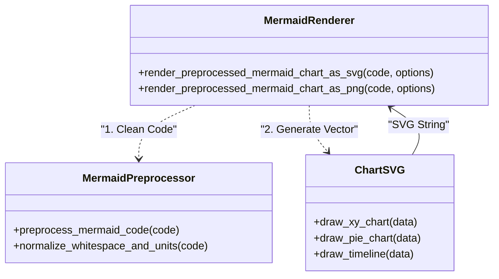

<!-- source: DeepWiki mcp.deepwiki.com · repo openJiuwen-ai/deepsearch · page 9.3 Report Export: HTML, DOCX, and Mermaid Rendering · fetched 2026-11-02 -->

# Report Export: HTML, DOCX, and Mermaid Rendering

<details>
<summary>Relevant source files</summary>

The following files were used as context for generating this wiki page:

- [deepsearch/docs/feature/server/report-conversion/html-docx-mermaid-export.md](deepsearch/docs/feature/server/report-conversion/html-docx-mermaid-export.md)
- [deepsearch/openjiuwen_deepsearch/algorithm/report_export/conversion_utils.py](deepsearch/openjiuwen_deepsearch/algorithm/report_export/conversion_utils.py)
- [deepsearch/openjiuwen_deepsearch/algorithm/report_export/html_export.py](deepsearch/openjiuwen_deepsearch/algorithm/report_export/html_export.py)
- [deepsearch/openjiuwen_deepsearch/algorithm/report_export/word_utils.py](deepsearch/openjiuwen_deepsearch/algorithm/report_export/word_utils.py)

</details>


This section details the report export subsystem, which handles the transformation of research results from Markdown into high-fidelity HTML and DOCX formats. It covers the rendering of Mermaid diagrams into SVGs and PNGs, mathematical formula protection, and the packaging of report bundles.

## 1. Overview and Architecture

The report export system is centered around the `/reports/convert` endpoint and the `report_export/` module. It follows a pipeline where raw Markdown is preprocessed, specialized content (like Mermaid or Math) is handled, and then converted into the target format.

### System Data Flow

The following diagram illustrates the flow from a research bundle to the final exported files.

**Report Export Pipeline**
```mermaid
graph TD
    subgraph "Input Space"
        [Bundle] --> |"report.md"| [MarkdownText]
        [Bundle] --> |"charts/*.png"| [VLMImages]
    end

    subgraph "Code Entity Space: openjiuwen_deepsearch.algorithm.report_export"
        [MarkdownText] --> [preprocess_markdown_text]
        [preprocess_markdown_text] --> [mermaid_preprocess.py]
        
        subgraph "Mermaid Rendering"
            [mermaid_preprocess.py] --> [mermaid_renderer.py]
            [mermaid_renderer.py] --> [chart_svg.py]
            [chart_svg.py] --> |"SVG Strings"| [HTMLPath]
            [chart_svg.py] --> |"Pillow PNG"| [DOCXPath]
        end

        subgraph "Format Conversion"
            [HTMLPath] --> [html_export.py]
            [DOCXPath] --> [docx_export.py]
            [docx_export.py] --> [word_utils.py]
        end
    end

    subgraph "Output Space"
        [html_export.py] --> [Report.html]
        [docx_export.py] --> [Report.docx]
        [Report.html] --> [report_bundle.py]
        [Report.docx] --> [report_bundle.py]
        [report_bundle.py] --> [Final_ZIP]
    end
```
**Sources:** `[deepsearch/openjiuwen_deepsearch/algorithm/report_export/html_export.py:15-32]()`, `[deepsearch/openjiuwen_deepsearch/algorithm/report_export/docx_export.py:1-40]()`, `[deepsearch/docs/feature/server/report-conversion/html-docx-mermaid-export.md:37-50]()`

## 2. Shared Preprocessing and Utilities

Before conversion, the Markdown content undergoes normalization and protection steps in `conversion_utils.py` to ensure consistency across formats.

### Key Shared Functions
*   **`preprocess_markdown_text`**: Fixes common Markdown artifacts, including numbered heading boundaries, list indentation, and table caption normalization `[deepsearch/openjiuwen_deepsearch/algorithm/report_export/conversion_utils.py:255-298]()`.
*   **Math Protection**: The system uses heuristics to distinguish between mathematical formulas (`$...$`) and currency (e.g., `$5.00`).
    *   `_is_likely_inline_math`: Identifies formulas based on operators, Greek letters, or LaTeX commands `[deepsearch/openjiuwen_deepsearch/algorithm/report_export/conversion_utils.py:657-695]()`.
    *   `_is_currency_start`: Identifies currency patterns to prevent KaTeX or Word from misinterpreting them as math `[deepsearch/openjiuwen_deepsearch/algorithm/report_export/conversion_utils.py:612-637]()`.
*   **`protect_math_spans`**: Replaces detected math spans with NUL-based sentinels (`\x00MATH\x00`) to prevent the Markdown parser from mangling LaTeX symbols `[deepsearch/openjiuwen_deepsearch/algorithm/report_export/conversion_utils.py:729-762]()`.

**Sources:** `[deepsearch/openjiuwen_deepsearch/algorithm/report_export/conversion_utils.py:1-93]()`, `[deepsearch/docs/feature/server/report-conversion/html-docx-mermaid-export.md:57-61]()`

## 3. HTML Export

The `html_export.py` module generates a standalone HTML file. It supports two variants: `standard` (basic styling) and `styled` (enhanced semantic structure and custom CSS) `[deepsearch/openjiuwen_deepsearch/algorithm/report_export/html_export.py:35-36]()`.

### Implementation Details
*   **KaTeX Integration**: HTML reports include KaTeX (v0.16.11) for client-side math rendering. A `DOMContentLoaded` script performs "currency protection" by temporarily replacing `$` signs with a full-width character (`＄`) before KaTeX runs, then restoring them `[deepsearch/openjiuwen_deepsearch/algorithm/report_export/html_export.py:264-285]()`.
*   **Image Handling**: VLM-generated charts and other images are converted to Base64 Data URIs to ensure the HTML file is truly self-contained `[deepsearch/openjiuwen_deepsearch/algorithm/report_export/conversion_utils.py:349-385]()`.
*   **Mermaid**: Mermaid code blocks are rendered to inline SVGs using the internal `mermaid_renderer` `[deepsearch/openjiuwen_deepsearch/algorithm/report_export/html_export.py:221-231]()`.

**Sources:** `[deepsearch/openjiuwen_deepsearch/algorithm/report_export/html_export.py:37-285]()`, `[deepsearch/docs/feature/server/report-conversion/html-docx-mermaid-export.md:9-11]()`

## 4. DOCX Export and Word Utilities

The `docx_export.py` and `word_utils.py` modules handle the complex conversion from Markdown/HTML fragments to OpenXML (Word).

### The Conversion Pipeline
1.  **HTML Parsing**: The system first converts Markdown to an intermediate HTML fragment using `markdown` with extensions `[deepsearch/openjiuwen_deepsearch/algorithm/report_export/docx_export.py:130-150]()`.
2.  **Node Traversal**: `HtmlToDocxConverter` traverses the HTML tree using `BeautifulSoup` `[deepsearch/openjiuwen_deepsearch/algorithm/report_export/docx_export.py:245-260]()`.
3.  **Math Conversion**: LaTeX math is converted to Office Math Markup Language (OMML).
    *   Uses `latex2mathml` to get MathML `[deepsearch/openjiuwen_deepsearch/algorithm/report_export/word_utils.py:22]()`.
    *   Uses `mathml2omml` to convert MathML to Word's native XML format `[deepsearch/openjiuwen_deepsearch/algorithm/report_export/word_utils.py:23]()`.
4.  **List Handling**: Native Word multilevel lists are created to ensure correct indentation and numbering for nested `<ul>` and `<ol>` tags `[deepsearch/openjiuwen_deepsearch/algorithm/report_export/word_utils.py:191-211]()`.

### Post-Processing
After the initial document generation, `WordPostProcessor` applies:
*   **Font Normalization**: Sets the default font (e.g., "Microsoft YaHei") for all paragraphs and runs `[deepsearch/openjiuwen_deepsearch/algorithm/report_export/docx_export.py:465-495]()`.
*   **Table Centering**: Aligns all tables to the center of the page `[deepsearch/openjiuwen_deepsearch/algorithm/report_export/docx_export.py:530-545]()`.
*   **Image Optimization**: Uses Pillow to upscale and enhance chart images for better print quality in Word `[deepsearch/openjiuwen_deepsearch/algorithm/report_export/docx_export.py:555-600]()`.

**Sources:** `[deepsearch/openjiuwen_deepsearch/algorithm/report_export/docx_export.py:41-110]()`, `[deepsearch/openjiuwen_deepsearch/algorithm/report_export/word_utils.py:1-51]()`, `[deepsearch/docs/feature/server/report-conversion/html-docx-mermaid-export.md:12-15]()`

## 5. Mermaid Rendering Engine

DeepSearch implements a pure-Python Mermaid rendering pipeline that does not require external tools like `mmdc` or Headless Chrome.

### Rendering Workflow


### Key Components
*   **`mermaid_preprocess.py`**: Extracts data from Mermaid code blocks (xychart, pie, timeline) and normalizes units and whitespace `[deepsearch/openjiuwen_deepsearch/algorithm/report_export/mermaid_preprocess.py:1-60]()`.
*   **`chart_svg.py`**: A specialized SVG generator that draws charts using standard SVG elements. It handles axis scaling (`nice_ceil`/`nice_floor`), text wrapping, and color contrast checking `[deepsearch/openjiuwen_deepsearch/algorithm/report_export/chart_svg.py:1-100]()`.
*   **`mermaid_renderer.py`**: The orchestrator that decides whether to return an SVG (for HTML) or a PNG (for DOCX, via Pillow) `[deepsearch/openjiuwen_deepsearch/algorithm/report_export/mermaid_renderer.py:1-50]()`.

**Sources:** `[deepsearch/openjiuwen_deepsearch/algorithm/report_export/mermaid_renderer.py:10-40]()`, `[deepsearch/docs/feature/server/report-conversion/html-docx-mermaid-export.md:16-26]()`

## 6. Report Bundle Packaging

The `report_bundle.py` module manages the final packaging of these assets into a ZIP file for the user.

### Bundle Structure
*   **`report.md`**: The original research report.
*   **`report.html`**: The standalone HTML export.
*   **`report.docx`**: The Word export.
*   **`charts/`**: Directory containing PNG versions of all charts (both VLM-generated and Mermaid-rendered) `[deepsearch/docs/feature/server/report-conversion/html-docx-mermaid-export.md:23-25]()`.

**Sources:** `[deepsearch/openjiuwen_deepsearch/algorithm/report_export/report_bundle.py:1-50]()`, `[deepsearch/openjiuwen_deepsearch/algorithm/report_export/conversion_utils.py:408-435]()`

---

