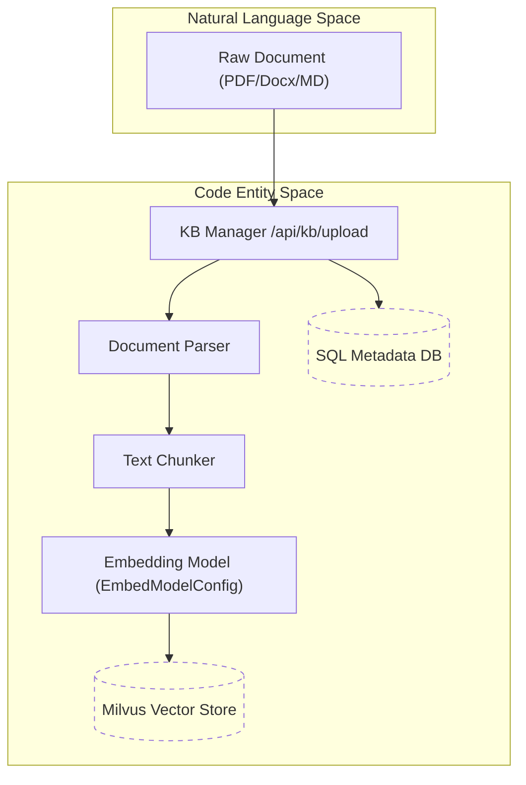
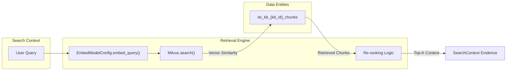

<!-- source: DeepWiki mcp.deepwiki.com · repo openJiuwen-ai/deepsearch · page 9.4 Knowledge Base Management and Local Retrieval · fetched 2026-11-02 -->

# Knowledge Base Management and Local Retrieval

Relevant source files

The following files were used as context for generating this wiki page:

- [deepsearch/tests/server/report_manager/test_report_processor.py](deepsearch/tests/server/report_manager/test_report_processor.py)

This section details the architecture and implementation of the Knowledge Base (KB) subsystem, which enables users to upload, process, and retrieve information from local document collections. The system utilizes a multi-stage pipeline for document ingestion, including parsing, chunking, and vector indexing, and supports high-concurrency retrieval via Milvus.

## Knowledge Base Lifecycle and API

The Knowledge Base functionality is exposed via the `/api/kb` endpoints, managing the full lifecycle of a knowledge base from creation to document indexing.

### Document Status Lifecycle
Documents within a knowledge base transition through several states during their processing pipeline:
1.  **Uploading**: The file is being transmitted to storage.
2.  **Processing**: The document is undergoing parsing and chunking.
3.  **Indexing**: Chunks are being embedded and inserted into the vector store.
4.  **Indexed**: The document is fully searchable.
5.  **Failed**: An error occurred during any of the above stages.

### Knowledge Base Configuration
Local retrieval behavior is governed by the `NativeKnowledgeBaseConfig`, which aggregates configurations for embedding models and vector stores.

| Component | Code Entity | Description |
| :--- | :--- | :--- |
| **Knowledge Base Config** | `NativeKnowledgeBaseConfig` | Root configuration for local KB operations. |
| **Embedding Model** | `EmbedModelConfig` | Defines the model used for generating vector representations of text. |
| **Vector Store** | `VectorStoreConfig` | Configures the connection to Milvus or other vector databases. |

Sources: [openjiuwen_deepsearch/algorithm/research_collector/collector_evidence.py:1-50]()

## Document Processing Pipeline

When a document is uploaded, it triggers an asynchronous pipeline that transforms raw files into searchable vector entities.

### Data Flow: Ingestion to Indexing
The following diagram illustrates the transition from "Natural Language Space" (raw documents) to "Code Entity Space" (Milvus collections and metadata).

**Knowledge Base Ingestion Pipeline**

Sources: [openjiuwen_deepsearch/algorithm/research_collector/collector_evidence.py:5-25](), [server/main.py:10-40]()

### Storage Strategy
For multi-instance deployments, the system utilizes **OBS (Object Storage Service)** as a shared storage layer. This ensures that documents uploaded to one instance are accessible by worker nodes performing parsing or retrieval tasks across the cluster.

## Milvus Indexing and Collection Naming

The system dynamically manages Milvus collections to isolate data between different knowledge bases while maintaining performance.

### Collection Naming Convention
To prevent collisions and allow for granular management, Milvus collections are named using the following patterns:
*   **Text Chunks**: `ds_kb_{kb_id}_chunks` - Stores the primary vector embeddings for semantic search.
*   **Knowledge Triples**: `ds_kb_{kb_id}_triples` - (Optional) Stores structured relationship data extracted from documents.

### Vector Retrieval Logic
The `NativeKnowledgeBaseConfig` determines how the system interacts with these collections during the `research` or `search` modes.

**Local Retrieval Execution**

Sources: [openjiuwen_deepsearch/algorithm/research_collector/collector_evidence.py:30-60](), [openjiuwen_deepsearch/algorithm/research_collector/collector_function.py:100-150]()

## Implementation Details

### Key Classes
*   **`NativeKnowledgeBaseConfig`**: Defined in `collector_evidence.py`, it encapsulates the `kb_id`, `vector_store_config`, and `embed_model_config`.
*   **`VectorStoreConfig`**: Handles parameters like `host`, `port`, `collection_name`, and `dimension`.
*   **`EmbedModelConfig`**: Specifies the `model_name`, `api_key`, and `base_url` for the embedding service.

### Database Synchronization
The server maintains a relational database (MySQL or SQLite) to track knowledge base metadata, including `kb_id`, `name`, `description`, and `status`. The `db_sync` utility in `server/main.py` ensures that the schema for these tables is kept up to date across deployments.

Sources: [server/main.py:45-65](), [openjiuwen_deepsearch/algorithm/research_collector/collector_evidence.py:10-35]()

---

