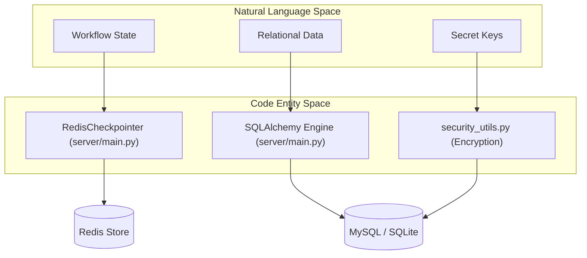
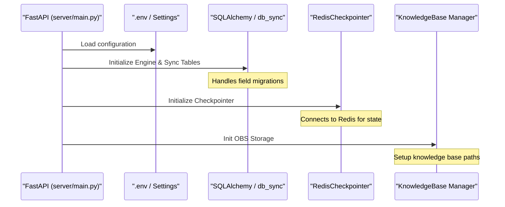

<!-- source: DeepWiki mcp.deepwiki.com · repo openJiuwen-ai/deepsearch · page 9.5 Persistence, Storage, and Configuration · fetched 2026-11-02 -->

# Persistence, Storage, and Configuration

Relevant source files

The following files were used as context for generating this wiki page:

- [deepsearch/tests/server/report_manager/test_report_processor.py](deepsearch/tests/server/report_manager/test_report_processor.py)

This section details the server-side persistence layer, configuration management, and storage abstractions of the openJiuwen-DeepSearch system. The architecture utilizes a combination of relational databases for metadata, Redis for distributed workflow state, and Object Storage (OBS) for large-scale knowledge base assets.

## Database and Persistence Layer

The system uses SQLAlchemy as its Object-Relational Mapper (ORM) to support both SQLite (for local development) and MySQL (for production) [deepsearch/server/main.py:41-55]().

### Repository Pattern and Space Scoping
Data access is organized through a repository pattern, ensuring that all queries are scoped by `space_id` to maintain multi-tenancy isolation. This is critical for entities like Knowledge Bases and Conversations.

### Database Synchronization and Migrations
The `db_sync` utility handles the automatic creation of tables and field migrations during the FastAPI lifespan [deepsearch/server/main.py:53-55](). It ensures that the database schema matches the SQLAlchemy models defined in the system.

### Security and API Key Management
To protect sensitive credentials (e.g., LLM provider keys), the system implements an encryption/decryption layer using `security_utils.py`. API keys are encrypted before storage in the database and decrypted only at runtime when initializing the `Runner` [deepsearch/server/main.py:46-50]().

| Feature | Implementation | File Reference |
| :--- | :--- | :--- |
| **ORM** | SQLAlchemy | `deepsearch/server/main.py` |
| **Engines** | MySQL / SQLite | `deepsearch/server/main.py` |
| **Encryption** | Fernet/AES | `security_utils.py` |
| **Multi-tenancy** | `space_id` scoping | Repository Pattern |

## Workflow State Persistence (Checkpointers)

The system manages the state of long-running research workflows using Checkpointers. These allow the system to resume a workflow after an interruption (e.g., Human-in-the-Loop feedback or server restart).

### Checkpointer Types
1.  **In-Memory Checkpointer**: Used for single-session CLI or lightweight local runs.
2.  **Redis Checkpointer**: Recommended for production. It stores the `Session` state and `AgentGraph` checkpoints in Redis, enabling distributed execution across multiple worker instances [deepsearch/server/main.py:56-60]().

### Data Flow: Persistence and Storage
The following diagram illustrates how the system bridges high-level persistence concepts to specific code entities.

**Entity Mapping: Persistence and State**

Sources: [deepsearch/server/main.py:41-60]().

## Object Storage (OBS) and Knowledge Base Files

For large files associated with the Knowledge Base (KB), the system abstracts storage through an Object Storage Service (OBS) interface.

### Storage Lifecycle
1.  **Upload**: Files are uploaded via the `/api/kb` endpoints [deepsearch/server/main.py:65-67]().
2.  **Persistence**: The raw file is stored in OBS (e.g., Huawei Cloud OBS or S3-compatible storage), while the metadata (file name, size, status) is stored in the relational database.
3.  **Processing**: The background pipeline retrieves the file from OBS to perform parsing and chunking before indexing into Milvus [deepsearch/server/main.py:65-67]().

### Shared Storage for Multi-Instance
In multi-instance deployments (DeepSearch Full Edition), OBS acts as the shared storage backend, ensuring that any worker node can access the source documents for a knowledge base regardless of which node received the initial upload.

## Configuration and Settings Model

The system configuration is centralized in a `Settings` model, which loads variables from `.env` files and environment variables.

### Key Configuration Categories
-   **Server Config**: `HOST`, `BACKEND_PORT`, and `WORKER_NUM` [deepsearch/server/main.py:75-80]().
-   **Database Config**: Connection strings for MySQL/SQLite.
-   **Redis Config**: Connection details for the checkpointer.
-   **Storage Config**: Credentials for OBS/S3.
-   **Security Config**: Secret keys for Fernet encryption.

### System Initialization Flow
The initialization sequence in `server/main.py` demonstrates how these components are wired together.

**System Component Initialization**

Sources: [deepsearch/server/main.py:41-80]().

## Export Persistence and Formatting

While primary persistence focuses on state and metadata, the system also handles the persistence of generated reports through the `report_export` module.

### Report Bundle Persistence
Generated reports are often bundled into ZIP files for download. This process involves:
1.  **Markdown Preprocessing**: Stripping internal citation markers like `[checked_citation:id]` [deepsearch/tests/server/report_manager/test_report_processor.py:136-152]().
2.  **HTML/DOCX Conversion**: Converting the processed Markdown into final formats [deepsearch/tests/server/report_manager/test_report_processor.py:67-88]().
3.  **Style Application**: Applying global styles (e.g., 1.15 line spacing in Word) to ensure professional output [deepsearch/tests/server/report_manager/test_report_processor.py:106-115]().

Sources: [deepsearch/tests/server/report_manager/test_report_processor.py:13-33](), [deepsearch/tests/server/report_manager/test_report_processor.py:106-152]().

---

