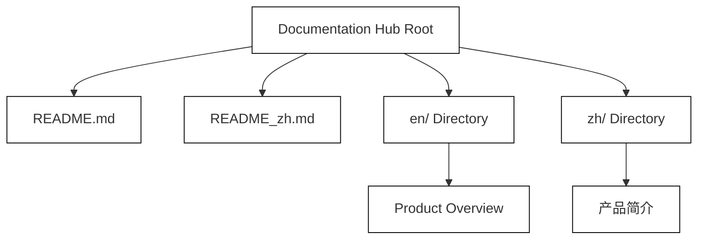
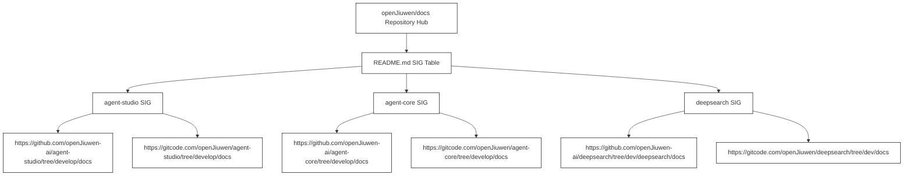

<!-- source: DeepWiki mcp.deepwiki.com · repo openJiuwen-ai/docs · page 1 Overview · fetched 2026-11-02 -->

# Overview

Relevant source files

The following files were used as context for generating this wiki page:

- [README.md](README.md)
- [README_zh.md](README_zh.md)

The openJiuwen documentation center repository (`openJiuwen-ai/docs`) acts as the central product-overview hub for the openJiuwen AI agent ecosystem [README.md:1-3()]. It provides high-level product definitions, architectural summaries, and serves as an index pointing to federated Special Interest Group (SIG) technical documentation across various code repositories [README.md:14-21()]. 

For a comprehensive guide on how the repository is structured and how to navigate between bilingual assets and external SIG technical resources, refer to the respective child pages below:
- Repository Layout and Navigation (see [Repository Layout and Navigation](#1.1))
- SIG Documentation Index (see [SIG Documentation Index](#1.2))

---

## 1.1. Repository Layout and Navigation

The repository organizes its core product documentation using a bilingual directory tree (`en/` and `zh/`) anchored by root index files [README.md:6-12()]. Readers can easily locate product descriptions and high-level architectural overviews by following the structured directory layout defined in `README.md` and `README_zh.md` [README_zh.md:6-12()].

*Diagram 1: Natural Language to Code Entity Mapping of the Repository Directory Structure*

Sources: [README.md:1-12()](), [README_zh.md:1-12()]()

---

## 1.2. SIG Documentation Index

Because technical documentation is decentralized across individual SIG repositories (such as `agent-studio`, `agent-core`, and `deepsearch`), this repository maintains an index mapping community SIG groups to their respective technical documentation trees on GitHub and GitCode [README.md:14-21(), README_zh.md:14-21()].

*Diagram 2: Federation Mapping from Documentation Hub to External SIG Repositories*

Sources: [README.md:14-21()](), [README_zh.md:14-21()]()

---

