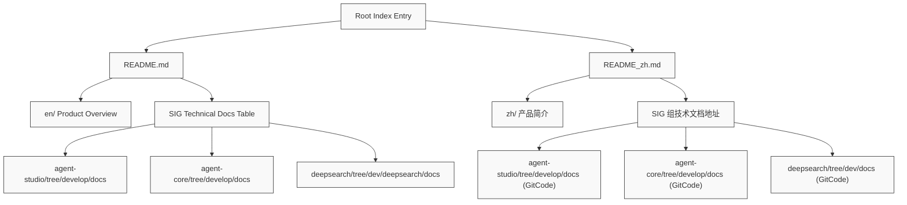
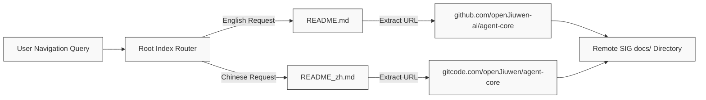

<!-- source: DeepWiki mcp.deepwiki.com · repo openJiuwen-ai/docs · page 1.1 Repository Layout and Navigation · fetched 2026-11-02 -->

# Repository Layout and Navigation

<details>
<summary>Relevant source files</summary>

The following files were used as context for generating this wiki page:

- [README.md](README.md)
- [README_zh.md](README_zh.md)

</details>


## Purpose and Scope

This document details the architectural layout, directory organization, and navigation patterns of the `openJiuwen-ai/docs` repository. The repository serves as the central product-overview hub for the openJiuwen ecosystem, maintaining top-level entry points (`README.md` and `README_zh.md`) and bridging readers to federated Special Interest Group (SIG) repositories [README.md:1-3]().

Sources:
- `README.md:1-3`
- `README_zh.md:1-3`

---

## Root Index Files (`README.md` and `README_zh.md`)

The repository root houses two primary multilingual index files: `README.md` for English-speaking users and `README_zh.md` for Chinese-speaking users [README.md:1-20](), [README_zh.md:1-20](). These files establish the entry protocol for the documentation center, defining the high-level system purpose, directory structures, and external SIG links.

- **`README.md`**: Acts as the primary English entry point, establishing the overview that product documentation lives centrally while technical specifications reside within individual SIG repositories [README.md:1-3]().
- **`README_zh.md`**: Serves as the localized counterpart, providing identical structural guidance in Chinese (`文档中心`, `产品简介`) [README_zh.md:1-3]().

Sources:
- `README.md:1-21`
- `README_zh.md:1-21`

---

## Directory Structure and Localization Layout

The repository is organized to separate localized content trees (`en/` and `zh/`) [README.md:6-12](), [README_zh.md:6-12](). 

```
-- zh
   |-- 产品简介 (Product Overview)
-- en
   |-- Product Overview
```

- **`zh/`**: Contains Chinese documentation assets, including localized product overview files (`产品简介`) [README_zh.md:8-9]().
- **`en/`**: Contains English documentation trees, mirroring the product overview structure (`Product Overview`) [README.md:10-11]().
- **Image Assets**: Static assets such as architectural schemas and system diagrams are managed locally to support the markdown documentation files across language trees.

Sources:
- `README.md:6-12`
- `README_zh.md:6-12`

---

## Navigation and Federated SIG Indexing

Readers navigate from the central documentation hub to specific technical modules via the Special Interest Group (SIG) documentation tables defined in the root README files [README.md:14-20](), [README_zh.md:14-20](). 

The navigation layout connects the central hub to external repositories:
- `agent-studio`: Maintained under the `agent-studio` repository [README.md:18]().
- `agent-core`: Maintained under the `agent-core` repository [README.md:19]().
- `deepsearch`: Maintained under the `deepsearch` repository [README.md:20]().

### Navigation Flow Architecture



Sources:
- `README.md:1-21`
- `README_zh.md:1-21`

---

## Code-to-Documentation Navigation Mapping

To resolve documentation targets from natural language queries to concrete repository endpoints, the routing layer maps human-readable SIG identifiers directly to remote documentation trees.



Sources:
- `README.md:14-21`
- `README_zh.md:14-21`

---

