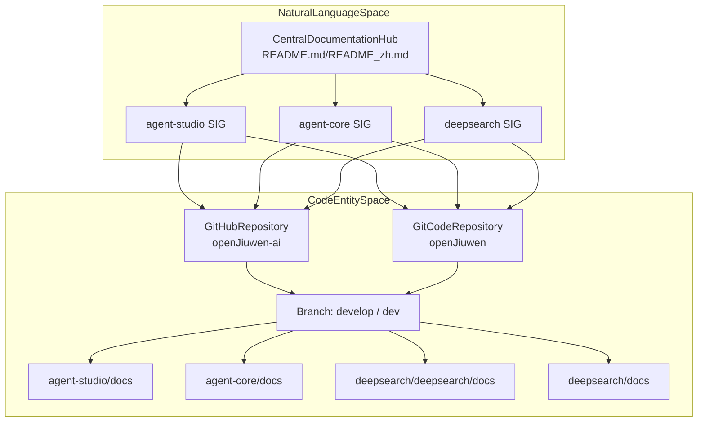
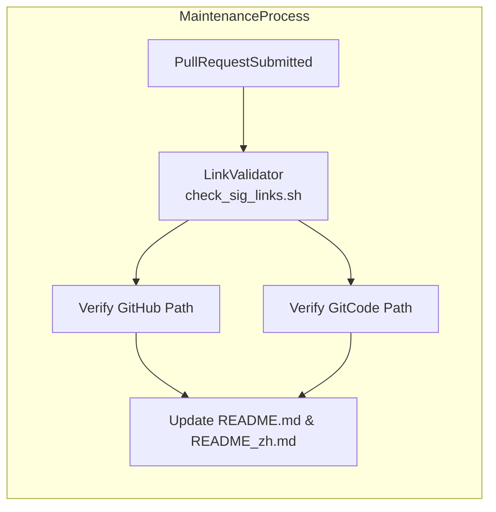

<!-- source: DeepWiki mcp.deepwiki.com · repo openJiuwen-ai/docs · page 1.2 SIG Documentation Index · fetched 2026-11-02 -->

# SIG Documentation Index

Relevant source files

The following files were used as context for generating this wiki page:

- [README.md](README.md)
- [README_zh.md](README_zh.md)

## Purpose and Scope
The SIG Documentation Index acts as the federated pointer registry for the openJiuwen ecosystem. While the central documentation repository handles product overviews and top-level architecture [`README.md:1-4`]() [`README_zh.md:1-3`](), individual Special Interest Groups (SIGs) maintain granular technical specifications, API contracts, and implementation guides within their respective source repositories [`README.md:14-21`]() [`README_zh.md:14-21`](). This section outlines the authoritative link structures, hosting platform bifurcations (GitHub vs. GitCode), branch naming conventions, and maintenance protocols required to navigate the openJiuwen technical landscape.

Sources: [`README.md:1-4`]() [`README_zh.md:1-3`](), [`README.md:14-21`]() [`README_zh.md:14-21`]()

---

## Technical Documentation Links Table
The openJiuwen community mirrors its repositories across both GitHub (international) and GitCode (regional/enterprise) platforms to ensure high availability and accessibility. The table below details the canonical entry points for each SIG's technical documentation folder:

| SIG Name | GitHub Documentation URL | GitCode Documentation URL | Primary Branch | Documentation Root Path |
| :--- | :--- | :--- | :--- | :--- |
| `agent-studio` | `https://github.com/openJiuwen-ai/agent-studio/tree/develop/docs` [`README.md:18`]() | `https://gitcode.com/openJiuwen/agent-studio/tree/develop/docs` [`README_zh.md:18`]() | `develop` | `/docs` |
| `agent-core` | `https://github.com/openJiuwen-ai/agent-core/tree/develop/docs` [`README.md:19`]() | `https://gitcode.com/openJiuwen/agent-core/tree/develop/docs` [`README_zh.md:19`]() | `develop` | `/docs` |
| `deepsearch` | `https://github.com/openJiuwen-ai/agent-core/tree/dev/deepsearch/docs` [`README.md:20`]() | `https://gitcode.com/openJiuwen/deepsearch/tree/dev/docs` [`README_zh.md:20`]() | `dev` | `/deepsearch/docs` (GitHub) / `/docs` (GitCode) |

Sources: [`README.md:16-21`]() [`README_zh.md:16-21`]()

---

## Branch Conventions and Path Variations
Different SIG repositories adhere to specific branching and directory structures based on their internal release lifecycles and sub-module organization:

1. **`develop` Branch Standard**: Repositories like `agent-studio` and `agent-core` use the `develop` branch for ongoing feature integration. Documentation is consistently located at the repository root under the `docs/` directory [`README.md:18-19`]() [`README_zh.md:18-19`]().
2. **`dev` Branch Standard**: The `deepsearch` repository utilizes a shorter `dev` branch nomenclature [`README.md:20`]() [`README_zh.md:20`]().
3. **Monorepo Subpath Variations**: Due to nested package structures in the GitHub environment, `deepsearch` nests its documentation path under `/deepsearch/docs` [`README.md:20`](), whereas the GitCode mirror flattens this structure to `/docs` [`README_zh.md:20`].

Sources: [`README.md:18-20`]() [`README_zh.md:18-20`]()

---

## Architecture and Link Resolution Flow

The following diagram bridges the natural language documentation references in the central hub to the concrete repository entities and branch endpoints across hosting platforms.

Sources: [`README.md:1-21`]() [`README_zh.md:1-21`]()

---

## Link Maintenance and Synchronization Protocol

To prevent broken references between the central documentation hub and individual SIG repositories, maintainers must follow strict synchronization rules:

* **Dual Platform Validation**: Whenever a repository path or branch name changes (e.g., transitioning `agent-core` from `develop` to a release branch), both GitHub and GitCode index tables in `README.md` and `README_zh.md` must be updated atomically.
* **Relative vs Absolute Links**: External technical documentation links must always use absolute HTTPS URLs pointing to the specific tree and commit/branch hash or stable branch (`develop`/`dev`) rather than relative file paths, because the documents reside outside the central documentation repository bounds [`README.md:14-21`]() [`README_zh.md:14-21`]().

Sources: [`README.md:14-21`]() [`README_zh.md:14-21`]()

---

