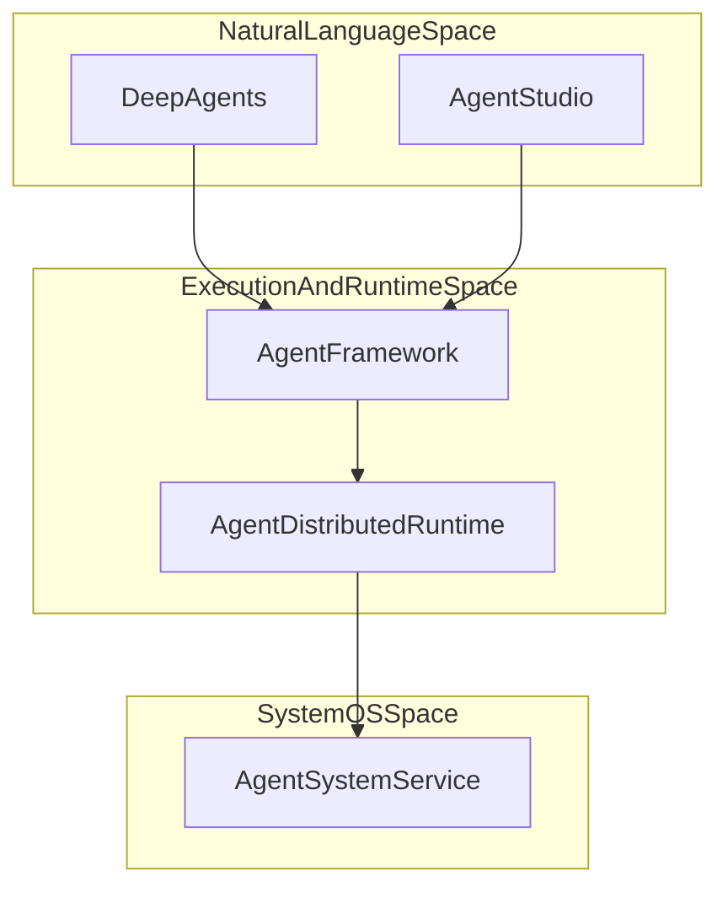
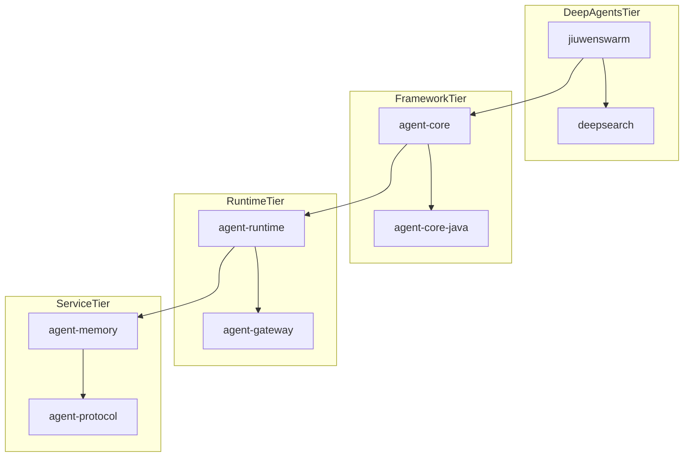
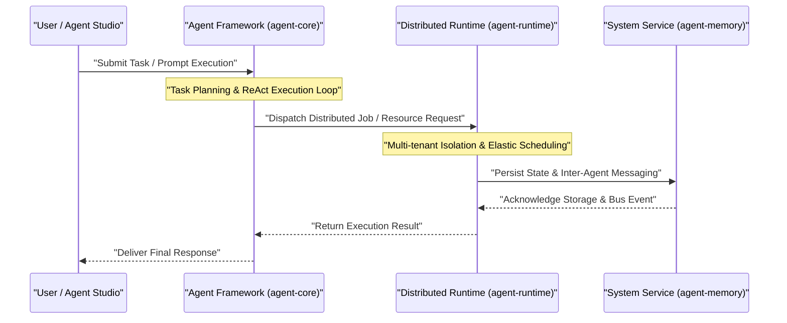

<!-- source: DeepWiki mcp.deepwiki.com · repo openJiuwen-ai/docs · page 2.1 Layered System Architecture · fetched 2026-11-02 -->

# Layered System Architecture

Relevant source files

The following files were used as context for generating this wiki page:

- [en/Product Overview.md](en/Product Overview.md)
- [en/images/architecture.png](en/images/architecture.png)
- [zh/images/architecture.png](zh/images/architecture.png)

## Purpose and Scope

This document details the layered system architecture of the openJiuwen platform. The architecture is designed to cover the complete lifecycle of AI Agents—spanning high-level scenario-oriented solution packages, low-code visual development environments, core orchestration and execution engines, distributed runtime infrastructures, and foundational AgentOS system services `[en/Product Overview.md:36-38]()`. 

---

## 1. The Five Architectural Layers

openJiuwen implements a hierarchical, capability-driven stack consisting of five distinct tiers `[en/Product Overview.md:36-38]()`:

1. **DeepAgents**: Provides complex, scenario-oriented Agents (such as `jiuwenswarm`, `jiuwensymbiosis`, and `deepsearch`) tailored for out-of-the-box vertical usage `[en/Product Overview.md:40-40]()`.
2. **Agent Studio**: A low-code and no-code visual development platform supporting workflow orchestration, prompt optimization, online debugging, and resource management `[en/Product Overview.md:41-41]()`.
3. **Agent Framework**: The core execution engine providing APIs for task planning, iterative execution, tool invocation, context/memory management, and multi-agent collaboration `[en/Product Overview.md:42-42]()`.
4. **Agent Distributed Runtime**: The runtime foundation supporting elastic scaling, multi-tenant isolation, service discovery, and high-performance cross-cluster communication `[en/Product Overview.md:43-43]()`.
5. **Agent System Service**: The foundational operating system tier (`AgentOS`) delivering security sandboxing, persistent memory storage, CLI utilities, standard file systems, and message bus services `[en/Product Overview.md:44-44]()`.

### System Capability Stack

Sources: `[en/Product Overview.md:36-47]()`

---

## 2. Component Architecture and Code Entity Mapping

To bridge natural language concepts to concrete codebase entities, the architecture maps high-level functional tiers to specific repository components and runtime modules.

### Component Mapping Table

| Architecture Layer | Associated Modules / Repositories | Core Technical Responsibilities |
| :--- | :--- | :--- |
| **DeepAgents** | `jiuwenswarm`, `jiuwensymbiosis`, `deepsearch` `[en/Product Overview.md:40-40]()` | Specialized multi-agent swarm orchestration and deep search workflows. |
| **Agent Studio** | `agent-studio` `[en/Product Overview.md:41-41]()` | Visual orchestration UI, prompt tuning interface, and debugging tools. |
| **Agent Framework** | `agent-core`, `agent-core-java` `[en/Product Overview.md:42-42]()` | ReAct loops, workflow graph execution, tool invocation, and memory APIs. |
| **Agent Distributed Runtime** | `agent-runtime`, `agent-runtime-java`, `agent-gateway` `[en/Product Overview.md:43-43]()` | Tenant isolation, auto-scaling, load balancing, and gateway routing. |
| **Agent System Service** | `agent-memory`, `agent-protocol` `[en/Product Overview.md:44-44()`] | Sandbox environments, cross-agent message bus, and persistent storage. |

### Code Entity Space Integration

Sources: `[en/Product Overview.md:36-47]()`

---

## 3. Cross-Layer Request Data Flow

When an AI Agent executes a task within openJiuwen, requests propagate downward from user interfaces through orchestration frameworks down to the distributed runtime and OS kernel services.

Sources: `[en/Product Overview.md:38-44]()`

---

