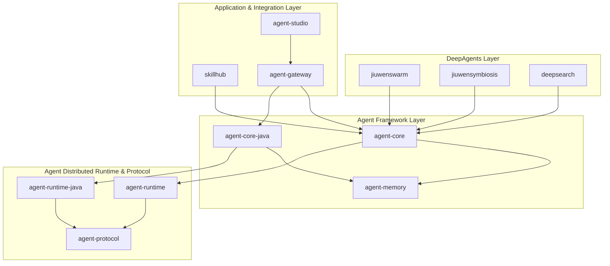
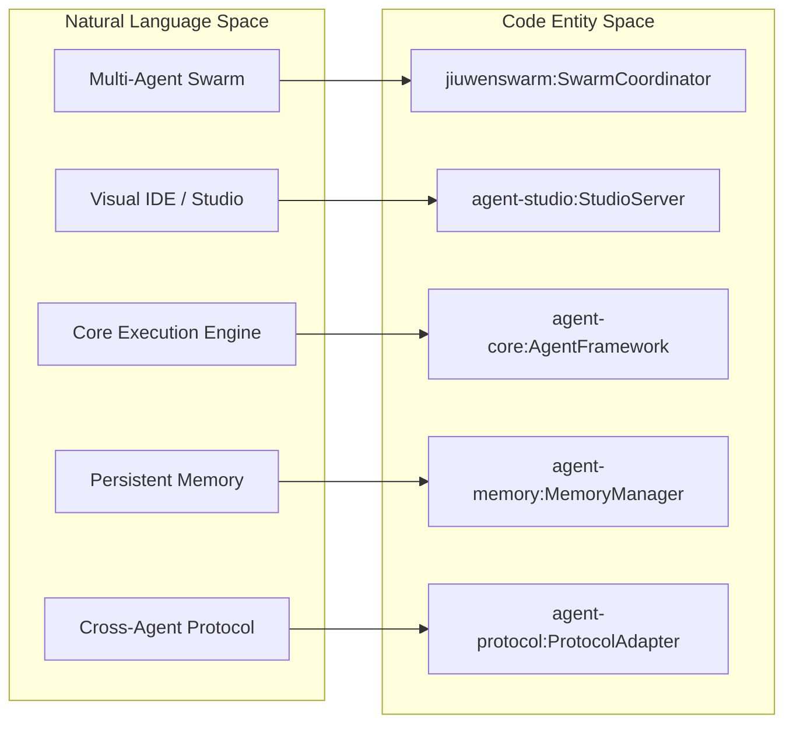

<!-- source: DeepWiki mcp.deepwiki.com · repo openJiuwen-ai/docs · page 2.2 Repository / Module Ecosystem · fetched 2026-11-02 -->

# Repository / Module Ecosystem

Relevant source files

The following files were used as context for generating this wiki page:

- [en/Product Overview.md](en/Product Overview.md)
- [en/images/repositories.jpg](en/images/repositories.jpg)
- [zh/images/repositories.jpg](zh/images/repositories.jpg)

## Purpose and Scope
This page provides a comprehensive technical walkthrough of the openJiuwen modular repository ecosystem. openJiuwen adopts a decoupled, layered repository design to span the complete lifecycle of AI Agents—from high-level swarm collaboration and deep search to core frameworks, multi-language runtimes, memory subsystems, and standardized communication protocols [en/Product Overview.md:36-51](). 

---

## 1. Modular Repository Ecosystem Overview

The openJiuwen platform is distributed across twelve specialized repositories that operate independently or compose into unified enterprise-grade systems [en/Product Overview.md:50-51](). The table below maps each repository to its architectural layer, primary scope, and representative code entities.

| Layer | Repository | Scope & Responsibility | Key Code Entities / Modules |
| :--- | :--- | :--- | :--- |
| **DeepAgents** | `jiuwenswarm` | Multi-agent swarm coordination and distributed agent orchestration. | `SwarmCoordinator`, `AgentRouter`, `TaskScheduler` |
| **DeepAgents** | `jiuwensymbiosis` | Human-agent symbiotic interaction and feedback loops. | `SymbiosisManager`, `HumanInTheLoopHandler` |
| **DeepAgents** | `deepsearch` | Deep information retrieval, reasoning search, and synthesis. | `DeepSearchEngine`, `QueryRewriter`, `ResultSynthesizer` |
| **Agent Studio / Hub** | `skillhub` | Skill registry, versioning, and tool distribution network. | `SkillRegistry`, `ToolLoader`, `MCPClient` |
| **Agent Studio / Hub** | `agent-studio` | Low-code/no-code visual web studio and IDE for orchestration. | `StudioServer`, `WorkflowCanvas`, `VisualDebugger` |
| **Agent Studio / Hub** | `agent-gateway` | API gateway, traffic management, and authentication for agents. | `GatewayRouter`, `AuthMiddleware`, `RateLimiter` |
| **Agent Framework** | `agent-core` | Python core framework, execution engine, and planning modules. | `AgentFramework`, `ReActAgent`, `WorkflowAgent` |
| **Agent Framework** | `agent-core-java` | Java core framework port for enterprise backend integration. | `JiuwenAgentCore`, `JavaWorkflowEngine` |
| **Agent Framework** | `agent-memory` | Unified persistent memory storage and retrieval subsystem. | `MemoryManager`, `VectorStoreAdapter`, `ContextWindow` |
| **Runtime & Service** | `agent-runtime` | Python distributed runtime, container isolation, and scheduling. | `RuntimeEngine`, `SandboxExecutor`, `ClusterManager` |
| **Runtime & Service** | `agent-runtime-java` | Java distributed runtime engine for cloud-native deployment. | `JavaRuntimeEngine`, `ServiceDiscovery` |
| **Runtime & Service** | `agent-protocol` | Standardized cross-agent communication protocols (A2A, A2X, MCP). | `ProtocolAdapter`, `MessageBus`, `EnvelopeCodec` |

Sources: [en/Product Overview.md:36-51]()

---

## 2. Ecosystem Architecture Diagram (`repositories.jpg`)

The following diagram reflects the architectural topology stored in `repositories.jpg`, illustrating how the outer application layers interface with the core execution framework, distributed runtime, and system services [en/Product Overview.md:36-51]().

Sources: [en/Product Overview.md:36-51](), [en/images/repositories.jpg:1-25]()

---

## 3. Natural Language Space to Code Entity Space Mapping

To bridge high-level architectural concepts with actual codebase implementations, the diagram below maps natural language architectural terms from the system design to their exact code entities, classes, and protocol endpoints.

Sources: [en/Product Overview.md:36-51]()

---

## 4. Deep Dive into Modular Repositories

### 4.1 DeepAgents Layer (`jiuwenswarm`, `jiuwensymbiosis`, `deepsearch`)
The DeepAgents layer provides ready-to-use, scenario-specific intelligence modules [en/Product Overview.md:40]().
* **`jiuwenswarm`**: Orchestrates multi-agent topologies, handling dynamic load balancing, intent routing, and role-based agent collaboration.
* **`jiuwensymbiosis`**: Manages human-in-the-loop interventions, capturing user feedback and steering agent execution paths.
* **`deepsearch`**: Implements advanced reasoning loops combined with web or corpus retrieval (`QueryRewriter`, `DeepSearchEngine`), delivering deep context synthesis for enterprise knowledge retrieval.

### 4.2 Application and Integration Layer (`skillhub`, `agent-studio`, `agent-gateway`)
This tier bridges developers and end-users with the underlying execution engines [en/Product Overview.md:41]().
* **`skillhub`**: Acts as a decentralized tool registry adhering to Model Context Protocol (MCP) standards, allowing dynamic loading of tools and plugins (`ToolLoader`).
* **`agent-studio`**: Provides a web-based visual canvas for drag-and-drop workflow orchestration and online debugging (`WorkflowCanvas`, `VisualDebugger`).
* **`agent-gateway`**: Exposes secure REST and gRPC endpoints, handling tenant authentication, rate limiting, and request routing (`GatewayRouter`, `AuthMiddleware`).

### 4.3 Agent Framework and Memory Subsystem (`agent-core`, `agent-core-java`, `agent-memory`)
Serving as the cognitive heart of openJiuwen, the framework repositories manage task planning and execution [en/Product Overview.md:42]().
* **`agent-core` / `agent-core-java`**: Provide the primary runtime loops (such as ReAct and Workflow execution engines) across Python and Java environments.
* **`agent-memory`**: Manages short-term context windows and long-term vector store integration (`VectorStoreAdapter`), ensuring state consistency across multi-turn interactions.

### 4.4 Distributed Runtime and Protocol Layer (`agent-runtime`, `agent-runtime-java`, `agent-protocol`)
This layer handles cloud-native deployment and inter-agent communication [en/Product Overview.md:43-44]().
* **`agent-runtime` / `agent-runtime-java`**: Handle process isolation, container sandboxing (`SandboxExecutor`), and elastic scaling across distributed clusters.
* **`agent-protocol`**: Defines standard message envelopes (`EnvelopeCodec`) and communication buses (`MessageBus`) ensuring seamless interoperability between heterogeneous agent nodes.

Sources: [en/Product Overview.md:36-51]()

---

