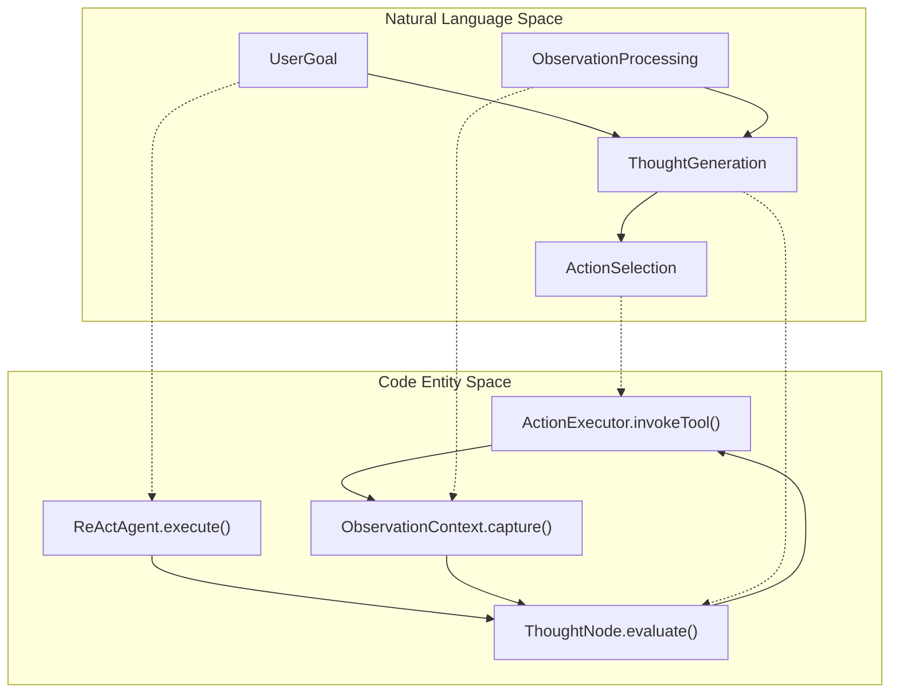
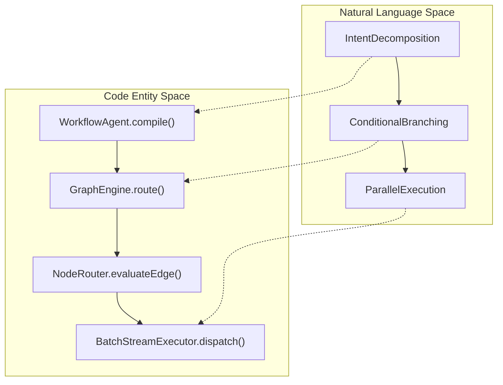

<!-- source: DeepWiki mcp.deepwiki.com · repo openJiuwen-ai/docs · page 2.3 Agent Types and Execution Engine · fetched 2026-11-02 -->

# Agent Types and Execution Engine

Relevant source files

The following files were used as context for generating this wiki page:

- [en/Product Overview.md](en/Product Overview.md)
- [en/images/ReActAgent.png](en/images/ReActAgent.png)
- [en/images/WorkflowAgent.png](en/images/WorkflowAgent.png)

## Purpose and Scope
This page details the core agent classifications—specifically `ReActAgent` and `WorkflowAgent`—alongside the hybrid batch-stream graph execution engine, state management architecture, and observability features provided by the openJiuwen `Agent Framework` [en/Product Overview.md:36-42](). 

---

## 1. ReActAgent and the Reasoning Loop
The `ReActAgent` implements the synergistic **Thought → Action → Observation** paradigm, empowering large language models to dynamically reason through tasks, invoke external tools or skills, and observe execution feedback before proceeding [en/Product Overview.md:3-4].

### Execution Flow
1. **Thought**: The model evaluates the current context and user goal, generating an explicit internal reasoning step.
2. **Action**: Based on the thought process, the agent selects a specific tool, API, or skill and formulates parameters.
3. **Observation**: The execution engine intercepts the tool output, feeding the raw result back into the agent's context window as an observation.

*Diagram 1: ReActAgent Natural Language to Code Entity Mapping*

**Sources:** `[en/Product Overview.md:3-4]`, `[en/images/ReActAgent.png:1-35]()`

---

## 2. WorkflowAgent Orchestration
While `ReActAgent` excels at autonomous, open-ended problem solving, `WorkflowAgent` provides structured execution through directed graphs. It manages deterministic task decomposition, branching logic, and parallel tool execution [en/Product Overview.md:19-22].

### Architecture & Routing
`WorkflowAgent` relies on graph definitions where nodes represent discrete tasks (e.g., prompt invocation, data transformation, sub-agent delegation) and edges represent conditional routing rules.

*Diagram 2: WorkflowAgent Natural Language to Code Entity Mapping*

**Sources:** `[en/Product Overview.md:19-22]`, `[en/images/WorkflowAgent.png:1-30]()`

---

## 3. Hybrid Batch-Stream Graph Engine
The execution engine bridges batch processing and streaming output models, allowing large-scale multi-agent graphs to execute with low latency and high throughput.

| Execution Mode | Primary Use Case | Underlying Mechanism |
| :--- | :--- | :--- |
| **Batch Mode** | Heavy data processing, multi-level intent routing, background analysis | Asynchronous task queues, worker pools, transactional state commits |
| **Stream Mode** | Real-time chat assistants, incremental text generation, live tool feedback | Reactive event streams, Server-Sent Events (SSE), token-by-token channels |

**Sources:** `[en/Product Overview.md:23-24]`, `[en/Product Overview.md:42-43]()`

---

## 4. State Management and Observability
Reliable production-grade execution requires rigorous state tracking and telemetry [en/Product Overview.md:34].

- **State Management**: Implements unified persistent memory storage and context management subsystems, isolating multi-tenant data while preserving session state across node transitions [en/Product Overview.md:42-44].
- **Observability**: Integrates tracing for every Thought → Action → Observation cycle, capturing runtime latency, token consumption, tool error codes, and cross-agent message bus activities.

**Sources:** `[en/Product Overview.md:34]`, `[en/Product Overview.md:42-44]()`

---

