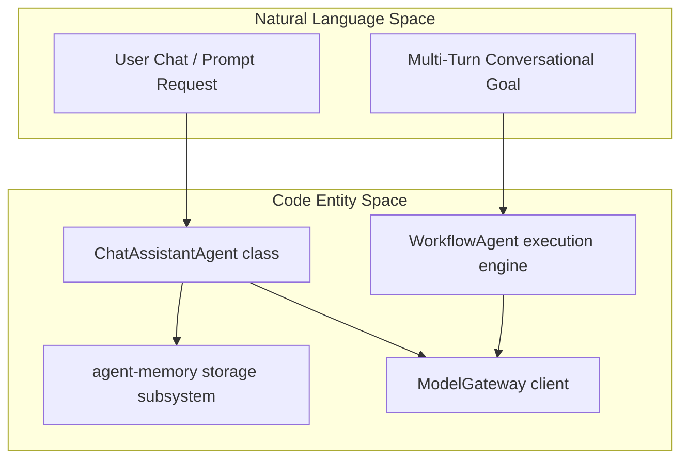
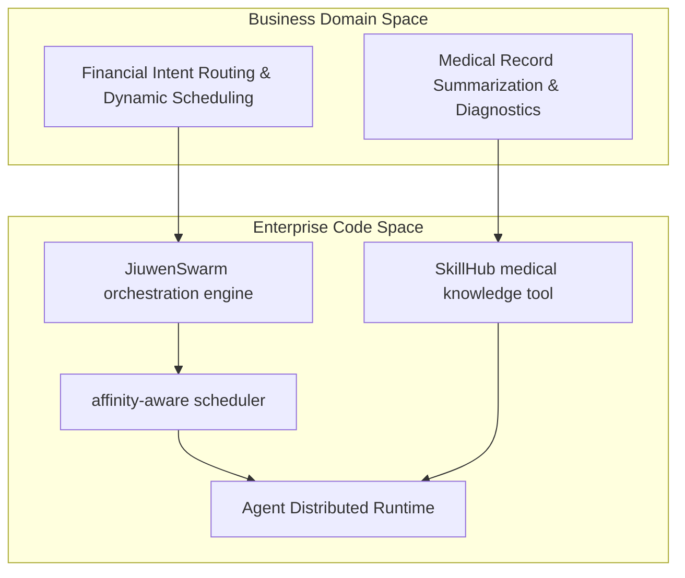
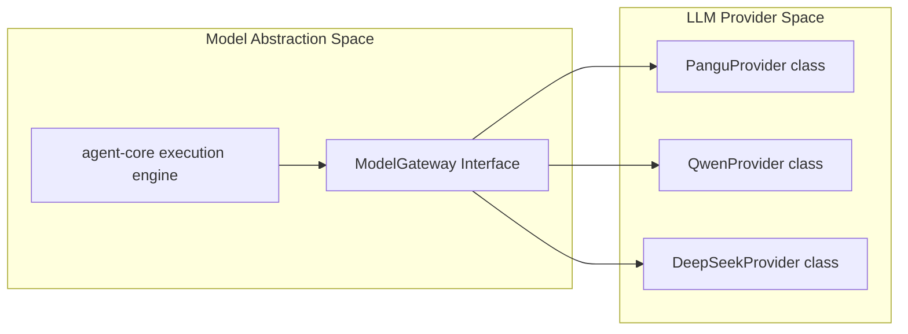

<!-- source: DeepWiki mcp.deepwiki.com · repo openJiuwen-ai/docs · page 2.4 Application Scenarios and LLM Support · fetched 2026-11-02 -->

# Application Scenarios and LLM Support

Relevant source files

The following files were used as context for generating this wiki page:

- [en/Product Overview.md](en/Product Overview.md)

This section covers the practical application scenarios supported by the openJiuwen platform across consumer (ToC) and enterprise (ToB) domains, alongside the foundational Large Language Model (LLM) backend integrations (including Pangu, Qwen, and DeepSeek) that power autonomous agent reasoning, task planning, and execution.

Sources: `en/Product Overview.md:7-25()`

## Consumer-Oriented (ToC) Application Scenarios

openJiuwen provides zero-code, low-code, and SDK-based development paradigms [en/Product Overview.md:31-31()] combined with prompt optimization to support single-turn and multi-turn conversational agents [en/Product Overview.md:13-13()].

- **Chat Assistant**: Implemented using natural language processing pipelines and contextual memory stores, managing dialogue state and delivering conversational interactions for customer support [en/Product Overview.md:15-15()].
- **Text Generation**: Utilizes underlying LLM generation capabilities for creative copywriting, article drafting, and automated press release generation [en/Product Overview.md:16-16()].
- **Intelligent Assistant**: Powered by task-planning engines and multi-agent coordination frameworks to handle schedule management, tool invocation, and transaction processing [en/Product Overview.md:17-17()].

*Figure 1: ToC Scenario Execution Flow bridging natural language intents to core agent classes.*

Sources: `en/Product Overview.md:11-18()`, `en/Product Overview.md:31-31()`

## Enterprise-Oriented (ToB) Application Scenarios

For enterprise environments, openJiuwen leverages workflow engines and multi-agent collaboration mechanisms to orchestrate complex tasks, ensuring high availability and commercial-grade stability [en/Product Overview.md:21-21(), en/Product Overview.md:34-34()].

- **Financial Industry**: Implements multi-level intent routing, intelligent task allocation, and dynamic agent scheduling via `jiuwenswarm` and core framework schedulers. Designed for low latency, high precision, and robust security in financial transaction systems [en/Product Overview.md:23-23()].
- **Healthcare**: Facilitates customized medical agents for medical record summarization, preliminary imaging data screening, and automated diagnostic/treatment recommendation generation, integrating professional medical knowledge bases [en/Product Overview.md:24-24()].

*Figure 2: ToB Scenario Architecture mapping enterprise workflows to distributed runtime components.*

Sources: `en/Product Overview.md:19-25()`, `en/Product Overview.md:34-34()`

## Supported Large Language Models (LLMs)

The openJiuwen framework abstracts model inference through a unified provider interface, allowing seamless integration with domestic and international foundational LLMs.

- **Pangu Model Integration**: Deeply integrated within enterprise deployments, leveraging Pangu's robust reasoning for domain-specific industrial and financial workflows.
- **Qwen Model Integration**: Utilized for high-throughput multilingual text generation, conversational chat assistants, and multi-turn contextual reasoning.
- **DeepSeek Model Integration**: Leveraged for cost-effective, high-accuracy code generation, logical reasoning, and complex task decomposition within the `agent-core` framework.

*Figure 3: LLM Provider Integration bridging execution engines to specific model adapter classes.*

Sources: `en/Product Overview.md:36-44()`

---

