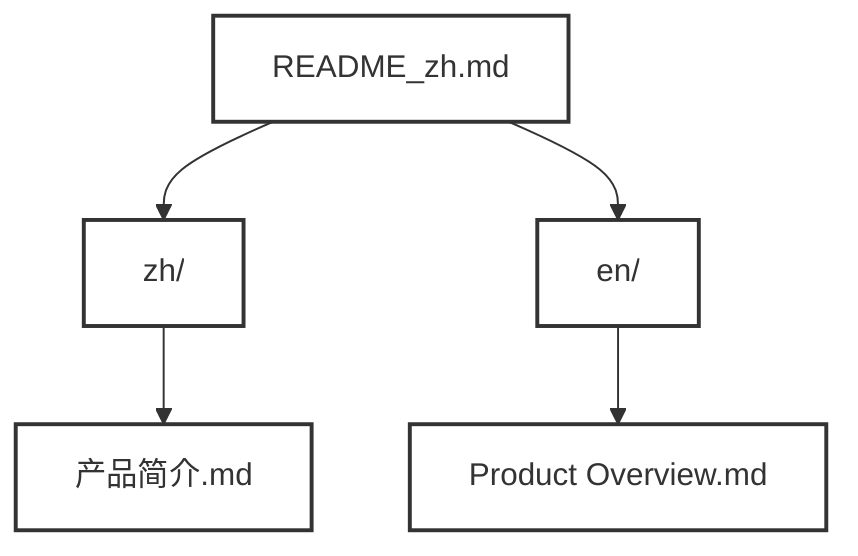
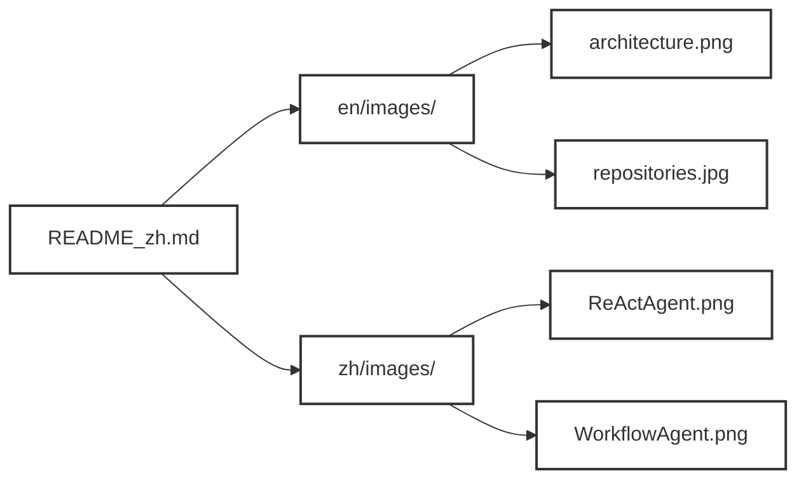

<!-- source: DeepWiki mcp.deepwiki.com · repo openJiuwen-ai/docs · page 3 Localization and Assets · fetched 2026-11-02 -->

# Localization and Assets

Relevant source files

The following files were used as context for generating this wiki page:

- [README_zh.md](README_zh.md)
- [en/images/architecture.png](en/images/architecture.png)

The localization and assets section provides a high-level overview of how the openJiuwen documentation center maintains bilingual parity across English and Chinese trees, along with the management of static image assets and architectural diagrams. 

For detailed contribution guidelines, directory structures, and synchronization workflows, refer to the child pages linked below.

---

## Bilingual Documentation Workflow

The documentation repository organizes its content into parallel language directories (`en/` and `zh/`), mirroring concepts between files such as `README_zh.md`, English product overviews, and Chinese counterparts like `产品简介.md` [README_zh.md:1-12](). Maintaining translation parity ensures that international contributors and users have synchronous access to the latest product specifications, architecture updates, and SIG integrations.

For details, see [Bilingual Documentation Workflow](#3.1).

### Diagram: Bilingual Documentation Structure

*Sources: [README_zh.md:1-12]()*

---

## Image Assets and Diagram Maintenance

Visual assets, including system architecture diagrams and agent execution flowcharts, are stored centrally within dedicated image directories (`en/images/` and `zh/images/`). These include core graphical assets such as `architecture.png`, `repositories.jpg`, `ReActAgent.png`, and `WorkflowAgent.png`. Maintaining these assets requires tracking source tooling metadata, adhering to strict relative-path referencing standards in Markdown files, and following established version-control update practices.

For details, see [Image Assets and Diagram Maintenance](#3.2).

### Diagram: Asset Storage and Reference Mapping

*Sources: [README_zh.md:1-20](), [en/images/architecture.png:1-1]() *

---

