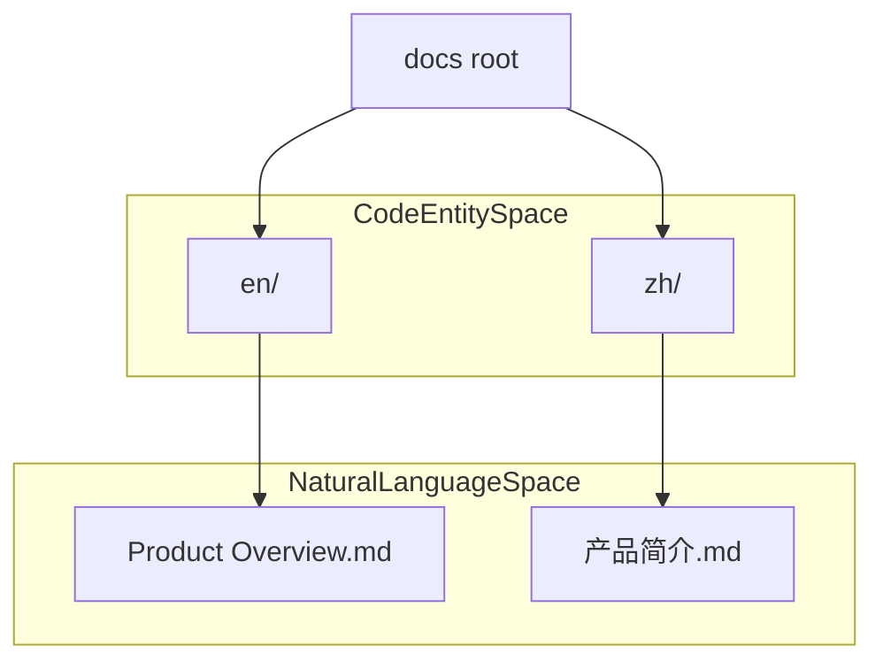
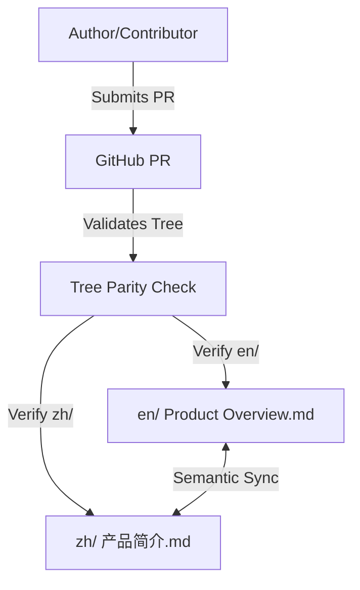

<!-- source: DeepWiki mcp.deepwiki.com · repo openJiuwen-ai/docs · page 3.1 Bilingual Documentation Workflow · fetched 2026-11-02 -->

# Bilingual Documentation workflow

Relevant source files

The following files were used as context for generating this wiki page:

- [README_zh.md](README_zh.md)

## Purpose and Scope

This page details the bilingual documentation workflow for the openJiuwen documentation center repository (`https://github.com/openJiuwen-ai/docs`). It defines how the English (`en/`) and Chinese (`zh/`) directory trees maintain structural symmetry, ensures translation parity between corresponding files (such as `Product Overview.md` and `产品简介.md`), and outlines the standard contribution guidance for maintaining dual-language documentation.

Sources: [README_zh.md:1-13]()

---

## Structural Mirroring and Tree Parity

The documentation repository enforces strict structural mirroring between the English and Chinese documentation trees [README_zh.md:7-12](). Every markdown file, subdirectory, and asset reference introduced in one language tree must have its structural counterpart in the other language tree to preserve navigation parity and relative-path validity.

Sources: [README_zh.md:6-13]()

---

## Translation Parity and Content Synchronization

To maintain synchronization across languages, contributors must keep semantic parity between the `en/` and `zh/` trees [README_zh.md:7-12](). When a new technical section, architectural diagram reference, or external link is added to `zh/产品简介.md`, a corresponding update must be synchronized to `en/Product Overview.md`.

Sources: [README_zh.md:6-13]()

---

## Contribution Guidance

Contributors adding or modifying documentation within `https://github.com/openJiuwen-ai/docs` must adhere to the following workflow:

1. **Dual-Tree Updates**: Any modification to a document in `zh/` must include a corresponding update to its sibling file in `en/` [README_zh.md:7-12]().
2. **Asset Path Resolution**: Relative links pointing to images or external SIG technical docs (such as those under `agent-studio`, `agent-core`, and `deepsearch`) must be verified for both language trees [README_zh.md:14-20]().
3. **SIG Link Integrity**: Cross-references to external repository documentation must point to the correct branches (e.g., `develop` or `dev`) as specified in the SIG index [README_zh.md:16-20]().

Sources: [README_zh.md:1-20]()

---

