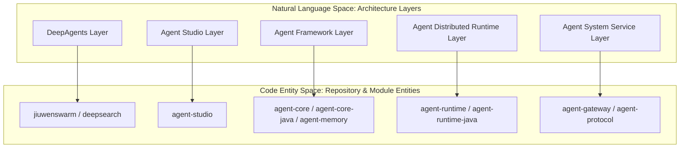
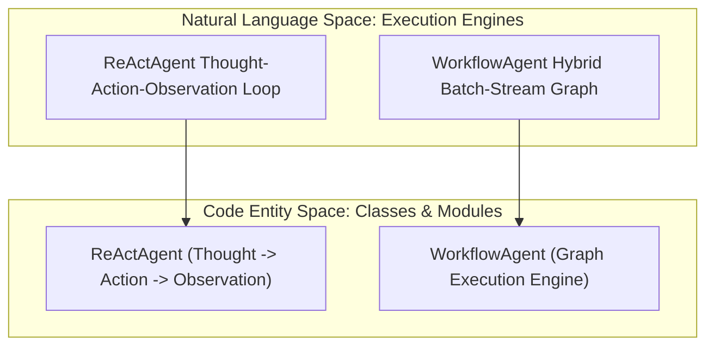

<!-- source: DeepWiki mcp.deepwiki.com · repo openJiuwen-ai/docs · page 3.2 Image Assets and Diagram Maintenance · fetched 2026-11-02 -->

# Image Assets and Diagram Maintenance

<details>
<summary>Relevant source files</summary>

The following files were used as context for generating this wiki page:

- [en/images/ReActAgent.png](en/images/ReActAgent.png)
- [en/images/WorkflowAgent.png](en/images/WorkflowAgent.png)
- [en/images/repositories.jpg](en/images/repositories.jpg)
- [zh/images/architecture.png](zh/images/architecture.png)
- [zh/images/repositories.jpg](zh/images/repositories.jpg)

</details>


## Purpose and Scope
This document provides a technical inventory and maintenance specification for static image assets located within the `en/images/` and `zh/images/` directories of the `openJiuwen-ai/docs` repository. It covers source tooling metadata (such as Adobe XMP headers), relative-path referencing conventions in Markdown, asset lifecycle update workflows, and the mapping between visual architectural artifacts and underlying source code entities.

---

## 1. Inventory of Core Image Assets
The documentation repository maintains a curated set of architectural and execution flow diagrams shared across English (`en/`) and Chinese (`zh/`) documentation trees. 

| Asset Filename | Target Directory | Primary Reference Context | Source Tooling / Format |
| -------------- | ---------------- | ------------------------- | ----------------------- |
| `architecture.png` | `en/images/`, `zh/images/` | Layered System Architecture Overview | Rasterized PNG |
| `repositories.jpg` | `en/images/`, `zh/images/` | Module & Repository Ecosystem Map | JPEG with XMP Metadata |
| `ReActAgent.png` | `en/images/`, `zh/images/` | ReAct Execution Loop Engine | Rasterized PNG |
| `WorkflowAgent.png` | `en/images/`, `zh/images/` | Hybrid Batch-Stream Workflow Engine | Rasterized PNG |

Sources: `zh/images/architecture.png:1-61`, `zh/images/repositories.jpg:1-25`, `en/images/repositories.jpg:1-25`, `en/images/ReActAgent.png:1-35`, `en/images/WorkflowAgent.png:1-30`

---

## 2. Source Tooling and XMP Metadata
Complex architectural diagrams such as `repositories.jpg` store rich authoring metadata embedded via Adobe Extensible Metadata Platform (XMP) standards. Inspection of the file headers reveals vector-to-raster export configurations:

- **Creator Tool**: `Adobe Illustrator CS6 (Windows)` [zh/images/repositories.jpg:16-16]()
- **Internal Title**: `九问架构图（可编辑）` (Editable openJiuwen Architecture Diagram) [zh/images/repositories.jpg:9-9]()
- **Timestamps**: Creation and modification metadata tracking synchronization dates [zh/images/repositories.jpg:17-19]()

When modifying these diagrams, contributors should update the source vector files (maintained outside the documentation repository or within design artifact stores) and re-export to match exact pixel dimensions and compression parameters to avoid git diff bloat.

Sources: `zh/images/repositories.jpg:1-25`, `en/images/repositories.jpg:1-25`

---

## 3. Relative-Path Referencing and Markdown Integration
Documentation files in `en/` and `zh/` reference static assets using relative Markdown path syntax. Because the directory hierarchy keeps images in parallel folders (`en/images/` and `zh/images/`), references remain localized to each language branch:

```markdown


```

Cross-language sharing of identical images requires maintaining clean directory parity between `en/images/` and `zh/images/`.

Sources: `zh/images/architecture.png:1-5`, `zh/images/repositories.jpg:1-10`

---

## 4. Bridging Natural Language Space to Code Entity Space

To maintain clarity between high-level architectural visuals and implementation realities, diagrams must map directly to code entities, repository names, and class definitions.

### System Architecture to Code Modules
The `architecture.png` artifact visualizes the 5-layer execution model. The following diagram maps these conceptual layers to exact codebase modules:


Sources: `zh/images/architecture.png:1-61`, `zh/images/repositories.jpg:1-25`

### Agent Engine Execution to Code Classes
The `ReActAgent.png` and `WorkflowAgent.png` diagrams illustrate agent control loops. The diagram below bridges these visual states to runtime classes:


Sources: `en/images/ReActAgent.png:1-35`, `en/images/WorkflowAgent.png:1-30`

---

## 5. Asset Update Practices
When updating diagrams in openJiuwen documentation, follow these mandatory steps:
1. **Source Modification**: Edit the master vector design file (corresponding to the Adobe XMP metadata in `repositories.jpg`).
2. **Export Parity**: Export optimized PNG/JPEG assets ensuring identical color profiles and resolution scaling.
3. **Bilingual Sync**: Ensure both `en/images/` and `zh/images/` receive updated binaries simultaneously if visual text is language-agnostic or updated in parallel.
4. **Link Validation**: Verify all relative Markdown image links across `en/` and `zh/` markdown files resolve correctly.

Sources: `zh/images/repositories.jpg:1-25`, `en/images/ReActAgent.png:1-10`

---

