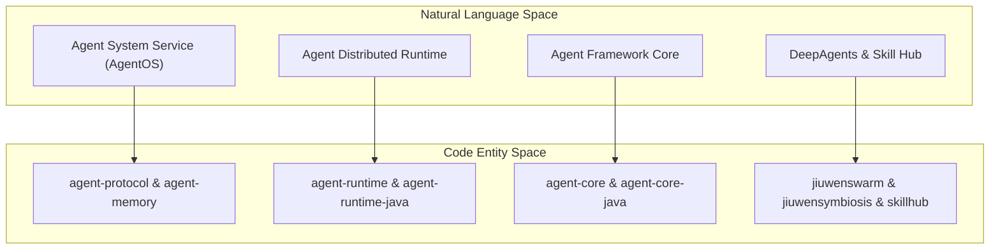
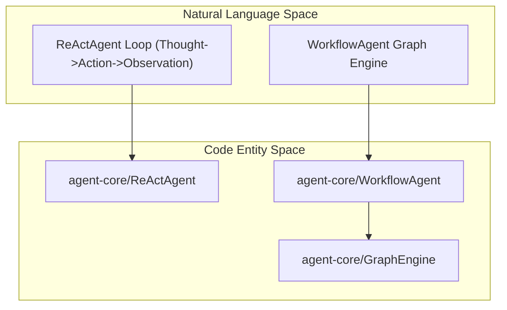

<!-- source: DeepWiki mcp.deepwiki.com · repo openJiuwen-ai/docs · page 4 Glossary · fetched 2026-11-02 -->

# Glossary

Relevant source files

The following files were used as context for generating this wiki page:

- [README.md](README.md)
- [en/Product Overview.md](en/Product Overview.md)
- [en/images/ReActAgent.png](en/images/ReActAgent.png)
- [en/images/WorkflowAgent.png](en/images/WorkflowAgent.png)

## Purpose and Scope

This glossary defines core terminology, architectural components, agent types, and protocol abbreviations specific to the openJiuwen AI Agent platform. It bridges natural language concepts with their corresponding code entities, repository structures, and technical implementations across the codebase.

Sources: [`README.md:1-21`(), `en/Product Overview.md:1-51`()]

---

## 1. Core Platform & Architectural Terms

### SIG (Special Interest Group)
Community-driven working groups responsible for developing and maintaining specific openJiuwen repositories and components, such as `agent-studio`, `agent-core`, and `deepsearch` [README.md:14-20]().

Sources: [`README.md:14-20`()]

### AgentOS / Agent System Service
The foundational operating system layer for AI Agents providing system-level security sandboxing, unified persistent memory storage, native CLI utilities, a standardized Agent file system, and a cross-agent message bus [en/Product Overview.md:44]().

Sources: [`en/Product Overview.md:36-47`()]

### 九问架构图 (openJiuwen Capability Architecture)
The high-level architectural blueprint defining the five functional layers of the platform: `DeepAgents`, `Agent Studio`, `Agent Framework`, `Agent Distributed Runtime`, and `Agent System Service` [en/Product Overview.md:38-44](), visually represented in `en/images/architecture.png` [en/Product Overview.md:46]().

Sources: [`en/Product Overview.md:36-47`()]

### ToB / ToC (Enterprise and Consumer Scenarios)
* **ToC (Consumer-oriented):** Zero-code, low-code, or SDK-based conversational agents, chat assistants, and text generation tools [en/Product Overview.md:11-17]().
* **ToB (Enterprise-oriented):** Multi-agent workflow systems, complex task decomposition, financial intent routing, and medical diagnostic support [en/Product Overview.md:19-24]().

Sources: [`en/Product Overview.md:7-24`()]

---

## 2. Modules & Repositories

### DeepAgents
Complex, scenario-oriented agent packages designed for out-of-the-box deployment, including `JiuwenSwarm`, `JiuwenSymbiosis`, and `DeepSearch` [en/Product Overview.md:40]().

### SkillHub
A modular repository and service hub dedicated to skill distribution, tool registration, and capability sharing across agent systems [README.md:3]().

### agent-core / agent-core-java
The core execution framework providing APIs for task planning, iterative execution, tool invocation, context management, memory subsystems, and multi-agent collaboration [en/Product Overview.md:42]().

### agent-runtime / agent-runtime-java
The distributed runtime infrastructure supporting multi-tenant isolation, elastic scaling, service registration/discovery, and high-performance cross-cluster communication [en/Product Overview.md:43]().

---

### Architecture Layer to Code Entity Mapping
This diagram bridges natural language architecture descriptions to specific repository modules and execution engines in the codebase.

Sources: [`en/Product Overview.md:36-51`(), `README.md:14-20`()]

---

## 3. Agent Types & Execution Engines

### ReActAgent
An agent type implementing the **Thought -> Action -> Observation** iterative loop, allowing agents to reason about tasks, invoke external tools, and observe execution results before proceeding [en/images/ReActAgent.png:1-35]().

### WorkflowAgent
An agent type driven by a hybrid batch-stream graph engine that orchestrates multi-step, deterministic or dynamic workflows with structured state management and observability features [en/images/WorkflowAgent.png:1-30]().

---

### Agent Engine to Code Entity Mapping
This diagram connects high-level agent paradigms to their underlying execution engine and loop structures in the codebase.

Sources: [`en/images/ReActAgent.png:1-35`(), `en/images/WorkflowAgent.png:1-30`(), `en/Product Overview.md:42`()]

---

## 4. Protocols & Communication

### MCP (Model Context Protocol)
A standardized communication protocol utilized within `agent-core` to manage contextual interactions between large language models and external data sources or tools.

### A2A (Agent-to-Agent Protocol)
A standardized messaging schema enabling decentralized or coordinated multi-agent collaboration across clusters via the cross-agent message bus [en/Product Overview.md:44]().

### A2X (Agent-to-X Protocol)
Generalized extension protocols supporting integration with external enterprise systems, databases, user interfaces, and third-party runtime environments.

Sources: [`en/Product Overview.md:42-44`()]