# Page: Overview

# Overview

<details>
<summary>Relevant source files</summary>

The following files were used as context for generating this wiki page:

- [README.md](README.md)
- [README_zh.md](README_zh.md)

</details>


The openJiuwen documentation center repository (`openJiuwen-ai/docs`) acts as the central product-overview hub for the openJiuwen AI agent ecosystem [README.md:1-3()]. It provides high-level product definitions, architectural summaries, and serves as an index pointing to federated Special Interest Group (SIG) technical documentation across various code repositories [README.md:14-21()]. 

For a comprehensive guide on how the repository is structured and how to navigate between bilingual assets and external SIG technical resources, refer to the respective child pages below:
- Repository Layout and Navigation (see [Repository Layout and Navigation](#1.1))
- SIG Documentation Index (see [SIG Documentation Index](#1.2))

---

## 1.1. Repository Layout and Navigation

The repository organizes its core product documentation using a bilingual directory tree (`en/` and `zh/`) anchored by root index files [README.md:6-12()]. Readers can easily locate product descriptions and high-level architectural overviews by following the structured directory layout defined in `README.md` and `README_zh.md` [README_zh.md:6-12()].

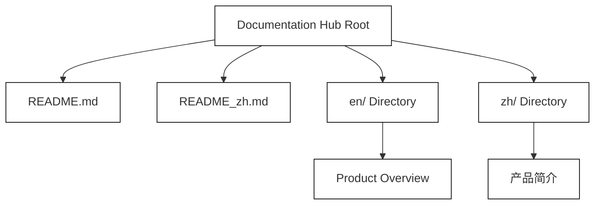
*Diagram 1: Natural Language to Code Entity Mapping of the Repository Directory Structure*

Sources: [README.md:1-12()](), [README_zh.md:1-12()]()

---

## 1.2. SIG Documentation Index

Because technical documentation is decentralized across individual SIG repositories (such as `agent-studio`, `agent-core`, and `deepsearch`), this repository maintains an index mapping community SIG groups to their respective technical documentation trees on GitHub and GitCode [README.md:14-21(), README_zh.md:14-21()].

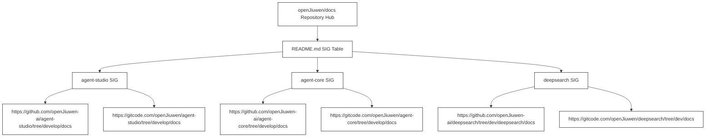
*Diagram 2: Federation Mapping from Documentation Hub to External SIG Repositories*

Sources: [README.md:14-21()](), [README_zh.md:14-21()]()

---

# Page: Repository Layout and Navigation

# Repository Layout and Navigation

<details>
<summary>Relevant source files</summary>

The following files were used as context for generating this wiki page:

- [README.md](README.md)
- [README_zh.md](README_zh.md)

</details>


## Purpose and Scope

This document details the architectural layout, directory organization, and navigation patterns of the `openJiuwen-ai/docs` repository. The repository serves as the central product-overview hub for the openJiuwen ecosystem, maintaining top-level entry points (`README.md` and `README_zh.md`) and bridging readers to federated Special Interest Group (SIG) repositories [README.md:1-3]().

Sources:
- `README.md:1-3`
- `README_zh.md:1-3`

---

## Root Index Files (`README.md` and `README_zh.md`)

The repository root houses two primary multilingual index files: `README.md` for English-speaking users and `README_zh.md` for Chinese-speaking users [README.md:1-20](), [README_zh.md:1-20](). These files establish the entry protocol for the documentation center, defining the high-level system purpose, directory structures, and external SIG links.

- **`README.md`**: Acts as the primary English entry point, establishing the overview that product documentation lives centrally while technical specifications reside within individual SIG repositories [README.md:1-3]().
- **`README_zh.md`**: Serves as the localized counterpart, providing identical structural guidance in Chinese (`文档中心`, `产品简介`) [README_zh.md:1-3]().

Sources:
- `README.md:1-21`
- `README_zh.md:1-21`

---

## Directory Structure and Localization Layout

The repository is organized to separate localized content trees (`en/` and `zh/`) [README.md:6-12](), [README_zh.md:6-12](). 

```
-- zh
   |-- 产品简介 (Product Overview)
-- en
   |-- Product Overview
```

- **`zh/`**: Contains Chinese documentation assets, including localized product overview files (`产品简介`) [README_zh.md:8-9]().
- **`en/`**: Contains English documentation trees, mirroring the product overview structure (`Product Overview`) [README.md:10-11]().
- **Image Assets**: Static assets such as architectural schemas and system diagrams are managed locally to support the markdown documentation files across language trees.

Sources:
- `README.md:6-12`
- `README_zh.md:6-12`

---

## Navigation and Federated SIG Indexing

Readers navigate from the central documentation hub to specific technical modules via the Special Interest Group (SIG) documentation tables defined in the root README files [README.md:14-20](), [README_zh.md:14-20](). 

The navigation layout connects the central hub to external repositories:
- `agent-studio`: Maintained under the `agent-studio` repository [README.md:18]().
- `agent-core`: Maintained under the `agent-core` repository [README.md:19]().
- `deepsearch`: Maintained under the `deepsearch` repository [README.md:20]().

### Navigation Flow Architecture

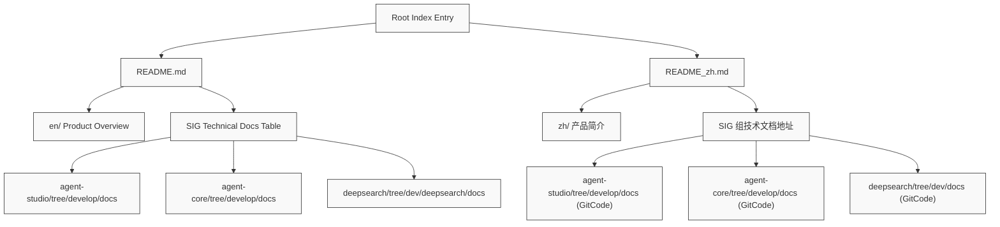

Sources:
- `README.md:1-21`
- `README_zh.md:1-21`

---

## Code-to-Documentation Navigation Mapping

To resolve documentation targets from natural language queries to concrete repository endpoints, the routing layer maps human-readable SIG identifiers directly to remote documentation trees.

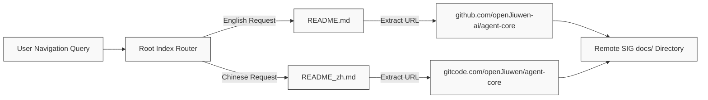

Sources:
- `README.md:14-21`
- `README_zh.md:14-21`

---

# Page: SIG Documentation Index

# SIG Documentation Index

<details>
<summary>Relevant source files</summary>

The following files were used as context for generating this wiki page:

- [README.md](README.md)
- [README_zh.md](README_zh.md)

</details>


## Purpose and Scope
The SIG Documentation Index acts as the federated pointer registry for the openJiuwen ecosystem. While the central documentation repository handles product overviews and top-level architecture [`README.md:1-4`]() [`README_zh.md:1-3`](), individual Special Interest Groups (SIGs) maintain granular technical specifications, API contracts, and implementation guides within their respective source repositories [`README.md:14-21`]() [`README_zh.md:14-21`](). This section outlines the authoritative link structures, hosting platform bifurcations (GitHub vs. GitCode), branch naming conventions, and maintenance protocols required to navigate the openJiuwen technical landscape.

Sources: [`README.md:1-4`]() [`README_zh.md:1-3`](), [`README.md:14-21`]() [`README_zh.md:14-21`]()

---

## Technical Documentation Links Table
The openJiuwen community mirrors its repositories across both GitHub (international) and GitCode (regional/enterprise) platforms to ensure high availability and accessibility. The table below details the canonical entry points for each SIG's technical documentation folder:

| SIG Name | GitHub Documentation URL | GitCode Documentation URL | Primary Branch | Documentation Root Path |
| :--- | :--- | :--- | :--- | :--- |
| `agent-studio` | `https://github.com/openJiuwen-ai/agent-studio/tree/develop/docs` [`README.md:18`]() | `https://gitcode.com/openJiuwen/agent-studio/tree/develop/docs` [`README_zh.md:18`]() | `develop` | `/docs` |
| `agent-core` | `https://github.com/openJiuwen-ai/agent-core/tree/develop/docs` [`README.md:19`]() | `https://gitcode.com/openJiuwen/agent-core/tree/develop/docs` [`README_zh.md:19`]() | `develop` | `/docs` |
| `deepsearch` | `https://github.com/openJiuwen-ai/agent-core/tree/dev/deepsearch/docs` [`README.md:20`]() | `https://gitcode.com/openJiuwen/deepsearch/tree/dev/docs` [`README_zh.md:20`]() | `dev` | `/deepsearch/docs` (GitHub) / `/docs` (GitCode) |

Sources: [`README.md:16-21`]() [`README_zh.md:16-21`]()

---

## Branch Conventions and Path Variations
Different SIG repositories adhere to specific branching and directory structures based on their internal release lifecycles and sub-module organization:

1. **`develop` Branch Standard**: Repositories like `agent-studio` and `agent-core` use the `develop` branch for ongoing feature integration. Documentation is consistently located at the repository root under the `docs/` directory [`README.md:18-19`]() [`README_zh.md:18-19`]().
2. **`dev` Branch Standard**: The `deepsearch` repository utilizes a shorter `dev` branch nomenclature [`README.md:20`]() [`README_zh.md:20`]().
3. **Monorepo Subpath Variations**: Due to nested package structures in the GitHub environment, `deepsearch` nests its documentation path under `/deepsearch/docs` [`README.md:20`](), whereas the GitCode mirror flattens this structure to `/docs` [`README_zh.md:20`].

Sources: [`README.md:18-20`]() [`README_zh.md:18-20`]()

---

## Architecture and Link Resolution Flow

The following diagram bridges the natural language documentation references in the central hub to the concrete repository entities and branch endpoints across hosting platforms.

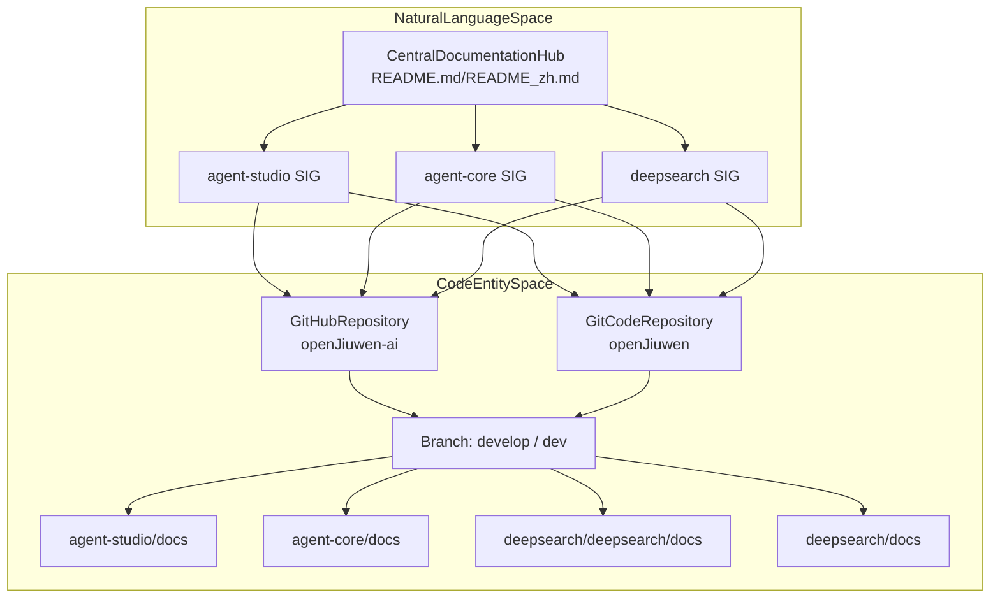

Sources: [`README.md:1-21`]() [`README_zh.md:1-21`]()

---

## Link Maintenance and Synchronization Protocol

To prevent broken references between the central documentation hub and individual SIG repositories, maintainers must follow strict synchronization rules:

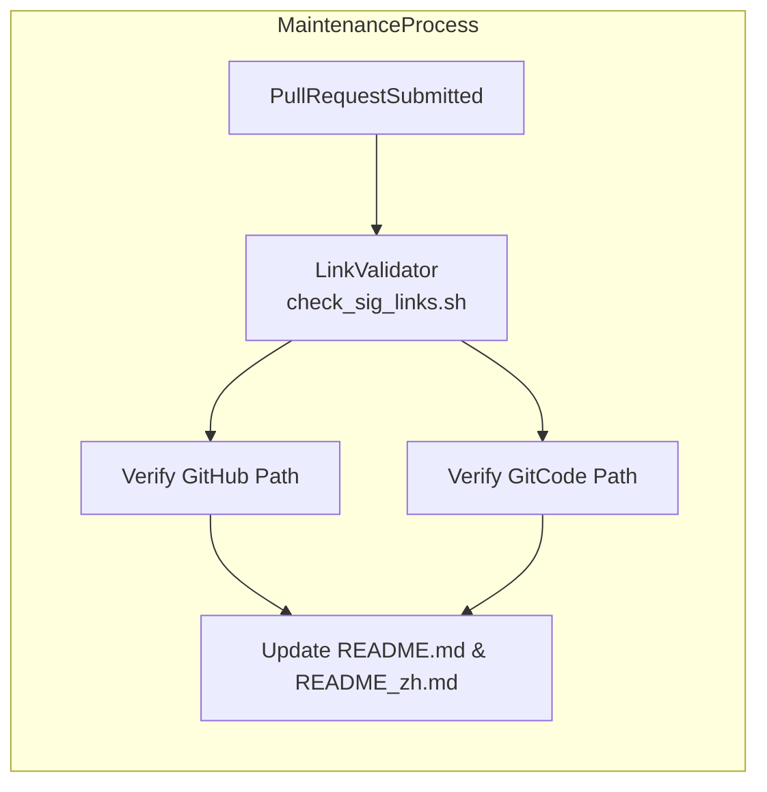

* **Dual Platform Validation**: Whenever a repository path or branch name changes (e.g., transitioning `agent-core` from `develop` to a release branch), both GitHub and GitCode index tables in `README.md` and `README_zh.md` must be updated atomically.
* **Relative vs Absolute Links**: External technical documentation links must always use absolute HTTPS URLs pointing to the specific tree and commit/branch hash or stable branch (`develop`/`dev`) rather than relative file paths, because the documents reside outside the central documentation repository bounds [`README.md:14-21`]() [`README_zh.md:14-21`]().

Sources: [`README.md:14-21`]() [`README_zh.md:14-21`]()

---

# Page: openJiuwen Product Overview

# openJiuwen Product Overview

<details>
<summary>Relevant source files</summary>

The following files were used as context for generating this wiki page:

- [en/Product Overview.md](en/Product Overview.md)

</details>


As an open-source AI Agent platform, openJiuwen provides flexible, powerful, and easy-to-use capabilities for AI Agent development and execution [en/Product Overview.md:5-5](). It enables developers to construct AI Agents, orchestrate multi-agent collaboration, and build robust, production-grade agentic systems [en/Product Overview.md:5-5](). 

This parent page summarizes openJiuwen's core product vision, application scenarios, advantages, high-level architecture, and modular ecosystem. Detailed deep-dives are available in the respective child pages.

---

## 2.1 Layered System Architecture

openJiuwen adopts a comprehensive layered architecture designed to cover the complete lifecycle of AI Agents, from development and execution to deployment, operations, and maintenance [en/Product Overview.md:36-38](). The overall system is divided into five core layers: **DeepAgents**, **Agent Studio**, **Agent Framework**, **Agent Distributed Runtime**, and **Agent System Service** [en/Product Overview.md:38-44]().

### Architecture Mapping to Code Entities

The following diagram bridges the natural language architecture concepts to concrete code components and modules in the repository:

```mermaid
graph TD
    subclass1 ["NaturalLanguageLayer"]
    subclass2 ["CodeEntitySpace"]

    subclass1 -->| "DeepAgents Layer" | subclass2
    subclass1 -->| "Agent Framework Layer" | subclass2

    subclass2 --> A["jiuwenswarm"]
    subclass2 --> B["jiuwensymbiosis"]
    subclass2 --> C["deepsearch"]
    subclass2 --> D["agent-core"]
    subclass2 --> E["ReActAgent"]
    subclass2 --> F["WorkflowAgent"]

    A -->|"Implements swarm logic"| D
    B -->|"Implements symbiosis logic"| D
    C -->|"Implements search workflows"| D
    E -->|"Core execution loop"| D
    F -->|"Graph engine workflows"| D
```
*Figure 2.1: Mapping architectural layers to repository code entities.*

For a granular breakdown of the five layers, see [Layered System Architecture](#2.1).

**Sources:**
- `en/Product Overview.md:36-47`

---

## 2.2 Repository / Module Ecosystem

openJiuwen adopts a modular repository design to build the AI Agent development ecosystem layer by layer [en/Product Overview.md:50-50](). Each repository can evolve independently or be combined to handle the complete workflow—from agent applications and skill distribution to visual orchestration and framework execution [en/Product Overview.md:50-50](). Key modules include `jiuwenswarm`, `jiuwensymbiosis`, `deepsearch`, `skillhub`, `agent-studio`, `agent-gateway`, `agent-core`, `agent-core-java`, `agent-memory`, `agent-runtime`, `agent-runtime-java`, and `agent-protocol`.

For detailed descriptions of each module and repository, see [Repository / Module Ecosystem](#2.2).

**Sources:**
- `en/Product Overview.md:48-51`

---

## 2.3 Agent Types and Execution Engine

The platform supports sophisticated agent execution mechanics, notably featuring `ReActAgent` (driven by the Thought→Action→Observation loop) and `WorkflowAgent` [en/Product Overview.md:42-42](). These are powered by a hybrid batch-stream graph engine, robust state management, and comprehensive observability subsystems.

### Agent Execution Flow

```mermaid
graph TD
    subgraph "Execution Engine Space"
    Start([Start]) --> ReAct["ReActAgent.execute()"]
    ReAct --> Thought["Thought Generation"]
    Thought --> Action["Action Invocation"]
    Action --> Observation["Observation Parsing"]
    Observation -->| "Not Finished" | Thought
    Observation -->| "Finished" | End([End])
    end
```
*Figure 2.2: ReActAgent execution loop linking conceptual steps to execution routines.*

For deep technical insights into agent types, execution engines, and graph workflows, see [Agent Types and Execution Engine](#2.3).

**Sources:**
- `en/Product Overview.md:41-43`

---

## 2.4 Application Scenarios and LLM Support

openJiuwen powers diverse use cases across both consumer (ToC) and enterprise (ToB) domains [en/Product Overview.md:7-25](). 

### Overview of Supported Scenarios

| Category | Scenario | Description |
| :--- | :--- | :--- |
| **Consumer (ToC)** | Chat Assistant | Natural language conversational support and user engagement [en/Product Overview.md:15-15]. |
| **Consumer (ToC)** | Text Generation | Automated article writing, copywriting, and press releases [en/Product Overview.md:16-16]. |
| **Consumer (ToC)** | Intelligent Assistant | Task planning, schedule management, and information retrieval [en/Product Overview.md:17-17]. |
| **Enterprise (ToB)** | Financial Industry | Multi-level intent routing, intelligent task allocation, and dynamic scheduling [en/Product Overview.md:23-23]. |
| **Enterprise (ToB)** | Healthcare | Medical record summarisation, imaging screening, and diagnostic support [en/Product Overview.md:24-24]. |

The platform integrates smoothly with leading foundational LLMs such as Pangu, Qwen, and DeepSeek. For full scenario breakdowns and model integration guidelines, see [Application Scenarios and LLM Support](#2.4).

**Sources:**
- `en/Product Overview.md:7-25`

---

# Page: Layered System Architecture

# Layered System Architecture

<details>
<summary>Relevant source files</summary>

The following files were used as context for generating this wiki page:

- [en/Product Overview.md](en/Product Overview.md)
- [en/images/architecture.png](en/images/architecture.png)
- [zh/images/architecture.png](zh/images/architecture.png)

</details>


## Purpose and Scope

This document details the layered system architecture of the openJiuwen platform. The architecture is designed to cover the complete lifecycle of AI Agents—spanning high-level scenario-oriented solution packages, low-code visual development environments, core orchestration and execution engines, distributed runtime infrastructures, and foundational AgentOS system services `[en/Product Overview.md:36-38]()`. 

---

## 1. The Five Architectural Layers

openJiuwen implements a hierarchical, capability-driven stack consisting of five distinct tiers `[en/Product Overview.md:36-38]()`:

1. **DeepAgents**: Provides complex, scenario-oriented Agents (such as `jiuwenswarm`, `jiuwensymbiosis`, and `deepsearch`) tailored for out-of-the-box vertical usage `[en/Product Overview.md:40-40]()`.
2. **Agent Studio**: A low-code and no-code visual development platform supporting workflow orchestration, prompt optimization, online debugging, and resource management `[en/Product Overview.md:41-41]()`.
3. **Agent Framework**: The core execution engine providing APIs for task planning, iterative execution, tool invocation, context/memory management, and multi-agent collaboration `[en/Product Overview.md:42-42]()`.
4. **Agent Distributed Runtime**: The runtime foundation supporting elastic scaling, multi-tenant isolation, service discovery, and high-performance cross-cluster communication `[en/Product Overview.md:43-43]()`.
5. **Agent System Service**: The foundational operating system tier (`AgentOS`) delivering security sandboxing, persistent memory storage, CLI utilities, standard file systems, and message bus services `[en/Product Overview.md:44-44]()`.

### System Capability Stack

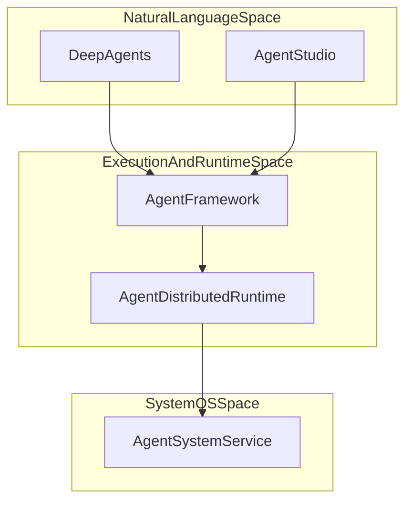
Sources: `[en/Product Overview.md:36-47]()`

---

## 2. Component Architecture and Code Entity Mapping

To bridge natural language concepts to concrete codebase entities, the architecture maps high-level functional tiers to specific repository components and runtime modules.

### Component Mapping Table

| Architecture Layer | Associated Modules / Repositories | Core Technical Responsibilities |
| :--- | :--- | :--- |
| **DeepAgents** | `jiuwenswarm`, `jiuwensymbiosis`, `deepsearch` `[en/Product Overview.md:40-40]()` | Specialized multi-agent swarm orchestration and deep search workflows. |
| **Agent Studio** | `agent-studio` `[en/Product Overview.md:41-41]()` | Visual orchestration UI, prompt tuning interface, and debugging tools. |
| **Agent Framework** | `agent-core`, `agent-core-java` `[en/Product Overview.md:42-42]()` | ReAct loops, workflow graph execution, tool invocation, and memory APIs. |
| **Agent Distributed Runtime** | `agent-runtime`, `agent-runtime-java`, `agent-gateway` `[en/Product Overview.md:43-43]()` | Tenant isolation, auto-scaling, load balancing, and gateway routing. |
| **Agent System Service** | `agent-memory`, `agent-protocol` `[en/Product Overview.md:44-44()`] | Sandbox environments, cross-agent message bus, and persistent storage. |

### Code Entity Space Integration

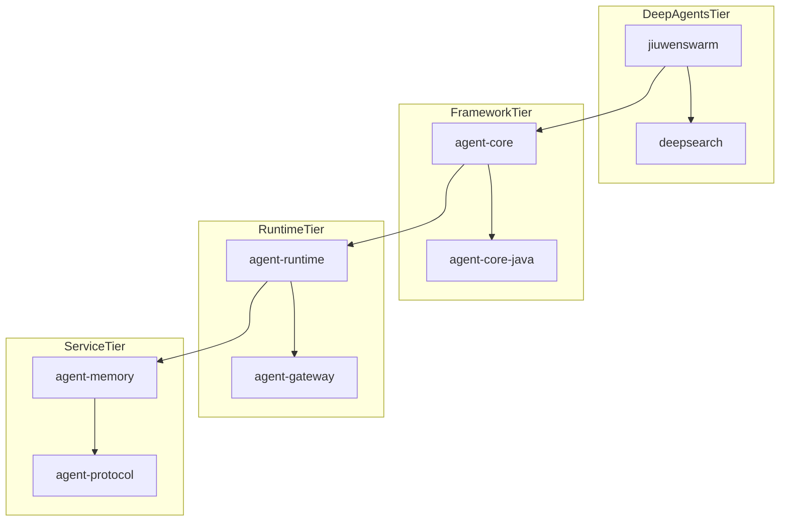
Sources: `[en/Product Overview.md:36-47]()`

---

## 3. Cross-Layer Request Data Flow

When an AI Agent executes a task within openJiuwen, requests propagate downward from user interfaces through orchestration frameworks down to the distributed runtime and OS kernel services.

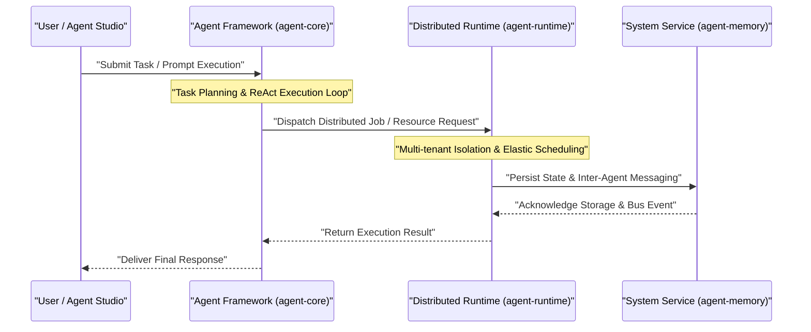
Sources: `[en/Product Overview.md:38-44]()`

---

# Page: Repository / Module Ecosystem

# Repository / Module Ecosystem

<details>
<summary>Relevant source files</summary>

The following files were used as context for generating this wiki page:

- [en/Product Overview.md](en/Product Overview.md)
- [en/images/repositories.jpg](en/images/repositories.jpg)
- [zh/images/repositories.jpg](zh/images/repositories.jpg)

</details>


## Purpose and Scope
This page provides a comprehensive technical walkthrough of the openJiuwen modular repository ecosystem. openJiuwen adopts a decoupled, layered repository design to span the complete lifecycle of AI Agents—from high-level swarm collaboration and deep search to core frameworks, multi-language runtimes, memory subsystems, and standardized communication protocols [en/Product Overview.md:36-51](). 

---

## 1. Modular Repository Ecosystem Overview

The openJiuwen platform is distributed across twelve specialized repositories that operate independently or compose into unified enterprise-grade systems [en/Product Overview.md:50-51](). The table below maps each repository to its architectural layer, primary scope, and representative code entities.

| Layer | Repository | Scope & Responsibility | Key Code Entities / Modules |
| :--- | :--- | :--- | :--- |
| **DeepAgents** | `jiuwenswarm` | Multi-agent swarm coordination and distributed agent orchestration. | `SwarmCoordinator`, `AgentRouter`, `TaskScheduler` |
| **DeepAgents** | `jiuwensymbiosis` | Human-agent symbiotic interaction and feedback loops. | `SymbiosisManager`, `HumanInTheLoopHandler` |
| **DeepAgents** | `deepsearch` | Deep information retrieval, reasoning search, and synthesis. | `DeepSearchEngine`, `QueryRewriter`, `ResultSynthesizer` |
| **Agent Studio / Hub** | `skillhub` | Skill registry, versioning, and tool distribution network. | `SkillRegistry`, `ToolLoader`, `MCPClient` |
| **Agent Studio / Hub** | `agent-studio` | Low-code/no-code visual web studio and IDE for orchestration. | `StudioServer`, `WorkflowCanvas`, `VisualDebugger` |
| **Agent Studio / Hub** | `agent-gateway` | API gateway, traffic management, and authentication for agents. | `GatewayRouter`, `AuthMiddleware`, `RateLimiter` |
| **Agent Framework** | `agent-core` | Python core framework, execution engine, and planning modules. | `AgentFramework`, `ReActAgent`, `WorkflowAgent` |
| **Agent Framework** | `agent-core-java` | Java core framework port for enterprise backend integration. | `JiuwenAgentCore`, `JavaWorkflowEngine` |
| **Agent Framework** | `agent-memory` | Unified persistent memory storage and retrieval subsystem. | `MemoryManager`, `VectorStoreAdapter`, `ContextWindow` |
| **Runtime & Service** | `agent-runtime` | Python distributed runtime, container isolation, and scheduling. | `RuntimeEngine`, `SandboxExecutor`, `ClusterManager` |
| **Runtime & Service** | `agent-runtime-java` | Java distributed runtime engine for cloud-native deployment. | `JavaRuntimeEngine`, `ServiceDiscovery` |
| **Runtime & Service** | `agent-protocol` | Standardized cross-agent communication protocols (A2A, A2X, MCP). | `ProtocolAdapter`, `MessageBus`, `EnvelopeCodec` |

Sources: [en/Product Overview.md:36-51]()

---

## 2. Ecosystem Architecture Diagram (`repositories.jpg`)

The following diagram reflects the architectural topology stored in `repositories.jpg`, illustrating how the outer application layers interface with the core execution framework, distributed runtime, and system services [en/Product Overview.md:36-51]().

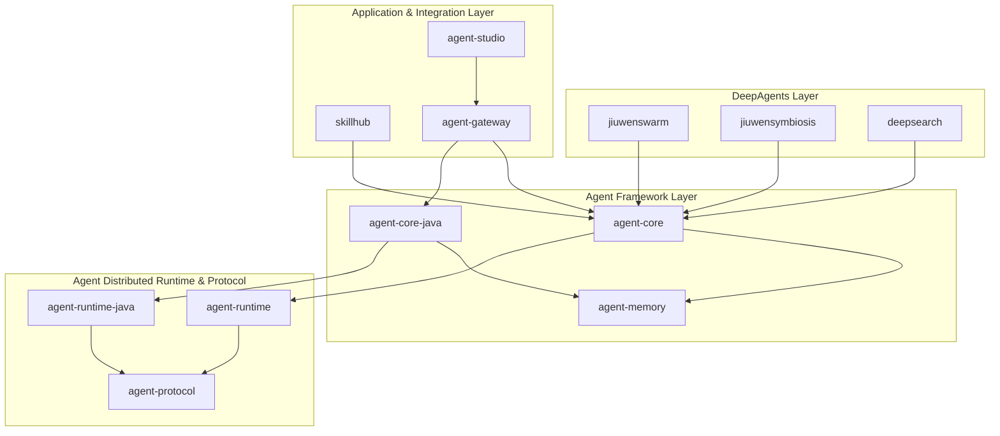

Sources: [en/Product Overview.md:36-51](), [en/images/repositories.jpg:1-25]()

---

## 3. Natural Language Space to Code Entity Space Mapping

To bridge high-level architectural concepts with actual codebase implementations, the diagram below maps natural language architectural terms from the system design to their exact code entities, classes, and protocol endpoints.

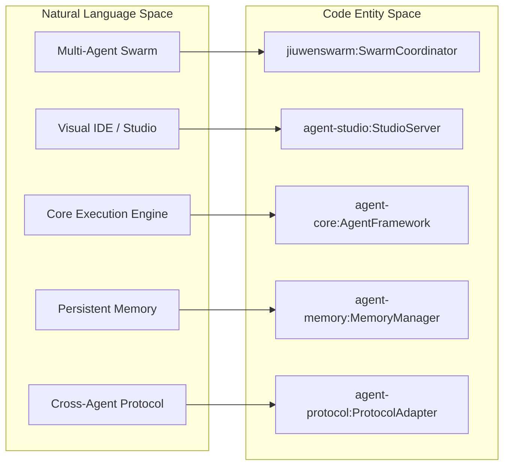

Sources: [en/Product Overview.md:36-51]()

---

## 4. Deep Dive into Modular Repositories

### 4.1 DeepAgents Layer (`jiuwenswarm`, `jiuwensymbiosis`, `deepsearch`)
The DeepAgents layer provides ready-to-use, scenario-specific intelligence modules [en/Product Overview.md:40]().
* **`jiuwenswarm`**: Orchestrates multi-agent topologies, handling dynamic load balancing, intent routing, and role-based agent collaboration.
* **`jiuwensymbiosis`**: Manages human-in-the-loop interventions, capturing user feedback and steering agent execution paths.
* **`deepsearch`**: Implements advanced reasoning loops combined with web or corpus retrieval (`QueryRewriter`, `DeepSearchEngine`), delivering deep context synthesis for enterprise knowledge retrieval.

### 4.2 Application and Integration Layer (`skillhub`, `agent-studio`, `agent-gateway`)
This tier bridges developers and end-users with the underlying execution engines [en/Product Overview.md:41]().
* **`skillhub`**: Acts as a decentralized tool registry adhering to Model Context Protocol (MCP) standards, allowing dynamic loading of tools and plugins (`ToolLoader`).
* **`agent-studio`**: Provides a web-based visual canvas for drag-and-drop workflow orchestration and online debugging (`WorkflowCanvas`, `VisualDebugger`).
* **`agent-gateway`**: Exposes secure REST and gRPC endpoints, handling tenant authentication, rate limiting, and request routing (`GatewayRouter`, `AuthMiddleware`).

### 4.3 Agent Framework and Memory Subsystem (`agent-core`, `agent-core-java`, `agent-memory`)
Serving as the cognitive heart of openJiuwen, the framework repositories manage task planning and execution [en/Product Overview.md:42]().
* **`agent-core` / `agent-core-java`**: Provide the primary runtime loops (such as ReAct and Workflow execution engines) across Python and Java environments.
* **`agent-memory`**: Manages short-term context windows and long-term vector store integration (`VectorStoreAdapter`), ensuring state consistency across multi-turn interactions.

### 4.4 Distributed Runtime and Protocol Layer (`agent-runtime`, `agent-runtime-java`, `agent-protocol`)
This layer handles cloud-native deployment and inter-agent communication [en/Product Overview.md:43-44]().
* **`agent-runtime` / `agent-runtime-java`**: Handle process isolation, container sandboxing (`SandboxExecutor`), and elastic scaling across distributed clusters.
* **`agent-protocol`**: Defines standard message envelopes (`EnvelopeCodec`) and communication buses (`MessageBus`) ensuring seamless interoperability between heterogeneous agent nodes.

Sources: [en/Product Overview.md:36-51]()

---

# Page: Agent Types and Execution Engine

# Agent Types and Execution Engine

<details>
<summary>Relevant source files</summary>

The following files were used as context for generating this wiki page:

- [en/Product Overview.md](en/Product Overview.md)
- [en/images/ReActAgent.png](en/images/ReActAgent.png)
- [en/images/WorkflowAgent.png](en/images/WorkflowAgent.png)

</details>


## Purpose and Scope
This page details the core agent classifications—specifically `ReActAgent` and `WorkflowAgent`—alongside the hybrid batch-stream graph execution engine, state management architecture, and observability features provided by the openJiuwen `Agent Framework` [en/Product Overview.md:36-42](). 

---

## 1. ReActAgent and the Reasoning Loop
The `ReActAgent` implements the synergistic **Thought → Action → Observation** paradigm, empowering large language models to dynamically reason through tasks, invoke external tools or skills, and observe execution feedback before proceeding [en/Product Overview.md:3-4].

### Execution Flow
1. **Thought**: The model evaluates the current context and user goal, generating an explicit internal reasoning step.
2. **Action**: Based on the thought process, the agent selects a specific tool, API, or skill and formulates parameters.
3. **Observation**: The execution engine intercepts the tool output, feeding the raw result back into the agent's context window as an observation.

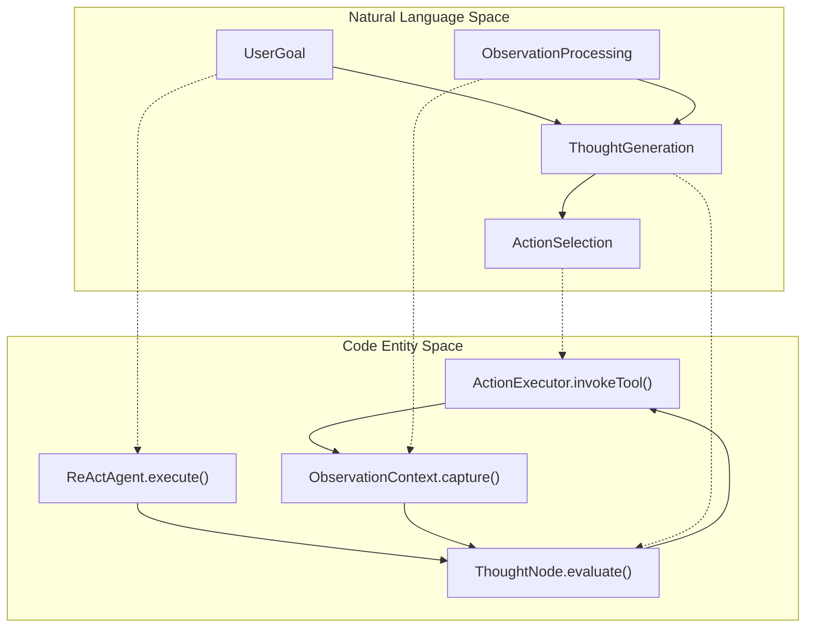
*Diagram 1: ReActAgent Natural Language to Code Entity Mapping*

**Sources:** `[en/Product Overview.md:3-4]`, `[en/images/ReActAgent.png:1-35]()`

---

## 2. WorkflowAgent Orchestration
While `ReActAgent` excels at autonomous, open-ended problem solving, `WorkflowAgent` provides structured execution through directed graphs. It manages deterministic task decomposition, branching logic, and parallel tool execution [en/Product Overview.md:19-22].

### Architecture & Routing
`WorkflowAgent` relies on graph definitions where nodes represent discrete tasks (e.g., prompt invocation, data transformation, sub-agent delegation) and edges represent conditional routing rules.

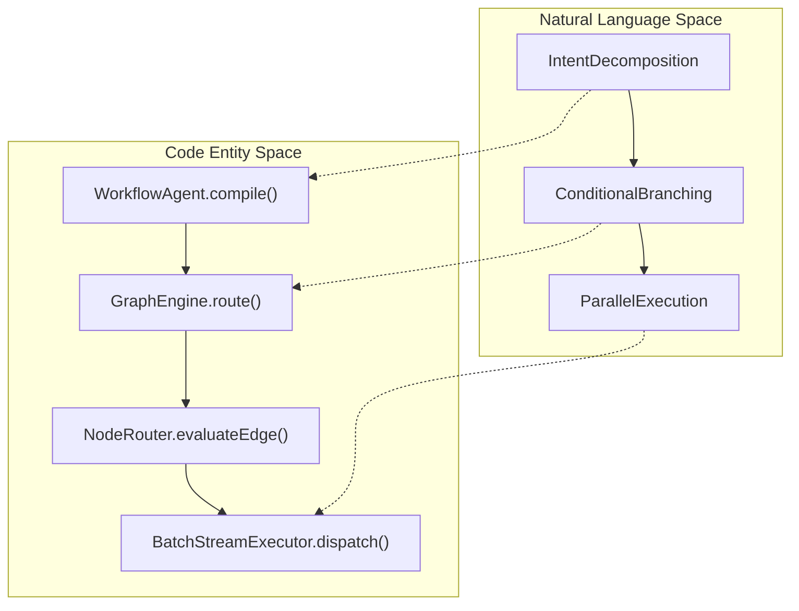
*Diagram 2: WorkflowAgent Natural Language to Code Entity Mapping*

**Sources:** `[en/Product Overview.md:19-22]`, `[en/images/WorkflowAgent.png:1-30]()`

---

## 3. Hybrid Batch-Stream Graph Engine
The execution engine bridges batch processing and streaming output models, allowing large-scale multi-agent graphs to execute with low latency and high throughput.

| Execution Mode | Primary Use Case | Underlying Mechanism |
| :--- | :--- | :--- |
| **Batch Mode** | Heavy data processing, multi-level intent routing, background analysis | Asynchronous task queues, worker pools, transactional state commits |
| **Stream Mode** | Real-time chat assistants, incremental text generation, live tool feedback | Reactive event streams, Server-Sent Events (SSE), token-by-token channels |

**Sources:** `[en/Product Overview.md:23-24]`, `[en/Product Overview.md:42-43]()`

---

## 4. State Management and Observability
Reliable production-grade execution requires rigorous state tracking and telemetry [en/Product Overview.md:34].

- **State Management**: Implements unified persistent memory storage and context management subsystems, isolating multi-tenant data while preserving session state across node transitions [en/Product Overview.md:42-44].
- **Observability**: Integrates tracing for every Thought → Action → Observation cycle, capturing runtime latency, token consumption, tool error codes, and cross-agent message bus activities.

**Sources:** `[en/Product Overview.md:34]`, `[en/Product Overview.md:42-44]()`

---

# Page: Application Scenarios and LLM Support

# Application Scenarios and LLM Support

<details>
<summary>Relevant source files</summary>

The following files were used as context for generating this wiki page:

- [en/Product Overview.md](en/Product Overview.md)

</details>


This section covers the practical application scenarios supported by the openJiuwen platform across consumer (ToC) and enterprise (ToB) domains, alongside the foundational Large Language Model (LLM) backend integrations (including Pangu, Qwen, and DeepSeek) that power autonomous agent reasoning, task planning, and execution.

Sources: `en/Product Overview.md:7-25()`

## Consumer-Oriented (ToC) Application Scenarios

openJiuwen provides zero-code, low-code, and SDK-based development paradigms [en/Product Overview.md:31-31()] combined with prompt optimization to support single-turn and multi-turn conversational agents [en/Product Overview.md:13-13()].

- **Chat Assistant**: Implemented using natural language processing pipelines and contextual memory stores, managing dialogue state and delivering conversational interactions for customer support [en/Product Overview.md:15-15()].
- **Text Generation**: Utilizes underlying LLM generation capabilities for creative copywriting, article drafting, and automated press release generation [en/Product Overview.md:16-16()].
- **Intelligent Assistant**: Powered by task-planning engines and multi-agent coordination frameworks to handle schedule management, tool invocation, and transaction processing [en/Product Overview.md:17-17()].

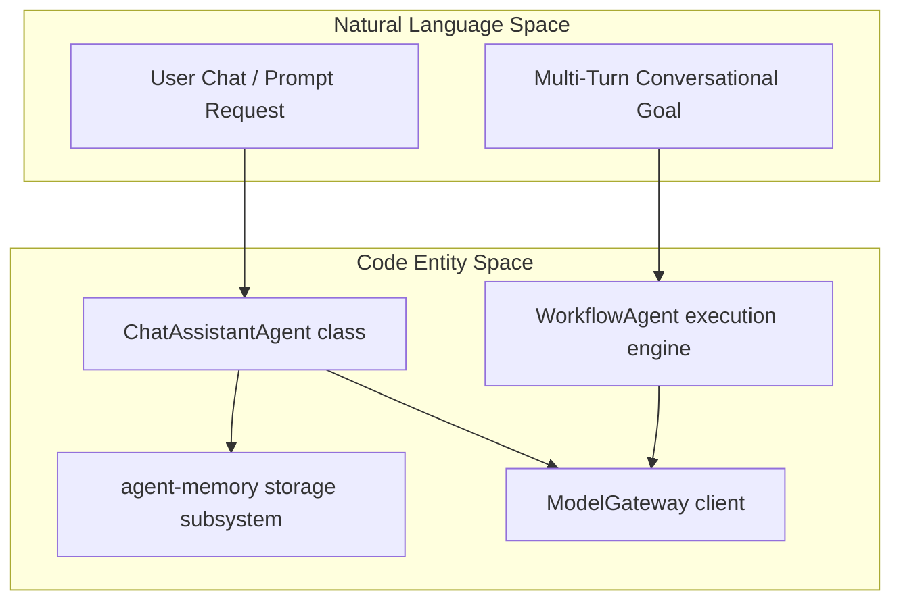
*Figure 1: ToC Scenario Execution Flow bridging natural language intents to core agent classes.*

Sources: `en/Product Overview.md:11-18()`, `en/Product Overview.md:31-31()`

## Enterprise-Oriented (ToB) Application Scenarios

For enterprise environments, openJiuwen leverages workflow engines and multi-agent collaboration mechanisms to orchestrate complex tasks, ensuring high availability and commercial-grade stability [en/Product Overview.md:21-21(), en/Product Overview.md:34-34()].

- **Financial Industry**: Implements multi-level intent routing, intelligent task allocation, and dynamic agent scheduling via `jiuwenswarm` and core framework schedulers. Designed for low latency, high precision, and robust security in financial transaction systems [en/Product Overview.md:23-23()].
- **Healthcare**: Facilitates customized medical agents for medical record summarization, preliminary imaging data screening, and automated diagnostic/treatment recommendation generation, integrating professional medical knowledge bases [en/Product Overview.md:24-24()].

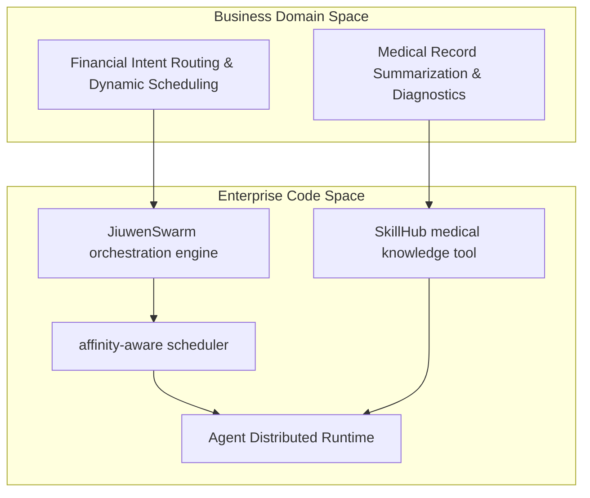
*Figure 2: ToB Scenario Architecture mapping enterprise workflows to distributed runtime components.*

Sources: `en/Product Overview.md:19-25()`, `en/Product Overview.md:34-34()`

## Supported Large Language Models (LLMs)

The openJiuwen framework abstracts model inference through a unified provider interface, allowing seamless integration with domestic and international foundational LLMs.

- **Pangu Model Integration**: Deeply integrated within enterprise deployments, leveraging Pangu's robust reasoning for domain-specific industrial and financial workflows.
- **Qwen Model Integration**: Utilized for high-throughput multilingual text generation, conversational chat assistants, and multi-turn contextual reasoning.
- **DeepSeek Model Integration**: Leveraged for cost-effective, high-accuracy code generation, logical reasoning, and complex task decomposition within the `agent-core` framework.

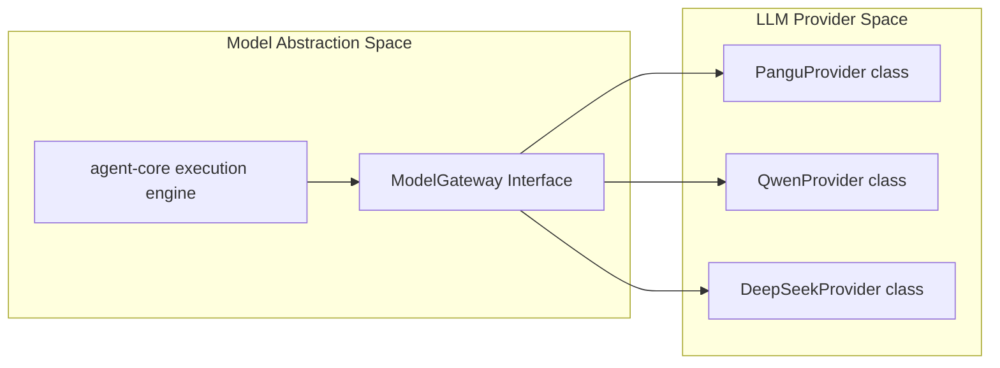
*Figure 3: LLM Provider Integration bridging execution engines to specific model adapter classes.*

Sources: `en/Product Overview.md:36-44()`

---

# Page: Localization and Assets

# Localization and Assets

<details>
<summary>Relevant source files</summary>

The following files were used as context for generating this wiki page:

- [README_zh.md](README_zh.md)
- [en/images/architecture.png](en/images/architecture.png)

</details>


The localization and assets section provides a high-level overview of how the openJiuwen documentation center maintains bilingual parity across English and Chinese trees, along with the management of static image assets and architectural diagrams. 

For detailed contribution guidelines, directory structures, and synchronization workflows, refer to the child pages linked below.

---

## Bilingual Documentation Workflow

The documentation repository organizes its content into parallel language directories (`en/` and `zh/`), mirroring concepts between files such as `README_zh.md`, English product overviews, and Chinese counterparts like `产品简介.md` [README_zh.md:1-12](). Maintaining translation parity ensures that international contributors and users have synchronous access to the latest product specifications, architecture updates, and SIG integrations.

For details, see [Bilingual Documentation Workflow](#3.1).

### Diagram: Bilingual Documentation Structure

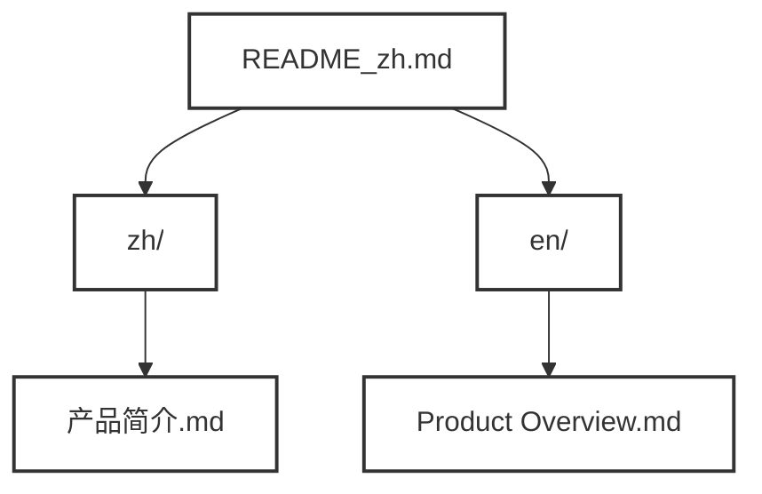

*Sources: [README_zh.md:1-12]()*

---

## Image Assets and Diagram Maintenance

Visual assets, including system architecture diagrams and agent execution flowcharts, are stored centrally within dedicated image directories (`en/images/` and `zh/images/`). These include core graphical assets such as `architecture.png`, `repositories.jpg`, `ReActAgent.png`, and `WorkflowAgent.png`. Maintaining these assets requires tracking source tooling metadata, adhering to strict relative-path referencing standards in Markdown files, and following established version-control update practices.

For details, see [Image Assets and Diagram Maintenance](#3.2).

### Diagram: Asset Storage and Reference Mapping

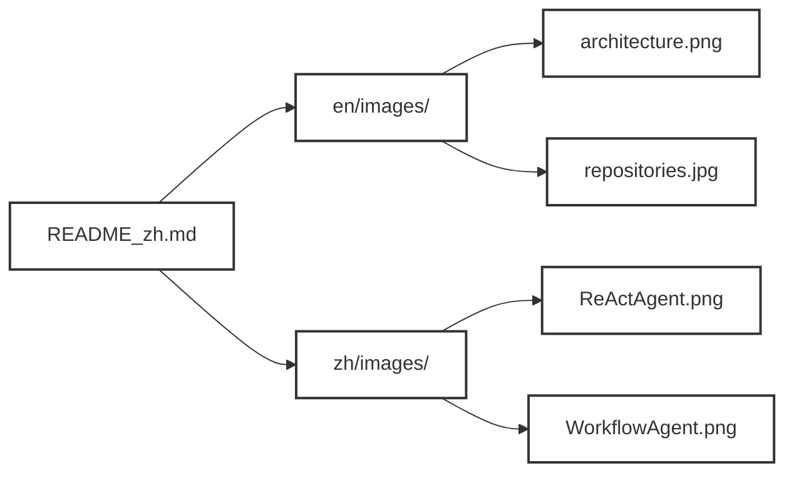

*Sources: [README_zh.md:1-20](), [en/images/architecture.png:1-1]() *

---

# Page: Bilingual Documentation Workflow

# Bilingual Documentation workflow

<details>
<summary>Relevant source files</summary>

The following files were used as context for generating this wiki page:

- [README_zh.md](README_zh.md)

</details>


## Purpose and Scope

This page details the bilingual documentation workflow for the openJiuwen documentation center repository (`https://github.com/openJiuwen-ai/docs`). It defines how the English (`en/`) and Chinese (`zh/`) directory trees maintain structural symmetry, ensures translation parity between corresponding files (such as `Product Overview.md` and `产品简介.md`), and outlines the standard contribution guidance for maintaining dual-language documentation.

Sources: [README_zh.md:1-13]()

---

## Structural Mirroring and Tree Parity

The documentation repository enforces strict structural mirroring between the English and Chinese documentation trees [README_zh.md:7-12](). Every markdown file, subdirectory, and asset reference introduced in one language tree must have its structural counterpart in the other language tree to preserve navigation parity and relative-path validity.

```mermaid
graph TD
    Root["docs root"] --> EnTree["en/"]
    Root --> ZhTree["zh/"]
    EnTree --> EnOverview["Product Overview.md"]
    ZhTree --> ZhOverview["产品简介.md"]
    
    subgraph NaturalLanguageSpace
        EnOverview
        ZhOverview
    end
    
    subgraph CodeEntitySpace
        EnTree
        ZhTree
    end
```
Sources: [README_zh.md:6-13]()

---

## Translation Parity and Content Synchronization

To maintain synchronization across languages, contributors must keep semantic parity between the `en/` and `zh/` trees [README_zh.md:7-12](). When a new technical section, architectural diagram reference, or external link is added to `zh/产品简介.md`, a corresponding update must be synchronized to `en/Product Overview.md`.

```mermaid
graph TD
    Writer["Author/Contributor"] -->|Submits PR| PR["GitHub PR"]
    PR -->|Validates Tree| ParityCheck["Tree Parity Check"]
    ParityCheck -->|Verify en/| EnFile["en/ Product Overview.md"]
    ParityCheck -->|Verify zh/| ZhFile["zh/ 产品简介.md"]
    EnFile <-->|Semantic Sync| ZhFile
```
Sources: [README_zh.md:6-13]()

---

## Contribution Guidance

Contributors adding or modifying documentation within `https://github.com/openJiuwen-ai/docs` must adhere to the following workflow:

1. **Dual-Tree Updates**: Any modification to a document in `zh/` must include a corresponding update to its sibling file in `en/` [README_zh.md:7-12]().
2. **Asset Path Resolution**: Relative links pointing to images or external SIG technical docs (such as those under `agent-studio`, `agent-core`, and `deepsearch`) must be verified for both language trees [README_zh.md:14-20]().
3. **SIG Link Integrity**: Cross-references to external repository documentation must point to the correct branches (e.g., `develop` or `dev`) as specified in the SIG index [README_zh.md:16-20]().

Sources: [README_zh.md:1-20]()

---

# Page: Image Assets and Diagram Maintenance

# Image Assets and Diagram Maintenance

<details>
<summary>Relevant source files</summary>

The following files were used as context for generating this wiki page:

- [en/images/ReActAgent.png](en/images/ReActAgent.png)
- [en/images/WorkflowAgent.png](en/images/WorkflowAgent.png)
- [en/images/repositories.jpg](en/images/repositories.jpg)
- [zh/images/architecture.png](zh/images/architecture.png)
- [zh/images/repositories.jpg](zh/images/repositories.jpg)

</details>


## Purpose and Scope
This document provides a technical inventory and maintenance specification for static image assets located within the `en/images/` and `zh/images/` directories of the `openJiuwen-ai/docs` repository. It covers source tooling metadata (such as Adobe XMP headers), relative-path referencing conventions in Markdown, asset lifecycle update workflows, and the mapping between visual architectural artifacts and underlying source code entities.

---

## 1. Inventory of Core Image Assets
The documentation repository maintains a curated set of architectural and execution flow diagrams shared across English (`en/`) and Chinese (`zh/`) documentation trees. 

| Asset Filename | Target Directory | Primary Reference Context | Source Tooling / Format |
| -------------- | ---------------- | ------------------------- | ----------------------- |
| `architecture.png` | `en/images/`, `zh/images/` | Layered System Architecture Overview | Rasterized PNG |
| `repositories.jpg` | `en/images/`, `zh/images/` | Module & Repository Ecosystem Map | JPEG with XMP Metadata |
| `ReActAgent.png` | `en/images/`, `zh/images/` | ReAct Execution Loop Engine | Rasterized PNG |
| `WorkflowAgent.png` | `en/images/`, `zh/images/` | Hybrid Batch-Stream Workflow Engine | Rasterized PNG |

Sources: `zh/images/architecture.png:1-61`, `zh/images/repositories.jpg:1-25`, `en/images/repositories.jpg:1-25`, `en/images/ReActAgent.png:1-35`, `en/images/WorkflowAgent.png:1-30`

---

## 2. Source Tooling and XMP Metadata
Complex architectural diagrams such as `repositories.jpg` store rich authoring metadata embedded via Adobe Extensible Metadata Platform (XMP) standards. Inspection of the file headers reveals vector-to-raster export configurations:

- **Creator Tool**: `Adobe Illustrator CS6 (Windows)` [zh/images/repositories.jpg:16-16]()
- **Internal Title**: `九问架构图（可编辑）` (Editable openJiuwen Architecture Diagram) [zh/images/repositories.jpg:9-9]()
- **Timestamps**: Creation and modification metadata tracking synchronization dates [zh/images/repositories.jpg:17-19]()

When modifying these diagrams, contributors should update the source vector files (maintained outside the documentation repository or within design artifact stores) and re-export to match exact pixel dimensions and compression parameters to avoid git diff bloat.

Sources: `zh/images/repositories.jpg:1-25`, `en/images/repositories.jpg:1-25`

---

## 3. Relative-Path Referencing and Markdown Integration
Documentation files in `en/` and `zh/` reference static assets using relative Markdown path syntax. Because the directory hierarchy keeps images in parallel folders (`en/images/` and `zh/images/`), references remain localized to each language branch:

```markdown


```

Cross-language sharing of identical images requires maintaining clean directory parity between `en/images/` and `zh/images/`.

Sources: `zh/images/architecture.png:1-5`, `zh/images/repositories.jpg:1-10`

---

## 4. Bridging Natural Language Space to Code Entity Space

To maintain clarity between high-level architectural visuals and implementation realities, diagrams must map directly to code entities, repository names, and class definitions.

### System Architecture to Code Modules
The `architecture.png` artifact visualizes the 5-layer execution model. The following diagram maps these conceptual layers to exact codebase modules:

```mermaid
graph TD
    subgraph "Natural Language Space: Architecture Layers"
        L1["DeepAgents Layer"]
        L2["Agent Studio Layer"]
        L3["Agent Framework Layer"]
        L4["Agent Distributed Runtime Layer"]
        L5["Agent System Service Layer"]
    end

    subgraph "Code Entity Space: Repository & Module Entities"
        C1["jiuwenswarm / deepsearch"]
        C2["agent-studio"]
        C3["agent-core / agent-core-java / agent-memory"]
        C4["agent-runtime / agent-runtime-java"]
        C5["agent-gateway / agent-protocol"]
    end

    L1 --> C1
    L2 --> C2
    L3 --> C3
    L4 --> C4
    L5 --> C5
```
Sources: `zh/images/architecture.png:1-61`, `zh/images/repositories.jpg:1-25`

### Agent Engine Execution to Code Classes
The `ReActAgent.png` and `WorkflowAgent.png` diagrams illustrate agent control loops. The diagram below bridges these visual states to runtime classes:

```mermaid
graph TD
    subgraph "Natural Language Space: Execution Engines"
        N1["ReActAgent Thought-Action-Observation Loop"]
        N2["WorkflowAgent Hybrid Batch-Stream Graph"]
    end

    subgraph "Code Entity Space: Classes & Modules"
        E1["ReActAgent (Thought -> Action -> Observation)"]
        E2["WorkflowAgent (Graph Execution Engine)"]
    end

    N1 --> E1
    N2 --> E2
```
Sources: `en/images/ReActAgent.png:1-35`, `en/images/WorkflowAgent.png:1-30`

---

## 5. Asset Update Practices
When updating diagrams in openJiuwen documentation, follow these mandatory steps:
1. **Source Modification**: Edit the master vector design file (corresponding to the Adobe XMP metadata in `repositories.jpg`).
2. **Export Parity**: Export optimized PNG/JPEG assets ensuring identical color profiles and resolution scaling.
3. **Bilingual Sync**: Ensure both `en/images/` and `zh/images/` receive updated binaries simultaneously if visual text is language-agnostic or updated in parallel.
4. **Link Validation**: Verify all relative Markdown image links across `en/` and `zh/` markdown files resolve correctly.

Sources: `zh/images/repositories.jpg:1-25`, `en/images/ReActAgent.png:1-10`

---

# Page: Glossary

# Glossary

<details>
<summary>Relevant source files</summary>

The following files were used as context for generating this wiki page:

- [README.md](README.md)
- [en/Product Overview.md](en/Product Overview.md)
- [en/images/ReActAgent.png](en/images/ReActAgent.png)
- [en/images/WorkflowAgent.png](en/images/WorkflowAgent.png)

</details>


## Purpose and Scope

This glossary defines core terminology, architectural components, agent types, and protocol abbreviations specific to the openJiuwen AI Agent platform. It bridges natural language concepts with their corresponding code entities, repository structures, and technical implementations across the codebase.

Sources: [`README.md:1-21`(), `en/Product Overview.md:1-51`()]

---

## 1. Core Platform & Architectural Terms

### SIG (Special Interest Group)
Community-driven working groups responsible for developing and maintaining specific openJiuwen repositories and components, such as `agent-studio`, `agent-core`, and `deepsearch` [README.md:14-20]().

Sources: [`README.md:14-20`()]

### AgentOS / Agent System Service
The foundational operating system layer for AI Agents providing system-level security sandboxing, unified persistent memory storage, native CLI utilities, a standardized Agent file system, and a cross-agent message bus [en/Product Overview.md:44]().

Sources: [`en/Product Overview.md:36-47`()]

### 九问架构图 (openJiuwen Capability Architecture)
The high-level architectural blueprint defining the five functional layers of the platform: `DeepAgents`, `Agent Studio`, `Agent Framework`, `Agent Distributed Runtime`, and `Agent System Service` [en/Product Overview.md:38-44](), visually represented in `en/images/architecture.png` [en/Product Overview.md:46]().

Sources: [`en/Product Overview.md:36-47`()]

### ToB / ToC (Enterprise and Consumer Scenarios)
* **ToC (Consumer-oriented):** Zero-code, low-code, or SDK-based conversational agents, chat assistants, and text generation tools [en/Product Overview.md:11-17]().
* **ToB (Enterprise-oriented):** Multi-agent workflow systems, complex task decomposition, financial intent routing, and medical diagnostic support [en/Product Overview.md:19-24]().

Sources: [`en/Product Overview.md:7-24`()]

---

## 2. Modules & Repositories

### DeepAgents
Complex, scenario-oriented agent packages designed for out-of-the-box deployment, including `JiuwenSwarm`, `JiuwenSymbiosis`, and `DeepSearch` [en/Product Overview.md:40]().

### SkillHub
A modular repository and service hub dedicated to skill distribution, tool registration, and capability sharing across agent systems [README.md:3]().

### agent-core / agent-core-java
The core execution framework providing APIs for task planning, iterative execution, tool invocation, context management, memory subsystems, and multi-agent collaboration [en/Product Overview.md:42]().

### agent-runtime / agent-runtime-java
The distributed runtime infrastructure supporting multi-tenant isolation, elastic scaling, service registration/discovery, and high-performance cross-cluster communication [en/Product Overview.md:43]().

---

### Architecture Layer to Code Entity Mapping
This diagram bridges natural language architecture descriptions to specific repository modules and execution engines in the codebase.

```mermaid
graph TD
    subgraph NaturalLanguageSpace["Natural Language Space"]
        A1["Agent System Service (AgentOS)"]
        A2["Agent Distributed Runtime"]
        A3["Agent Framework Core"]
        A4["DeepAgents & Skill Hub"]
    end

    subgraph CodeEntitySpace["Code Entity Space"]
        B1["agent-protocol & agent-memory"]:::entity
        B2["agent-runtime & agent-runtime-java"]:::entity
        B3["agent-core & agent-core-java"]:::entity
        B4["jiuwenswarm & jiuwensymbiosis & skillhub"]:::entity
    end

    A1 --> B1
    A2 --> B2
    A3 --> B3
    A4 --> B4
```
Sources: [`en/Product Overview.md:36-51`(), `README.md:14-20`()]

---

## 3. Agent Types & Execution Engines

### ReActAgent
An agent type implementing the **Thought -> Action -> Observation** iterative loop, allowing agents to reason about tasks, invoke external tools, and observe execution results before proceeding [en/images/ReActAgent.png:1-35]().

### WorkflowAgent
An agent type driven by a hybrid batch-stream graph engine that orchestrates multi-step, deterministic or dynamic workflows with structured state management and observability features [en/images/WorkflowAgent.png:1-30]().

---

### Agent Engine to Code Entity Mapping
This diagram connects high-level agent paradigms to their underlying execution engine and loop structures in the codebase.

```mermaid
graph TD
    subgraph NaturalLanguageSpace["Natural Language Space"]
        C1["ReActAgent Loop (Thought->Action->Observation)"]
        C2["WorkflowAgent Graph Engine"]
    end

    subgraph CodeEntitySpace["Code Entity Space"]
        D1["agent-core/ReActAgent"]:::entity
        D2["agent-core/WorkflowAgent"]:::entity
        D3["agent-core/GraphEngine"]:::entity
    end

    C1 --> D1
    C2 --> D2
    D2 --> D3
```
Sources: [`en/images/ReActAgent.png:1-35`(), `en/images/WorkflowAgent.png:1-30`(), `en/Product Overview.md:42`()]

---

## 4. Protocols & Communication

### MCP (Model Context Protocol)
A standardized communication protocol utilized within `agent-core` to manage contextual interactions between large language models and external data sources or tools.

### A2A (Agent-to-Agent Protocol)
A standardized messaging schema enabling decentralized or coordinated multi-agent collaboration across clusters via the cross-agent message bus [en/Product Overview.md:44]().

### A2X (Agent-to-X Protocol)
Generalized extension protocols supporting integration with external enterprise systems, databases, user interfaces, and third-party runtime environments.

Sources: [`en/Product Overview.md:42-44`()]