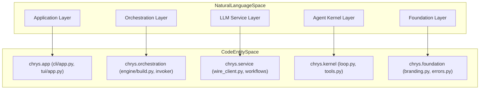
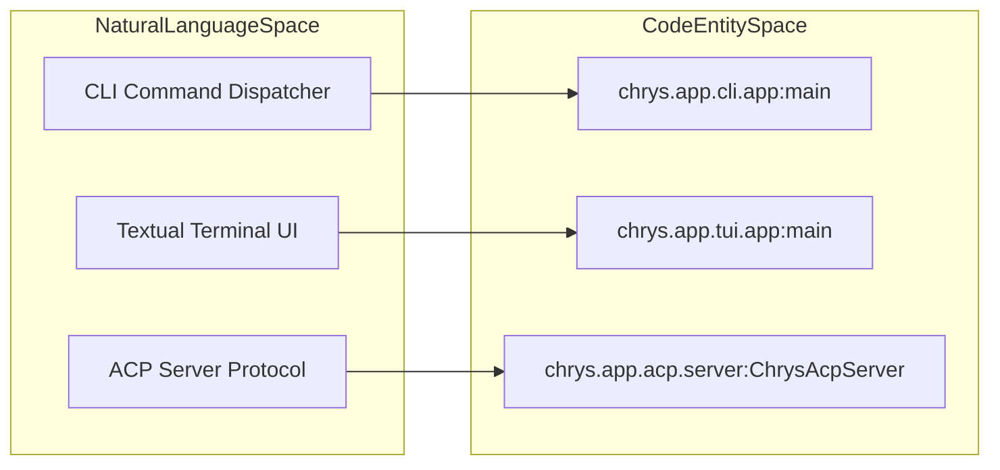

<!-- source: DeepWiki mcp.deepwiki.com · repo openJiuwen-ai/iCode · page 1 Overview · fetched 2026-11-02 -->

# Overview

Relevant source files

The following files were used as context for generating this wiki page:

- [.github/workflows/cd.yml](.github/workflows/cd.yml)
- [.github/workflows/ci.yml](.github/workflows/ci.yml)
- [.github/workflows/gc-freeze-calibration.yml](.github/workflows/gc-freeze-calibration.yml)
- [.github/workflows/pillow-manylinux2014.yml](.github/workflows/pillow-manylinux2014.yml)
- [.python-version](.python-version)
- [AGENTS.md](AGENTS.md)
- [NOTICE](NOTICE)
- [README.md](README.md)
- [README.zh.md](README.zh.md)
- [docs/en/start/getting-started.md](docs/en/start/getting-started.md)
- [docs/zh-Hans/start/getting-started.md](docs/zh-Hans/start/getting-started.md)
- [pyproject.toml](pyproject.toml)
- [scripts/build.ps1](scripts/build.ps1)
- [scripts/build.sh](scripts/build.sh)
- [scripts/build_offline_dist.sh](scripts/build_offline_dist.sh)
- [scripts/check_wheel.py](scripts/check_wheel.py)
- [scripts/chrys_test.py](scripts/chrys_test.py)
- [scripts/offline_wheel_overrides.txt](scripts/offline_wheel_overrides.txt)
- [tests/app/cli/test_app.py](tests/app/cli/test_app.py)
- [tests/architecture/test_chrys_test.py](tests/architecture/test_chrys_test.py)
- [tests/architecture/test_python_pin.py](tests/architecture/test_python_pin.py)
- [tests/architecture/test_workflow_action_pins.py](tests/architecture/test_workflow_action_pins.py)
- [uv.lock](uv.lock)

## Purpose and Scope

Chrys (distributed on PyPI as `iCode-TUI` and invoked via the `icode` command-line interface) is a general-purpose, extensible Python 3.14+ agent platform designed for building, executing, and evolving custom autonomous agents, workflows, and interactive terminal interfaces [AGENTS.md:3, pyproject.toml:4-5, pyproject.toml:81-82]. While the PyPI package distribution and wheel name use `icode-tui`, the core import namespace, application configuration directory (`~/.chrys`), environment variable prefix (`CHRYS_*`), and internal runtime identifiers remain under the `chrys` package namespace [AGENTS.md:3].

This wiki page provides a high-level architectural overview of the system, introducing the five foundational layers of the codebase and mapping out the documentation structure. For installation procedures, environment configuration, and workspace startup details, see [Getting Started](#1.1). For repository layout details and architectural layering rules, see [Layering and Repository Map](#1.2).

### Sources
- `AGENTS.md:3`
- `pyproject.toml:4-83`

---

## The Five-Layer Architecture

The codebase is organized into a strict five-layer architecture that separates cross-cutting foundation primitives from agent execution kernels, LLM wire services, orchestration workflows, and application frontends.

### Architecture Overview Diagram

The following diagram bridges the conceptual Natural Language Space to the Code Entity Space, linking architectural layers to their primary implementation packages and entry points under `src/chrys/`.

**Figure 1**: Mapping from architectural concepts to codebase packages.

### Sources
- `AGENTS.md:3`
- `pyproject.toml:81-82`
- `scripts/check_wheel.py:37-75`

---

### Layer Breakdown

1. **Foundation Layer (`chrys.foundation`)**: Provides cross-cutting primitives including configuration management (`spec()`, environment variables), error taxonomy (`ErrorKind`, retry handling), internationalization (`LocaleController`), platform helpers, and runtime patches [AGENTS.md:3].
2. **Kernel Layer (`chrys.kernel`)**: Implements the core agent turn lifecycle loop (`kernel/loop.py`), argument validation, exhaustion tails, tool execution result shaping (`kernel/tools.py`), compaction strategies, and OpenTelemetry instrumentation [AGENTS.md:3].
3. **Service Layer (`chrys.service`)**: Encapsulates LLM provider wire clients (`WireClient`, `sdk_openai`, `sdk_anthropic`), request codecs, chat completion stream assembly (`StreamState`), request tracking, and the workflow execution engine [AGENTS.md:3].
4. **Orchestration Layer (`chrys.orchestration`)**: Manages session hosting, engine builds (`AgentBuilder`), invoker runtimes, sub-agent policy execution, context providers, and workflow coordination [AGENTS.md:3].
5. **Application Layer (`chrys.app`)**: Unifies the Textual TUI (`chrys.app.tui.app`), headless CLI (`chrys.app.cli.app`), and ACP server (`ChrysAcpServer`) behind a shared event bus (`EventBus`) [AGENTS.md:3, tests/app/cli/test_app.py:15].

### Frontend and Runtime Execution Flow

**Figure 2**: Frontend interface mapping to execution entry points.

### Sources
- `AGENTS.md:3`
- `pyproject.toml:81-82`
- `tests/app/cli/test_app.py:15-136`

---

## Wiki Map and Child Pages

The wiki is organized into thematic chapters mirroring the structural boundaries of the codebase:

- **1. Overview** (Current Page) — High-level introduction, architecture map, and wiki index.
  - **1.1 Getting Started** — Installation via `uv`/pip, execution modes (`icode`, `icode run`, `icode acp`), and API configuration [docs/en/start/getting-started.md:1]().
  - **1.2 Layering and Repository Map** — Directory structure under `src/chrys`, architecture enforcement tests, and utility scripts [scripts/chrys_test.py:109]().
- **2. Foundation Layer** — Configuration, error classification, internationalization, and platform patches.
- **3. Kernel: Agent Loop** — Turn lifecycle, tool execution, compaction, and instrumentation.
- **4. LLM Service Layer** — Wire clients, OpenAI/Anthropic codecs, and telemetry tracking.
- **5. Tools, Approvals and Safety** — Builtin tools, approval pipelines, mutation tracking, and middleware.
- **6. Extensibility: Profiles, Skills, Hooks, MCP** — Agent profiles, custom skills, lifecycle hooks, and Model Context Protocol servers.
- **7. Orchestration: Engine, Sub-agents and Workflows** — Session hosts, execution engines, invoker runtimes, and workflows.
- **8. Application Layer: TUI, CLI and ACP** — Terminal UI widgets, command-line routing, trajectory dashboard, and ACP server integration.
- **9. Development, Testing and Release** — Smart test infrastructure (`scripts/chrys_test.py`), CI/CD workflows, and packaging.
- **10. Glossary** — Precise definitions of codebase terminology with code pointers.

### Sources
- `AGENTS.md:3`
- `docs/en/start/getting-started.md:1-15`
- `scripts/chrys_test.py:109-170`

---

