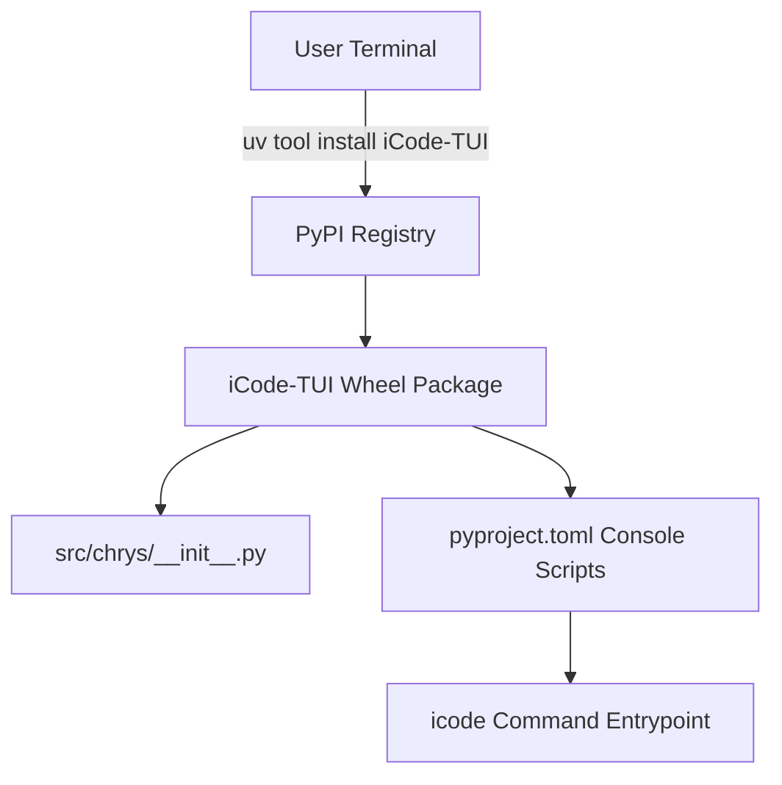
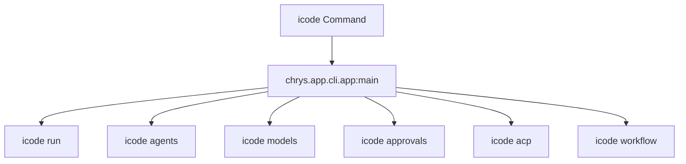

<!-- source: DeepWiki mcp.deepwiki.com · repo openJiuwen-ai/iCode · page 1.1 Getting Started · fetched 2026-11-02 -->

# Getting Started

<details>
<summary>Relevant source files</summary>

The following files were used as context for generating this wiki page:

- [docs/en/guides/daily-use/workspaces.md](docs/en/guides/daily-use/workspaces.md)
- [docs/en/guides/running/icode-run.md](docs/en/guides/running/icode-run.md)
- [docs/en/start/getting-started.md](docs/en/start/getting-started.md)
- [docs/zh-Hans/guides/daily-use/workspaces.md](docs/zh-Hans/guides/daily-use/workspaces.md)
- [docs/zh-Hans/guides/running/icode-run.md](docs/zh-Hans/guides/running/icode-run.md)
- [docs/zh-Hans/start/getting-started.md](docs/zh-Hans/start/getting-started.md)
- [pyproject.toml](pyproject.toml)
- [scripts/check_wheel.py](scripts/check_wheel.py)
- [src/chrys/app/acp/session_manager.py](src/chrys/app/acp/session_manager.py)
- [src/chrys/app/cli/run.py](src/chrys/app/cli/run.py)
- [src/chrys/app/cli/workflow.py](src/chrys/app/cli/workflow.py)
- [src/chrys/app/tui/screens/dialogs/file_picker.tcss](src/chrys/app/tui/screens/dialogs/file_picker.tcss)
- [src/chrys/app/tui/screens/dialogs/new_folder.py](src/chrys/app/tui/screens/dialogs/new_folder.py)
- [src/chrys/app/tui/screens/dialogs/new_folder.tcss](src/chrys/app/tui/screens/dialogs/new_folder.tcss)
- [src/chrys/orchestration/engine/run/runner.py](src/chrys/orchestration/engine/run/runner.py)
- [src/chrys/orchestration/engine/session_lifecycle.py](src/chrys/orchestration/engine/session_lifecycle.py)
- [src/chrys/orchestration/session_host.py](src/chrys/orchestration/session_host.py)
- [src/chrys/orchestration/workflows/coordinator.py](src/chrys/orchestration/workflows/coordinator.py)
- [src/chrys/orchestration/workflows/preview.py](src/chrys/orchestration/workflows/preview.py)
- [src/chrys/orchestration/workflows/worker_client.py](src/chrys/orchestration/workflows/worker_client.py)
- [tests/app/cli/test_run.py](tests/app/cli/test_run.py)
- [tests/app/tui/screens/test_file_picker_new_folder.py](tests/app/tui/screens/test_file_picker_new_folder.py)
- [tests/orchestration/engine/run/test_retry_lifecycle.py](tests/orchestration/engine/run/test_retry_lifecycle.py)
- [tests/orchestration/workflows/test_worker_client.py](tests/orchestration/workflows/test_worker_client.py)
- [uv.lock](uv.lock)

</details>


## Purpose and Scope
This wiki page details the initial setup, invocation, execution modes, and environment configuration for `iCode` (distributed on PyPI as `iCode-TUI`, implemented via the package name `chrys`) [pyproject.toml:1-4](). It bridges installation practices (`uv`, pip, or prebuilt offline distributions), entry-point resolution (`icode`), the structural divergence between interactive and headless execution (`icode` TUI vs `icode run` vs `icode acp`), model authentication via API keys, and workspace context management.

---

## 1. Installation and Environment Setup
`iCode` requires Python >=3.14 for standard tool installations [pyproject.toml:8](), or self-contained runtimes via offline packages. The primary installation path uses Astral's `uv` tool runner:

```shell
uv tool install iCode-TUI
```

For environments lacking direct Python 3.14 access or internet connectivity, prebuilt offline bundles (`icode-<platform>-<arch>-v<version>-offline.tar.gz/.zip`) include an isolated interpreter and all pinned dependencies [docs/en/start/getting-started.md:21-35](). 

The build system configurations, metadata targets, and dependency trees are defined in `pyproject.toml`.


*Diagram 1: Installation flow mapping PyPI distribution to local command registration.*

Sources: [pyproject.toml:1-83](), [docs/en/start/getting-started.md:5-82]()

---

## 2. First Run and CLI Entrypoints
The console script entrypoint is mapped directly to the application runner [pyproject.toml:81-83]():
```toml
[project.scripts]
icode = "chrys.app.cli.app:main"
```

The underlying CLI architecture exposes several subcommands and helpers that handle execution routing, verification, and diagnostics [scripts/check_wheel.py:37-52]().


*Diagram 2: Natural language CLI commands mapped to underlying Python executable functions.*

Sources: [pyproject.toml:81-83](), [scripts/check_wheel.py:37-52]()

---

## 3. Execution Modes: TUI vs `icode run` vs `icode acp`
`iCode` supports three distinct execution interfaces sharing the underlying orchestration engine and event loop (`EventBus`):

1. **Interactive TUI (`icode`)**: Launches the Textual-based terminal user interface (`chrys.app.tui.app`), providing real-time streaming, chat history, rich Markdown/Mermaid rendering, approval prompts, and trajectory visualizers.
2. **Headless Run (`icode run`)**: Executes a specific task or agent loop non-interactively, emitting structured progress logs to `stderr` and final outputs to `stdout`.
3. **ACP Server (`icode acp`)**: Starts the Agent Client Protocol server (`ChrysAcpServer`), enabling IDE integrations and external clients to interact with `iCode` sessions via standard JSON-RPC over stdio or sockets.

Sources: [docs/en/start/getting-started.md:107-118](), [src/chrys/app/cli/workflow.py:61-132]()

---

## 4. API Keys and Model Configuration
Model credentials and parameters are managed through settings metadata (`Settings` dataclass) and persisted configuration files within the user's home data directory (`~/.chrys` or `%APPDATA%\chrys`) [docs/en/start/getting-started.md:105](). 

API keys can be supplied interactively via the TUI Model Configuration screen (**F4**) [docs/en/start/getting-started.md:120-128]() or injected via environment variables (such as provider-specific keys or `CHRYS_*` overrides). Configuration resolution merges project-level overrides from `.chrys/` with global defaults.

Sources: [docs/en/start/getting-started.md:120-133](), [docs/en/guides/ daily-use/workspaces.md:1-52]()

---

## 5. Workspaces and Working Directories
File operations, ripgrep searches, and command executions target a designated working directory. 

* **Startup selection**: The directory from which `icode` is invoked becomes the default workspace, or can be explicitly overridden via the `-C` or `--workdir` flags [docs/en/guides/daily-use/workspaces.md:5-20]().
* **Runtime switching**: Users can switch working directories mid-session using the `/chdir` command or through the file picker and folder creation gateway (`NewFolderDialog`) [docs/en/guides/daily-use/workspaces.md:22-30](), [src/chrys/app/tui/screens/dialogs/new_folder.py:122-133]().
* **Missing Workspaces**: If a working directory is deleted or moved externally, `iCode` intercepts operations and prompts the user to remap or select a valid path via the recovery flow [docs/en/guides/daily-use/workspaces.md:40-51]().

Sources: [docs/en/guides/daily-use/workspaces.md:1-51](), [src/chrys/app/tui/screens/dialogs/new_folder.py:122-155]()

---

