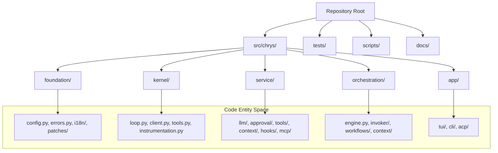
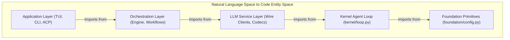
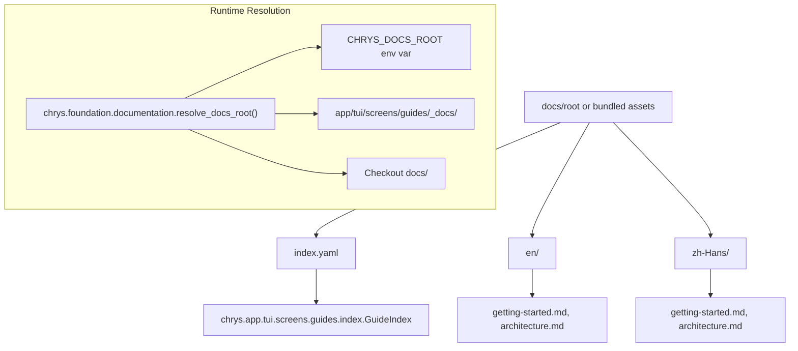

<!-- source: DeepWiki mcp.deepwiki.com · repo openJiuwen-ai/iCode · page 1.2 Layering and Repository Map · fetched 2026-11-02 -->

# Layering and Repository Map

Relevant source files

The following files were used as context for generating this wiki page:

- [.github/workflows/pillow-manylinux2014.yml](.github/workflows/pillow-manylinux2014.yml)
- [AGENTS.md](AGENTS.md)
- [NOTICE](NOTICE)
- [scripts/build_offline_dist.sh](scripts/build_offline_dist.sh)
- [scripts/chrys_test.py](scripts/chrys_test.py)
- [scripts/offline_wheel_overrides.txt](scripts/offline_wheel_overrides.txt)
- [src/chrys/app/features/buddy/pixel_sprites.py](src/chrys/app/features/buddy/pixel_sprites.py)
- [src/chrys/app/tui/screens/guides/index.py](src/chrys/app/tui/screens/guides/index.py)
- [src/chrys/app/tui/screens/guides/screen.py](src/chrys/app/tui/screens/guides/screen.py)
- [src/chrys/app/tui/widgets/chat/image_preview.py](src/chrys/app/tui/widgets/chat/image_preview.py)
- [src/chrys/app/tui/widgets/chrome/image_paste.py](src/chrys/app/tui/widgets/chrome/image_paste.py)
- [src/chrys/foundation/documentation.py](src/chrys/foundation/documentation.py)
- [src/chrys/orchestration/invoker/runtime.py](src/chrys/orchestration/invoker/runtime.py)
- [src/chrys/service/context/providers/context_management.py](src/chrys/service/context/providers/context_management.py)
- [src/chrys/service/context/providers/documentation.py](src/chrys/service/context/providers/documentation.py)
- [src/chrys/service/tools/builtins/doc_converter/artifacts.py](src/chrys/service/tools/builtins/doc_converter/artifacts.py)
- [src/chrys/service/tools/builtins/doc_converter/parsers/base.py](src/chrys/service/tools/builtins/doc_converter/parsers/base.py)
- [src/chrys/service/tools/builtins/doc_converter/parsers/pdf.py](src/chrys/service/tools/builtins/doc_converter/parsers/pdf.py)
- [src/chrys/service/tools/builtins/doc_converter/parsers/xlsx.py](src/chrys/service/tools/builtins/doc_converter/parsers/xlsx.py)
- [tests/app/features/buddy/test_pixel_sprites.py](tests/app/features/buddy/test_pixel_sprites.py)
- [tests/architecture/test_chrys_test.py](tests/architecture/test_chrys_test.py)
- [tests/architecture/test_test_hygiene.py](tests/architecture/test_test_hygiene.py)
- [tests/architecture/test_workflow_action_pins.py](tests/architecture/test_workflow_action_pins.py)
- [tests/service/context/providers/test_context_management.py](tests/service/context/providers/test_context_management.py)

## Purpose and Scope
This page defines the directory structure of the `src/chrys/` package, explains the strict architectural layering rules enforced by the test suite, details the helper utilities in `scripts/` and `playground/`, and maps the documentation (`docs/`) tree and runtime resolution mechanisms.

Sources: [AGENTS.md:1-4](), [scripts/chrys_test.py:3-9]()

---

## 1. Repository Directory Layout (`src/chrys/`)
The Chrys core platform codebase resides under `src/chrys/` with clear functional separation across five distinct architectural layers. Supporting files such as test suites, developer scripts, and documentation trees live at the repository root.

Sources: [AGENTS.md:3-4](), [src/chrys/foundation/documentation.py:10-12]()

---

## 2. Layering Architecture and Enforcement Rules
Chrys enforces a strict unidirectional dependency graph across its five architectural layers. Lower layers (such as `foundation` and `kernel`) are forbidden from importing symbols from higher layers (`service`, `orchestration`, or `app`). Architecture guard tests enforce these invariants at test time.

Sources: [scripts/chrys_test.py:109-141](), [tests/architecture/test_chrys_test.py:83-93]()

### Architecture Guard Mechanisms
- **Layering Tests**: `tests/architecture/test_layering.py` verifies that module imports strictly adhere to the downward dependency direction [scripts/chrys_test.py:141-141]().
- **Test Discovery**: `scripts/chrys_test.py` maps architecture tests to specific file patterns via `ARCHITECTURE_RULES` [scripts/chrys_test.py:109-169]().
- **Smart Test Selection**: Local change analysis traces runtime imports up to `_MAX_SOURCE_IMPORT_HOPS = 2` to selectively run relevant pytest targets [scripts/chrys_test.py:44-44]().

Sources: [scripts/chrys_test.py:109-169](), [tests/architecture/test_chrys_test.py:83-93]()

---

## 3. Utilities in `scripts/` and `playground/`
Development, testing, and release packaging rely on specialized utilities located in the root `scripts/` directory:

| Utility Script | Primary Role | Code Pointer |
| -------------- | ------------ | ------------ |
| `scripts/chrys_test.py` | Smart and complete test execution runner with CPU niceness lowering (`_BELOW_NORMAL_NICENESS = 10`) | [scripts/chrys_test.py:3-46]() |
| `scripts/i18n.py` | Translation catalog management (extract, update, compile, check) | [AGENTS.md:18-18]() |
| `scripts/check_wheel.py` | Fresh environment wheel installation probe and artifact validation | [AGENTS.md:27-27]() |
| `scripts/build.sh` / `build.ps1` | Standalone binary bundling script referencing `PYTHON_BUILD_STANDALONE_RELEASE` | [AGENTS.md:37-37]() |

Sources: [AGENTS.md:17-37](), [scripts/chrys_test.py:3-46]()

---

## 4. Documentation Tree and Bundled Assets
User guides and technical documentation are maintained in Markdown format under `docs/` and driven by a structured index schema.

Sources: [src/chrys/app/tui/screens/guides/index.py:25-77](), [src/chrys/foundation/documentation.py:14-36]()

### Documentation Resolution Logic
The function `resolve_docs_root()` determines the active documentation path using a tiered fallback strategy:
1. Explicit path override via the `CHRYS_DOCS_ROOT` environment variable [src/chrys/foundation/documentation.py:22-28]().
2. Bundled documentation package located at `app/tui/screens/guides/_docs/` [src/chrys/foundation/documentation.py:30-32]().
3. Source checkout repository root `docs/` directory [src/chrys/foundation/documentation.py:33-35]().

Sources: [src/chrys/foundation/documentation.py:14-36](), [src/chrys/app/tui/screens/guides/index.py:57-77]()

---

