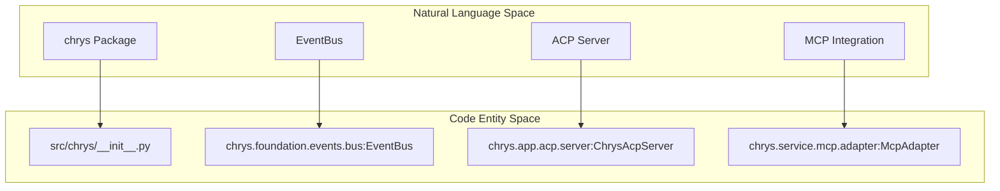
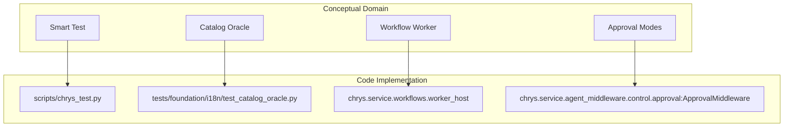

<!-- source: DeepWiki mcp.deepwiki.com · repo openJiuwen-ai/iCode · page 10 Glossary · fetched 2026-11-02 -->

# Glossary

Relevant source files

The following files were used as context for generating this wiki page:

- [.github/workflows/pillow-manylinux2014.yml](.github/workflows/pillow-manylinux2014.yml)
- [AGENTS.md](AGENTS.md)
- [NOTICE](NOTICE)
- [locales/chrys.pot](locales/chrys.pot)
- [locales/zh-Hans/LC_MESSAGES/chrys.po](locales/zh-Hans/LC_MESSAGES/chrys.po)
- [scripts/build_offline_dist.sh](scripts/build_offline_dist.sh)
- [scripts/chrys_test.py](scripts/chrys_test.py)
- [scripts/offline_wheel_overrides.txt](scripts/offline_wheel_overrides.txt)
- [src/chrys/app/acp/doc/frontend-api.md](src/chrys/app/acp/doc/frontend-api.md)
- [src/chrys/app/acp/transport.py](src/chrys/app/acp/transport.py)
- [src/chrys/app/cli/acp.py](src/chrys/app/cli/acp.py)
- [src/chrys/app/cli/approvals.py](src/chrys/app/cli/approvals.py)
- [src/chrys/app/tui/screens/dialogs/approval/bodies/file_edit.py](src/chrys/app/tui/screens/dialogs/approval/bodies/file_edit.py)
- [src/chrys/app/tui/screens/dialogs/approval/dialog.py](src/chrys/app/tui/screens/dialogs/approval/dialog.py)
- [src/chrys/app/tui/screens/settings/layout.py](src/chrys/app/tui/screens/settings/layout.py)
- [src/chrys/foundation/config/settings.py](src/chrys/foundation/config/settings.py)
- [src/chrys/foundation/i18n/_catalogs/zh-Hans/LC_MESSAGES/chrys.mo](src/chrys/foundation/i18n/_catalogs/zh-Hans/LC_MESSAGES/chrys.mo)
- [src/chrys/service/agent_middleware/control/approval.py](src/chrys/service/agent_middleware/control/approval.py)
- [src/chrys/service/approval/reuse.py](src/chrys/service/approval/reuse.py)
- [src/chrys/service/tools/approval_targets.py](src/chrys/service/tools/approval_targets.py)
- [src/chrys/service/tools/builtins/shell.py](src/chrys/service/tools/builtins/shell.py)
- [tests/app/cli/test_approvals.py](tests/app/cli/test_approvals.py)
- [tests/architecture/test_chrys_test.py](tests/architecture/test_chrys_test.py)
- [tests/architecture/test_workflow_action_pins.py](tests/architecture/test_workflow_action_pins.py)
- [tests/architecture/trajectory_wait_manifest.json](tests/architecture/trajectory_wait_manifest.json)
- [tests/foundation/i18n/_catalog_oracle_ids.py](tests/foundation/i18n/_catalog_oracle_ids.py)
- [tests/foundation/i18n/test_catalog_oracle.py](tests/foundation/i18n/test_catalog_oracle.py)
- [tests/service/agent_middleware/test_approval_reuse_boundaries.py](tests/service/agent_middleware/test_approval_reuse_boundaries.py)

## Purpose and Scope

This wiki page provides formal technical definitions for codebase-specific terms, architectural primitives, and conceptual subsystems within the `iCode` / `chrys` platform (`AGENTS.md:3`). Each entry describes the runtime behavior, data flow, key classes or functions, and includes exact code pointers to facilitate navigation and maintenance across the repository.

---

## Codebase Terminology

### chrys
* **Definition**: The root import package name, internal namespace, data key prefix, and filesystem storage directory (`~/.chrys`) for the engine and kernel runtime (`AGENTS.md:3`).
* **Implementation & Code Pointers**: Defined across the source tree under `[src/chrys/__init__.py:1-16]()`, managing internal configuration structures and core modules.

### iCode-TUI
* **Definition**: The PyPI distribution name (`icode_tui-*.whl`) and packaging bundle whose primary user-facing command entrypoint is `icode` (`AGENTS.md:3`).
* **Implementation & Code Pointers**: Configured in `[pyproject.toml:1-50]()` and bootstrapped via CLI application scripts in `[src/chrys/app/cli/__init__.py:1-3]()`.

### EventBus
* **Definition**: The core internal publish-subscribe communication fabric that decouples the engine backend from all frontends (TUI, headless CLI, and ACP server) (`[src/chrys/app/acp/doc/frontend-api.md:14-15]`).
* **Implementation & Code Pointers**: Implemented in `[src/chrys/foundation/events/bus.py:1-120]`, managing asynchronous event publication and subscription queues as cataloged in `[tests/architecture/trajectory_wait_manifest.json:34-41]()`.

### ACP (Agent Client Protocol)
* **Definition**: A standardized client protocol complemented by Chrys-private extensions (`chrys/*`, `session/*`, `mcp/*`) that enables external clients (such as the VS Code extension) to achieve feature parity with the Textual TUI (`[src/chrys/app/acp/doc/frontend-api.md:1-36]()`).
* **Implementation & Code Pointers**: Handled by request routers and session managers in `[src/chrys/app/acp/server.py:1-150]()` and `[src/chrys/app/acp/session_manager.py:1-120]()`.

### MCP (Model Context Protocol)
* **Definition**: An integration framework enabling the agent kernel to communicate with external MCP servers for supplementary tools, prompts, and data resources.
* **Implementation & Code Pointers**: Managed via server adapters and loaders located under `[src/chrys/service/mcp/adapter.py:1-100]()`.

### Approval Modes
* **Definition**: Session-level enforcement policies governing how tool execution requests are validated (`manual`, `auto`, or `bypass`) (`[src/chrys/app/acp/doc/frontend-api.md:92-101]()`).
* **Implementation & Code Pointers**: Implemented in `[src/chrys/service/agent_middleware/control/approval.py:1-140]()` and rendered via TUI dialog components in `[src/chrys/app/tui/screens/dialogs/approval/dialog.py:1-90]()`.

### Acquisition
* **Definition**: The automated context gathering and workspace memory loading process that injects relevant documentation or project files into the initial model prompt.
* **Implementation & Code Pointers**: Implemented in memory loaders under `[src/chrys/service/context/memory_loader.py:1-125]()`.

### Request Attempt ID
* **Definition**: A unique tracking identifier (`Chrys-Request-Attempt-Id`) passed through HTTP headers and observability layers to track wire calls and retry attempts across LLM provider interactions.
* **Implementation & Code Pointers**: Defined and tracked in provider wire clients under `[src/chrys/service/llm/tracking.py:1-80]()` (or equivalent wire observers).

### StreamState
* **Definition**: The internal state machine accumulator responsible for assembling streaming chunks, delta blocks, and tool call arguments during chat completion responses from OpenAI and Anthropic codecs.
* **Implementation & Code Pointers**: Implemented within the streaming codec modules under `[src/chrys/service/llm/codecs/stream_state.py:1-110]()`.

### Provenance
* **Definition**: The meta-tracking property that records the source origin (e.g., default, global configuration file, environment variable, or project-layer override) of any loaded setting or configuration value.
* **Implementation & Code Pointers**: Managed inside settings configuration specs in `[src/chrys/foundation/config/settings.py:1-150]()`.

### Coercion
* **Definition**: The automatic type conversion and validation applied to raw configuration values (e.g., from environment variables like `CHRYS_*` or YAML files) to conform to typed dataclass specifications.
* **Implementation & Code Pointers**: Implemented in settings coercion utilities under `[src/chrys/foundation/config/spec.py:1-120]()`.

### Smart Test
* **Definition**: A local test selection utility that analyzes changed repository paths using import graphs and fixture consumers to execute only the relevant pytest targets.
* **Implementation & Code Pointers**: Implemented in `[scripts/chrys_test.py:1-171]()` and governed by architecture rules.

### Trajectory
* **Definition**: The chronologically recorded sequence of agent turns, tool calls, user prompts, and execution timing stamps used for analytics, debugging, and playback.
* **Implementation & Code Pointers**: Structured via wait manifests and event inventories in `[tests/architecture/trajectory_wait_manifest.json:1-40]()`.

### Compaction
* **Definition**: The context window management strategy that summarizes or prunes older conversation history and tool outputs to prevent token exhaustion.
* **Implementation & Code Pointers**: Implemented in context management modules under `[src/chrys/kernel/compaction.py:1-100]()`.

### Skills
* **Definition**: Modular, model-facing text instructions and auxiliary tools discovered in user or project directories that extend agent capabilities.
* **Implementation & Code Pointers**: Discovered and loaded via `[src/chrys/service/skills/loader.py:1-90]()`.

### Hooks
* **Definition**: User-defined or global lifecycle extension scripts that intercept session construction, turn execution, and tool events.
* **Implementation & Code Pointers**: Loaded and dispatched via `[src/chrys/orchestration/session_hooks.py:1-117]()`.

### Profiles
* **Definition**: Declarative YAML configurations defining agent roles, model parameters, and chat options.
* **Implementation & Code Pointers**: Validated and parsed through schemas in `[src/chrys/service/profiles/agents/schema.py:1-80]()`.

### Sub-agent
* **Definition**: A specialized nested agent instance executed with bounded context, specialized toolsets, and isolated kernel policies orchestrated by a parent session.
* **Implementation & Code Pointers**: Implemented within runtime worker recipes under `[src/chrys/orchestration/engine/run/sub_agent.py:1-100]()`.

### Workflow Worker
* **Definition**: An isolated background worker process executing long-running workflow tasks and communicating securely via the workflow SDK and coordinator protocol.
* **Implementation & Code Pointers**: Implemented in worker hosting modules under `[src/chrys/service/workflows/worker_host.py:1-120]()` and guarded by `[tests/architecture/test_workflow_worker_purity.py:1-40]()`.

### Catalog Oracle
* **Definition**: An automated test harness that validates semantic consistency, pluralization rules, and exact message ID parity between tracked POT, PO, and compiled MO translation catalogs.
* **Implementation & Code Pointers**: Implemented in `[tests/foundation/i18n/test_catalog_oracle.py:1-43]()` alongside helper modules.

---

## Architectural Mapping Diagrams

### System-to-Code Entity Space: Core Primitives
The following diagram maps high-level architecture primitives to their concrete Python modules and classes within the repository:

*Sources: `[src/chrys/__init__.py:1-16]()`, `[src/chrys/foundation/events/bus.py:1-120]()`, `[src/chrys/app/acp/server.py:1-150]`, `[src/chrys/service/mcp/adapter.py:1-100]()`*

### Engine and Verification Space: Execution & Quality Gates
The following diagram illustrates how operational engines, test selectors, and verification oracles correspond to codebase components:

*Sources: `[scripts/chrys_test.py:1-50]()`, `[tests/foundation/i18n/test_catalog_oracle.py:1-43]()`, `[src/chrys/service/workflows/worker_host.py:1-50]()`, `[src/chrys/service/agent_middleware/control/approval.py:1-50]()`*

---
Sources: `[AGENTS.md:1-37]()`, `[src/chrys/app/acp/doc/frontend-api.md:1-129]()`, `[tests/architecture/trajectory_wait_manifest.json:1-41]()`, `[tests/foundation/i18n/test_catalog_oracle.py:1-43]()`, `[scripts/chrys_test.py:1-171]()`