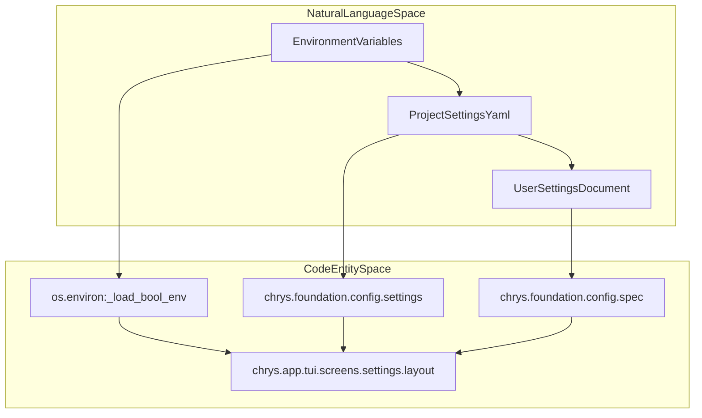
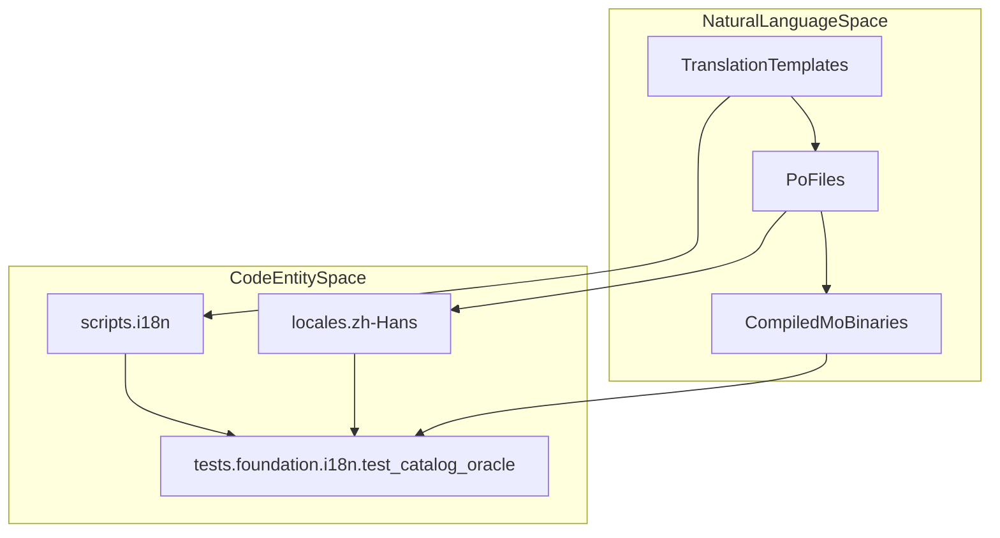

<!-- source: DeepWiki mcp.deepwiki.com · repo openJiuwen-ai/iCode · page 2 Foundation Layer · fetched 2026-11-02 -->

# Foundation Layer

Relevant source files

The following files were used as context for generating this wiki page:

- [docs/en/guides/configuration/compaction.md](docs/en/guides/configuration/compaction.md)
- [docs/zh-Hans/guides/configuration/compaction.md](docs/zh-Hans/guides/configuration/compaction.md)
- [locales/chrys.pot](locales/chrys.pot)
- [locales/zh-Hans/LC_MESSAGES/chrys.po](locales/zh-Hans/LC_MESSAGES/chrys.po)
- [src/chrys/app/tui/screens/settings/layout.py](src/chrys/app/tui/screens/settings/layout.py)
- [src/chrys/foundation/config/settings.py](src/chrys/foundation/config/settings.py)
- [src/chrys/foundation/errors/__init__.py](src/chrys/foundation/errors/__init__.py)
- [src/chrys/foundation/i18n/_catalogs/zh-Hans/LC_MESSAGES/chrys.mo](src/chrys/foundation/i18n/_catalogs/zh-Hans/LC_MESSAGES/chrys.mo)
- [src/chrys/foundation/platform/files.py](src/chrys/foundation/platform/files.py)
- [src/chrys/kernel/__init__.py](src/chrys/kernel/__init__.py)
- [src/chrys/kernel/compaction.py](src/chrys/kernel/compaction.py)
- [src/chrys/service/approval/grant_store.py](src/chrys/service/approval/grant_store.py)
- [src/chrys/service/context/compaction/strategy.py](src/chrys/service/context/compaction/strategy.py)
- [tests/app/tui/widgets/test_file_scanner.py](tests/app/tui/widgets/test_file_scanner.py)
- [tests/foundation/i18n/_catalog_oracle_ids.py](tests/foundation/i18n/_catalog_oracle_ids.py)
- [tests/foundation/i18n/test_catalog_oracle.py](tests/foundation/i18n/test_catalog_oracle.py)
- [tests/foundation/platform/test_files.py](tests/foundation/platform/test_files.py)
- [tests/kernel/_fakes.py](tests/kernel/_fakes.py)
- [tests/kernel/test_loop_context_overflow_note.py](tests/kernel/test_loop_context_overflow_note.py)
- [tests/service/agent_middleware/test_approval_reuse_review_regressions.py](tests/service/agent_middleware/test_approval_reuse_review_regressions.py)
- [tests/service/context/compaction/test_context_overflow_note.py](tests/service/context/compaction/test_context_overflow_note.py)

The Foundation layer provides low-level, cross-cutting primitives for the `iCode` (`chrys`) codebase. It encapsulates fundamental services used across all upper layers—Kernel, Service, Orchestration, and Application—including configuration management, internationalization catalogs, error classification and retry policies, platform-specific filesystem operations, runtime patches, and core event types.

Sources: `src/chrys/foundation/config/settings.py:1-48`, `src/chrys/foundation/errors/__init__.py:1-12`

---

## 2.1 Configuration and Settings

The configuration subsystem handles hierarchical settings resolution across environment variables (`CHRYS_*`), user documents, project-specific overrides (`settings.yaml`), and defaults. Settings are structured around typed dataclasses decorated with metadata specs that dictate coercion rules, validation policies, and UI rendering layout integration.

For details, see [Configuration and Settings](#2.1).

*Figure 1: Bridging configuration inputs to setting specs and layout renderers.*

Sources: `src/chrys/foundation/config/settings.py:1-62`, `src/chrys/app/tui/screens/settings/layout.py:1-20`

---

## 2.2 Internationalization (i18n)

The internationalization layer supplies multi-language support (such as English fallbacks and Simplified Chinese catalogs) through GNU `gettext` message catalogs (`locales/*.pot`, `.po`, `.mo`). Translation pipelines are governed by extraction and verification scripts, runtime `LocaleController` wiring, and strict catalog oracle tests that ensure message ID consistency across releases.

For details, see [Internationalization (i18n)](#2.2).

*Figure 2: Translation asset compilation and oracle test validation pipeline.*

Sources: `locales/chrys.pot:1-20`, `tests/foundation/i18n/test_catalog_oracle.py:1-30`, `tests/foundation/i18n/_catalog_oracle_ids.py:1-17`

---

## 2.3 Error Classification and Retry

Error handling is centralized in `chrys.foundation.errors`, providing a single taxonomy for provider signals, network failures, and execution exceptions. Key primitives include `classify_error`, retryability predicates, context-overflow limit detection, and continuation token invalidation checks, avoiding fragmented error-handling logic across the codebase.

For details, see [Error Classification and Retry](#2.3).

Sources: `src/chrys/foundation/errors/__init__.py:1-38`

---

## 2.4 Platform, Patches and Utilities

Platform abstractions encapsulate operating-system differences, providing secure owner-only filesystem helpers, atomic file operations with robust retry mechanisms for Windows file locking, process output capture utilities, and Textual UI runtime patches.

For details, see [Platform, Patches and Utilities](#2.4).

Sources: `src/chrys/foundation/platform/files.py:1-50`, `tests/foundation/platform/test_files.py:1-30`

---

