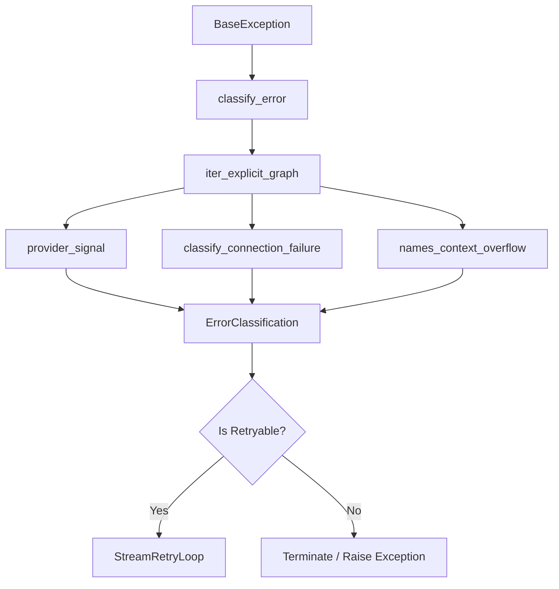

<!-- source: DeepWiki mcp.deepwiki.com · repo openJiuwen-ai/iCode · page 2.3 Error Classification and Retry · fetched 2026-11-02 -->

# Error Classification and Retry

<details>
<summary>Relevant source files</summary>

The following files were used as context for generating this wiki page:

- [docs/en/guides/configuration/compaction.md](docs/en/guides/configuration/compaction.md)
- [docs/zh-Hans/guides/configuration/compaction.md](docs/zh-Hans/guides/configuration/compaction.md)
- [src/chrys/foundation/errors/__init__.py](src/chrys/foundation/errors/__init__.py)
- [src/chrys/foundation/errors/classify.py](src/chrys/foundation/errors/classify.py)
- [src/chrys/foundation/errors/provider.py](src/chrys/foundation/errors/provider.py)
- [src/chrys/kernel/__init__.py](src/chrys/kernel/__init__.py)
- [src/chrys/kernel/compaction.py](src/chrys/kernel/compaction.py)
- [src/chrys/orchestration/invoker/attempts.py](src/chrys/orchestration/invoker/attempts.py)
- [src/chrys/service/agent_middleware/response_validation.py](src/chrys/service/agent_middleware/response_validation.py)
- [src/chrys/service/context/compaction/strategy.py](src/chrys/service/context/compaction/strategy.py)
- [src/chrys/service/llm/chat_completions/stream.py](src/chrys/service/llm/chat_completions/stream.py)
- [tests/foundation/errors/test_provider_signal.py](tests/foundation/errors/test_provider_signal.py)
- [tests/kernel/_fakes.py](tests/kernel/_fakes.py)
- [tests/kernel/test_loop_context_overflow_note.py](tests/kernel/test_loop_context_overflow_note.py)
- [tests/kernel/test_loop_stream_close.py](tests/kernel/test_loop_stream_close.py)
- [tests/orchestration/invoker/test_attempt_stream_close.py](tests/orchestration/invoker/test_attempt_stream_close.py)
- [tests/service/agent_middleware/test_response_validation_stream_close.py](tests/service/agent_middleware/test_response_validation_stream_close.py)
- [tests/service/context/compaction/test_context_overflow_note.py](tests/service/context/compaction/test_context_overflow_note.py)
- [tests/service/llm/test_openai_chat_stream_assembly.py](tests/service/llm/test_openai_chat_stream_assembly.py)

</details>


## Purpose and Scope
This page documents the unified error classification and retry subsystem in the `chrys` foundation layer (`src/chrys/foundation/errors/`) and its integration with the orchestration and kernel layers. The subsystem provides a single-pass error classifier (`classify_error`), a normalized provider signal extractor (`ProviderSignal`), a deterministic error taxonomy (`ErrorKind`), policy evaluation for retryability, context-overflow pattern detection, and continuation token lifecycle management during retries.

---

## 1. Error Taxonomy and `ErrorKind`

All low-level model responses, transport exceptions, HTTP status codes, and custom client exceptions are mapped into a unified enumeration of error categories called `ErrorKind`. This taxonomy abstracts vendor-specific error structures into actionable classes that steer the retry loop and user-facing notifications.

Key error kinds defined by the foundation layer include:
- `RATE_LIMITED`: Throttling or rate-limit violations (e.g., HTTP 429, `rate_limit_exceeded`).
- `OVERLOADED`: Server capacity overload or node resource exhaustion.
- `SERVER_ERROR`: Upstream gateway or provider server failures (HTTP 5xx).
- `QUOTA_EXHAUSTED`: Billing, quota, or balance exhaustion (non-retryable).
- `CONTEXT_OVERFLOW`: Exceeding the model's token context window.
- `PAYLOAD_TOO_LARGE`: Request payload or attachment too large for ingestion (HTTP 413).
- `AUTH_FAILED`: Invalid API keys, permission errors, or authentication rejections.
- `REQUEST_REJECTED`: Invalid request parameters, prompt structures, or malformed image URIs.
- `CONTENT_FILTERED`: Safety policy violations or content filters triggered.
- `STREAM_TRUNCATED`: Interrupted or incomplete stream deliveries without a proper stop sequence.

Sources: `[src/chrys/foundation/errors/kinds.py:1-45]`, `[src/chrys/foundation/errors/provider.py:40-91]()`

---

## 2. The One Error Classifier and `ProviderSignal`

The core invariant of the classification pipeline is that errors are classified **once** per exception graph via `classify_error(exc)` [src/chrys/foundation/errors/classify.py:3-11](). Stale exceptions left in `__context__` from prior requests are ignored by walking only the explicit graph (`iter_explicit_graph`) [src/chrys/foundation/errors/classify.py:147-151]().

```
+-------------------------------------------------------+
| Natural Language Space:                               |
| "rate limit exceeded", "exceeds the context window",  |
| HTTP 429, APIStatusError, ProviderResponseError       |
+---------------------------+---------------------------+
                            |
                            v
+-------------------------------------------------------+
| Code Entity Space:                                    |
| - classify_error(exc) -> ErrorClassification          |
| - provider_signal(explicit) -> ProviderSignal         |
| - ErrorKind taxonomy evaluation                       |
+-------------------------------------------------------+
```

### `ProviderSignal` Extraction
A `ProviderSignal` is extracted from the first SDK-shaped exception in walk order (such as `ProviderResponseError`, an object with an integer `status_code`, or a bare OpenAI/Anthropic error with a `body` and `code`) [src/chrys/foundation/errors/provider.py:3-11](). It normalizes:
- `status_code`: HTTP status code if present.
- `code`: Vendor-specific error string (e.g., `"insufficient_quota"`).
- `error_type`: Provider error classification type.
- `message`: Cleaned provider error message.
- `retry_after`: Parsed delay in seconds from `retry-after` headers [tests/foundation/errors/test_provider_signal.py:85-94]().

### Diagram: Error Classification Flow

Sources: `[src/chrys/foundation/errors/classify.py:147-171]`, `[src/chrys/foundation/errors/provider.py:3-12]`, `[src/chrys/foundation/errors/__init__.py:1-68]()`

---

## 3. Retryability and Transient Policies

Retry decisions balance transport resilience against terminal domain failures. Non-retryable error kinds—such as quota exhaustion (`QUOTA_EXHAUSTED`), context overflow (`CONTEXT_OVERFLOW`), and payload size limits (`PAYLOAD_TOO_LARGE`)—short-circuit retry loops immediately, regardless of transient settings [src/chrys/foundation/errors/classify.py:85-87]().

### Non-Retryable Provider Error Codes
Account quota and billing limits are strictly non-retryable because retrying the same request against an exhausted account will invariably fail [src/chrys/foundation/errors/provider.py:25-35]():
- `"insufficient_quota"`
- `"billing_hard_limit_reached"`
- `"exceeded_current_quota_error"`
- `"usage_not_included"`
- `_GLM_QUOTA_CODE` ("1113" on 402/429 responses) [src/chrys/foundation/errors/provider.py:36-38]()

### Retry Decision Logic
1. **Owner-Terminal Veto**: Full chain checks determine if a higher-level workflow canceled or vetoed the operation [src/chrys/foundation/errors/classify.py:157-160]().
2. **Explicit Signal**: If the provider signal supplies an explicit retryable override, it takes precedence [src/chrys/foundation/errors/classify.py:161-162]().
3. **Deterministic Network Failures**: Deterministic TCP/DNS connection failures are non-retryable at the request level, while transient drops trigger backoff [src/chrys/foundation/errors/classify.py:163-164]().
4. **Kind Blacklists**: Kinds in `_NON_RETRYABLE_KINDS` are forced non-retryable [src/chrys/foundation/errors/classify.py:165-168]().

Sources: `[src/chrys/foundation/errors/provider.py:25-35]`, `[src/chrys/foundation/errors/classify.py:147-171]()`

---

## 4. Context-Overflow Detection and Handling

Context overflows occur when input tokens exceed the model's supported context window. The subsystem detects overflows through two mechanisms: provider error codes and heuristic regex pattern matching across exception text.

### Detection Patterns
Provider error codes explicitly flagged as overflow include `context_length_exceeded` and `model_context_window_exceeded` [src/chrys/foundation/errors/provider.py:105](). Additionally, regex patterns scan error messages across multiple LLM vendors (OpenAI, Anthropic, Gemini, xAI, Groq, DeepSeek, Kimi, llama.cpp, LM Studio) for phrases such as:
- `"context window"` [src/chrys/foundation/errors/provider.py:111]()
- `"maximum context length"` [src/chrys/foundation/errors/provider.py:112]()
- `"prompt is too long"` [src/chrys/foundation/errors/provider.py:113]()
- `"input token count.*exceeds the maximum"` [src/chrys/foundation/errors/provider.py:116]()

### Veto Rules for Overflow
Throttling errors mentioning tokens (e.g., "Too many tokens per minute") are explicitly classified as rate limits rather than context overflows by checking `_NON_OVERFLOW_PHRASES` and `_NON_OVERFLOW_STATUS_CODES` (413, 429) [src/chrys/foundation/errors/provider.py:139-160]().

### Compaction Integration
When a model fills its context window mid-stream, `CONTEXT_WINDOW_FILLED_KEY` (`chrys_context_window_filled`) is set in response properties [src/chrys/kernel/compaction.py:106-110](). `raise_if_context_window_filled()` intercepts this and raises a non-retryable `ProviderResponseError`, signaling the compaction engine to summarize or trim conversation history before the next turn [src/chrys/kernel/compaction.py:113-124]() [docs/en/guides/configuration/compaction.md:13-16]().

Sources: `[src/chrys/foundation/errors/provider.py:105-160]`, `[src/chrys/kernel/compaction.py:106-124]`, `[docs/en/guides/configuration/compaction.md:1-42]()`

---

## 5. Continuation Tokens and State Resumption

When interacting with endpoints supporting background or session-based continuations (such as long-running stored responses), continuation tokens link retry attempts to the active server-side session.

### State Management in Retries
- **`has_live_continuation_token`**: Inspects run options to determine if an active background response handle is currently bound [src/chrys/orchestration/invoker/attempts.py:86-91]().
- **`drop_continuation_token`**: Clears stale tokens so a fresh request can be initiated if the continuation session expires or faults [src/chrys/orchestration/invoker/attempts.py:94-99]().
- **`continuation_token_observer_for`**: A callback mirror that captures kernel-emitted continuation tokens and injects them into retry-owned request options, ensuring transient polling failures resume the exact same server-side computation [src/chrys/orchestration/invoker/attempts.py:101-123]().

Sources: `[src/chrys/orchestration/invoker/attempts.py:86-123]()`

---

