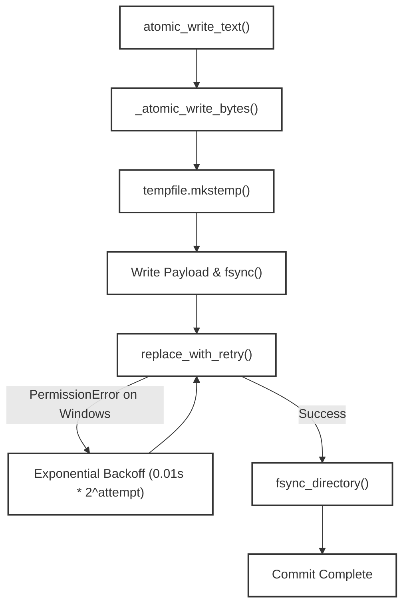
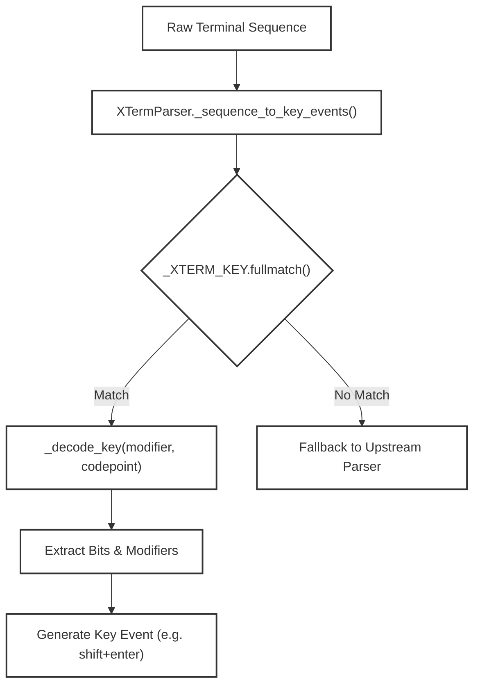
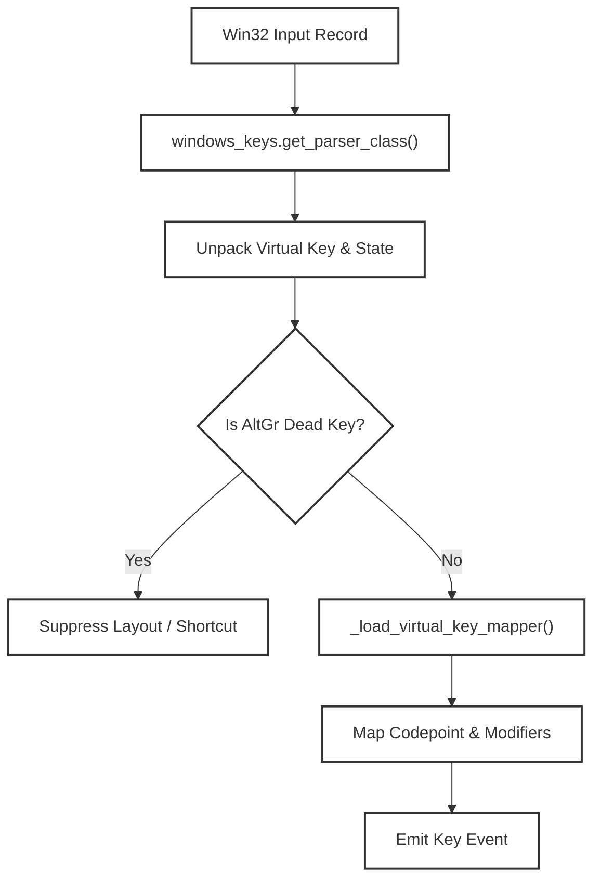

<!-- source: DeepWiki mcp.deepwiki.com · repo openJiuwen-ai/iCode · page 2.4 Platform, Patches and Utilities · fetched 2026-11-02 -->

# Platform, Patches and Utilities

Relevant source files

The following files were used as context for generating this wiki page:

- [src/chrys/app/tui/widgets/text_area.py](src/chrys/app/tui/widgets/text_area.py)
- [src/chrys/foundation/patches/patcher.py](src/chrys/foundation/patches/patcher.py)
- [src/chrys/foundation/patches/textual_extended_keys.py](src/chrys/foundation/patches/textual_extended_keys.py)
- [src/chrys/foundation/platform/files.py](src/chrys/foundation/platform/files.py)
- [src/chrys/service/approval/grant_store.py](src/chrys/service/approval/grant_store.py)
- [tests/app/tui/terminal/test_terminal_widget_input.py](tests/app/tui/terminal/test_terminal_widget_input.py)
- [tests/app/tui/widgets/editor/test_highlighter.py](tests/app/tui/widgets/editor/test_highlighter.py)
- [tests/app/tui/widgets/editor/test_keymap_pilots.py](tests/app/tui/widgets/editor/test_keymap_pilots.py)
- [tests/app/tui/widgets/test_file_scanner.py](tests/app/tui/widgets/test_file_scanner.py)
- [tests/app/tui/widgets/test_shift_enter_protocol.py](tests/app/tui/widgets/test_shift_enter_protocol.py)
- [tests/app/tui/widgets/test_text_area.py](tests/app/tui/widgets/test_text_area.py)
- [tests/conftest.py](tests/conftest.py)
- [tests/foundation/patches/test_patcher.py](tests/foundation/patches/test_patcher.py)
- [tests/foundation/patches/test_textual_extended_keys.py](tests/foundation/patches/test_textual_extended_keys.py)
- [tests/foundation/patches/test_textual_windows_keys.py](tests/foundation/patches/test_textual_windows_keys.py)
- [tests/foundation/platform/test_files.py](tests/foundation/platform/test_files.py)
- [tests/foundation/test_documentation.py](tests/foundation/test_documentation.py)
- [tests/service/agent_middleware/test_approval_reuse_review_regressions.py](tests/service/agent_middleware/test_approval_reuse_review_regressions.py)

## Purpose and Scope
This document covers the cross-cutting platform primitives, filesystem durability helpers, process management routines, Windows console adaptations, and third-party Textual framework patches (`src/chrys/foundation/platform/` and `src/chrys/foundation/patches/`). These modules provide the underlying OS abstraction layer ensuring reliable atomic storage, secure file permissions, cross-platform terminal keyboard mapping, and documentation loading across POSIX and Windows environments.

---

## 1. Filesystem Helpers and Secure Storage

The filesystem subsystem in `src/chrys/foundation/platform/files.py` provides cross-platform atomic write operations, robust file renaming with retry mechanisms for Windows file-locking behaviors, directory synchronization (`fsync`), and strict owner-only permission enforcement.

### Atomic Operations and Windows Retry Logic
Filesystem writes utilize temporary files in the same directory combined with atomic renames to prevent partial or corrupted states during crashes. On Windows, antivirus scanners, file indexers, and synchronization clients frequently hold short-lived locks on files, triggering `PermissionError` during replacement. To mitigate this, `replace_with_retry` implements an exponential backoff loop over up to 6 attempts [src/chrys/foundation/platform/files.py:135-154]().

*Figure 1: Atomic write and Windows rename retry control flow.*

Sources: `src/chrys/foundation/platform/files.py:135-194]()`, `tests/foundation/platform/test_files.py:40-64]()`

### Secure Owner-Only Storage
For sensitive files such as approval grants (`src/chrys/service/approval/grant_store.py`) and session state envelopes, chrys enforces strict owner-only permissions. The helpers `atomic_write_owner_only_bytes`, `atomic_write_owner_only_text`, and `secure_open_owner_only_binary` configure operating-system-specific security descriptors (POSIX file modes `0o600` and Windows discretionary access control lists) to block unauthorized local user access.

Sources: `src/chrys/foundation/platform/files.py:25-30]`, `src/chrys/service/approval/grant_store.py:34-85]()`

---

## 2. Textual Runtime Patches (Extended Keys and Windows Input)

Textual terminals often misinterpret modified text keys (such as `Shift+Enter`, `Ctrl+Enter`, or `modifyOtherKeys` sequences) or mangle non-ASCII and surrogate-bearing characters. The patches in `src/chrys/foundation/patches/` modify the Textual runtime in-place without patching upstream package files directly.

### Extended Key Decoding
`textual_extended_keys.py` intercepts xterm-compatible modified text keys matching the `CSI 27;modifier;codepoint ~` wire format before Textual's default parser processes them [src/chrys/foundation/patches/textual_extended_keys.py:42-108]().

*Figure 2: Interception and decoding flow in `textual_extended_keys.py`.*

Sources: `src/chrys/foundation/patches/textual_extended_keys.py:58-113]()`, `tests/foundation/patches/test_textual_extended_keys.py:26-85]()`

### Driver Mode Pairing and Lifecycle
The driver patch intercepts `Driver.write` and `Driver.close` to ensure that terminal keyboard enhancement modes (such as `modifyOtherKeys` level 2 and Kitty keyboard protocol modes) are properly paired with reset escape sequences upon application stop, suspension, or crash [src/chrys/foundation/patches/textual_extended_keys.py:115-153]().

Sources: `src/chrys/foundation/patches/textual_extended_keys.py:115-153]`, `tests/foundation/patches/test_textual_extended_keys.py:135-157]()`

---

## 3. Windows Console and Keyboard Adaptation

Windows terminal support is augmented by `textual_windows_keys.py`, which unpacks Win32 input mode records and maps virtual key codes against the active keyboard layout while respecting `AltGr` composition states.

*Figure 3: Win32 console keyboard record decoding pipeline.*

Sources: `src/chrys/foundation/patches/textual_windows_keys.py:1-150]`, `tests/foundation/patches/test_textual_windows_keys.py:35-113]()`

---

## 4. Documentation and Utility Loaders

Chrys includes internal documentation loaders and utility modules that aggregate Markdown guides and localization bundles for the TUI help system and offline distribution.

### Documentation Loader Architecture
Documentation files located under `docs/` are indexed and verified through tests in `tests/test_documentation.py`. These utilities ensure structural integrity, valid cross-references, and localized guide synchronization.

Sources: `tests/test_documentation.py:1-100]()`

---

