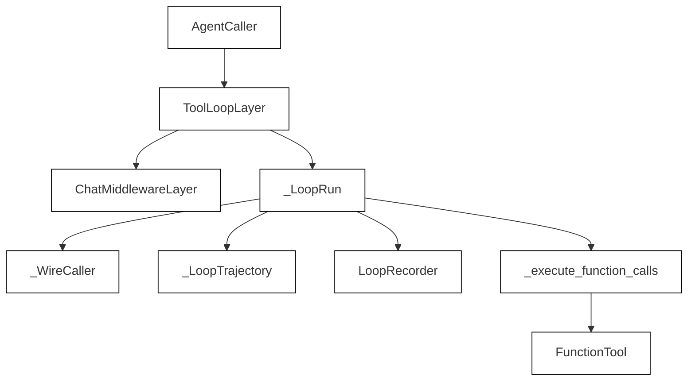
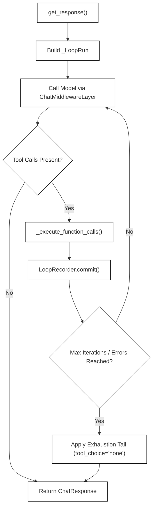
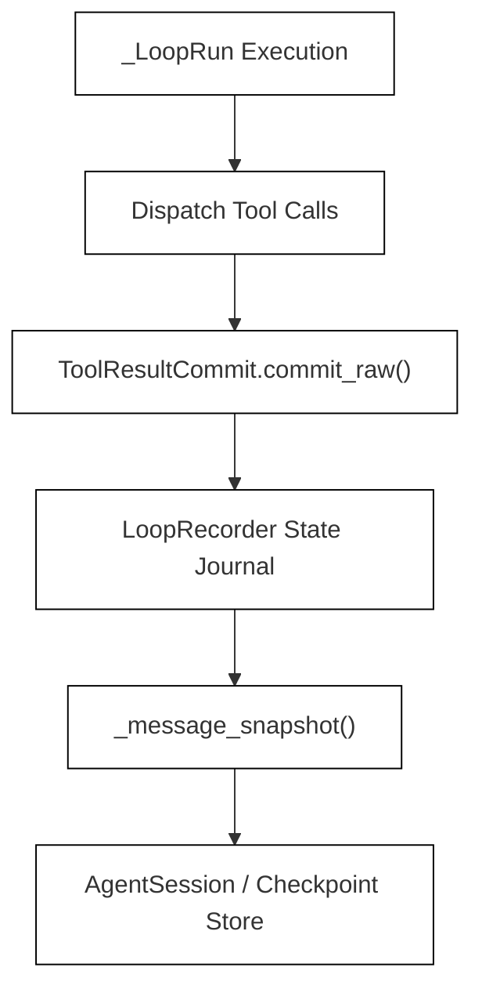

<!-- source: DeepWiki mcp.deepwiki.com · repo openJiuwen-ai/iCode · page 3.1 Loop and Agent Execution · fetched 2026-11-02 -->

# Loop and Agent Execution

Relevant source files

The following files were used as context for generating this wiki page:

- [src/chrys/kernel/_loop_recorder.py](src/chrys/kernel/_loop_recorder.py)
- [src/chrys/kernel/_tool_execution.py](src/chrys/kernel/_tool_execution.py)
- [src/chrys/kernel/agent.py](src/chrys/kernel/agent.py)
- [src/chrys/kernel/loop.py](src/chrys/kernel/loop.py)
- [tests/architecture/test_copy_freshness.py](tests/architecture/test_copy_freshness.py)
- [tests/kernel/test_agent.py](tests/kernel/test_agent.py)
- [tests/kernel/test_agent_service_handles.py](tests/kernel/test_agent_service_handles.py)
- [tests/kernel/test_loop.py](tests/kernel/test_loop.py)
- [tests/kernel/test_loop_argument_validation.py](tests/kernel/test_loop_argument_validation.py)
- [tests/kernel/test_loop_exhaustion_tail.py](tests/kernel/test_loop_exhaustion_tail.py)
- [tests/kernel/test_loop_invocation_order.py](tests/kernel/test_loop_invocation_order.py)
- [tests/kernel/test_loop_non_object_arguments.py](tests/kernel/test_loop_non_object_arguments.py)
- [tests/kernel/test_unexecuted_tool_operations.py](tests/kernel/test_unexecuted_tool_operations.py)

## Purpose and Scope

This document details the kernel-level loop execution architecture implemented in `src/chrys/kernel/loop.py`, `src/chrys/kernel/_loop_recorder.py`, and `src/chrys/kernel/_tool_execution.py`. It covers the model-tool iteration turn lifecycle, argument validation guarantees, tool invocation ordering and execution stamps, exhaustion-tail stripping, and the loop recorder's interrupt-recovery journaling.

Sources: `src/chrys/kernel/loop.py:1-21`, `src/chrys/kernel/_loop_recorder.py:1-30`, `src/chrys/kernel/_tool_execution.py:1-28`

---

## 1. Loop Architecture and Component Mapping

The kernel loop coordinates communication between agent chat middleware, provider wire clients, and tool execution engines. The primary entry point is `ToolLoopLayer`, which wraps chat middleware layers and invokes model calls through a structured retry runner (`_WireCaller`) and trajectory tracker (`_LoopTrajectory`).

### Diagram: Natural Language to Code Entity Space — Loop Subsystems

*Sources: `src/chrys/kernel/loop.py:7-13`, `src/chrys/kernel/client.py:1-50`, `tests/kernel/test_loop.py:135-194`*

---

## 2. Turn Lifecycle and Iteration Mechanics

`ToolLoopLayer.get_response()` initiates execution loops bounded by iteration limits and consecutive error budgets.

### Iteration Boundaries and Constants
* `DEFAULT_MAX_ITERATIONS = 40`: Maximum model-tool exchange rounds before an exhaustion tail is forced [src/chrys/kernel/loop.py:102].
* `DEFAULT_MAX_CONSECUTIVE_ERRORS = 3`: Consecutive tool failure budget before halting execution [src/chrys/kernel/loop.py:103].
* `CONTINUATION_POLL_INTERVAL_SECONDS = 2.0`: Interval between asynchronous continuation polls for background responses [src/chrys/kernel/loop.py:108].

### Turn Execution Flow

*Sources: `src/chrys/kernel/loop.py:7-18`, `src/chrys/kernel/loop.py:101-109`, `tests/kernel/test_loop.py:135-145`*

---

## 3. Argument Validation and Pre-pipeline Guards

Before tool execution reaches the middleware pipeline, `_execute_function_calls` and validation routines in `src/chrys/kernel/_tool_execution.py` validate argument structures.

### Key Validation Checks
* **Non-Object Validation**: Arguments that parse as primitive types, lists, or non-object JSON values are rejected with an `argument_parsing` error (`TOOL_ERROR_KIND_METADATA_KEY = "argument_parsing"`), preventing execution on unvalidated payloads [tests/kernel/test_loop_non_object_arguments.py:3-9].
* **Type Strictness**: Boolean-to-integer coercion violations (e.g., passing a boolean where an integer or literal is required) raise actionable argument errors prior to invoking `FunctionTool.invoke` [tests/kernel/test_loop_argument_validation.py:161-196].

Sources: `src/chrys/kernel/_tool_execution.py:119-148`, `tests/kernel/test_loop_non_object_arguments.py:1-111`

---

## 4. Invocation Order, Provenance, and Execution Stamps

The kernel loop acts as the sole authority for stamping call provenance and invocation ordinals.

* **Invocation Order**: Tracked using `TOOL_INVOCATION_ORDER_KEY` to sequence concurrent tool dispatches [chrys/foundation/tool_invocation_order.py:43].
* **Execution Stamps**: `EXECUTION_STAMP_KEY` records outcomes (`ok` or `error`) and error kinds on function metadata after middleware processing [tests/kernel/test_loop_invocation_order.py:60-78].
* **Provenance**: The loop injects static context and tool kinds (`TOOL_CALL_KIND_METADATA_KEY`) onto function call contents prior to pipeline entry [tests/kernel/test_loop_invocation_order.py:84-106].

Sources: `src/chrys/kernel/loop.py:42-43`, `tests/kernel/test_loop_invocation_order.py:1-78`, `src/chrys/kernel/_tool_execution.py:51-53`

---

## 5. Exhaustion Tails and Unexecutable Call Stripping

When iteration bounds or tool call limits are reached, the loop triggers an exhaustion tail by setting `tool_choice="none"` on the final model request.

### Stripping Mechanics
If a provider ignores `tool_choice="none"` and returns unexecutable function calls in the exhaustion tail, `_strip_unexecutable_calls_from_response` removes them from the transcript and replaces them with fallback text (e.g., `_MAX_ITERATIONS_FALLBACK_TEXT`) [src/chrys/kernel/loop.py:173-185]:

| Fallback Constant | Trigger Condition |
| :--- | :--- |
| `_MAX_ITERATIONS_FALLBACK_TEXT` | Reached `max_iterations` bound [src/chrys/kernel/loop.py:173] |
| `_CONSECUTIVE_ERRORS_FALLBACK_TEXT` | Reached consecutive tool error limit [src/chrys/kernel/loop.py:174] |
| `_MAX_FUNCTION_CALLS_FALLBACK_TEXT` | Reached maximum function calls quota [src/chrys/kernel/loop.py:177] |

Sources: `src/chrys/kernel/loop.py:173-185`, `tests/kernel/test_loop_exhaustion_tail.py:55-93`

---

## 6. The Loop Recorder and Interrupt Recovery

`LoopRecorder` in `src/chrys/kernel/_loop_recorder.py` maintains an interrupt-recovery journal. It captures message snapshots (`_message_snapshot`) and tool result commitments during active loops, allowing sessions to resume or rollback safely after cancellation or failures.

### Diagram: Loop Recorder and Journaling Flow

*Sources: `src/chrys/kernel/_loop_recorder.py:1-50`, `src/chrys/kernel/loop.py:12-13`, `tests/architecture/test_copy_freshness.py:73-81`*

---

