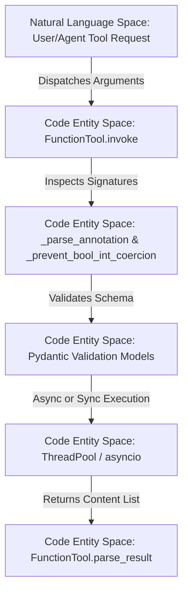
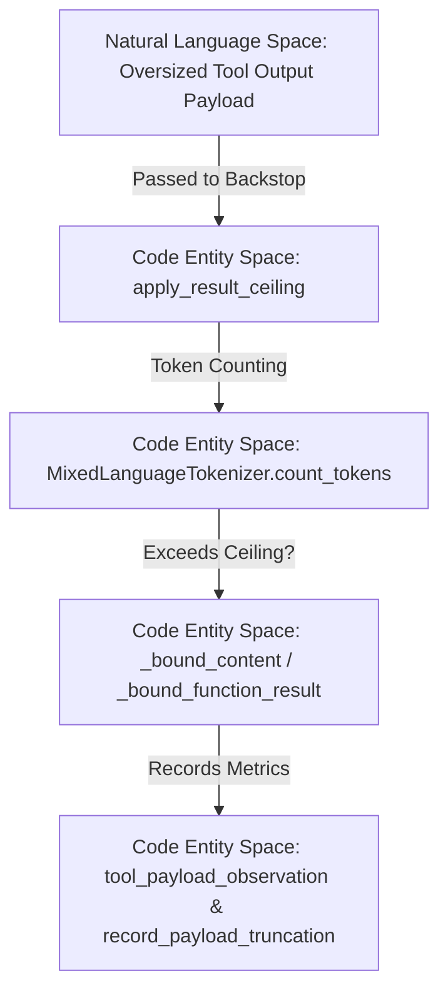
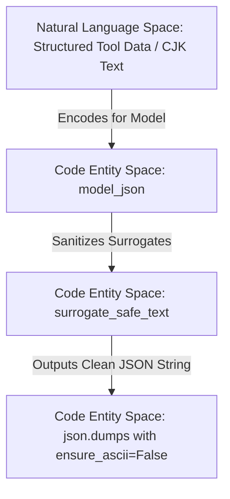

<!-- source: DeepWiki mcp.deepwiki.com · repo openJiuwen-ai/iCode · page 3.2 Tool Execution and Result Shaping · fetched 2026-11-02 -->

# Tool Execution and Result Shaping

<details>
<summary>Relevant source files</summary>

The following files were used as context for generating this wiki page:

- [src/chrys/foundation/io/result_content.py](src/chrys/foundation/io/result_content.py)
- [src/chrys/foundation/text/model_json.py](src/chrys/foundation/text/model_json.py)
- [src/chrys/foundation/trajectory/event_types.py](src/chrys/foundation/trajectory/event_types.py)
- [src/chrys/kernel/_content.py](src/chrys/kernel/_content.py)
- [src/chrys/kernel/_result_ceiling.py](src/chrys/kernel/_result_ceiling.py)
- [src/chrys/kernel/tools.py](src/chrys/kernel/tools.py)
- [src/chrys/service/agent_middleware/events/tool_events.py](src/chrys/service/agent_middleware/events/tool_events.py)
- [src/chrys/service/approval/judge.py](src/chrys/service/approval/judge.py)
- [src/chrys/service/llm/clients.py](src/chrys/service/llm/clients.py)
- [src/chrys/service/llm/openai_responses/history.py](src/chrys/service/llm/openai_responses/history.py)
- [src/chrys/service/llm/raw_http_log.py](src/chrys/service/llm/raw_http_log.py)
- [src/chrys/service/mutations/pipeline.py](src/chrys/service/mutations/pipeline.py)
- [tests/foundation/text/test_model_json.py](tests/foundation/text/test_model_json.py)
- [tests/kernel/test_result_ceiling.py](tests/kernel/test_result_ceiling.py)
- [tests/kernel/test_tools.py](tests/kernel/test_tools.py)

</details>


This page documents section 3.2 of the iCode architecture, focusing on the kernel's tool execution framework (`chrys.kernel.tools`), content normalization (`chrys.kernel._content`), token-budget result ceilings (`chrys.kernel._result_ceiling`), model-optimized JSON encoding (`chrys.foundation.text.model_json`), and result metadata handling.

---

## 1. FunctionTool Construction, Introspection, and Invocation

The `FunctionTool` class and the `@tool` decorator provide the core abstraction for exposing Python functions and schema-defined tools to agent execution loops [src/chrys/kernel/tools.py:70-76](). Unlike framework middleware, `FunctionTool.invoke` is kept lean, avoiding decorative logging while handling argument validation, type coercion prevention, context injection, and thread offloading for synchronous tools.

### Key Components and Mechanisms
* **The `@tool` Decorator**: Introspects Python function signatures, docstrings, and type hints to generate Pydantic validation models and JSON schemas [src/chrys/kernel/tools.py:70-76]().
* **Annotation Parsing**: String annotations are converted into Pydantic field descriptions [src/chrys/kernel/tools.py:141-155](). Boolean/integer coercions are strictly guarded to prevent Python's implicit `True == 1` type-casting bugs in `Literal` and integer fields [src/chrys/kernel/tools.py:158-190]().
* **Context Injection**: If a parameter is annotated with `FunctionInvocationContext`, the engine automatically injects the active invocation context [src/chrys/kernel/tools.py:127-139]().
* **Thread Offloading & Cancellation**: Synchronous functions executed within an async loop are offloaded to worker threads. If cancellation occurs immediately after completion, `SyncToolCancelledAfterCompletion` preserves the completed return value so the tool loop can journal it before cancellation unwinds [src/chrys/kernel/tools.py:82-96]().


*Sources: [src/chrys/kernel/tools.py:70-197](), [tests/kernel/test_tools.py:114-191]()*

---

## 2. Content Normalization and Parsing

Tool outputs can originate from diverse sources, including native Python strings, structured JSON dictionaries, MCP (Model Context Protocol) tool outputs, and foreign `Content` objects. The kernel normalizes these heterogeneous results into a unified sequence of `Content` primitives via `normalize_tools()` and `FunctionTool.parse_result()` [src/chrys/kernel/tools.py:75](), [src/chrys/kernel/_content.py:35-59]().

### Normalization Pipeline
1. **Unwrapping Sequences**: Incoming results (such as lists or tuples) are walked recursively to extract underlying items [src/chrys/foundation/io/result_content.py:46-55]().
2. **Foreign Content Adaptation**: Objects implementing `to_dict()` (such as MCP result residues) are converted into standard `Content` instances [tests/kernel/test_tools.py:93-102]().
3. **Fallback Diagnostics**: Unrecognized shapes or objects lacking standard text-bearing attributes (`text`, `result`, `output`, `message`) trigger a warning log and format an error string prefixed with `Error: ` so that failures propagate visibly to the LLM and TUI rather than masquerading as successful results [src/chrys/foundation/io/result_content.py:68-117]().

```mermaid
graph TD
    sub1[""Natural Language Space: Raw Tool Execution Output""] -->|"Parsed by Kernel"| sub2[""Code Entity Space: normalize_tools & FunctionTool.parse_result""]
    sub2 -->|"Checks Types"| sub3[""Code Entity Space: _parse_content_list""]
    sub3 -->|"String / Dict / Foreign Object"| sub4[""Code Entity Space: Content.from_dict / Content.from_text""]
    sub4 -->|"Unified Output Sequence"| sub5[""Code Entity Space: list[Content]""]
```
*Sources: [src/chrys/kernel/tools.py:70-76](), [src/chrys/kernel/_content.py:35-60](), [src/chrys/foundation/io/result_content.py:23-128]()*

---

## 3. Result Ceilings and Bounding

To protect LLM context windows from memory exhaustion caused by oversized tool outputs (e.g., massive log files or database dumps), the kernel applies an idempotent result ceiling via `apply_result_ceiling()` [src/chrys/kernel/_result_ceiling.py:177-181]().

### Bounding Logic
* **Token-Budget Enforcement**: Utilizes `MixedLanguageTokenizer` to measure exact token counts across text fields (`text`, `result`, `output`, `message`, `stdout`, `stderr`, `exception`) [src/chrys/kernel/_result_ceiling.py:11-22]().
* **Idempotency and Safety**: If a result exceeds the configured token ceiling, it is truncated using `truncate_output` or `truncate_content_texts`, appending a truncation notice while preserving non-text components (such as binary image attachments) in their original positions [src/chrys/kernel/_result_ceiling.py:54-78]().
* **Exception Preservation**: Truncation algorithms ensure that explicit error exceptions are never completely erased, carving out a dedicated token budget before trimming standard output text [src/chrys/kernel/_result_ceiling.py:81-98]().
* **Telemetry Observation**: Payload truncations are recorded via `tool_payload_observation` context variables, feeding telemetry data directly into trajectory event pipelines [src/chrys/kernel/_result_ceiling.py:113-121]().


*Sources: [src/chrys/kernel/_result_ceiling.py:1-181](), [tests/kernel/test_result_ceiling.py:1-163]()*

---

## 4. Model JSON Encoding and Metadata

When data structures, dictionary arguments, or structured outputs are serialized for the LLM to read, standard Python `json.dumps` behavior (which escapes non-ASCII characters like CJK symbols or emojis into `\uXXXX` sequences) creates unnecessary token overhead and reduces readability [src/chrys/foundation/text/model_json.py:14-25]().

### Model-Optimized Serialization
* **`model_json()` Function**: Wraps `json.dumps` with `ensure_ascii=False`, keeping multi-byte natural languages and emojis unescaped [src/chrys/foundation/text/model_json.py:14-25]().
* **Surrogate Safety**: Employs `surrogate_safe_text` to handle lone high/low surrogate characters safely, ensuring valid UTF-8 encoding without crashing serialization on malformed string data [src/chrys/foundation/text/model_json.py:11-25](), [tests/foundation/text/test_model_json.py:16-24]().
* **Result Metadata**: Metadata keys associated with tool outcomes (such as error classifications, execution stamps, and sub-agent attribution IDs) are injected into the result context before being committed to invocation histories [src/chrys/service/agent_middleware/events/tool_events.py:25-30]().


*Sources: [src/chrys/foundation/text/model_json.py:1-25](), [tests/foundation/text/test_model_json.py:1-27]()*

---
Sources: [src/chrys/kernel/tools.py:1-197](), [src/chrys/kernel/_content.py:1-188](), [src/chrys/kernel/_result_ceiling.py:1-181](), [src/chrys/foundation/text/model_json.py:1-25](), [src/chrys/foundation/io/result_content.py:1-161](), [tests/kernel/test_tools.py:1-191](), [tests/kernel/test_result_ceiling.py:1-163](), [tests/foundation/text/test_model_json.py:1-27]()

---

