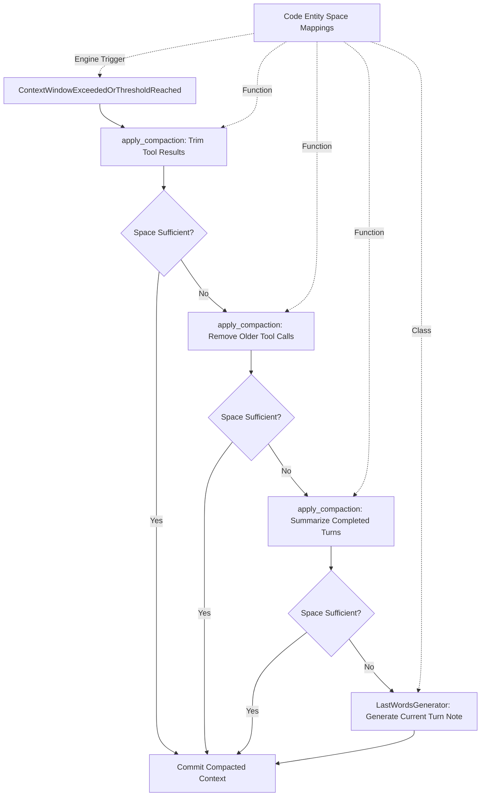
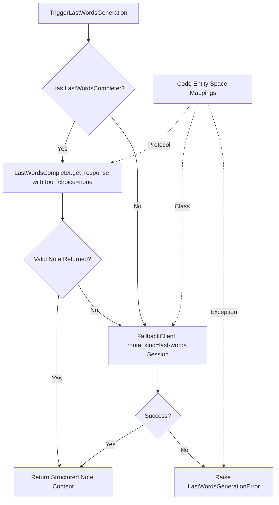

<!-- source: DeepWiki mcp.deepwiki.com · repo openJiuwen-ai/iCode · page 3.3 Context Compaction · fetched 2026-11-02 -->

# Context Compaction

Relevant source files

The following files were used as context for generating this wiki page:

- [docs/en/guides/configuration/chat-options.md](docs/en/guides/configuration/chat-options.md)
- [docs/en/guides/configuration/compaction.md](docs/en/guides/configuration/compaction.md)
- [docs/zh-Hans/guides/configuration/chat-options.md](docs/zh-Hans/guides/configuration/chat-options.md)
- [docs/zh-Hans/guides/configuration/compaction.md](docs/zh-Hans/guides/configuration/compaction.md)
- [src/chrys/app/tui/screens/models/screen.py](src/chrys/app/tui/screens/models/screen.py)
- [src/chrys/foundation/errors/__init__.py](src/chrys/foundation/errors/__init__.py)
- [src/chrys/kernel/__init__.py](src/chrys/kernel/__init__.py)
- [src/chrys/kernel/client.py](src/chrys/kernel/client.py)
- [src/chrys/kernel/compaction.py](src/chrys/kernel/compaction.py)
- [src/chrys/service/context/compaction/last_words.py](src/chrys/service/context/compaction/last_words.py)
- [src/chrys/service/context/compaction/strategy.py](src/chrys/service/context/compaction/strategy.py)
- [src/chrys/service/profiles/models/schema.py](src/chrys/service/profiles/models/schema.py)
- [tests/app/tui/screens/test_model_config.py](tests/app/tui/screens/test_model_config.py)
- [tests/foundation/i18n/test_catalogs.py](tests/foundation/i18n/test_catalogs.py)
- [tests/foundation/i18n/test_localizer.py](tests/foundation/i18n/test_localizer.py)
- [tests/kernel/_fakes.py](tests/kernel/_fakes.py)
- [tests/kernel/test_client_last_words_completer.py](tests/kernel/test_client_last_words_completer.py)
- [tests/kernel/test_loop_context_overflow_note.py](tests/kernel/test_loop_context_overflow_note.py)
- [tests/orchestration/engine/build/test_agent_builder_rollback.py](tests/orchestration/engine/build/test_agent_builder_rollback.py)
- [tests/orchestration/engine/state/test_current_agent.py](tests/orchestration/engine/state/test_current_agent.py)
- [tests/orchestration/engine/test_settings_reload.py](tests/orchestration/engine/test_settings_reload.py)
- [tests/orchestration/engine/test_shutdown_close.py](tests/orchestration/engine/test_shutdown_close.py)
- [tests/orchestration/sub_agents/test_client.py](tests/orchestration/sub_agents/test_client.py)
- [tests/service/context/compaction/test_context_overflow_note.py](tests/service/context/compaction/test_context_overflow_note.py)
- [tests/service/context/compaction/test_last_words.py](tests/service/context/compaction/test_last_words.py)
- [tests/service/context/compaction/test_last_words_completer.py](tests/service/context/compaction/test_last_words_completer.py)
- [tests/service/context/compaction/test_last_words_fallback.py](tests/service/context/compaction/test_last_words_fallback.py)
- [tests/service/llm/test_failed_response_usage.py](tests/service/llm/test_failed_response_usage.py)
- [tests/service/mcp/test_cache.py](tests/service/mcp/test_cache.py)
- [tests/service/mcp/test_cache_e2e.py](tests/service/mcp/test_cache_e2e.py)
- [tests/service/profiles/models/test_serializer.py](tests/service/profiles/models/test_serializer.py)

## Purpose and Scope
This page documents the context compaction subsystem within the `iCode` kernel and service layers (`chrys`). It details the token compaction strategy and multi-phase reduction ladder, the `LastWordsCompleter` side-call infrastructure used to summarize dropped turn timelines, context overflow detection and guard rails, and the `UsageTrackingMiddleware` token accounting system.

Sources: `src/chrys/kernel/compaction.py`, `src/chrys/service/context/compaction/last_words.py`, `src/chrys/service/context/middleware/usage.py`

---

## 1. Compaction Strategy and the Reduction Ladder

When a conversation approaches a model's context window limit, the kernel executes a structured reduction algorithm via `apply_compaction` [src/chrys/kernel/__init__.py:53](). Compaction operates on message groups annotated with metadata keys such as `GROUP_ANNOTATION_KEY`, `EXCLUDED_KEY`, and `GROUP_TOKEN_COUNT_KEY` [src/chrys/kernel/compaction.py:54-66]().

The compaction pipeline follows a strict multi-phase ladder:
1. **Tool Result Trimming**: Summarizes older tool results in place to reduce payload volume.
2. **Tool Call Removal**: Drops older tool calls and their associated results from the active payload.
3. **Turn Summarization**: Replaces completed historical turns with structured compaction summaries (`SUMMARY_OF_MESSAGE_IDS_KEY`, `SUMMARY_OF_GROUP_IDS_KEY`) [src/chrys/kernel/compaction.py:68-69]().
4. **Last Words Extraction**: When the current turn must be compressed, it generates a synthesized progress note (`LastWordsGenerator`) and injects it into a system reminder block, stripping intermediate tool calls and assistant text.

Sources: `src/chrys/kernel/compaction.py`, `docs/en/guides/configuration/compaction.md`

---

## 2. Last-Words Completer and Generation

The `LastWordsGenerator` class manages the generation of summary notes when Phase 4 compaction drops uncompleted turn elements [src/chrys/service/context/compaction/last_words.py:69](). 

### Primary Path: Natural-Completion Side Call
The primary generation mechanism uses the client-owned protocol `LastWordsCompleter` [src/chrys/kernel/compaction.py:161-167](). 
- Sends only the current turn's validated group timeline plus a structured guidance instruction message [src/chrys/service/context/compaction/last_words.py:10-15]().
- Runs inside an `internal_side_call_scope()` to prevent telemetry and stream response publishers from treating the throwaway note as part of the live conversation [src/chrys/kernel/compaction.py:137-153]().
- Forces `tool_choice="none"` and wraps instructions in a triple no-tools directive to prevent the model from emitting function call blocks instead of prose notes [src/chrys/service/context/compaction/last_words.py:10-15]().

### Fallback Path: Reconstruction Prompt
If the completer is absent, rejects the side call due to context window sizing, or exhausts its local retry budget (`_COMPLETER_MAX_RETRIES = 2`), the generator falls back to a fresh two-message reconstruction session (`route_kind="last-words"`) [src/chrys/service/context/compaction/last_words.py:16-22, 91]().

Sources: `src/chrys/kernel/compaction.py`, `src/chrys/service/context/compaction/last_words.py`

---

## 3. Context Overflow Notes and Guard Rails

When a provider returns a context window exhaustion error during a compaction side call or normal turn execution, the kernel enforces strict invariants to prevent infinite failure loops.

- **Context Window Filled Key**: `CONTEXT_WINDOW_FILLED_KEY` is set in `additional_properties` when a model fills its context window mid-generation [src/chrys/kernel/compaction.py:110-112]().
- **Validation Guard**: `raise_if_context_window_filled()` inspects chat responses and immediately raises a non-retryable `ProviderResponseError` if the note or message was truncated due to context exhaustion [src/chrys/kernel/compaction.py:113-123]().
- **Error Classification**: `may_be_context_overflow()` in `chrys.foundation.errors` analyzes provider error signals and status codes to determine whether to trigger automatic history compaction or fail the operation [src/chrys/foundation/errors/__init__.py:25]().

Sources: `src/chrys/kernel/compaction.py`, `src/chrys/ foundation/errors/__init__.py`

---

## 4. Usage Middleware and Token Accounting

Token usage incurred during both live conversation turns and internal compaction side calls is tracked centrally via the middleware pipeline.

- **UsageTrackingMiddleware**: Intercepts chat response cycles to capture token counts (`input_tokens`, `output_tokens`, `total_tokens`) [tests/service/llm/test_failed_response_usage.py:35, 140-141]().
- **Side-Call Accounting**: `LastWordsGenerator` accepts a `report_usage` callback hook (`_report_side_call_usage()`) that forwards token consumption from auxiliary side calls to the application's token usage panel, even when side-call generation encounters recoverable errors or refutations [tests/context/compaction/test_last_words_completer.py:88-158]().

Sources: `tests/service/llm/test_failed_response_usage.py`, `tests/service/context/compaction/test_last_words_completer.py`

---

