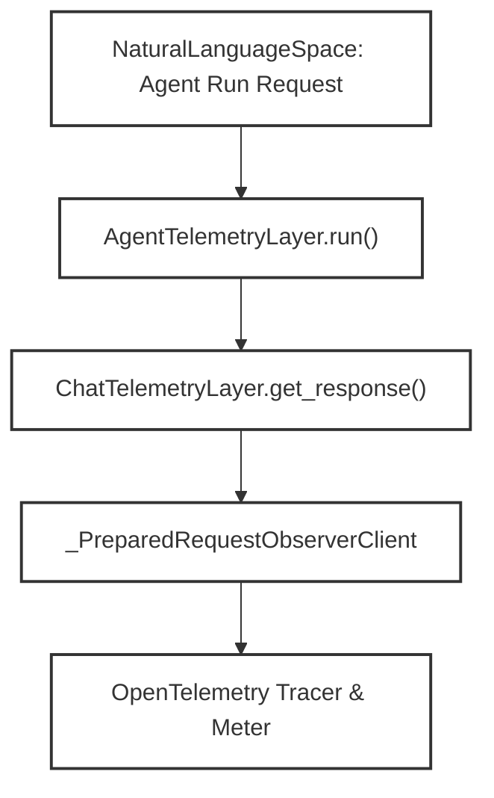
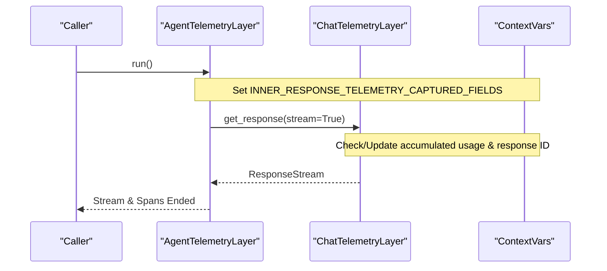
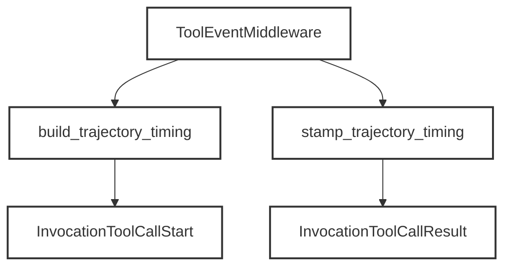

<!-- source: DeepWiki mcp.deepwiki.com · repo openJiuwen-ai/iCode · page 3.4 Kernel Telemetry and Instrumentation · fetched 2026-11-02 -->

# Kernel Telemetry and Instrumentation

Relevant source files

The following files were used as context for generating this wiki page:

- [src/chrys/foundation/trajectory/event_types.py](src/chrys/foundation/trajectory/event_types.py)
- [src/chrys/kernel/instrumentation.py](src/chrys/kernel/instrumentation.py)
- [src/chrys/service/agent_middleware/events/tool_events.py](src/chrys/service/agent_middleware/events/tool_events.py)
- [src/chrys/service/llm/clients.py](src/chrys/service/llm/clients.py)
- [src/chrys/service/llm/raw_http_log.py](src/chrys/service/llm/raw_http_log.py)
- [src/chrys/service/mutations/pipeline.py](src/chrys/service/mutations/pipeline.py)
- [tests/kernel/test_telemetry.py](tests/kernel/test_telemetry.py)

This page covers the kernel telemetry and instrumentation subsystem of `iCode` (`chrys`), focusing on OpenTelemetry span generation, metric collection via `src/chrys/kernel/instrumentation.py` [src/chrys/kernel/instrumentation.py:1-1618](), and trajectory timing stamps that track execution flow and durations.

---

## 1. OpenTelemetry Architecture and Seams

The telemetry infrastructure relies on two primary wrapper layers: `ChatTelemetryLayer` and `AgentTelemetryLayer`. Both layers interact with the foundation-owned `TELEMETRY_GATE` (which defaults to disabled) to control overhead and capture semantic GenAI spans and metrics [src/chrys/kernel/instrumentation.py:5-10]().

The tracer and meter scope name is hardcoded to `chrys` with the package version `__version__` [src/chrys/kernel/instrumentation.py:133-134](). Agent spans inherit provider names from the host's `AGENT_PROVIDER_NAME` class variable, while chat spans use the underlying model provider's name [src/chrys/kernel/instrumentation.py:20-22]().

*Figure 1: Telemetry invocation hierarchy bridging request flow to OpenTelemetry wrappers.*

**Sources:**
- `src/chrys/kernel/instrumentation.py:1-56`
- `tests/kernel/test_telemetry.py:1-48`

---

## 2. ContextVars, Deduping, and Streaming Activation

To prevent double-counting usage statistics and response identifiers across nested agent and inner chat calls, telemetry uses explicit `ContextVar` channels [src/chrys/kernel/instrumentation.py:137-147]():

- `INNER_RESPONSE_TELEMETRY_CAPTURED_FIELDS`: A context variable tracking captured fields like `response_id` [src/chrys/kernel/instrumentation.py:140-143]().
- `INNER_ACCUMULATED_USAGE`: Tracks cumulative token usage across inner exchanges [src/chrys/kernel/instrumentation.py:145-146]().

For non-streaming calls, deduplication ContextVars are set and reset inside the returned coroutine to ensure that task execution boundaries do not improperly reset tokens [src/chrys/kernel/instrumentation.py:11-13](). For streaming spans, activation occurs around each pull, and cleanup closes the span before resetting ContextVars [src/chrys/kernel/instrumentation.py:13-16]().

*Figure 2: ContextVar lifecycle and span management during streaming agent runs.*

**Sources:**
- `src/chrys/kernel/instrumentation.py:11-16`, `src/chrys/kernel/instrumentation.py:137-147`

---

## 3. Metrics, Histograms, and Attribute Taxonomies

OpenTelemetry attribute keys and metric names are defined via the `OtelAttr` string enum class [src/chrys/kernel/instrumentation.py:184-192](). These include standard GenAI semantic conventions such as `gen_ai.operation.name` and `gen_ai.provider.name` [src/chrys/kernel/instrumentation.py:187-188]().

Histograms for token usage and operation duration utilize explicit bucket boundaries defined as constants [src/chrys/kernel/instrumentation.py:149-181]():
- `TOKEN_USAGE_BUCKET_BOUNDARIES`: Ranging from `1` up to `67,108,864` tokens [src/chrys/kernel/instrumentation.py:150-165]().
- `OPERATION_DURATION_BUCKET_BOUNDARIES`: Ranging from `0.01` to `81.92` seconds [src/chrys/kernel/instrumentation.py:166-181]().

Per-tool duration metrics and function-name attributes use the `chrys.function.*` namespace [src/chrys/kernel/instrumentation.py:24-26]().

**Sources:**
- `src/chrys/kernel/instrumentation.py:149-192`

---

## 4. Trajectory Timing Stamps and Event Integration

Execution flows and operation boundaries emit structured events defined in `EventType` (`src/chrys/foundation/trajectory/event_types.py`) [src/chrys/foundation/trajectory/event_types.py:18-98](). 

Tool executions and middleware integrate timing stamps (`build_trajectory_timing`, `stamp_trajectory_timing`) to capture precise execution intervals [src/chrys/service/agent_middleware/events/tool_events.py:33](). These timing records accompany tool operation traces and outcome metadata through the event bus.

*Figure 3: Trajectory timing stamp emission during tool middleware execution.*

**Sources:**
- `src/chrys/foundation/trajectory/event_types.py:18-98`
- `src/chrys/service/agent_middleware/events/tool_events.py:7-35`

---

