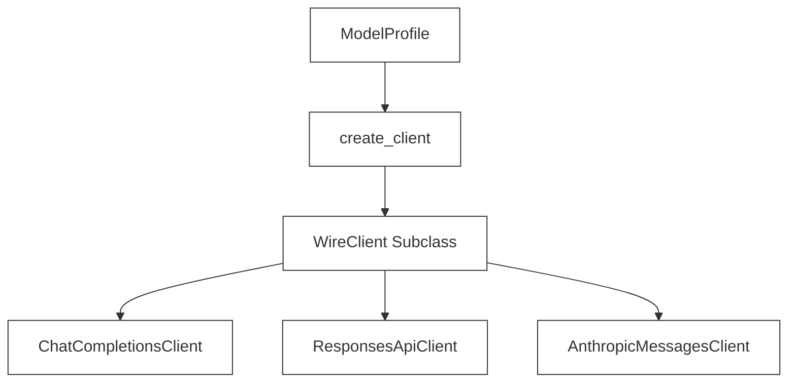
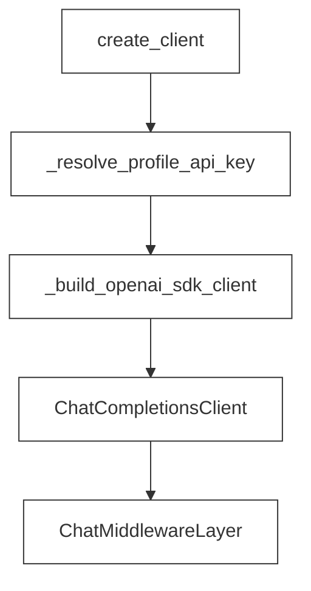

<!-- source: DeepWiki mcp.deepwiki.com · repo openJiuwen-ai/iCode · page 4.1 Wire Clients and Client Factory · fetched 2026-11-02 -->

# Wire Clients and Client Factory

Relevant source files

The following files were used as context for generating this wiki page:

- [src/chrys/service/llm/anthropic_messages/request.py](src/chrys/service/llm/anthropic_messages/request.py)
- [src/chrys/service/llm/chat_completions/client.py](src/chrys/service/llm/chat_completions/client.py)
- [src/chrys/service/llm/openai_responses/client.py](src/chrys/service/llm/openai_responses/client.py)
- [src/chrys/service/llm/openai_responses/request.py](src/chrys/service/llm/openai_responses/request.py)
- [src/chrys/service/llm/sdk_anthropic.py](src/chrys/service/llm/sdk_anthropic.py)
- [src/chrys/service/llm/sdk_headers.py](src/chrys/service/llm/sdk_headers.py)
- [src/chrys/service/llm/sdk_openai.py](src/chrys/service/llm/sdk_openai.py)
- [src/chrys/service/llm/sdk_retry.py](src/chrys/service/llm/sdk_retry.py)
- [tests/foundation/errors/_corpus.py](tests/foundation/errors/_corpus.py)
- [tests/foundation/test_errors.py](tests/foundation/test_errors.py)
- [tests/foundation/test_is_retryable.py](tests/foundation/test_is_retryable.py)
- [tests/integration/engine/test_stateless_store_option.py](tests/integration/engine/test_stateless_store_option.py)
- [tests/kernel/test_wire_retry.py](tests/kernel/test_wire_retry.py)
- [tests/service/llm/test_client_contracts.py](tests/service/llm/test_client_contracts.py)
- [tests/service/llm/test_clients_factory.py](tests/service/llm/test_clients_factory.py)
- [tests/service/llm/test_codec_shared_mappings.py](tests/service/llm/test_codec_shared_mappings.py)

Purpose and Scope: This section details the LLM Service Layer wire client architecture in `iCode` (`chrys`), covering the `WireClient` base contract, provider-specific SDK guards (`sdk_openai` and `sdk_anthropic`), header management, error retry policies, client behavior contracts, and the factory subsystem (`create_client`) that instantiates execution stacks from model profiles.

---

## 1. The `WireClient` Base Contract

All LLM provider interactions inherit from the abstract `WireClient` base class, which defines core service properties, telemetry traits, and transport interception mechanisms. Implementations such as `ChatCompletionsClient` [src/chrys/service/llm/chat_completions/client.py:124-129](), `ResponsesApiClient` [src/chrys/service/llm/openai_responses/client.py:88-93](), and Anthropic clients encapsulate underlying SDK connections.

Key class attributes exposed by wire clients include:
- `OTEL_PROVIDER_NAME`: Identifies the OpenTelemetry instrumentation group (e.g., `"openai"`, `"anthropic"`).
- `STORES_BY_DEFAULT`: Boolean flag indicating whether conversation turns are persisted by the provider service by default.
- `FORCES_STATELESS`: Boolean flag enforcing stateless requests.
- `MIN_OUTPUT_CAP_TOKENS`: Integer defining the minimum output token threshold.

Client traits are queried by the execution stack and validated during engine contract testing [tests/service/llm/test_client_contracts.py:131-160]().

*Figure 1: Natural Language to Code Entity mapping for wire client inheritance.*

Sources: `src/chrys/service/llm/chat_completions/client.py:124-161]`, `src/chrys/service/llm/openai_responses/client.py:88-147]`, `tests/service/llm/test_client_contracts.py:131-160]`

---

## 2. Provider SDK Integrations and Guard Classes

To ensure robust communication and avoid duplicate headers or invalid retries, `iCode` wraps third-party provider SDKs (`AsyncOpenAI` and `AsyncAnthropic`) with mixin classes.

- `RetryGuardedAsyncOpenAI`: Combines `DeterministicConnectionSleepGuard`, `CaseFoldedDefaultHeaders`, and `AsyncOpenAI` [src/chrys/service/llm/sdk_openai.py:17-18]().
- `RetryGuardedAsyncAnthropic`: Combines `DeterministicConnectionDecisionGuard`, `CaseFoldedDefaultHeaders`, and `AsyncAnthropic` [src/chrys/service/llm/sdk_anthropic.py:17-18]().
- `CaseFoldedDefaultHeaders`: Implements header normalization in `src/chrys/service/llm/sdk_headers.py` to prevent case duplication over HTTP transports.

Sources: `src/chrys/service/llm/sdk_openai.py:1-19]`, `src/chrys/service/llm/sdk_anthropic.py:1-19]`, `src/chrys/service/llm/sdk_headers.py`

---

## 3. The Client Factory and Stack Construction

The entry point for generating operational LLM connections is `create_client`, defined in `src/chrys/service/llm/clients.py` [tests/service/llm/test_clients_factory.py:34-42](). It resolves profile configurations, environment variable overrides (such as API keys and base URLs), initializes the appropriate provider SDK client via helpers like `_build_openai_sdk_client` and `_build_anthropic_sdk_client`, and wraps the resulting `WireClient` in middleware layers (such as `ChatMiddlewareLayer` and `ToolLoopLayer`).

*Figure 2: Execution flow of client stack assembly.*

Sources: `tests/service/llm/test_clients_factory.py:34-42]`, `src/chrys/service/llm/clients.py`

---

## 4. Headers, Request Attempt IDs, and Retries

Wire calls inject tracking metadata including `Chrys-Request-Attempt-Id`, session identifiers (`SESSION_ID_HEADER`, `PARENT_SESSION_ID_HEADER`), and model identifiers (`MODEL_ID_HEADER`) [tests/service/llm/test_clients_factory.py:22-28](). 

Retry policies differentiate between transient network faults (which trigger backoff and re-attempt logic) and deterministic client-side or validation errors (such as malformed payloads or unrecoverable authentication failures) handled by `DeterministicConnectionSleepGuard` and `DeterministicConnectionDecisionGuard`.

Sources: `src/chrys/service/llm/sdk_retry.py]`, `tests/service/llm/test_client_contracts.py:1-178]`

---

