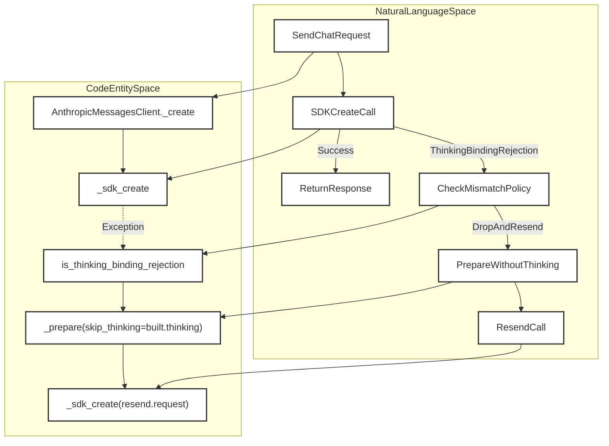
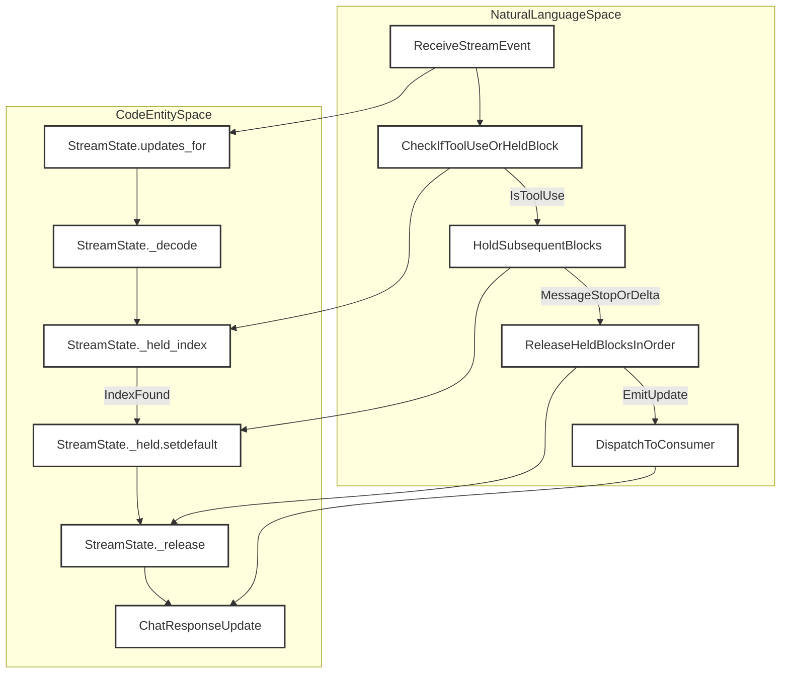

<!-- source: DeepWiki mcp.deepwiki.com · repo openJiuwen-ai/iCode · page 4.3 Anthropic Messages Codec · fetched 2026-11-02 -->

# Anthropic Messages Codec

Relevant source files

The following files were used as context for generating this wiki page:

- [src/chrys/service/llm/anthropic_messages/client.py](src/chrys/service/llm/anthropic_messages/client.py)
- [src/chrys/service/llm/anthropic_messages/decode.py](src/chrys/service/llm/anthropic_messages/decode.py)
- [src/chrys/service/llm/anthropic_messages/history.py](src/chrys/service/llm/anthropic_messages/history.py)
- [src/chrys/service/llm/anthropic_messages/stream.py](src/chrys/service/llm/anthropic_messages/stream.py)
- [tests/service/llm/test_anthropic_citations.py](tests/service/llm/test_anthropic_citations.py)
- [tests/service/llm/test_anthropic_finish_reason.py](tests/service/llm/test_anthropic_finish_reason.py)
- [tests/service/llm/test_anthropic_hosted_normalization.py](tests/service/llm/test_anthropic_hosted_normalization.py)
- [tests/service/llm/test_anthropic_stream_errors.py](tests/service/llm/test_anthropic_stream_errors.py)
- [tests/service/llm/test_anthropic_streaming.py](tests/service/llm/test_anthropic_streaming.py)
- [tests/service/llm/test_anthropic_thinking_binding.py](tests/service/llm/test_anthropic_thinking_binding.py)
- [tests/service/llm/test_anthropic_thinking_replay.py](tests/service/llm/test_anthropic_thinking_replay.py)
- [tests/service/llm/test_codec_compat_repairs.py](tests/service/llm/test_codec_compat_repairs.py)
- [tests/support/wire_cases/_kit.py](tests/support/wire_cases/_kit.py)

## Purpose and Scope

This page documents the Anthropic Messages API codec layer in `chrys`, which handles interactions with Anthropic's provider models (via direct SDK, Bedrock, Foundry, or Vertex). It covers wire client encapsulation, history normalization, thinking block preservation and repair policies, response decoding (including citations and stop reasons), and real-time streaming assembly via `StreamState`.

Sources: `[src/chrys/service/llm/anthropic_messages/client.py:5-14]`, `[src/chrys/service/llm/anthropic_messages/history.py:5-21]`, `[src/chrys/service/llm/anthropic_messages/decode.py:5-10]`, `[src/chrys/service/llm/anthropic_messages/stream.py:5-22]()`.

---

## 1. Anthropic Client and Request Lifecycle

The wire client implementation is centered on `AnthropicMessagesClient`, defined in `[src/chrys/service/llm/anthropic_messages/client.py:51-101]`. It extends `WireClient` and forces stateless operation (`FORCES_STATELESS = True`), as the Anthropic Messages API does not maintain server-side conversation states.

When a request encounters an error where replayed thinking blocks are rejected due to binding to a different conversation (`is_thinking_binding_rejection`), `AnthropicMessagesClient._create` catches the exception, strips the problematic thinking blocks, and resends the request once without them (unless the prefix mismatch policy is explicitly set to `error`) `[src/chrys/service/llm/anthropic_messages/client.py:143-172]`, `[src/chrys/foundation/errors.py]()`.

### Diagram: Natural Language Space to Code Entity Space: Thinking Binding Recovery Flow

Sources: `[src/chrys/service/llm/anthropic_messages/client.py:114-172]`, `[src/chrys/foundation/errors.py]()`.

---

## 2. History Normalization and Repairs

Chat history encoding for Anthropic is implemented in `[src/chrys/service/llm/anthropic_messages/history.py:83-117]`. The function `encode_history` takes a sequence of `Message` objects, extracts cross-provider hosted tool degradations via `cross_provider_hosted_degradations` `[src/chrys/service/llm/anthropic_messages/history.py:102-103]`, and maps content blocks to wire roles (`assistant`, `user`, or `system`).

### Key Repair Rules
1. **Unsigned Thinking Removal**: Thinking blocks without valid signatures or those marked with `THINKING_STRIPPED_KEY` are stripped out `[src/chrys/service/llm/anthropic_messages/history.py:95-101]`, `[src/chrys/service/llm/anthropic_messages/history.py:154]`.
2. **Empty Message Pruning**: If stripping blocks leaves a wire message completely empty, the message is omitted from the payload `[src/chrys/service/llm/anthropic_messages/history.py:5-17]`.
3. **Tool ID Normalization**: Foreign tool call IDs (such as Kimi-style names like `functions.read_file:0`) are mapped to IDs conforming to the regex `[A-Za-z0-9_-]+` accepted by Anthropic `[src/chrys/service/llm/anthropic_messages/history.py:54-55]`.
4. **Blank Text Elimination**: Blank or whitespace-only text blocks preceding tool uses are pruned to satisfy API constraints `[src/chrys/service/llm/anthropic_messages/history.py:5-17]`.

Sources: `[src/chrys/service/llm/anthropic_messages/history.py:58-157]`.

---

## 3. Blocking Response and Stream Decoding

### Blocking Messages
Blocking responses are processed by `decode_message` in `[src/chrys/service/llm/anthropic_messages/decode.py:78-102]`. This function:
* Extracts token usage and estimates context input tokens `[src/chrys/service/llm/anthropic_messages/decode.py:87-89]`.
* Decodes content blocks (including text, thinking, redacted thinking, local tool uses, server tools, and MCP tool calls) via `decode_blocks` `[src/chrys/service/llm/anthropic_messages/decode.py:90]`, `[src/chrys/service/llm/anthropic_messages/decode.py:112-123]`.
* Validates stop reasons; if a model stops due to a `refusal` while attempting tool calls, it raises an exception via `refused_calls_error` `[src/chrys/service/llm/anthropic_messages/decode.py:91-93]`.

### Streaming and `StreamState`
Streaming event parsing is managed by `StreamState` in `[src/chrys/service/llm/anthropic_messages/stream.py:80-159]`. 

### Diagram: Natural Language Space to Code Entity Space: Stream Holding and Release Pipeline

Sources: `[src/chrys/service/llm/anthropic_messages/stream.py:102-159]`.

### Citations Decoding
Anthropic citations (such as `char_location`, `page_location`, `content_block_location`, `web_search_result_location`, and `search_result_location`) are parsed into structured `Annotation` objects by `decode_citations` in `[src/chrys/service/llm/anthropic_messages/decode.py]()` and tested under `[tests/service/llm/test_anthropic_citations.py:34-122]`.

Sources: `[src/chrys/service/llm/anthropic_messages/decode.py:1-160]`, `[tests/service/llm/test_anthropic_citations.py:34-132]`.

---

