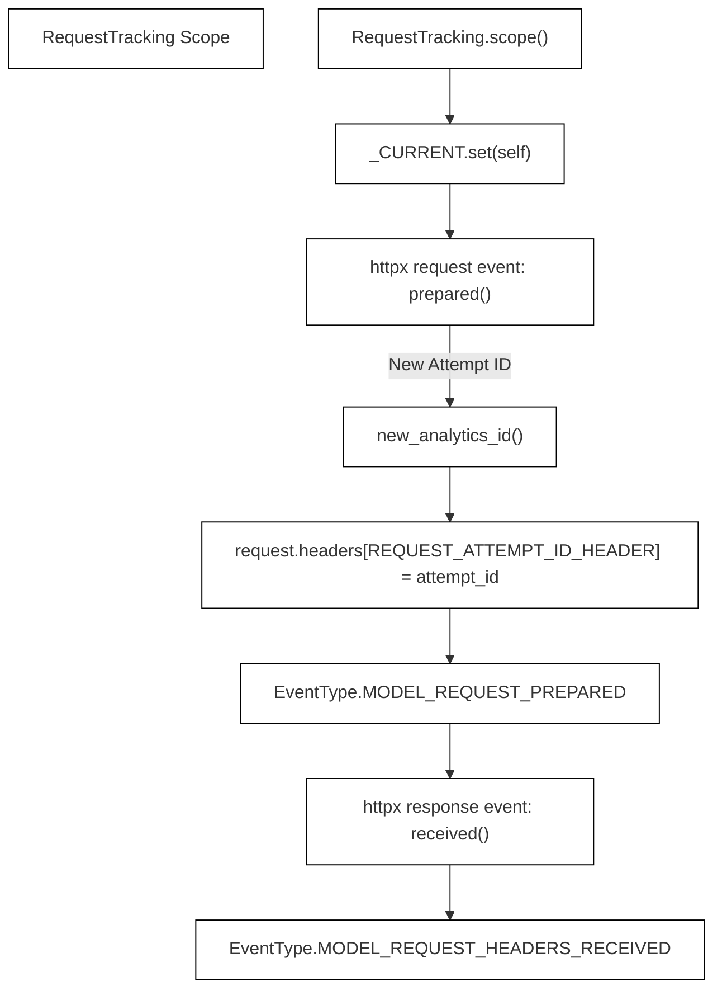
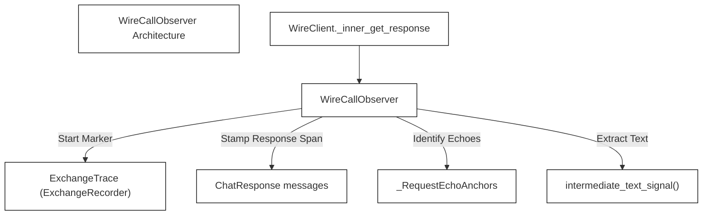

<!-- source: DeepWiki mcp.deepwiki.com · repo openJiuwen-ai/iCode · page 4.4 Request Tracking and Observability · fetched 2026-11-02 -->

# Request Tracking and Observability

Relevant source files

The following files were used as context for generating this wiki page:

- [docs/en/guides/daily-use/sessions.md](docs/en/guides/daily-use/sessions.md)
- [docs/zh-Hans/guides/daily-use/sessions.md](docs/zh-Hans/guides/daily-use/sessions.md)
- [src/chrys/foundation/util/chrys_headers.py](src/chrys/foundation/util/chrys_headers.py)
- [src/chrys/service/llm/observer.py](src/chrys/service/llm/observer.py)
- [src/chrys/service/llm/provider_request_ids.py](src/chrys/service/llm/provider_request_ids.py)
- [src/chrys/service/llm/request_tracking.py](src/chrys/service/llm/request_tracking.py)
- [src/chrys/service/llm/wire_client.py](src/chrys/service/llm/wire_client.py)
- [tests/service/agent_middleware/test_tool_operation_stamps.py](tests/service/agent_middleware/test_tool_operation_stamps.py)
- [tests/service/llm/test_provider_request_ids.py](tests/service/llm/test_provider_request_ids.py)
- [tests/service/llm/test_request_tracking.py](tests/service/llm/test_request_tracking.py)
- [tests/service/llm/test_route_extension_wire.py](tests/service/llm/test_route_extension_wire.py)

## Purpose and Scope
This page details the request tracking and observability machinery implemented in the iCode LLM service layer. It covers per-HTTP-attempt identities via `Chrys-Request-Attempt-Id`, normalization and precedence rules for upstream provider request IDs, wire-call observation through `WireCallObserver`, and raw HTTP stream logging.

---

## 1. Request Attempt Lifecycle and `Chrys-Request-Attempt-Id`
Every outbound HTTP acquisition (including SDK retries and redirects) is stamped with a unique analytics identifier (`request_attempt_id`) using `httpx` event hooks defined in `src/chrys/service/llm/request_tracking.py` [src/chrys/service/llm/request_tracking.py:3-68](). 

The `RequestTracking` dataclass maintains the active scope via a `ContextVar` (`_CURRENT`), ensuring that concurrent calls or redirected hops never share attempt IDs [src/chrys/service/llm/request_tracking.py:34-52]().

*Diagram 1: Request Attempt Lifecycle mapping to `request_tracking.py` execution flows.*

**Sources:** `src/chrys/service/llm/request_tracking.py`, `tests/service/llm/test_request_tracking.py`

---

## 2. Provider Request ID Normalization and Precedence
Providers, inference servers, and API gateways return disparate headers containing their own internal request tracking identifiers. The service layer parses these using a strict precedence list defined in `src/chrys/service/llm/provider_request_ids.py` [src/chrys/service/llm/provider_request_ids.py:3-17]().

### Header Precedence Table
| Precedence Order | Header Name | Primary Senders | Evidence Class |
| :--- | :--- | :--- | :--- |
| 1 | `x-generation-id` | OpenRouter | `Evidence.DOCS` |
| 2 | `x-oneapi-request-id` | one-api, new-api | `Evidence.SOURCE` |
| 3 | `x-litellm-call-id` | LiteLLM proxy | `Evidence.DOCS` |
| 4 | `x-request-id` | OpenAI, Groq, Together AI, vLLM, SGLang | `Evidence.RESPONSE` / `Evidence.SOURCE` |
| 5 | `request-id` | Anthropic | `Evidence.RESPONSE` |
| 6 | `x-oai-request-id` | OpenAI Codex backend | `Evidence.CLIENT_SOURCE` |
| 7 | `msh-request-id` | Moonshot AI | `Evidence.ERROR_RESPONSE` |
| 8 | `minimax-request-id` | MiniMax | `Evidence.RESPONSE` |

The helper function `read_provider_request_id(headers)` iterates over `PROVIDER_REQUEST_ID_HEADERS`, validating that headers are printable, bounded to `_MAX_REQUEST_ID_CHARS` (256 characters), and returning the first matched identifier [src/chrys/service/llm/provider_request_ids.py:28-213]().

**Sources:** `src/chrys/service/llm/provider_request_ids.py`, `tests/service/llm/test_provider_request_ids.py`

---

## 3. `WireCallObserver` and Exchange Telemetry
The `WireCallObserver` class in `src/chrys/service/llm/observer.py` bridges low-level wire transmissions with trajectory exchanges and intermediate text generation [src/chrys/service/llm/observer.py:3-33]().

*Diagram 2: `WireCallObserver` interaction map linking wire calls to trajectory exchanges and text buffers.*

### Key Responsibilities of `WireCallObserver`:
1. **Exchange Recording:** Emits start markers before requests leave and finish markers when responses land [src/chrys/service/llm/observer.py:8-10]().
2. **Timing Attribution:** Stamps response timing exclusively onto newly produced provider-hosted contents, ignoring request echoes managed via `_RequestEchoAnchors` [src/chrys/service/llm/observer.py:11-19]().
3. **Intermediate Text Hooking:** Intercepts model-authored text accompanying tool calls, pushing them into intermediate text buffers before downstream tool loops parse the response [src/chrys/service/llm/observer.py:20-28]().

**Sources:** `src/chrys/service/llm/observer.py`, `src/chrys/service/llm/wire_client.py`

---

## 4. Raw HTTP Logging and Wire Boundary Tracking
When configured with a target log destination (such as `raw_http_log_path` in `_build_profile_http_client`), the HTTP client logs complete request/response exchanges in JSON Lines format [tests/service/llm/test_request_tracking.py:77-82](). 

Each record correlates directly with the current request attempt ID:
- **`exchange_id`**: Matches the `Chrys-Request-Attempt-Id` header injected during the `prepared` HTTP hook [tests/service/llm/test_request_tracking.py:114-115]().
- **Isolation:** Concurrently executing scopes or automatic redirects maintain isolated attempt IDs, ensuring traces never cross contaminate [tests/service/llm/test_request_tracking.py:118-153]().

**Sources:** `tests/service/llm/test_request_tracking.py`, `src/chrys/service/llm/request_tracking.py`

---

