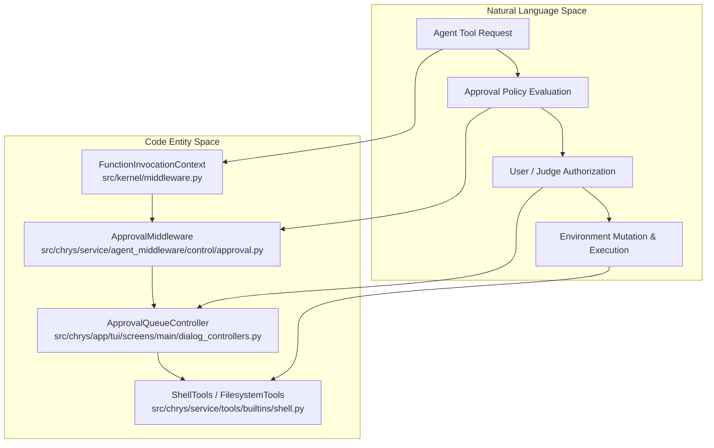
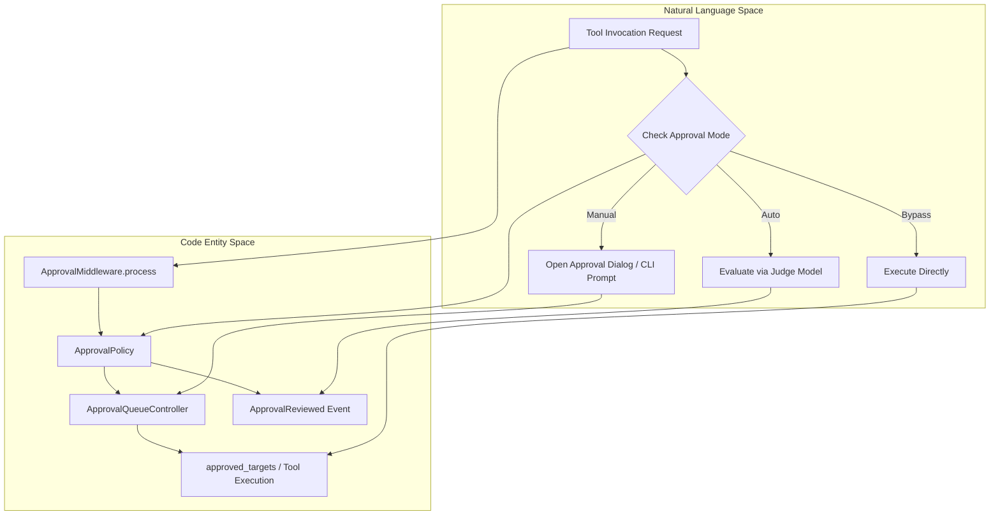

<!-- source: DeepWiki mcp.deepwiki.com · repo openJiuwen-ai/iCode · page 5 Tools, Approvals and Safety · fetched 2026-11-02 -->

# Tools, Approvals and Safety

Relevant source files

The following files were used as context for generating this wiki page:

- [docs/en/guides/configuration/approval.md](docs/en/guides/configuration/approval.md)
- [docs/zh-Hans/guides/configuration/approval.md](docs/zh-Hans/guides/configuration/approval.md)
- [src/chrys/app/cli/approvals.py](src/chrys/app/cli/approvals.py)
- [src/chrys/app/tui/screens/main/dialog_controllers.py](src/chrys/app/tui/screens/main/dialog_controllers.py)
- [src/chrys/service/agent_middleware/control/approval.py](src/chrys/service/agent_middleware/control/approval.py)
- [src/chrys/service/approval/reuse.py](src/chrys/service/approval/reuse.py)
- [src/chrys/service/tools/approval_targets.py](src/chrys/service/tools/approval_targets.py)
- [src/chrys/service/tools/builtins/shell.py](src/chrys/service/tools/builtins/shell.py)
- [tests/app/cli/test_acp.py](tests/app/cli/test_acp.py)
- [tests/app/cli/test_acp_transport_shutdown.py](tests/app/cli/test_acp_transport_shutdown.py)
- [tests/app/cli/test_approvals.py](tests/app/cli/test_approvals.py)
- [tests/app/tui/screens/main/test_approval_preview_timeout.py](tests/app/tui/screens/main/test_approval_preview_timeout.py)
- [tests/app/tui/screens/test_approval_timeout.py](tests/app/tui/screens/test_approval_timeout.py)
- [tests/app/tui/screens/test_dialog_controllers.py](tests/app/tui/screens/test_dialog_controllers.py)
- [tests/architecture/trajectory_wait_manifest.json](tests/architecture/trajectory_wait_manifest.json)
- [tests/service/agent_middleware/test_approval_reuse_boundaries.py](tests/service/agent_middleware/test_approval_reuse_boundaries.py)

The Tools, Approvals and Safety layer governs how agents interact with the host environment, how destructive actions are intercepted and authorized, and how filesystem or repository mutations are tracked and safely rolled back. This subsystem bridges autonomous model planning with secure, observable execution.

For details on specific child topics, see:
- [Builtin Tools](#5.1) — Shell execution (PTY/pipe), filesystem read/write/edit, search (ripgrep), doc converter, ask_user, skills tools, and workspace paths.
- [Approval Pipeline](#5.2) — `ApprovalMiddleware`, approval modes (`manual`, `auto`, `bypass`), approval targets, judge model, reuse grants, and the `icode approvals` CLI.
- [Mutation Tracking and Rollback](#5.3) — Mutation pipeline, git calibrator, snapshots and rollback, and workspace change notices.
- [Agent Middleware](#5.4) — Middleware chain coordinating `ask_user`, approvals, response validation, tool/sub-agent/hosted-tool events, and stamps.

---

## Architecture Overview

The following diagram bridges the natural language conceptual space of tool invocation and safety to the concrete code entities implementing them across the kernel and service layers.

*Sources: `src/chrys/app/tui/screens/main/dialog_controllers.py:174-185`, `src/chrys/service/tools/builtins/shell.py:1-21`*

---

## 5.1 Builtin Tools

The builtin tools subsystem provides the core capabilities available to agents, including terminal shell execution (utilizing PTY streams on Unix and pipes on Windows), structured filesystem inspection and editing, ripgrep-based search, document conversion, user interaction (`ask_user`), and custom workspace-scoped skills [src/chrys/service/tools/builtins/shell.py:1-21](). 

For comprehensive details on tool implementations, safety boundaries, output capturing, and path resolution, see [Builtin Tools](#5.1).

*Sources: `src/chrys/service/tools/builtins/shell.py:1-21`*

---

## 5.2 Approval Pipeline

The approval pipeline intercepts tool calls before execution to verify safety and compliance. It supports three primary modes—`manual`, `auto` (via an LLM approval judge), and `bypass`—alongside persistent reuse grants and audit controls [docs/en/guides/configuration/approval.md:5-16]().

*Sources: `docs/en/guides/configuration/approval.md:5-16`, `src/chrys/app/tui/screens/main/dialog_controllers.py:174-185`*

For complete coverage of the `ApprovalMiddleware`, runtime timeouts, approval targets, reuse grants, and the `icode approvals` CLI, see [Approval Pipeline](#5.2).

*Sources: `docs/en/guides/configuration/approval.md:1-127`, `src/chrys/app/tui/screens/main/dialog_controllers.py:174-185`, `src/chrys/service/tools/approval_targets.py:3-10`*

---

## 5.3 Mutation Tracking and Rollback

To prevent unintended modifications during agent runs, the mutation tracking subsystem records workspace modifications, utilizes git calibrators to snapshot changes, and offers deterministic rollback pathways combined with workspace change notices [src/chrys/service/tools/approval_targets.py:3-10]().

For details on snapshots, tracing, and rollback mechanics, see [Mutation Tracking and Rollback](#5.3).

*Sources: `src/chrys/service/tools/approval_targets.py:3-10`*

---

## 5.4 Agent Middleware

Agent execution is wrapped by a modular middleware chain that intercepts turns, injects prompt metadata, handles user questions, enforces approvals, validates tool responses, and dispatches telemetry events and contextual stamps.

For details on the middleware execution order and event hooks, see [Agent Middleware](#5.4).

---

