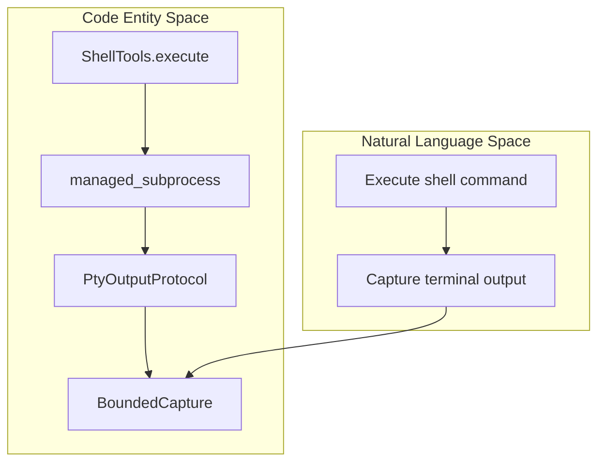
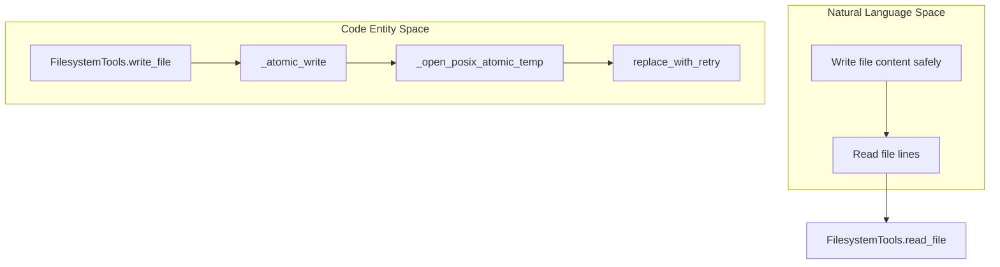
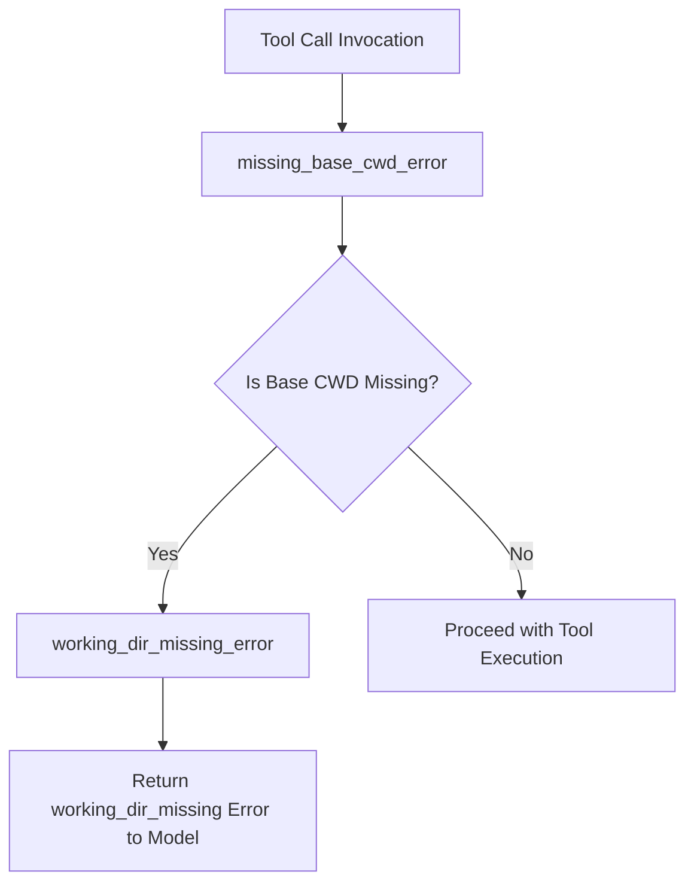

<!-- source: DeepWiki mcp.deepwiki.com · repo openJiuwen-ai/iCode · page 5.1 Builtin Tools · fetched 2026-11-02 -->

# Builtin Tools

Relevant source files

The following files were used as context for generating this wiki page:

- [src/chrys/app/cli/approvals.py](src/chrys/app/cli/approvals.py)
- [src/chrys/app/tui/support/prompt_history.py](src/chrys/app/tui/support/prompt_history.py)
- [src/chrys/foundation/platform/output_capture.py](src/chrys/foundation/platform/output_capture.py)
- [src/chrys/foundation/text/lines.py](src/chrys/foundation/text/lines.py)
- [src/chrys/service/agent_middleware/control/approval.py](src/chrys/service/agent_middleware/control/approval.py)
- [src/chrys/service/approval/reuse.py](src/chrys/service/approval/reuse.py)
- [src/chrys/service/hooks/outbox.py](src/chrys/service/hooks/outbox.py)
- [src/chrys/service/mutations/git_calibrator.py](src/chrys/service/mutations/git_calibrator.py)
- [src/chrys/service/tools/approval_targets.py](src/chrys/service/tools/approval_targets.py)
- [src/chrys/service/tools/builtins/doc_converter/__init__.py](src/chrys/service/tools/builtins/doc_converter/__init__.py)
- [src/chrys/service/tools/builtins/filesystem.py](src/chrys/service/tools/builtins/filesystem.py)
- [src/chrys/service/tools/builtins/search.py](src/chrys/service/tools/builtins/search.py)
- [src/chrys/service/tools/builtins/shell.py](src/chrys/service/tools/builtins/shell.py)
- [src/chrys/service/tools/workspace_paths.py](src/chrys/service/tools/workspace_paths.py)
- [tests/app/cli/test_approvals.py](tests/app/cli/test_approvals.py)
- [tests/app/tui/support/test_prompt_history.py](tests/app/tui/support/test_prompt_history.py)
- [tests/architecture/trajectory_wait_manifest.json](tests/architecture/trajectory_wait_manifest.json)
- [tests/service/agent_middleware/test_approval_reuse_boundaries.py](tests/service/agent_middleware/test_approval_reuse_boundaries.py)
- [tests/service/hooks/test_outbox.py](tests/service/hooks/test_outbox.py)
- [tests/service/mutations/test_git_calibrator.py](tests/service/mutations/test_git_calibrator.py)
- [tests/service/mutations/test_probe_stdin_isolation.py](tests/service/mutations/test_probe_stdin_isolation.py)
- [tests/service/tools/_doc_converter_fakes.py](tests/service/tools/_doc_converter_fakes.py)
- [tests/service/tools/test_doc_converter.py](tests/service/tools/test_doc_converter.py)
- [tests/service/tools/test_filesystem.py](tests/service/tools/test_filesystem.py)
- [tests/service/tools/test_result_metadata.py](tests/service/tools/test_result_metadata.py)
- [tests/service/tools/test_search.py](tests/service/tools/test_search.py)
- [tests/service/tools/test_search_batches.py](tests/service/tools/test_search_batches.py)
- [tests/service/tools/test_search_binary.py](tests/service/tools/test_search_binary.py)
- [tests/service/tools/test_search_diagnostics.py](tests/service/tools/test_search_diagnostics.py)
- [tests/service/tools/test_search_streaming.py](tests/service/tools/test_search_streaming.py)
- [tests/service/tools/test_working_dir_missing.py](tests/service/tools/test_working_dir_missing.py)
- [tests/support/windows_replace.py](tests/support/windows_replace.py)

## Purpose and Scope

The builtin tools module provides the foundational capabilities exposed to the iCode agent kernel, allowing agents to interact with the host operating system, execute shell commands, perform bounded workspace search via ripgrep, read, write, and edit local files, and convert documents. These tools are instantiated with session environment contexts and enforce strict safety boundaries, including working directory validation, token ceilings, atomicity, and output capture truncation.

Sources: `src/chrys/service/tools/builtins/shell.py:1-21`, `src/chrys/service/tools/builtins/search.py:1-14`, `src/chrys/service/tools/builtins/filesystem.py:1-10`

---

## 1. Shell Execution Tool (`ShellTools`)

Shell execution is handled by `ShellTools` in `src/chrys/service/tools/builtins/shell.py`. On POSIX platforms, commands are launched with standard output and error streams attached to a Pseudo-Terminal (PTY) with `TERM=dumb` set. This ensures programs emit terminal-like streams while suppressing complex ANSI formatting sequences. Stdin is mapped to `/dev/null` and the PTY is not installed as a controlling terminal, preventing interactive terminal reads from triggering job-control stops. On Windows, standard OS pipes are used instead of a PTY.

Outputs are captured through `BoundedCapture` (`[chrys/foundation/platform/output_capture.py]()-`), preserving head and tail allocations when output exceeds token thresholds.

Sources: `src/chrys/service/tools/builtins/shell.py:1-50`

---

## 2. Filesystem Tools: Read, Write, and Edit (`FilesystemTools`)

Filesystem operations are implemented via `FilesystemTools` in `src/chrys/service/tools/builtins/filesystem.py`. The module provides three core primitives:
- `read_file`: Reads files with line-ending normalization and token windowing.
- `write_file`: Writes content atomically using a same-directory temporary file coupled with `os.replace()`.
- `edit_file`: Performs targeted text replacements with before/after diff previews.

Atomic writes (`_atomic_write`) guarantee that file modifications leave the target untouched if an error or interruption occurs mid-write.

Sources: `src/chrys/service/tools/builtins/filesystem.py:1-177`

---

## 3. Search Tools: Grep and Glob (`SearchTools`)

Code search is powered by ripgrep (`rg`) through `src/chrys/service/tools/builtins/search.py`. The binary is bundled as package data or discovered via system `PATH` fallback (`_find_rg`). 

Key architectural details include:
- **Multi-Encoding Fallbacks**: When search patterns contain non-ASCII characters, automatic multi-encoding passes (UTF-8, GBK, system ANSI codepages) are executed.
- **Batch Splitting**: Large sets of file paths are partitioned via `_file_batches` to respect OS-specific command-line length limits (`_WINDOWS_COMMAND_LIMIT` vs `_POSIX_COMMAND_LIMIT`).
- **Stream Processing**: Ripgrep `--json` output records are parsed incrementally, aborting early once result limits are saturated.

Sources: `src/chrys/service/tools/builtins/search.py:1-183`, `tests/service/tools/test_search_batches.py:27-58`

---

## 4. Document Converter (`DocConverterTools`)

The document conversion service (`src/chrys/service/tools/builtins/doc_converter/__init__.py`) translates complex documents (PDF, DOCX, PPTX, and text/table-only XLS/XLSX) into clean Markdown. 

The pipeline includes:
- Embedded raster asset extraction restricted to PDF, DOCX, and PPTX formats.
- Surrogate safety text normalization (`_normalize_document_text`).
- Table of contents extraction (`_extract_toc`) with token budget enforcement.
- Session artifact storage integration via `DocumentImageSink` to track generated images.

Sources: `tests/service/tools/test_doc_converter.py:31-95`

---

## 5. Workspace Paths and Deleted CWD Handling

If a session's working directory is deleted or moved externally while turns are executing, tools avoid misleading "file not found" errors. Instead, `src/chrys/service/tools/workspace_paths.py` intercepts path resolution and returns a deterministic `working_dir_missing` error signal.

Sources: `src/chrys/service/tools/workspace_paths.py:1-50`, `tests/service/tools/test_working_dir_missing.py:1-69`

---

## 6. Approval Targets and State Verification

Before executing write or shell operations, target paths and directories are bound and verified via `src/chrys/service/tools/approval_targets.py`. 

The `ApprovedTargets` dataclass maintains precise records of confirmed files and working directories. Tools re-verify these targets at execution time; if a target has changed since approval, a `CHANGED_AFTER_APPROVAL` validation error is raised to protect workspace integrity.

Sources: `src/chrys/service/tools/approval_targets.py:1-93`, `tests/service/agent_middleware/test_approval_reuse_boundaries.py:125-154`

---

