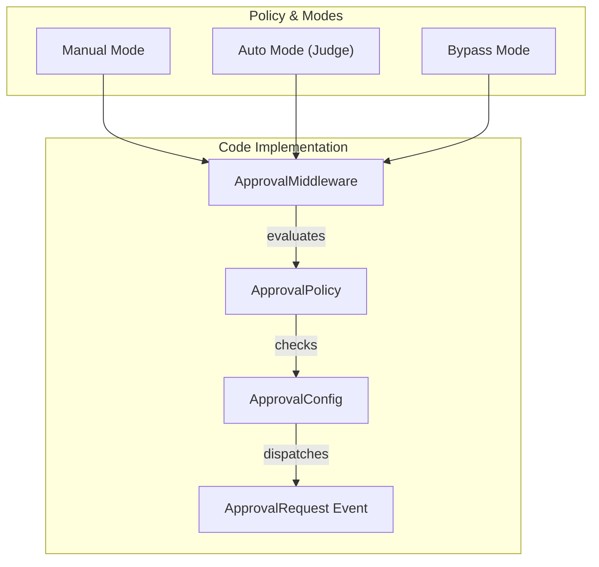
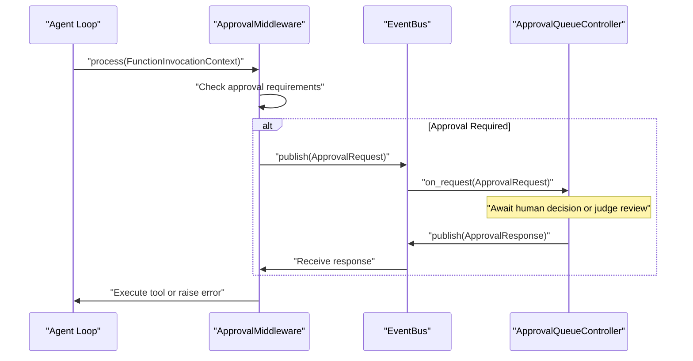
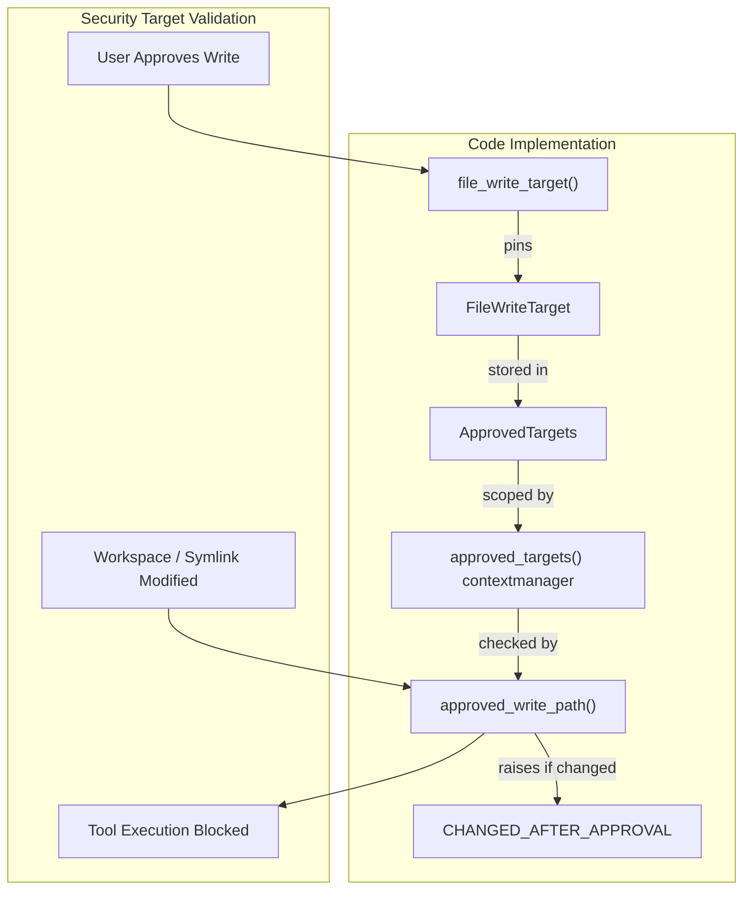

<!-- source: DeepWiki mcp.deepwiki.com · repo openJiuwen-ai/iCode · page 5.2 Approval Pipeline · fetched 2026-11-02 -->

# Approval Pipeline

Relevant source files

The following files were used as context for generating this wiki page:

- [docs/en/guides/configuration/approval.md](docs/en/guides/configuration/approval.md)
- [docs/zh-Hans/guides/configuration/approval.md](docs/zh-Hans/guides/configuration/approval.md)
- [src/chrys/app/cli/approvals.py](src/chrys/app/cli/approvals.py)
- [src/chrys/app/tui/screens/main/dialog_controllers.py](src/chrys/app/tui/screens/main/dialog_controllers.py)
- [src/chrys/service/agent_middleware/control/approval.py](src/chrys/service/agent_middleware/control/approval.py)
- [src/chrys/service/approval/reuse.py](src/chrys/service/approval/reuse.py)
- [src/chrys/service/tools/approval_targets.py](src/chrys/service/tools/approval_targets.py)
- [src/chrys/service/tools/builtins/shell.py](src/chrys/service/tools/builtins/shell.py)
- [tests/app/cli/test_acp.py](tests/app/cli/test_acp.py)
- [tests/app/cli/test_acp_transport_shutdown.py](tests/app/cli/test_acp_transport_shutdown.py)
- [tests/app/cli/test_approvals.py](tests/app/cli/test_approvals.py)
- [tests/app/tui/screens/main/test_approval_preview_timeout.py](tests/app/tui/screens/main/test_approval_preview_timeout.py)
- [tests/app/tui/screens/test_approval_timeout.py](tests/app/tui/screens/test_approval_timeout.py)
- [tests/app/tui/screens/test_dialog_controllers.py](tests/app/tui/screens/test_dialog_controllers.py)
- [tests/architecture/trajectory_wait_manifest.json](tests/architecture/trajectory_wait_manifest.json)
- [tests/service/agent_middleware/test_approval_reuse_boundaries.py](tests/service/agent_middleware/test_approval_reuse_boundaries.py)
- [tests/service/approval/test_judge.py](tests/service/approval/test_judge.py)

## Purpose and Scope
The Approval Pipeline governs security boundaries and human-in-the-loop validation for agent tool invocations in iCode (`chrys`). It intercepts tool executions via middleware, applies configurable security policies, evaluates calls using heuristics or an LLM judge model, validates execution targets against race conditions, supports persistent approval reuse grants (session or project scope), and integrates across the TUI, ACP server, and CLI interfaces.

Sources: `docs/en/guides/configuration/approval.md`, `src/chrys/service/agent_middleware/control/approval.py` [src/chrys/service/agent_middleware/control/approval.py:1-40]()

---

## 1. Approval Modes and Policy Architecture
The approval pipeline operates under three primary execution modes governed by `ApprovalPolicy`:
- **MANUAL**: Tool calls requiring approval present an interactive dialog or ACP permission request and block execution until an explicit user decision (`ApprovalResponse`) is received.
- **AUTO**: An LLM judge model evaluates tool parameters against the current environment and workspace. Safe calls are auto-approved; suspicious calls are flagged and routed to the user.
- **BYPASS**: Bypasses all approval rules and security checks, executing tool calls directly (unavailable as a persistent default setting for safety reasons).

Settings and overrides are managed through `ApprovalConfig` and resolved against explicit policy rules in `ApprovalPolicy`.

Sources: `docs/en/guides/configuration/approval.md`, `src/chrys/service/profiles/agents/schema.py` [src/chrys/service/agent_middleware/control/approval.py:1-80]()

---

## 2. Approval Middleware and Event Loop Integration
Tool executions are intercepted by `ApprovalMiddleware`, which acts as a kernel middleware layer. When a tool invocation requires approval, `ApprovalMiddleware` halts execution, publishes an `ApprovalRequest` event to the `EventBus`, and awaits an `ApprovalResponse` or `ApprovalCancelled` event.

Sources: `src/chrys/service/agent_middleware/control/approval.py` [src/chrys/service/agent_middleware/control/approval.py:30-120](), `src/chrys/app/tui/screens/main/dialog_controllers.py` [src/chrys/app/tui/screens/main/dialog_controllers.py:174-200]()

---

## 3. Judge Model Evaluation (Auto Mode)
In `AUTO` mode, tool calls are assessed by a judge model before prompting the user. The judge receives context including:
- Current timestamp and workspace directory paths.
- All user prompts for the current turn (highlighting the latest prompt).
- Tool name, category (`tool_kind`), and raw arguments.

If the judge marks a call as safe, it proceeds without human intervention. If flagged as suspicious, it triggers `ApprovalReviewed` with a `reason`, opening an interactive approval dialog with the cursor positioned defensively in the reason/decline field. If the judge model fails or times out, the system fails closed by presenting the approval request to the user.

Sources: `docs/en/guides/configuration/approval.md`, `tests/app/tui/screens/test_approval_timeout.py` [tests/app/tui/screens/test_approval_timeout.py:58-75]()

---

## 4. Approval Targets and State Re-validation
To prevent race conditions where files or working directories change between approval and actual execution, `chrys.service.tools.approval_targets` records exact target states during approval.

- `FileWriteTarget`: Captures file paths, symlink source targets, and physical referents.
- `ApprovedTargets`: Bundles confirmed file write targets and approved working directories (`cwd`).
- `approved_targets`: A context manager scoping approved targets to a tool execution thread.
- `approved_write_path`: Re-resolves the file destination at runtime; raises `ValueError` (`CHANGED_AFTER_APPROVAL`) if the file or directory structure was altered post-approval.

Sources: `src/chrys/service/tools/approval_targets.py` [src/chrys/service/tools/approval_targets.py:1-92]()

---

## 5. Reuse Grants and Session/Project Persistence
Users can bypass repetitive confirmations for specific shell commands or file modifications by creating reuse grants managed via `ApprovalReuseBinding` and `chrys.service.approval.reuse`.

- **Scopes**: Grants can be scoped to `EXACT_SESSION` (persists for the duration of the session and its restores) or `PROJECT` (applies across sessions within the same project directory).
- **Boundaries**: Grants enforce strict environment matching (working directory, platform shell path, arguments). Sensitive operations (e.g., credentials, SSH keys, agent-specified run directories, sub-agents, workflows, MCP tools) are explicitly excluded from reuse grants.

Sources: `tests/service/agent_middleware/test_approval_reuse_boundaries.py` [tests/service/agent_middleware/test_approval_reuse_boundaries.py:1-90](), `src/chrys/service/approval/reuse.py` [src/chrys/service/approval/reuse.py:1-100]()

---

## 6. The `icode approvals` CLI
Persisted reuse grants can be audited and managed using the `icode approvals` command-line interface (`src/chrys/app/cli/approvals.py`). Supported subcommands include:
- `icode approvals list [--project DIR] [--session SESSION_ID] [--json]`: Enumerates active reuse grants.
- `icode approvals revoke GRANT_ID`: Revokes a specific approval grant by its identifier.
- `icode approvals clear [--project DIR] [--session SESSION_ID] [--all]`: Bulk clears grants matching the specified scope or purges all stored grants.

Sources: `docs/en/guides/configuration/approval.md`, `src/chrys/app/cli/approvals.py` [src/chrys/app/cli/approvals.py:1-101]()

---

