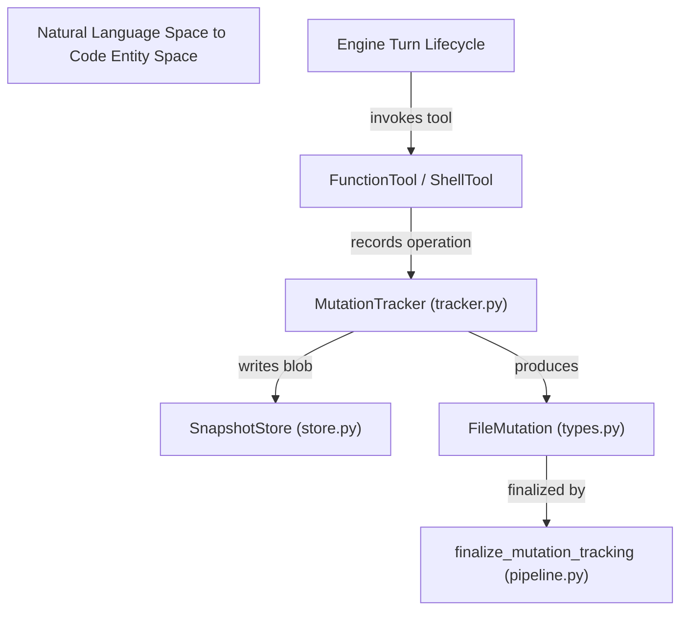
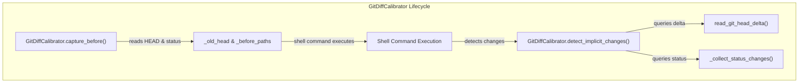

<!-- source: DeepWiki mcp.deepwiki.com · repo openJiuwen-ai/iCode · page 5.3 Mutation Tracking and Rollback · fetched 2026-11-02 -->

# Mutation Tracking and Rollback

Relevant source files

The following files were used as context for generating this wiki page:

- [src/chrys/foundation/platform/files.py](src/chrys/foundation/platform/files.py)
- [src/chrys/foundation/platform/output_capture.py](src/chrys/foundation/platform/output_capture.py)
- [src/chrys/service/approval/grant_store.py](src/chrys/service/approval/grant_store.py)
- [src/chrys/service/mutations/git_calibrator.py](src/chrys/service/mutations/git_calibrator.py)
- [src/chrys/service/tools/builtins/search.py](src/chrys/service/tools/builtins/search.py)
- [tests/app/tui/widgets/test_file_scanner.py](tests/app/tui/widgets/test_file_scanner.py)
- [tests/foundation/platform/test_files.py](tests/foundation/platform/test_files.py)
- [tests/service/agent_middleware/test_approval_reuse_review_regressions.py](tests/service/agent_middleware/test_approval_reuse_review_regressions.py)
- [tests/service/mutations/test_git_calibrator.py](tests/service/mutations/test_git_calibrator.py)
- [tests/service/mutations/test_pipeline.py](tests/service/mutations/test_pipeline.py)
- [tests/service/mutations/test_probe_stdin_isolation.py](tests/service/mutations/test_probe_stdin_isolation.py)
- [tests/service/tools/test_result_metadata.py](tests/service/tools/test_result_metadata.py)
- [tests/service/tools/test_search.py](tests/service/tools/test_search.py)
- [tests/service/tools/test_search_batches.py](tests/service/tools/test_search_batches.py)
- [tests/service/tools/test_search_binary.py](tests/service/tools/test_search_binary.py)
- [tests/service/tools/test_search_diagnostics.py](tests/service/tools/test_search_diagnostics.py)
- [tests/service/tools/test_search_streaming.py](tests/service/tools/test_search_streaming.py)

## Purpose and Scope
This page details the mutation tracking and rollback infrastructure in `iCode` (`chrys/service/mutations/`), which monitors, snapshots, and calibrates file modifications performed by tools, sub-agents, or external shell commands. It covers the core mutation pipeline, the `GitDiffCalibrator` for implicit change detection, snapshot storage mechanics, and workspace change synchronization.

---

## 1. Mutation Pipeline and Tracking Infrastructure
The mutation pipeline records file modifications during agent execution turns, associating each change with a specific tool invocation or shell execution source. 

*   **`MutationTracker`**: Coordinates state across a turn, recording changes via `track()` or `record()` methods and interfacing with the backing store [tests/service/mutations/test_pipeline.py:18-95]().
*   **`SnapshotStore`**: Manages content blobs on disk under the session or project workspace, storing immutable content keyed by content hashes [tests/service/mutations/test_pipeline.py:17]().
*   **`FileMutation`**: A dataclass capturing individual operations (`MutationOp.MODIFY`, `MutationOp.CREATE`, `MutationOp.DELETE`), source categories (`MutationSource.SHELL`, `MutationSource.EDIT_FILE`, `MutationSource.IMPLICIT`), tool call IDs, timestamps, and hash transitions (`before_hash`, `after_hash`) [tests/service/mutations/test_pipeline.py:30-45]().

*Sources: [tests/service/mutations/test_pipeline.py:10-46](), [tests/service/mutations/test_pipeline.py:89-105]()*

When a tool completes, `finalize_mutation_tracking` reads the file snapshots using `_read_file_snapshot` or collapses shell mutations via `_read_shell_snapshots` to construct a unified diff and metadata summary (`FileMutationTextSnapshot`) [tests/service/mutations/test_pipeline.py:10-18, 127-145]().

---

## 2. Git Calibrator and Implicit Change Detection
When an agent executes shell commands (`ShellTools`), files can be modified implicitly without direct calls to file editing tools. The `GitDiffCalibrator` detects these changes by comparing Git repository state before and after command execution [src/chrys/service/mutations/git_calibrator.py:3-179]().

*Sources: [src/chrys/service/mutations/git_calibrator.py:110-179]()*, [tests/service/mutations/test_git_calibrator.py:100-123]()*

*   **`capture_before()`**: Captures the current HEAD object ID (`read_git_head_oid`) and enumerates dirty working tree paths prior to command execution [src/chrys/service/mutations/git_calibrator.py:110-137]().
*   **`detect_implicit_changes()`**: Compares post-execution status and HEAD deltas against already tracked paths, returning a list of `ImplicitChange` objects [src/chrys/service/mutations/git_calibrator.py:139-179]().
*   **Guardrails**: Repositories exceeding `MAX_DIRTY_FILES` (500 files) skip status calibration to prevent performance degradation, marking detection as truncated [src/chrys/service/mutations/git_calibrator.py:32-34, 121-125]().

---

## 3. Snapshots, Diffing, and Rollback Mechanics
File revisions are managed through content addressing and snapshot collapsing:

| Component / Function | Role / Responsibility |
| :--- | :--- |
| `SnapshotStore` | Stores content blobs on disk and enforces size thresholds (`DEFAULT_MAX_SNAPSHOT_FILE_BYTES`) [src/chrys/service/mutations/git_calibrator.py:27]() |
| `_read_file_snapshot` | Retrieves `before_text` and `after_text` from content blobs corresponding to `before_hash` and `after_hash` [tests/service/mutations/test_pipeline.py:54-87]() |
| `_read_shell_snapshots` | Collapses multiple consecutive mutations on the same path, preserving the initial `before_text` and final `after_text` [tests/service/mutations/test_pipeline.py:127-145]() |

If multiple mutations occur on a single path during a turn, `_read_shell_snapshots` ensures intermediate states are collapsed, retaining the correct provenance and operation type (`create`, `modify`, `delete`) [tests/service/mutations/test_pipeline.py:127-156]().

*Sources: [tests/service/mutations/test_pipeline.py:54-156]()*

---

## 4. Workspace Change Notices and Event Integration
Tracked mutations integrate directly with the application session state and frontend views:
*   **Change Summaries**: Finalized mutations produce diff structures that populate tool result cards and trajectory analytics in the TUI [tests/service/mutations/test_pipeline.py:89-105]().
*   **Locking**: Per-file and per-store locks (`FileLock`) protect concurrent reads and writes when multiple agent workers or threads access snapshot stores and grant registries [src/chrys/service/approval/grant_store.py:67-81]().

*Sources: [src/chrys/service/approval/grant_store.py:67-81](), [tests/service/mutations/test_pipeline.py:89-105]()*

---

