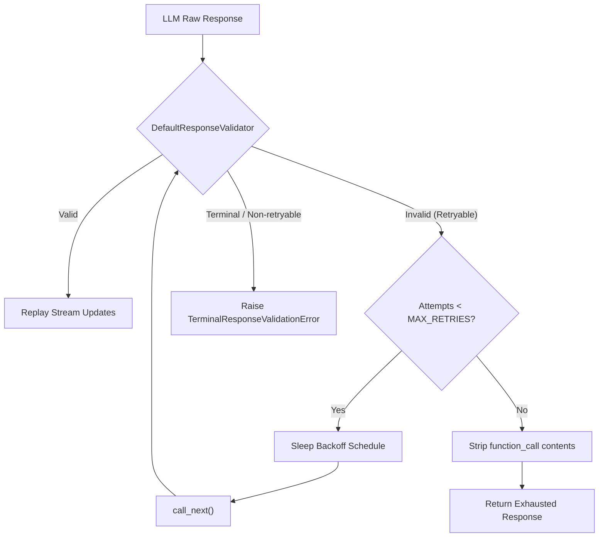
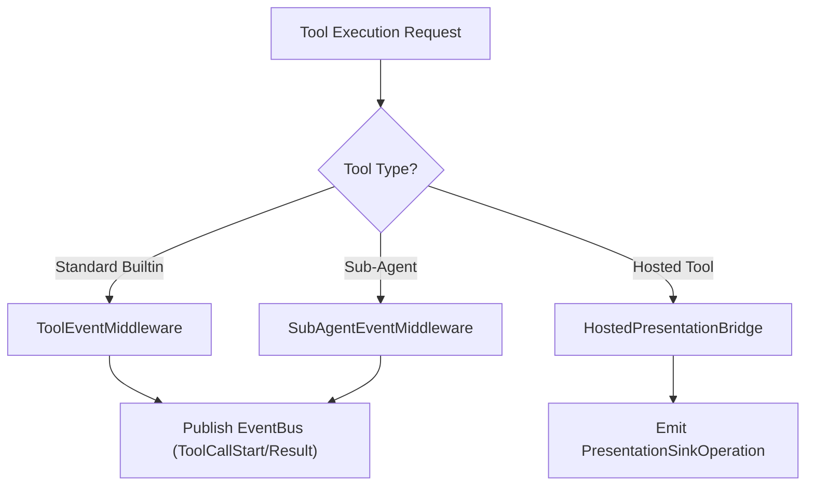

<!-- source: DeepWiki mcp.deepwiki.com · repo openJiuwen-ai/iCode · page 5.4 Agent Middleware · fetched 2026-11-02 -->

# Agent Middleware

<details>
<summary>Relevant source files</summary>

The following files were used as context for generating this wiki page:

- [docs/en/guides/running/workflows.md](docs/en/guides/running/workflows.md)
- [docs/zh-Hans/guides/running/workflows.md](docs/zh-Hans/guides/running/workflows.md)
- [src/chrys/app/tui/screens/main/workflow_run_control.py](src/chrys/app/tui/screens/main/workflow_run_control.py)
- [src/chrys/app/tui/widgets/chat/renderers/ask_user.py](src/chrys/app/tui/widgets/chat/renderers/ask_user.py)
- [src/chrys/app/tui/widgets/chrome/input_bar.py](src/chrys/app/tui/widgets/chrome/input_bar.py)
- [src/chrys/orchestration/engine/run/bindings.py](src/chrys/orchestration/engine/run/bindings.py)
- [src/chrys/orchestration/invoker/attempts.py](src/chrys/orchestration/invoker/attempts.py)
- [src/chrys/service/agent_middleware/control/ask_user.py](src/chrys/service/agent_middleware/control/ask_user.py)
- [src/chrys/service/agent_middleware/events/hosted_tools.py](src/chrys/service/agent_middleware/events/hosted_tools.py)
- [src/chrys/service/agent_middleware/events/sub_agent_events.py](src/chrys/service/agent_middleware/events/sub_agent_events.py)
- [src/chrys/service/agent_middleware/response_validation.py](src/chrys/service/agent_middleware/response_validation.py)
- [src/chrys/service/agent_middleware/validators.py](src/chrys/service/agent_middleware/validators.py)
- [tests/app/tui/widgets/test_tool_card.py](tests/app/tui/widgets/test_tool_card.py)
- [tests/kernel/test_loop_stream_close.py](tests/kernel/test_loop_stream_close.py)
- [tests/orchestration/engine/test_hosted_presentation.py](tests/orchestration/engine/test_hosted_presentation.py)
- [tests/orchestration/invoker/test_attempt_stream_close.py](tests/orchestration/invoker/test_attempt_stream_close.py)
- [tests/service/agent_middleware/test_hosted_tools.py](tests/service/agent_middleware/test_hosted_tools.py)
- [tests/service/agent_middleware/test_response_validation_stream_close.py](tests/service/agent_middleware/test_response_validation_stream_close.py)
- [tests/service/agent_middleware/test_response_validators.py](tests/service/agent_middleware/test_response_validators.py)
- [tests/service/context/compaction/_last_words_helpers.py](tests/service/context/compaction/_last_words_helpers.py)
- [tests/service/tools/test_ask_user.py](tests/service/tools/test_ask_user.py)

</details>


The agent middleware architecture in `icode` (under `src/chrys/service/agent_middleware/`) implements a composable processing pipeline for function/tool invocations, safety checks, interactive prompts (`ask_user`), policy approvals, response validation, and trajectory event recording. This page details the middleware layers, control flows, and event translation mechanisms that bridge raw LLM tool calls with the TUI, ACP servers, and trajectory tracking.

---

## 1. Middleware Architecture Overview

The middleware system is partitioned into two primary integration levels: **Chat-level middleware** (operating on prompt-response loops via `ChatMiddleware`) and **Function-level middleware** (operating on individual tool calls via `FunctionMiddleware`). The main execution run orchestration composes these layers during engine builds (`TurnBindings`) [src/chrys/orchestration/engine/run/bindings.py]().

```
+---------------------------------------------------------------------------------+
|                                 LLM Service / Core                              |
+---------------------------------------------------------------------------------+
                                         |
                                         v
+---------------------------------------------------------------------------------+
|                        Chat-Level Middleware Chain                              |
|   - ResponseValidationMiddleware [src/chrys/service/agent_middleware/response_validation.py]() |
+---------------------------------------------------------------------------------+
                                         |
                                         v
+---------------------------------------------------------------------------------+
|                      Function-Level Middleware Chain                            |
|   - ApprovalMiddleware [src/chrys/service/agent_middleware/control/approval.py]()             |
|   - AskUserMiddleware [src/chrys/service/agent_middleware/control/ask_user.py]()               |
|   - ToolEventMiddleware / SubAgentEventMiddleware [src/chrys/service/agent_middleware/events/sub_agent_events.py]() |
+---------------------------------------------------------------------------------+
                                         |
                                         v
+---------------------------------------------------------------------------------+
|                             Tool Execution (Kernel)                             |
+---------------------------------------------------------------------------------+
```

Sources:
- `src/chrys/orchestration/engine/run/bindings.py`
- `src/chrys/service/agent_middleware/response_validation.py`

---

## 2. Interactive Prompts: `ask_user` Middleware

The `AskUserMiddleware` intercepts `ask_user` tool invocations to pause agent execution, surface an interactive dialog or TUI prompt to the user, and collect structured responses without ever executing a physical tool function [src/chrys/service/agent_middleware/control/ask_user.py]().

### Implementation & Data Flow
1. **Tool Identification**: When a tool call matches `KIND_ASK_USER`, the middleware intercepts invocation via `process(context, call_next)` [src/chrys/service/agent_middleware/control/ask_user.py]().
2. **Validation**: Arguments are parsed via `parse_ask_user_questions()` and validated against constraints (e.g., maximum question count, duplicate option labels) [src/chrys/service/agent_middleware/control/ask_user.py:52-110]().
3. **Event Publishing**: A `QuestionToUser` event is published to the `EventBus`, containing options and metadata [tests/service/tools/test_ask_user.py:13]().
4. **Result Resolution**: The middleware awaits the corresponding `AskUserResponse` or timeout (`DEFAULT_ASK_USER_TIMEOUT_SECONDS`), populating `context.result` directly with the user's answer [src/chrys/service/agent_middleware/control/ask_user.py:117-164]().

```mermaid
sequenceTitle "AskUserMiddleware Flow"
sequenceDiagram
    participant Agent as "Agent Loop"
    participant Middleware as "AskUserMiddleware"
    participant Bus as "EventBus"
    participant User as "TUI / Frontend"

    Agent->>Middleware: "FunctionInvocationContext (ask_user)"
    Middleware->>Middleware: "_validate_questions()"
    Middleware->>Bus: "Publish QuestionToUser"
    Bus->>User: "Display AskUserDialog"
    User-->>Bus: "Publish AskUserResponse"
    Bus-->>Middleware: "Receive Answer"
    Middleware-->>Agent: "Populate context.result & skip tool execution"
```

Sources:
- `src/chrys/service/agent_middleware/control/ask_user.py`
- `tests/service/tools/test_ask_user.py`

---

## 3. Response Validation Middleware

`ResponseValidationMiddleware` sits at the innermost layer of the chat middleware chain, catching malformed responses from inference backends (such as empty content arrays, whitespace-only text, or leaked tool tags) before they corrupt session history [src/chrys/service/agent_middleware/response_validation.py]().

### Retry & Stripping Strategy
* **Validation**: Finalized `ChatResponse` objects are passed through a `ResponseValidator` (e.g., `DefaultResponseValidator`) [src/chrys/service/agent_middleware/response_validation.py:25-26]()
* **Retries**: On local validation failure, the middleware sleeps with an exponential backoff schedule (`DEFAULT_BACKOFF_SCHEDULE`) and retries up to `MAX_RETRIES` (3 additional attempts) [src/chrys/service/agent_middleware/response_validation.py:131-144]().
* **Function Call Stripping**: On the final exhausted attempt, any `function_call` content items are stripped. This prevents the agent tool loop from repeatedly executing malformed tool calls in an infinite cycle [src/chrys/service/agent_middleware/response_validation.py:45-53]().



Sources:
- `src/chrys/service/agent_middleware/response_validation.py`
- `src/chrys/service/agent_middleware/validators.py`

---

## 4. Tool, Sub-Agent, and Hosted-Tool Events

Tool execution generates telemetry, lifecycle events, and presentation structures. Middleware components manage these transformations:

* **`ToolEventMiddleware`**: Intercepts standard tool execution, records start/result timing stamps, applies execution stamps [src/chrys/foundation/tool_execution_stamp.py](), and updates mutation trackers (`MutationTracker`) for file/shell modifications [src/chrys/service/agent_middleware/events/sub_agent_events.py]().
* **`SubAgentEventMiddleware`**: A specialized lightweight variant used during recursive sub-agent runs, publishing `InvocationToolCallStart` and `InvocationToolCallResult` events alongside live progress updates (`InvocationProgress`) [src/chrys/service/agent_middleware/events/sub_agent_events.py:143-160]().
* **Hosted Tool Adaptation**: `adapt_hosted_tool()` bridges provider-specific remote execution models (such as code interpreters or search extensions) into unified view primitives (`HostedToolView`, `HostedToolOperation`) for presentation sinks [src/chrys/service/agent_middleware/events/hosted_tools.py:100-179]().



Sources:
- `src/chrys/service/agent_middleware/events/sub_agent_events.py`
- `src/chrys/service/agent_middleware/events/hosted_tools.py`

---

## 5. Stamps and Trajectory Integration

Middleware interactions write trajectory stamps to record execution provenance and precise timing metrics:

* **Execution Stamps**: `write_execution_stamp()` embeds execution context into tool results, tracking which agent profile, turn, and invocation path produced a given artifact [src/chrys/foundation/tool_execution_stamp.py]().
* **Timing & Waits**: Tool operations bind to trajectory contexts via `bind_tool_operation()` and `stamp_trajectory_timing()`, enabling the TUI Trajectory Dashboard to render duration charts and wait category classifications (`WaitCategory`) [src/chrys/foundation/trajectory/event_types.py]() [src/chrys/service/agent_middleware/events/sub_agent_events.py:38-40]().

Sources:
- `src/chrys/foundation/tool_execution_stamp.py`
- `src/chrys/foundation/trajectory/event_types.py`
- `src/chrys/service/agent_middleware/events/sub_agent_events.py`

---

