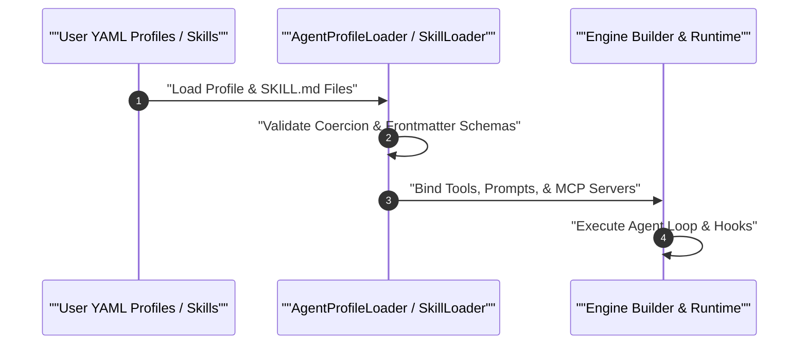

<!-- source: DeepWiki mcp.deepwiki.com · repo openJiuwen-ai/iCode · page 6 Extensibility: Profiles, Skills, Hooks, MCP · fetched 2026-11-02 -->

# Extensibility: Profiles, Skills, Hooks, MCP

<details>
<summary>Relevant source files</summary>

The following files were used as context for generating this wiki page:

- [docs/en/guides/extensions/skills.md](docs/en/guides/extensions/skills.md)
- [docs/en/reference/agent-profile.md](docs/en/reference/agent-profile.md)
- [docs/zh-Hans/guides/extensions/skills.md](docs/zh-Hans/guides/extensions/skills.md)
- [docs/zh-Hans/reference/agent-profile.md](docs/zh-Hans/reference/agent-profile.md)
- [src/chrys/service/profiles/agents/loader.py](src/chrys/service/profiles/agents/loader.py)
- [src/chrys/service/skills/loader.py](src/chrys/service/skills/loader.py)
- [tests/service/profiles/agents/test_loader.py](tests/service/profiles/agents/test_loader.py)
- [tests/service/skills/test_loader.py](tests/service/skills/test_loader.py)

</details>


This page serves as a high-level overview of how iCode (`chrys`) is extended through agent/model profiles, file and inline skills, lifecycle hooks, and Model Context Protocol (MCP) servers. The extensibility architecture allows developers and users to customize agent behaviors, bind specific Large Language Models (LLMs), inject domain-specific instructions, orchestrate event-driven hooks, and mount external tools dynamically.

For detailed technical specifications, implementation classes, and configuration guides, refer to the respective child pages:
- [Agent and Model Profiles](#6.1)
- [Skills](#6.2)
- [Hooks](#6.3)
- [MCP Integration](#6.4)

```mermaid
graph TD
    subgraph NaturalLanguage[""Natural Language Space: Configurations & Skills""]
        NC[""YAML Agent/Model Profiles""]
        SC[""SKILL.md & Frontmatter Files""]
        HC[""Lifecycle Hook Scripts""]
        MC[""MCP Server Stdio/HTTP Config""]
    end

    subgraph CodeEntitySpace[""Code Entity Space: Extensibility Handlers""]
        NC --> AP[""AgentProfileLoadError / AgentProfileLoader (src/chrys/service/profiles/agents/loader.py)""]
        SC --> SP[""ChrysSkillsProvider (src/chrys/service/skills/provider.py)""]
        HC --> HL[""HookLoader (chrys/service/hooks/loader.py)""]
        MC --> MA[""McpAdapter (chrys/service/mcp/adapter.py)""]
    end
```
*Sources: [docs/en/reference/agent-profile.md:1-88](), [src/chrys/service/profiles/agents/loader.py:1-45](), [src/chrys/service/skills/loader.py:1-45]()*

---

## 6.1. Agent and Model Profiles

Agent and model profiles govern the behavior, capabilities, model selection, tool permissions, and memory constraints of individual agents. Stored as local YAML files in user configuration directories (e.g., `~/.chrys/agents/`), profiles are discovered, validated, and normalized at startup. 

The loader enforces strict schema rules, validates string fields, handles encoding detection (supporting UTF-8, GBK, and BOM-marked UTF-16/32), and assigns stable hexadecimal identifiers when omitted.

For detailed documentation on profile schemas, coercion rules, normalization logic, and model configuration screens, see [Agent and Model Profiles](#6.1).

*Sources: [docs/en/reference/agent-profile.md:1-88](), [src/chrys/service/profiles/agents/loader.py:1-54](), [tests/service/profiles/agents/test_loader.py:22-59]()*

---

## 6.2. Skills

Skills provide reusable sets of instructions, reference materials, and local scripts that expand an agent's capability to execute specialized tasks. Skills can be discovered via file system directories containing a `SKILL.md` file with YAML frontmatter, or defined inline within agent profile configurations.

The skill subsystem performs discovery up to two directory levels deep, parses frontmatter using `PyYAML` with a tolerant line-based fallback for malformed files, validates naming constraints, and exposes skill capabilities directly to the agent runtime.

For detailed installation guides, directory discovery rules, frontmatter specifications, and execution parameters, see [Skills](#6.2).

*Sources: [docs/en/guides/extensions/skills.md:1-50](), [src/chrys/service/skills/loader.py:1-45](), [tests/service/skills/test_loader.py:12-43]()*

---

## 6.3. Hooks

Lifecycle hooks enable event-driven extensibility by allowing external scripts or handlers to execute at key points in the agent turn lifecycle, such as before tool execution, after model responses, or during error handling. 

Hook configurations are loaded via specialized loader components, managed through outbox queues, and integrated into engine builds to intercept execution flow securely.

For information on authoring guides, hook loaders, outbox message handling, and engine integration, see [Hooks](#6.3).

*Sources: [tests/service/profiles/agents/test_loader.py:171-190]()*

---

## 6.4. MCP Integration

Model Context Protocol (MCP) integration allows agents to connect to external tool providers over `stdio` or HTTP transports. MCP servers provide dynamic tool definitions, prompt templates, and instruction sets that augment the agent's environment.

The architecture features owned MCP servers, adapters, progressive loading policies, caching mechanisms, header variable expansions (e.g., `{{ENV_VAR}}`), and granular error surfaces to handle server disconnections or timeouts gracefully.

For details on configuring MCP servers, transports, progressive disclosure, and error management, see [MCP Integration](#6.4).

*Sources: [docs/en/reference/agent-profile.md:127-158](), [src/chrys/service/profiles/agents/loader.py:1-45]()*

---


*Sources: [docs/en/reference/agent-profile.md:1-88](), [src/chrys/service/skills/loader.py:1-45]()*

---

