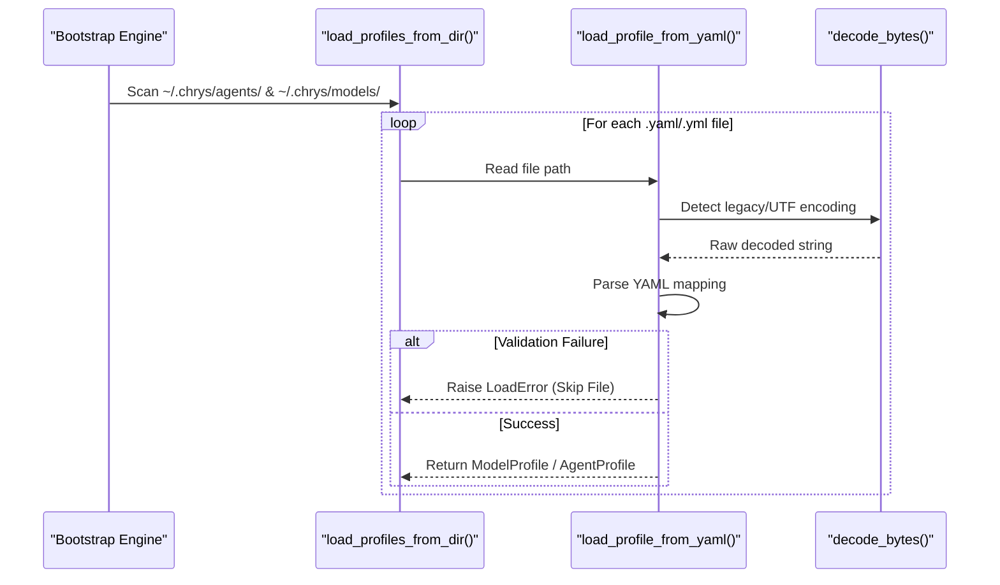

<!-- source: DeepWiki mcp.deepwiki.com · repo openJiuwen-ai/iCode · page 6.1 Agent and Model Profiles · fetched 2026-11-02 -->

# Agent and Model Profiles

<details>
<summary>Relevant source files</summary>

The following files were used as context for generating this wiki page:

- [docs/en/guides/configuration/agents.md](docs/en/guides/configuration/agents.md)
- [docs/en/guides/configuration/models.md](docs/en/guides/configuration/models.md)
- [docs/en/reference/agent-profile.md](docs/en/reference/agent-profile.md)
- [docs/zh-Hans/guides/configuration/agents.md](docs/zh-Hans/guides/configuration/agents.md)
- [docs/zh-Hans/guides/configuration/models.md](docs/zh-Hans/guides/configuration/models.md)
- [docs/zh-Hans/reference/agent-profile.md](docs/zh-Hans/reference/agent-profile.md)
- [src/chrys/app/tui/screens/main/config_actions.py](src/chrys/app/tui/screens/main/config_actions.py)
- [src/chrys/app/tui/screens/main/model_indicator.py](src/chrys/app/tui/screens/main/model_indicator.py)
- [src/chrys/app/tui/widgets/chrome/status_bar.py](src/chrys/app/tui/widgets/chrome/status_bar.py)
- [src/chrys/service/profiles/agents/loader.py](src/chrys/service/profiles/agents/loader.py)
- [src/chrys/service/profiles/models/loader.py](src/chrys/service/profiles/models/loader.py)
- [src/chrys/service/profiles/models/options.py](src/chrys/service/profiles/models/options.py)
- [tests/orchestration/engine/run/test_stream_stall.py](tests/orchestration/engine/run/test_stream_stall.py)
- [tests/service/profiles/agents/test_loader.py](tests/service/profiles/agents/test_loader.py)
- [tests/service/profiles/models/test_loader.py](tests/service/profiles/models/test_loader.py)
- [tests/service/profiles/models/test_options.py](tests/service/profiles/models/test_options.py)

</details>


## Purpose and Scope
This section covers the technical architecture and implementation details of agent and model profiles within the `iCode` (`chrys`) service layer. It details the schemas (`AgentProfile`, `ModelProfile`), YAML loaders, encoding detection, strict type coercion rules, chat options parsing, environment variable templating, and their integration with the TUI configuration screens and CLI commands.

---

## 1. Profile Schemas and Dataclasses

Model and agent profiles are modeled as immutable Python dataclasses that map directly to user-editable YAML files stored in platform-specific configuration directories (`~/.chrys/models/` and `~/.chrys/agents/`). 

Model profiles define wire connectivity parameters, including model identifiers, API styles (`chat_completions` vs `responses`), timeout thresholds, stream controls, and vendor-specific protocol adaptations like Anthropic thinking block bindings. Agent profiles define behavioral rules, system instructions, tool white-lists, memory references, compaction policies, and sub-agent hierarchies.

```mermaid
graph TD
    YAMLFile[""User YAML File (<name>.yaml)""] -->|Decoded via decode_bytes| Loader[""loader.py / load_profile_from_yaml()""]
    Loader -->|Coerces & Validates Fields| Coercion[""coercion.py / _coerce_int()""]
    Coercion -->|Constructs Dataclass| Schema[""schema.py / ModelProfile & AgentProfile""]
    Schema -->|Parses JSON Options| Options[""options.py / parse_chat_options()""]
    Options -->|Provides Runtime Payload| Kernel[""Agent Kernel & Wire Clients""]

    classDef default fill:#fff,stroke:#333,stroke-width:1px;
```

**Sources:** `src/chrys/service/profiles/models/loader.py`, `src/chrys/service/profiles/agents/loader.py`, `docs/en/reference/agent-profile.md`

---

## 2. Loaders, Encoding Detection and Normalization

Profiles are loaded at application startup from disk using `load_profile_from_yaml()` and `load_profiles_from_dir()`. Because user profiles frequently contain international characters, loaders invoke robust encoding detection via `decode_bytes` to safely process UTF-8, UTF-8 with BOM, legacy encodings like GBK/GB18030, and UTF-16/UTF-32.

If a YAML file is damaged or fails validation, a `ModelProfileLoadError` or `AgentProfileLoadError` is raised. The file is skipped without mutating its bytes on disk, preventing corrupt configurations from halting application bootstrap.



**Sources:** `src/chrys/service/profiles/models/loader.py`, `src/chrys/service/profiles/agents/loader.py`, `tests/service/profiles/models/test_loader.py`

---

## 3. Strict Type Coercion and Safety Rules

To prevent silent misconfigurations—such as YAML booleans interpreting as numeric values—loaders enforce explicit type validation. Functions like `_coerce_int` and `_coerce_float` explicitly reject Python `bool` types before casting values.

- **Integer Coercion**: A YAML boolean (`true` or `false`) passed to a field like `max_output_tokens` would otherwise coerce to `1` or `0` in Python. Coercion guards explicitly reject booleans and non-numeric inputs.
- **Thinking Block Bindings**: Anthropic profile thinking modes are validated against `VALID_THINKING_BLOCK_BINDINGS` (`auto`, `drop_block`, `error`, `off`). Unrecognized strings or malformed configurations fail loading.
- **Legacy Migrations**: `_migrate_chat_options_output_cap()` extracts legacy provider-native token limits from `chat_options` JSON strings (such as `max_tokens`) and migrates them to the canonical top-level `max_output_tokens` attribute.

```c
// Conceptual Coercion Control Flow
if (isinstance(value, bool)) {
    raise ModelProfileLoadError("Field must be an integer, got bool");
}
```

**Sources:** `src/chrys/service/profiles/models/loader.py:37-100()`, `src/chrys/service/profiles/agents/loader.py:64-142()`, `tests/service/profiles/models/test_loader.py:25-101()`

---

## 4. Chat Options and Environment Variable Templating

Model profiles store provider-specific request overrides in `chat_options` as serialized JSON strings. When preparing execution payloads, `parse_chat_options()` decodes these strings, resolves environment variable templates (`{{ENV_VAR}}`), strips protected safety keys, and removes Chrys-managed headers.

```mermaid
graph TD
    RawJSON[""ModelProfile.chat_options (JSON String)""] -->|json.loads()| Parse[""parse_chat_options()""]
    Parse -->|Resolve Templates| EnvResolver[""resolve_env_template_values()""]
    EnvResolver -->|Strip Forbidden Keys| Security[""_drop_protected_chat_options()""]
    Security -->|Sanitize Extra Headers| HeaderFilter[""_drop_managed_extra_headers()""]
    HeaderFilter -->|Effective Dict| Client[""Chat Completions / Responses Codec""]

    classDef default fill:#fff,stroke:#333,stroke-width:1px;
```

- **Protected Key Stripping**: Keys that bypass context admission or manage conversation state internally (`messages`, `prompt`, `conversation_id`, `continuation_token`) are automatically stripped from `chat_options` and `extra_body` to prevent state corruption.
- **Header Protection**: Chrys-managed headers (such as `X-Chrys-*` tracing or session IDs) injected via `extra_headers` are dropped to prevent client-side spoofing of observability metadata.

**Sources:** `src/chrys/service/profiles/models/options.py:32-177()`, `tests/service/profiles/models/test_options.py:37-141()`

---

## 5. CLI and TUI Model/Agent Screens

Profiles are managed interactively through Terminal User Interface (TUI) windows or queried via the CLI.

- **TUI Model Screen (`F4` or `/models`)**: Renders a split-pane view with profile lists on the left and schema forms on the right. During active task execution, the model configuration window automatically switches to read-only mode.
- **TUI Agent Screen (`F2` or `/agents`)**: Manages agent properties across modular tabs (`basic`, `instructions`, `tools`, `sub-agents`, `skills`, `mcp`, `memory`, `compaction`). Built-in agents (`Code`, `QA`, `Explore`, `General`) can be reset to factory defaults via the interface, regenerating or clearing user override YAMLs in `~/.chrys/agents/`.
- **CLI Commands**: Subcommands like `icode profiles` and `icode agents` inspect, validate, and list loaded profiles across active workspaces.

**Sources:** `docs/en/guides/configuration/models.md:1-163()`, `docs/en/guides/configuration/agents.md:1-116()`, `docs/en/reference/agent-profile.md:1-88()`

---

