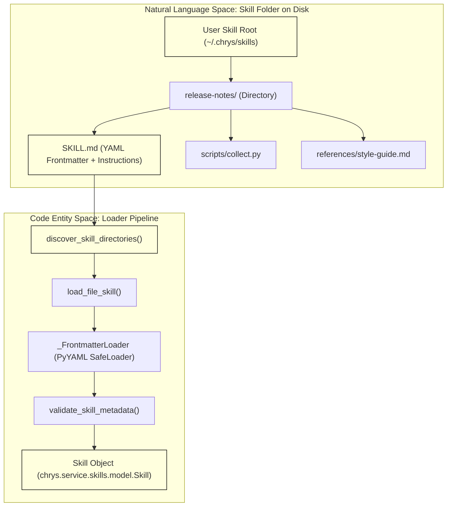
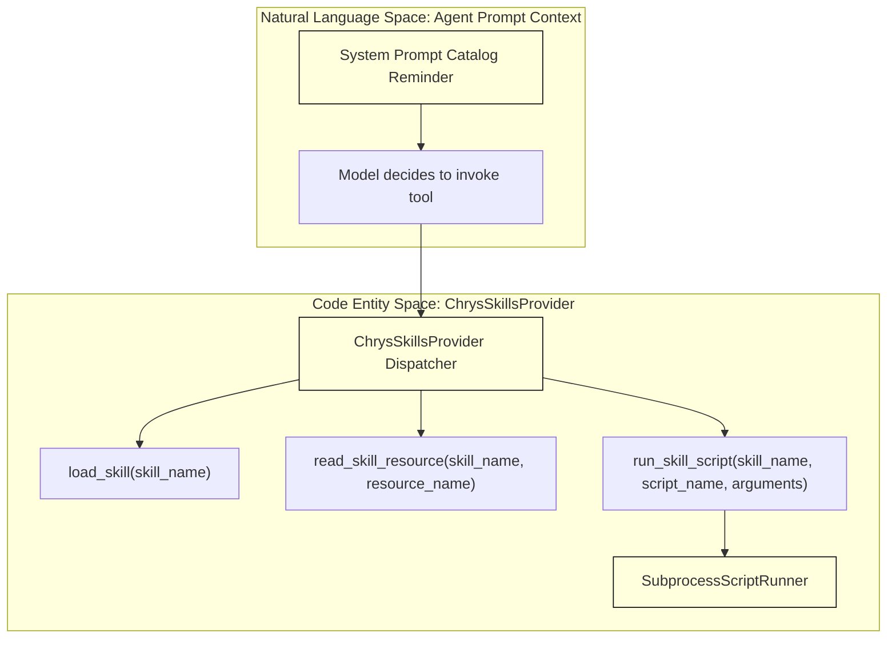

<!-- source: DeepWiki mcp.deepwiki.com · repo openJiuwen-ai/iCode · page 6.2 Skills · fetched 2026-11-02 -->

# Skills

Relevant source files

The following files were used as context for generating this wiki page:

- [docs/en/guides/extensions/skills.md](docs/en/guides/extensions/skills.md)
- [docs/zh-Hans/guides/extensions/skills.md](docs/zh-Hans/guides/extensions/skills.md)
- [src/chrys/app/tui/widgets/chat/renderers/skill.py](src/chrys/app/tui/widgets/chat/renderers/skill.py)
- [src/chrys/service/skills/loader.py](src/chrys/service/skills/loader.py)
- [src/chrys/service/skills/provider.py](src/chrys/service/skills/provider.py)
- [tests/service/skills/test_loader.py](tests/service/skills/test_loader.py)
- [tests/service/skills/test_model_facing_text.py](tests/service/skills/test_model_facing_text.py)
- [tests/service/skills/test_tool_arguments.py](tests/service/skills/test_tool_arguments.py)

## Purpose and Scope

Skills in iCode (`chrys`) provide reusable instructions, reference materials, and scripts that extend agent capabilities for specialized workflows. This page details the technical implementation of skill discovery, the parser and loader, the `ChrysSkillsProvider` runtime service, tool definitions (`load_skill`, `read_skill_resource`, `run_skill_script`), and model-facing text handling.

Sources:
- `docs/en/guides/extensions/skills.md:1-50` [docs/en/guides/extensions/skills.md]()
- `src/chrys/service/skills/loader.py:5-30` [src/chrys/service/skills/loader.py]()
- `src/chrys/service/skills/provider.py:5-18` [src/chrys/service/skills/provider.py]()

---

## Skill Discovery and Loader

The skill discovery and loader subsystem (`chrys.service.skills.loader`) scans configured directory roots for folders containing a `SKILL.md` file, validates frontmatter metadata, and builds `Skill`, `SkillResource`, and `SkillScript` model instances.

### Discovery and Parsing Architecture

Discovery searches each configured root path up to `MAX_SEARCH_DEPTH` (2 levels) deep [src/chrys/service/skills/loader.py:53-55](). When a `SKILL.md` file is located, its containing directory defines the skill boundary. Resource and script files are recursively scanned within the skill folder up to `DEFAULT_SEARCH_DEPTH` (2 levels) [src/chrys/service/skills/loader.py:87-89]().

Sources:
- `src/chrys/service/skills/loader.py:7-30` [src/chrys/service/skills/loader.py]()
- `src/chrys/service/skills/loader.py:53-90` [src/chrys/service/skills/loader.py]()

### Frontmatter Safety and Tolerant Fallbacks

The loader uses a specialized PyYAML safe loader subclass, `_FrontmatterLoader`, which explicitly disables anchor and alias expansion to prevent recursive expansion attacks, while enforcing a maximum nesting depth of `MAX_FRONTMATTER_DEPTH` (64 levels) [src/chrys/service/skills/loader.py:107-131](). 

If a file's frontmatter contains non-strict YAML scalar formatting (such as unquoted colons), a line-based fallback parser (`_fallback_line_parse`) scans top-level `key: value` pairs line by line [src/chrys/service/skills/loader.py:133-136]().

Metadata validation is enforced by `validate_skill_metadata`, checking that the skill name matches its parent directory name, contains only lowercase alphanumeric characters and hyphens, and stays within character length ceilings (`MAX_NAME_LENGTH` = 64, `MAX_DESCRIPTION_LENGTH` = 1024) [src/chrys/service/skills/loader.py:91-156]() and `tests/service/skills/test_loader.py:176-191` [tests/service/skills/test_loader.py]().

Sources:
- `src/chrys/service/skills/loader.py:103-169` [src/chrys/service/skills/loader.py]()
- `tests/service/skills/test_loader.py:84-191` [tests/service/skills/test_loader.py]()

---

## Skill Provider and Progressive Tools

The `ChrysSkillsProvider` class (`chrys.service.skills.provider`) manages runtime skill catalogs, static prompt instructions, and the registration of core skill tools.

### Progressive Disclosure Tools

To minimize context window saturation, skills are exposed via a progressive disclosure model where the initial system prompt includes only a lightweight catalog summary. The agent invokes specific tools to inspect full instructions or data:

1. `load_skill`: Retrieves full instructions and file metadata for a specific file-based or inline skill.
2. `read_skill_resource`: Reads a named resource file attached to a skill within token budgeting limits (`DEFAULT_RESOURCE_MAX_TOKENS`) [src/chrys/service/skills/provider.py:5-18]() and [src/chrys/service/skills/constants.py]().
3. `run_skill_script`: Executes an allowed script file attached to the skill with positional arguments and an explicit working directory [src/chrys/service/skills/provider.py:15-18]().

Sources:
- `src/chrys/service/skills/provider.py:5-45` [src/chrys/service/skills/provider.py]()
- `src/chrys/app/tui/widgets/chat/renderers/skill.py:5-16` [src/chrys/app/tui/widgets/chat/renderers/skill.py]()

### Tool Argument Validation and Rejection

Top-level tool arguments are strictly validated. Any unknown argument passed to `load_skill`, `read_skill_resource`, or `run_skill_script` results in an explicit argument parsing error metadata classification (`TOOL_ERROR_KIND_METADATA_KEY`) rather than silent omission [tests/service/skills/test_tool_arguments.py:3-57]() [tests/service/skills/test_tool_arguments.py]().

Sources:
- `tests/service/skills/test_tool_arguments.py:1-58` [tests/service/skills/test_tool_arguments.py]()

---

## Script Execution and Safety

Skill scripts execute locally through `run_skill_script`. Safety rules govern their execution:

- **Extension Whitelisting**: Script file extensions must match configured allowed extensions (defaulting to `.py`, `.sh`, `.ps1`) [docs/en/guides/extensions/skills.md:48-49]().
- **Output Ceilings**: Script stdout/stderr streams exceeding 32 MiB are truncated, preserving the beginning and end segments while informing the agent of truncated bytes [docs/en/guides/extensions/skills.md:54-55]().
- **Sandbox Note**: Skill scripts run as local processes without sandbox isolation, requiring pre-installation inspection of trusted sources [docs/en/guides/extensions/skills.md:52-53]().

Sources:
- `docs/en/guides/extensions/skills.md:48-55` [docs/en/guides/extensions/skills.md]()

---

## Model-Facing Text and Encoding Resilience

All skill names, descriptions, resource contents, and error messages rendered to the model or serialized into JSON histories must remain safe against encoding issues and malformed Unicode strings (such as lone surrogate code points).

Tests in `tests/service/skills/test_model_facing_text.py` verify that `ChrysSkillsProvider` catalogs, slash-reference reminders, and token-budgeted resource readers successfully survive lone surrogate characters (`\ud800`, `\udcff`) and undecodable byte filenames without breaking downstream wire serialization (`json.dumps` with `ensure_ascii=False`) [tests/service/skills/test_model_facing_text.py:3-100]().

Sources:
- `tests/service/skills/test_model_facing_text.py:3-101` [tests/service/skills/test_model_facing_text.py]()

---

