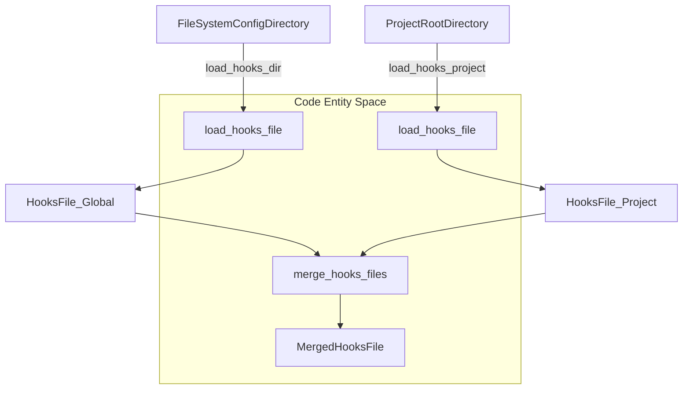
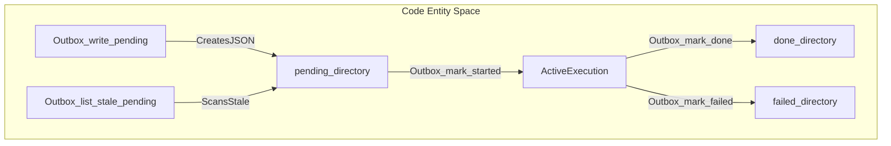

<!-- source: DeepWiki mcp.deepwiki.com · repo openJiuwen-ai/iCode · page 6.3 Hooks · fetched 2026-11-02 -->

# Hooks

Relevant source files

The following files were used as context for generating this wiki page:

- [docs/en/reference/hooks.md](docs/en/reference/hooks.md)
- [docs/zh-Hans/reference/hooks.md](docs/zh-Hans/reference/hooks.md)
- [src/chrys/app/tui/support/prompt_history.py](src/chrys/app/tui/support/prompt_history.py)
- [src/chrys/foundation/text/lines.py](src/chrys/foundation/text/lines.py)
- [src/chrys/service/hooks/docs/authoring.md](src/chrys/service/hooks/docs/authoring.md)
- [src/chrys/service/hooks/loader.py](src/chrys/service/hooks/loader.py)
- [src/chrys/service/hooks/outbox.py](src/chrys/service/hooks/outbox.py)
- [src/chrys/service/tools/builtins/doc_converter/__init__.py](src/chrys/service/tools/builtins/doc_converter/__init__.py)
- [src/chrys/service/tools/builtins/filesystem.py](src/chrys/service/tools/builtins/filesystem.py)
- [tests/app/tui/support/test_prompt_history.py](tests/app/tui/support/test_prompt_history.py)
- [tests/orchestration/engine/build/test_lifecycle_hooks.py](tests/orchestration/engine/build/test_lifecycle_hooks.py)
- [tests/service/hooks/test_loader.py](tests/service/hooks/test_loader.py)
- [tests/service/hooks/test_outbox.py](tests/service/hooks/test_outbox.py)
- [tests/service/tools/test_filesystem.py](tests/service/tools/test_filesystem.py)
- [tests/support/windows_replace.py](tests/support/windows_replace.py)

## Purpose and Scope
This section covers the implementation and runtime mechanics of lifecycle hooks within the `chrys` agent engine. Hooks allow automated local script or command execution in response to agent lifecycle events, tool calls, user prompts, and context compaction stages. Topics include configuration loading and schema merging, the subprocess execution process contract, the durable outbox for reliable task recovery, and lifecycle hook integration during agent engine builds.

Sources: `docs/en/reference/hooks.md:1-50()`, `docs/zh-Hans/reference/hooks.md:1-50()`

---

## Hook Loader and Configuration
The hook loader parses global and project-level configuration files (`hooks.yaml`, `hooks.yml`, `hooks.json`) into strongly typed dataclass structures. It supports encoding sniffing (UTF-8, UTF-8-sig, UTF-16, UTF-32, and GBK/GB18030) and fail-fast validation via `HooksConfigError`.

Files and functions involved:
- `load_hooks_file(path: Path) -> HooksFile`: Reads and decodes a hooks configuration file [src/chrys/service/hooks/loader.py:58-86()].
- `load_hooks_dir(config_dir: Path) -> HooksFile`: Discovers and loads global hook configurations under `~/.chrys/hooks/` [src/chrys/service/hooks/loader.py:89-102()].
- `load_hooks_project(project_root: Path) -> HooksFile | None`: Discovers and loads repository-local hook configurations under `<project_root>/.chrys/hooks/` [src/chrys/service/hooks/loader.py:105-121()].
- `merge_hooks_files(project: HooksFile | None, global_: HooksFile | None) -> MergedHooksFile`: Combines project and global hook definitions, enforcing project-first ordering and field-by-field settings precedence [src/chrys/service/hooks/loader.py:124-167()].

Sources: `src/chrys/service/hooks/loader.py:58-167()`, `tests/service/hooks/test_loader.py:25-141()`

---

## Authoring Guide and Process Contract
When the engine executes a hook, it spawns an isolated subprocess according to a strict environment and file contract. The runtime provides payload data via a temporary JSON file and captures structured decisions through a result file.

- **Environment Variables**: `CHRYS_HOOK_ID`, `CHRYS_HOOK_EVENT`, `CHRYS_HOOK_PAYLOAD_FILE`, `CHRYS_HOOK_RESULT`, along with `PYTHONUTF8=1` and `PYTHONIOENCODING=utf-8` [src/chrys/service/hooks/docs/authoring.md:14-23()].
- **Payload Envelope**: Every payload contains a base envelope (`schema`, `event`, `timestamp`, `session_id`, `profile`, `cwd`) plus event-specific attributes such as `tool`, `result`, or `turn` [src/chrys/service/hooks/docs/authoring.md:43-112()].
- **Decision Contract**: Blocking hooks may write a decision object containing `action: "block"` or `action: "modify"` to `$CHRYS_HOOK_RESULT` to gate or rewrite agent behavior [src/chrys/service/hooks/docs/authoring.md:193-210()].

Sources: `src/chrys/service/hooks/docs/authoring.md:1-210()`

---

## Durable Outbox
For non-blocking tasks requiring reliable delivery across process restarts or crashes, the `Outbox` class manages job persistence through file-system queues divided into `pending`, `done`, and `failed` directories.

Key classes and routines in `src/chrys/service/hooks/outbox.py`:
- `Outbox(base_dir: Path)`: Initializes outbox subdirectories and guarantees owner-only file permissions (`0o600`) [tests/service/hooks/test_outbox.py:19-65()].
- `write_pending(...)`: Serializes hook payloads into the pending queue [tests/service/hooks/test_outbox.py:26-30()].
- `mark_started(job)`: Moves or updates task state while handling briefly locked files via retry loops [tests/service/hooks/test_outbox.py:43-53()].
- `list_stale_pending(retry_age_seconds)`: Identifies uncompleted jobs exceeding age thresholds for asynchronous background retry [tests/service/hooks/test_outbox.py:81-98()].

Sources: `src/chrys/service/hooks/outbox.py:15-120()`, `tests/service/hooks/test_outbox.py:19-120()`

---

## Lifecycle Hook Integration in Engine Builds
During agent session bootstrap and engine assembly, hook managers are instantiated and configured via `AgentLoader`. They coordinate with trajectory recorders, settings handles, and event buses.

- `AgentLoader.build_hook_manager`: Constructs and attaches hook handlers during engine construction [tests/orchestration/engine/build/test_lifecycle_hooks.py:105-110()].
- Runtime Hook Snapshotting: Ensures loaded hook configurations preserve source provenance while stripping out sensitive script execution parameters when inspecting runtime state [tests/orchestration/engine/build/test_lifecycle_hooks.py:163-180()].

Sources: `tests/orchestration/engine/build/test_lifecycle_hooks.py:1-180()`

---

