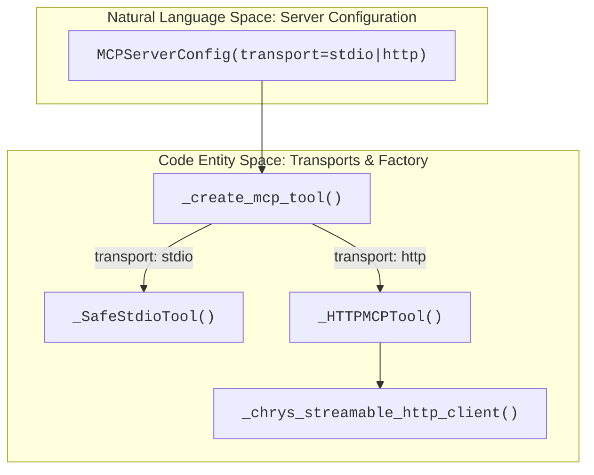
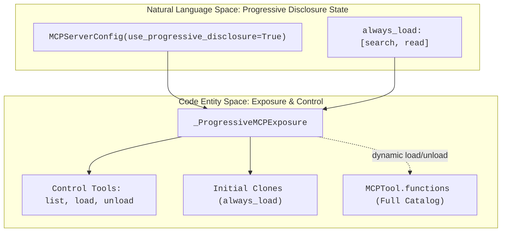

<!-- source: DeepWiki mcp.deepwiki.com · repo openJiuwen-ai/iCode · page 6.4 MCP Integration · fetched 2026-11-02 -->

# MCP Integration

Relevant source files

The following files were used as context for generating this wiki page:

- [docs/en/guides/extensions/mcp.md](docs/en/guides/extensions/mcp.md)
- [docs/zh-Hans/guides/extensions/mcp.md](docs/zh-Hans/guides/extensions/mcp.md)
- [src/chrys/service/mcp/_connection.py](src/chrys/service/mcp/_connection.py)
- [src/chrys/service/mcp/_http_transport.py](src/chrys/service/mcp/_http_transport.py)
- [src/chrys/service/mcp/_progressive.py](src/chrys/service/mcp/_progressive.py)
- [src/chrys/service/mcp/adapter.py](src/chrys/service/mcp/adapter.py)
- [src/chrys/service/mcp/errors.py](src/chrys/service/mcp/errors.py)
- [src/chrys/service/mcp/owned.py](src/chrys/service/mcp/owned.py)
- [tests/service/mcp/test_adapter.py](tests/service/mcp/test_adapter.py)
- [tests/service/mcp/test_http_transport.py](tests/service/mcp/test_http_transport.py)
- [tests/service/mcp/test_model_visible_errors.py](tests/service/mcp/test_model_visible_errors.py)
- [tests/service/mcp/test_owned.py](tests/service/mcp/test_owned.py)
- [tests/service/mcp/test_private_contracts.py](tests/service/mcp/test_private_contracts.py)
- [tests/service/mcp/test_progressive.py](tests/service/mcp/test_progressive.py)
- [tests/service/mcp/test_tool_result_content.py](tests/service/mcp/test_tool_result_content.py)

## Purpose and Scope

This page documents the Model Context Protocol (MCP) integration subsystem within Chrys (`src/chrys/service/mcp/`), which enables the engine to connect to third-party or custom MCP servers, expose their tools, resources, and prompts as Chrys `FunctionTool` instances, manage connections via stdio and streamable HTTP transports, execute progressive tool disclosure, apply result limits and caching, and isolate failure surfaces.

Sources: `src/chrys/service/mcp/owned.py:1-12`, `src/chrys/service/mcp/adapter.py:1-18` [src/chrys/service/mcp/owned.py](), [src/chrys/service/mcp/adapter.py]()

---

## 1. Owned MCP Servers and Transports

Chrys implements an owned MCP client tool engine that wraps standard MCP server interactions (`src/chrys/service/mcp/owned.py`). It manages connection lifecycles, tool loading, prompt parsing, and OpenTelemetry spans without relying on WebSocket or long-running task driving.

### Transport Implementations

Two transport mechanisms are supported via server configurations (`src/chrys/service/mcp/_connection.py`):
1. **Stdio Transport (`_SafeStdioTool`)**: Spawns local subprocesses via safe parameters, capturing stderr separately from the JSON-RPC stdout channel to guard protocol integrity.
2. **HTTP Transport (`_HTTPMCPTool`)**: Connects to remote endpoints using a streamable HTTP transport (`src/chrys/service/mcp/_http_transport.py`).

*Figure 1: MCP Server Configuration to Transport Code Entities*

Sources: `src/chrys/service/mcp/_connection.py:113-155`, `src/chrys/service/mcp/_http_transport.py:35-76` [src/chrys/service/mcp/_connection.py](), [src/chrys/service/mcp/_http_transport.py]()

### HTTP POST-Failure Wakeup Patch

The streamable HTTP client patches the upstream MCP SDK's `StreamableHTTPTransport._handle_post_request` hook (`src/chrys/service/mcp/_http_transport.py`). When an HTTP POST request fails or times out, pending `ClientSession.send_request` calls would otherwise hang indefinitely waiting for responses. The patched transport converts HTTP failures into synthetic JSON-RPC error messages (`LOCAL_HTTP_FAILURE_ERROR_DATA`), ensuring clean failure propagation without locking the agent build.

Sources: `src/chrys/service/mcp/_http_transport.py:35-156` [src/chrys/service/mcp/_http_transport.py]()

---

## 2. MCP Adapter and Namespace Management

The `MCPAdapter` class (`src/chrys/service/mcp/adapter.py`) manages connecting to MCP servers, parsing server capabilities into an `MCPTestReport`, and converting remote tools into Chrys `FunctionTool` instances.

### Tool Name Normalization and Validation

Model providers impose strict naming rules (rejecting periods or special punctuation). Chrys normalizes tool names using `_normalize_mcp_name()` and prefixes them when requested (`src/chrys/service/mcp/owned.py`). 

To prevent naming conflicts, `MCPAdapter` validates namespaces and detects collisions or ambiguities:
* **`MCPToolNameCollisionError`**: Raised when permitted tool names are not globally unique across servers.
* **`MCPToolNameAmbiguityError`**: Raised when a configured `allowed_tools` or `always_load` filter matches multiple remote tools without a disambiguating prefix.
* **`MCPToolNameValidationError`**: Raised when exposed tool names violate model provider compatibility constraints.

Sources: `src/chrys/service/mcp/owned.py:119-134`, `src/chrys/service/mcp/errors.py:92-167`, `src/chrys/service/mcp/adapter.py:3-18` [src/chrys/service/mcp/owned.py](), [src/chrys/service/mcp/errors.py](), [src/chrys/service/mcp/adapter.py]()

---

## 3. Progressive Tool Disclosure

When `use_progressive_disclosure` is enabled in `MCPServerConfig`, the engine avoids injecting large remote tool catalogs into the model context upfront. Instead, `_ProgressiveMCPExposure` (`src/chrys/service/mcp/_progressive.py`) exposes a minimal control surface alongside any tools specified in `always_load`.

*Figure 2: Progressive MCP Disclosure Architecture*

### Control Tools
The progressive disclosure mechanism introduces three stable control tools (`src/chrys/service/mcp/_progressive.py`):
1. `list_mcp_tools`: Lists available remote tools that are not yet loaded.
2. `load_mcp_tools`: Dynamically loads specific remote tools into the active session context.
3. `unload_mcp_tools`: Unloads tools to free context space.

Sources: `src/chrys/service/mcp/_progressive.py:55-159` [src/chrys/service/mcp/_progressive.py]()

---

## 4. Result Caching, Limits and Media Handling

### Connection Caching
`MCPConnectionCache` (`src/chrys/service/mcp/cache.py`) caches active MCP server connections keyed by server configuration parameters (`mcp_config_cache_key`), avoiding redundant handshakes across agent turn iterations.

### Result Shaping and Content Decoding
Tool results returned by MCP servers undergo rigorous content sanitization and token-limit enforcement (`src/chrys/service/mcp/result_limits.py`, `src/chrys/service/mcp/content.py`):
* Binary media (images, audio) is validated and decoded from base64 (`decode_media_base64`). Malformed media items fall back to text placeholders (`INVALID_IMAGE_TEXT`, `INVALID_AUDIO_TEXT`) without failing the entire tool execution.
* Resource links are converted into model-readable text descriptions.
* Result tokens are capped against `DEFAULT_MCP_TOOL_RESULT_MAX_TOKENS` or configured server limits.

Sources: `src/chrys/service/mcp/cache.py:1-60`, `src/chrys/service/mcp/content.py:1-50`, `src/chrys/service/mcp/result_limits.py:1-80` [src/chrys/service/mcp/cache.py](), [src/chrys/service/mcp/content.py](), [src/chrys/service/mcp/result_limits.py]()

---

## 5. Error Surfaces and Failure Isolation

MCP integration failures are classified to distinguish between infrastructure issues, configuration errors, and execution failures (`src/chrys/service/mcp/errors.py`).

### Failure Isolation Strategy
* **Connection Failures**: `MCPConnectionError` captures stderr tails, process exit codes, and non-JSON stdout welcome banners emitted by misbehaving stdio servers. `connect_all()` catches individual server failures so that an offline MCP server does not block the entire agent build.
* **Model-Visible Error Filtering**: Local transport details (such as HTTP URLs containing bearer tokens or local stack traces) are stripped before returning errors to the model. The model only receives explicit server-provided error text (`ModelVisibleToolError`), while internal diagnostics remain recorded in trace logs.

Sources: `src/chrys/service/mcp/adapter.py:8-18`, `src/chrys/service/mcp/errors.py:19-167`, `tests/service/mcp/test_model_visible_errors.py:1-143` [src/chrys/service/mcp/adapter.py](), [src/chrys/service/mcp/errors.py](), [tests/service/mcp/test_model_visible_errors.py]()

---

