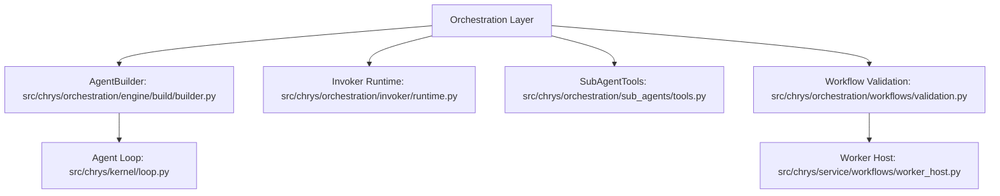
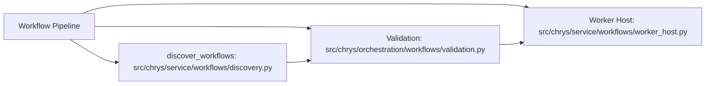

<!-- source: DeepWiki mcp.deepwiki.com · repo openJiuwen-ai/iCode · page 7 Orchestration: Engine, Sub-agents and Workflows · fetched 2026-11-02 -->

# Orchestration: Engine, Sub-agents and Workflows

Relevant source files

The following files were used as context for generating this wiki page:

- [docs/en/reference/workflows.md](docs/en/reference/workflows.md)
- [docs/zh-Hans/reference/workflows.md](docs/zh-Hans/reference/workflows.md)
- [src/chrys/orchestration/engine/build/builder.py](src/chrys/orchestration/engine/build/builder.py)
- [src/chrys/orchestration/invoker/acp.py](src/chrys/orchestration/invoker/acp.py)
- [src/chrys/orchestration/invoker/contracts.py](src/chrys/orchestration/invoker/contracts.py)
- [src/chrys/orchestration/sub_agents/kernel_policy.py](src/chrys/orchestration/sub_agents/kernel_policy.py)
- [src/chrys/orchestration/sub_agents/tools.py](src/chrys/orchestration/sub_agents/tools.py)
- [src/chrys/orchestration/workflows/agent_node.py](src/chrys/orchestration/workflows/agent_node.py)
- [src/chrys/orchestration/workflows/agent_node_build.py](src/chrys/orchestration/workflows/agent_node_build.py)
- [src/chrys/orchestration/workflows/validation.py](src/chrys/orchestration/workflows/validation.py)
- [src/chrys/service/workflows/discovery.py](src/chrys/service/workflows/discovery.py)
- [src/chrys/service/workflows/worker_host.py](src/chrys/service/workflows/worker_host.py)
- [tests/app/cli/test_workflow_validate.py](tests/app/cli/test_workflow_validate.py)
- [tests/orchestration/workflows/test_worker_diagnostics.py](tests/orchestration/workflows/test_worker_diagnostics.py)
- [tests/service/workflows/test_discovery_packages.py](tests/service/workflows/test_discovery_packages.py)
- [tests/service/workflows/test_sdk.py](tests/service/workflows/test_sdk.py)

This section covers the orchestration layer of iCode (`src/chrys/orchestration/`), which coordinates session lifecycles, agent execution engines, sub-agent invocations, and Python-based workflow execution. 

For detailed deep-dives, refer to the child pages:
- [Engine Build and Run](#7.1)
- [Invoker Runtime and Sub-agents](#7.2)
- [Workflows](#7.3)
- [Context Providers and Session State](#7.4)

---

## Architecture Overview

The orchestration layer bridges high-level agent definitions and workflows with the core execution loop and low-level LLM service clients.

*Figure 1: Orchestration subsystem hierarchy and code entities.*

Sources: `src/chrys/orchestration/engine/build/builder.py:3-10`(), `src/chrys/orchestration/sub_agents/tools.py:3-13`(), `src/chrys/orchestration/workflows/validation.py:3-13`()

---

## 7.1 Engine Build and Run

The engine assembly subsystem translates an `AgentProfile` and session configuration into an executable `Agent` instance coupled with `TurnBindings`. The `AgentBuilder` handles environment wiring, compaction strategy, tool loading, and skill providers.

For comprehensive details on agent building, bindings, session lifecycles, retry policies, settings reloads, and shutdown sequences, see [Engine Build and Run](#7.1).

Sources: `src/chrys/orchestration/engine/build/builder.py:3-10`()

---

## 7.2 Invoker Runtime and Sub-agents

The invoker runtime provides robust invocation contracts, retry tracking, and alternative transports like the Agent Client Protocol (ACP). Sub-agents are managed via `SubAgentTools`, which wrap sub-agent executions into function tools for parent agents while enforcing global and per-agent concurrency limits.

For details on invoker contracts, attempts, ACP invokers, runtime recipes, and kernel policies, see [Invoker Runtime and Sub-agents](#7.2).

Sources: `src/chrys/orchestration/sub_agents/tools.py:3-13`()

---

## 7.3 Workflows

The workflow engine executes user-defined workflows written as Python files or packages (`.chrys/workflows/`). Workflows are discovered, validated through multi-stage checks, and executed inside a secured worker host process (`worker_host.py`) communicating over an RPC protocol.

*Figure 2: Workflow discovery, validation, and worker isolation pipeline.*

For workflow SDK specifications, worker host/client coordination, and the `icode workflow` CLI, see [Workflows](#7.3).

Sources: `src/chrys/service/workflows/discovery.py:3-15`(), `src/chrys/orchestration/workflows/validation.py:3-13`(), `src/chrys/service/workflows/worker_host.py:3-25`()

---

## 7.4 Context Providers and Session State

Context management providers, documentation loaders, and session state persistence layers handle the history of conversations, checkpointing, forking, and workspace trajectory logging.

For details on context strategies, session stores, listing, persistence, and history management, see [Context Providers and Session State](#7.4).

---

