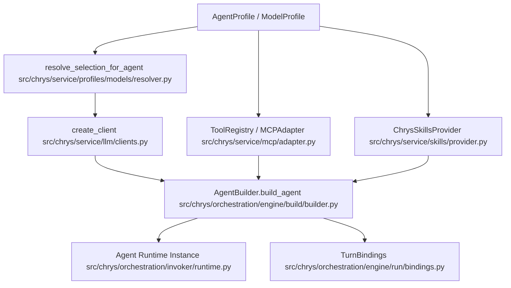
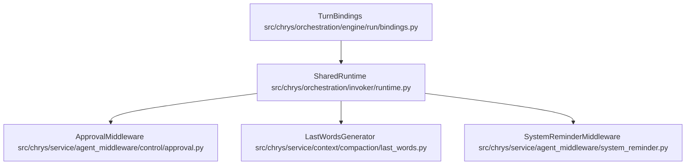
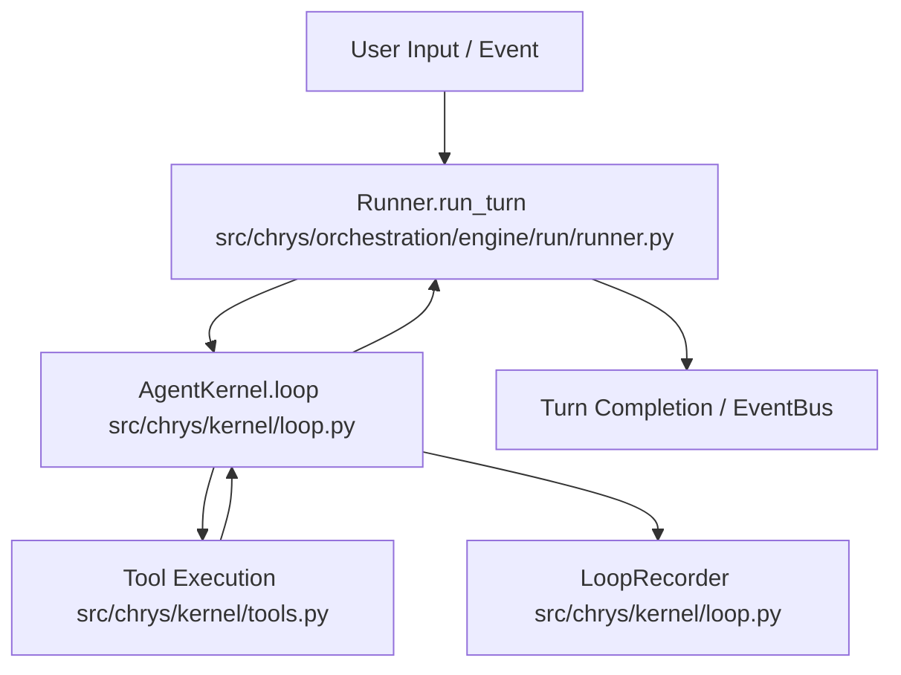

<!-- source: DeepWiki mcp.deepwiki.com · repo openJiuwen-ai/iCode · page 7.1 Engine Build and Run · fetched 2026-11-02 -->

# Engine Build and Run

Relevant source files

The following files were used as context for generating this wiki page:

- [docs/en/guides/running/icode-run.md](docs/en/guides/running/icode-run.md)
- [docs/zh-Hans/guides/running/icode-run.md](docs/zh-Hans/guides/running/icode-run.md)
- [src/chrys/app/acp/session_manager.py](src/chrys/app/acp/session_manager.py)
- [src/chrys/app/cli/run.py](src/chrys/app/cli/run.py)
- [src/chrys/app/cli/workflow.py](src/chrys/app/cli/workflow.py)
- [src/chrys/orchestration/engine/build/builder.py](src/chrys/orchestration/engine/build/builder.py)
- [src/chrys/orchestration/engine/run/runner.py](src/chrys/orchestration/engine/run/runner.py)
- [src/chrys/orchestration/engine/session_lifecycle.py](src/chrys/orchestration/engine/session_lifecycle.py)
- [src/chrys/orchestration/invoker/acp.py](src/chrys/orchestration/invoker/acp.py)
- [src/chrys/orchestration/invoker/contracts.py](src/chrys/orchestration/invoker/contracts.py)
- [src/chrys/orchestration/session_host.py](src/chrys/orchestration/session_host.py)
- [src/chrys/orchestration/sub_agents/kernel_policy.py](src/chrys/orchestration/sub_agents/kernel_policy.py)
- [src/chrys/orchestration/sub_agents/tools.py](src/chrys/orchestration/sub_agents/tools.py)
- [src/chrys/orchestration/workflows/agent_node.py](src/chrys/orchestration/workflows/agent_node.py)
- [src/chrys/orchestration/workflows/agent_node_build.py](src/chrys/orchestration/workflows/agent_node_build.py)
- [src/chrys/orchestration/workflows/coordinator.py](src/chrys/orchestration/workflows/coordinator.py)
- [src/chrys/orchestration/workflows/preview.py](src/chrys/orchestration/workflows/preview.py)
- [src/chrys/orchestration/workflows/worker_client.py](src/chrys/orchestration/workflows/worker_client.py)
- [tests/app/cli/test_run.py](tests/app/cli/test_run.py)
- [tests/foundation/i18n/test_catalogs.py](tests/foundation/i18n/test_catalogs.py)
- [tests/foundation/i18n/test_localizer.py](tests/foundation/i18n/test_localizer.py)
- [tests/orchestration/engine/build/test_agent_builder_rollback.py](tests/orchestration/engine/build/test_agent_builder_rollback.py)
- [tests/orchestration/engine/run/test_retry_lifecycle.py](tests/orchestration/engine/run/test_retry_lifecycle.py)
- [tests/orchestration/engine/state/test_current_agent.py](tests/orchestration/engine/state/test_current_agent.py)
- [tests/orchestration/engine/test_settings_reload.py](tests/orchestration/engine/test_settings_reload.py)
- [tests/orchestration/engine/test_shutdown_close.py](tests/orchestration/engine/test_shutdown_close.py)
- [tests/orchestration/sub_agents/test_client.py](tests/orchestration/sub_agents/test_client.py)
- [tests/orchestration/workflows/test_worker_client.py](tests/orchestration/workflows/test_worker_client.py)
- [tests/service/context/compaction/test_last_words.py](tests/service/context/compaction/test_last_words.py)
- [tests/service/mcp/test_cache.py](tests/service/mcp/test_cache.py)
- [tests/service/mcp/test_cache_e2e.py](tests/service/mcp/test_cache_e2e.py)

## Purpose and Scope

This page documents the orchestration engine's architecture for building, running, and managing agent execution environments in iCode. It details how agent profiles are transformed into active runtimes via `AgentBuilder`, how turn bindings and invoker resources are wired, the session lifecycle (creation, restoration, persistence, and forking), the runner turn loop execution, the error and retry recovery lifecycle, and dynamic settings reload and shutdown semantics.

---

## 1. AgentBuilder and Construction

The `AgentBuilder` infrastructure extracts environment-wiring logic from the engine into a cohesive build pipeline (`src/chrys/orchestration/engine/build/builder.py`). Given an `AgentProfile` and configuration settings, it orchestrates model selection, compaction strategies, memory loading, tool registries, MCP adapters, skills, and middleware chains to construct an executable `Agent` and associated `TurnBindings`.

*Sources: `src/chrys/orchestration/engine/build/builder.py:1-162()`, `tests/orchestration/engine/build/test_agent_builder_rollback.py:1-100()`*

When build steps fail midway, `build_agent` executes a reverse-order resource rollback to prevent orphaned subprocesses (such as MCP stdio servers) or un-exited agent contexts.

---

## 2. TurnBindings and Invoker Runtimes

`TurnBindings` and shared runtimes (`src/chrys/orchestration/engine/run/bindings.py` and `src/chrys/orchestration/invoker/runtime.py`) package the closure state needed for an agent turn. This includes context inputs, approval middlewares, system reminders, and last-words compaction generators.

| Component | Code Module | Role |
| :--- | :--- | :--- |
| `TurnBindings` | `src/chrys/orchestration/engine/run/bindings.py` | Holds references to the loaded agent, turn context, and execution resources. |
| `SharedRuntime` | `src/chrys/orchestration/invoker/runtime.py` | Encapsulates shared event publishers, bus connections, and session telemetry state. |
| `ApprovalMiddleware` | `src/chrys/service/agent_middleware/control/approval.py` | Intercepts tool mutations requiring user permission or policy evaluation. |

*Sources: `src/chrys/orchestration/engine/build/builder.py:1-100()`, `src/chrys/orchestration/engine/run/bindings.py:1-50()`*

---

## 3. Session Lifecycle

Sessions manage persistence, state storage, and historical checkpoints. The session lifecycle is managed by `ChrysSessionHost` (`src/chrys/orchestration/session_host.py`) and session state helpers (`src/chrys/orchestration/engine/session_lifecycle.py`).

- **Creation**: Initializes a unique session identifier, binds environment context (`SessionEnvironment`), and sets up JSON file state stores (`JsonFileStateStore`).
- **Restoration**: Reloads message history, context fingerprints, and profile bindings from disk.
- **Forking**: Clones existing sessions to branch exploration paths or sub-agent execution contexts while retaining parent session lineage references.

*Sources: `src/chrys/orchestration/session_host.py:1-45()`, `src/chrys/orchestration/engine/session_lifecycle.py:1-60()`*

---

## 4. Runner and Turn Execution

The runner (`src/chrys/orchestration/engine/run/runner.py`) handles the execution of turns within an agent session. It coordinates user inputs, dispatches agent loops, captures intermediate progress via the `EventBus`, and formats final outputs.

*Sources: `src/chrys/orchestration/engine/run/runner.py:1-80()`, `src/chrys/kernel/loop.py:1-50()`*

---

## 5. Retry Lifecycle

Transient errors, rate limits, context overflows, and malformed provider outputs are intercepted by the error classification and retry machinery (`src/chrys/foundation/retry.py` and `src/chrys/orchestration/engine/execution.py`).

- **ErrorKind Classification**: Categorizes errors into retryable communication failures, rate limits, provider signal rejections, or terminal validation errors.
- **PendingRetry**: Manages exponential backoff schedules, corrective prompt injections (e.g., asking the model to fix a schema violation), and last-words compaction retries.

*Sources: `src/chrys/orchestration/engine/execution.py:1-70()`, `tests/orchestration/engine/run/test_retry_lifecycle.py:1-50()`*

---

## 6. Settings Reload and Shutdown

The engine lifecycle state machine (`src/chrys/orchestration/engine/state/machine.py`) and assembly module (`src/chrys/orchestration/engine/assembly.py`) govern configuration reloads and clean shutdowns.

- **Settings Reload**: Detects changes to `settings.yaml` or environment overrides (`CHRYS_*`), re-coerces settings, and updates active profiles without dropping valid session history.
- **Shutdown**: Asynchronously closes all active resources, terminates MCP subprocesses through connection caches, flushes hooks (`HookManager`), and releases active pass handles [tests/orchestration/engine/test_shutdown_close.py:1-131(), tests/orchestration/engine/state/test_current_agent.py:33-61()].

*Sources: `src/chrys/orchestration/engine/state/machine.py:1-50()`, `tests/orchestration/engine/test_shutdown_close.py:1-131()`*

---

