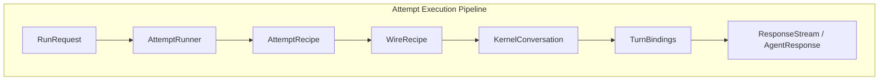
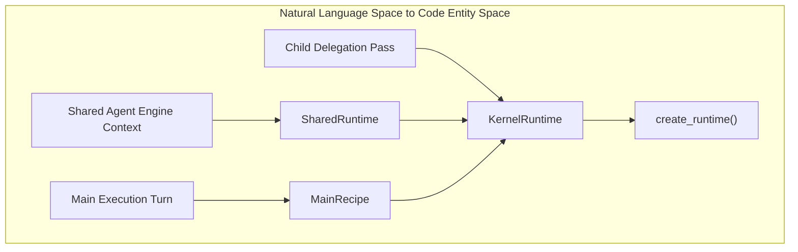
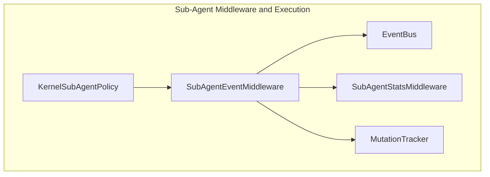

<!-- source: DeepWiki mcp.deepwiki.com · repo openJiuwen-ai/iCode · page 7.2 Invoker Runtime and Sub-agents · fetched 2026-11-02 -->

# Invoker Runtime and Sub-agents

Relevant source files

The following files were used as context for generating this wiki page:

- [src/chrys/orchestration/engine/run/bindings.py](src/chrys/orchestration/engine/run/bindings.py)
- [src/chrys/service/agent_middleware/events/hosted_tools.py](src/chrys/service/agent_middleware/events/hosted_tools.py)
- [src/chrys/service/agent_middleware/events/sub_agent_events.py](src/chrys/service/agent_middleware/events/sub_agent_events.py)
- [tests/orchestration/engine/test_hosted_presentation.py](tests/orchestration/engine/test_hosted_presentation.py)
- [tests/orchestration/invoker/test_documentation.py](tests/orchestration/invoker/test_documentation.py)
- [tests/orchestration/invoker/test_runtime_recipes.py](tests/orchestration/invoker/test_runtime_recipes.py)
- [tests/service/agent_middleware/test_hosted_tools.py](tests/service/agent_middleware/test_hosted_tools.py)

### Purpose and Scope
This document covers the technical design and implementation of the invoker runtime, execution attempts, runtime recipes, and sub-agent policies within `iCode` (`chrys`). The subsystem coordinates agent turn lifecycles, wire retries, isolation boundaries, sub-agent delegation, and event emission across main and child agent sessions.

---

## 1. Invoker Contracts and Core Types

The invoker layer defines strongly-typed execution intents, requests, and outcomes to decouple frontends and orchestration loops from kernel primitives. 

* `RunIntent`: Specifies the high-level purpose of an invocation request (e.g., user-driven chat turns, automated workflow steps, or background recovery actions).
* `RunRequest`: Encapsulates message context, model parameters, timeout constraints, and cancellation tokens for a run.
* `InvocationOutcome`: Represents the final state of an invocation pass, detailing success, failure dispositions, and recovery metadata.
* `AbortCause`: Enumerates reasons for run interruption (such as user cancellation, stream stalling, or safety triggers).

Sources: `[src/chrys/orchestration/invoker/contracts.py:1-70]()`

---

## 2. Attempt Runner and Wire Recipes

Execution resilience relies on `AttemptRunner` and `AttemptRecipe`, which wrap model calls and kernel loops with fault-tolerance, backoff schedules, and history rollback capabilities.

*Sources: `[src/chrys/orchestration/invoker/attempts.py:1-60]`, `[src/chrys/orchestration/engine/run/bindings.py:138-181]()`*

### Turn Bindings and Retry State
`TurnBindings` composes main-pass callbacks, middleware chains, and retry boundaries (`[src/chrys/orchestration/engine/run/bindings.py:138-181]()`). It manages auxiliary per-run buffers via `_TurnRetryState` (`[src/chrys/orchestration/engine/run/bindings.py:128-136]()`), ensuring that tool events, approvals, and loop recorders roll back cleanly upon history restoration or transient network failures. Transients are mitigated using backoff schedules defined by `TRANSIENT_RETRY_BACKOFF_SECONDS` (`[src/chrys/orchestration/engine/run/bindings.py:31-34, 145-151]()`).

---

## 3. Runtime Recipes and Engine Construction

Runtimes are segregated into shared resources and execution-specific recipes to optimize memory and enable fast agent switching or sub-agent spawning.

*Sources: `[src/chrys/orchestration/invoker/runtime.py:1-40]`, `[tests/orchestration/invoker/test_runtime_recipes.py:20-35]()`*

### Key Runtime Components
* `SharedRuntime`: Holds immutable or multi-session resources such as model profiles, registered tools, and shared providers (`[tests/orchestration/invoker/test_runtime_recipes.py:20-25]()`).
* `MainRecipe`: Defines configurations specific to the primary agent session, excluding transient context-management providers from shared states (`[tests/orchestration/invoker/test_runtime_recipes.py:99-120]()`).
* `KernelRuntime`: The instantiated runtime wrapper executing within a `Conversation` context (`[tests/orchestration/invoker/test_runtime_recipes.py:20-25]()`).
* `create_runtime`: Factory function binding an owner conversation, shared configuration, and recipe into an executable runtime environment (`[tests/orchestration/invoker/runtime.py:1-50]`, `[tests/orchestration/invoker/test_documentation.py:18-20]()`).

Sources: `[src/chrys/orchestration/invoker/runtime.py:1-60]`, `[tests/orchestration/invoker/test_runtime_recipes.py:99-143]()`

---

## 4. Sub-Agent Client, Kernel Policy, and Event Middleware

Sub-agents allow hierarchical delegation of complex sub-tasks. The execution policy and event pipeline govern how child agents interact with tools, report progress, and log transcripts.

*Sources: `[src/chrys/sub_agents/kernel_policy.py:1-50]`, `[src/chrys/service/agent_middleware/events/sub_agent_events.py:121-177]()`*

### Sub-Agent Middleware Classes
* `SubAgentStatsMiddleware`: A lightweight middleware recording inner tool completions without publishing live TUI events (`[src/chrys/service/agent_middleware/events/sub_agent_events.py:121-141]()`).
* `SubAgentEventMiddleware`: Created fresh per `_invoke()` call with a unique `invocation_id`. It publishes `InvocationToolCallStart` and `InvocationToolCallResult` events, tracks cumulative tool call counts, publishes `InvocationProgress`, and registers mutations with the `MutationTracker` (`[src/chrys/service/agent_middleware/events/sub_agent_events.py:143-177]()`).
* `KernelSubAgentPolicy`: Configures execution constraints, prompt overlays, and tool filtering for child agent delegations (`[src/chrys/orchestration/sub_agents/kernel_policy.py:1-60]()`).

Sources: `[src/chrys/sub_agents/kernel_policy.py:1-80]`, `[src/chrys/service/agent_middleware/events/sub_agent_events.py:121-177]()`

---

## 5. Hosted Tools and Presentation Architecture

Provider-hosted tools (such as web search, code interpreters, and remote execution environments) are normalized into uniform views and operation streams.

| Operation Class / View | Purpose / Role |
| :--- | :--- |
| `HostedToolView` | Safe, provider-neutral presentation fields for a single hosted tool occurrence (`[src/chrys/service/agent_middleware/events/hosted_tools.py:67-85]()`). |
| `IntermediateTextOp` | Text preceding or separating tool activity within an attempt (`[src/chrys/service/agent_middleware/events/hosted_tools.py:88-96]()`). |
| `HostedToolStartOp` / `HostedToolResultOp` | Lifecycle sentinels for hosted tool presentation and terminal state tracking (`[src/chrys/service/agent_middleware/events/hosted_tools.py:115-162]()`). |
| `HostedPresentationBridge` | Manages live presentation synchronization and sink operations across model streaming chunks. |

Sources: `[src/chrys/service/agent_middleware/events/hosted_tools.py:67-180]`, `[tests/service/agent_middleware/test_hosted_tools.py:35-56]()`

---

