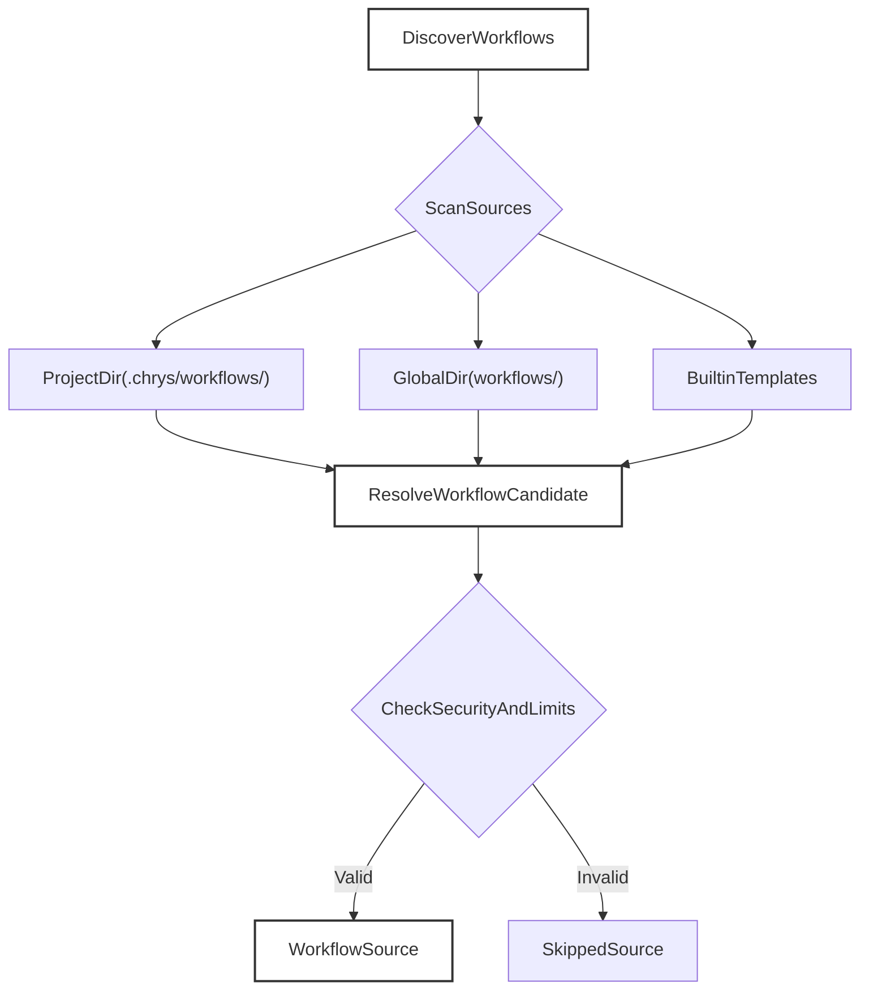
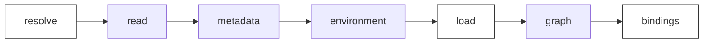
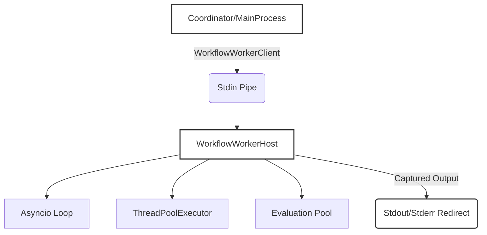
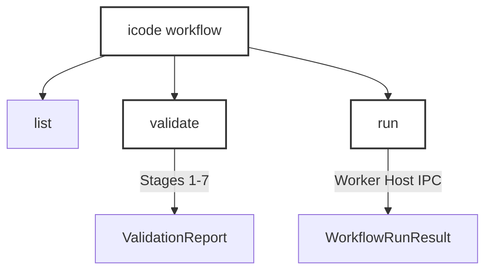

<!-- source: DeepWiki mcp.deepwiki.com · repo openJiuwen-ai/iCode · page 7.3 Workflows · fetched 2026-11-02 -->

# Workflows

<details>
<summary>Relevant source files</summary>

The following files were used as context for generating this wiki page:

- [docs/en/guides/running/icode-run.md](docs/en/guides/running/icode-run.md)
- [docs/en/reference/workflows.md](docs/en/reference/workflows.md)
- [docs/zh-Hans/guides/running/icode-run.md](docs/zh-Hans/guides/running/icode-run.md)
- [docs/zh-Hans/reference/workflows.md](docs/zh-Hans/reference/workflows.md)
- [src/chrys/app/acp/session_manager.py](src/chrys/app/acp/session_manager.py)
- [src/chrys/app/cli/run.py](src/chrys/app/cli/run.py)
- [src/chrys/app/cli/workflow.py](src/chrys/app/cli/workflow.py)
- [src/chrys/orchestration/engine/run/runner.py](src/chrys/orchestration/engine/run/runner.py)
- [src/chrys/orchestration/engine/session_lifecycle.py](src/chrys/orchestration/engine/session_lifecycle.py)
- [src/chrys/orchestration/session_host.py](src/chrys/orchestration/session_host.py)
- [src/chrys/orchestration/workflows/coordinator.py](src/chrys/orchestration/workflows/coordinator.py)
- [src/chrys/orchestration/workflows/preview.py](src/chrys/orchestration/workflows/preview.py)
- [src/chrys/orchestration/workflows/validation.py](src/chrys/orchestration/workflows/validation.py)
- [src/chrys/orchestration/workflows/worker_client.py](src/chrys/orchestration/workflows/worker_client.py)
- [src/chrys/service/workflows/discovery.py](src/chrys/service/workflows/discovery.py)
- [src/chrys/service/workflows/worker_host.py](src/chrys/service/workflows/worker_host.py)
- [tests/app/cli/test_run.py](tests/app/cli/test_run.py)
- [tests/app/cli/test_workflow_validate.py](tests/app/cli/test_workflow_validate.py)
- [tests/app/tui/screens/main/conftest.py](tests/app/tui/screens/main/conftest.py)
- [tests/orchestration/engine/run/test_retry_lifecycle.py](tests/orchestration/engine/run/test_retry_lifecycle.py)
- [tests/orchestration/workflows/test_documentation.py](tests/orchestration/workflows/test_documentation.py)
- [tests/orchestration/workflows/test_worker_client.py](tests/orchestration/workflows/test_worker_client.py)
- [tests/orchestration/workflows/test_worker_diagnostics.py](tests/orchestration/workflows/test_worker_diagnostics.py)
- [tests/service/workflows/test_discovery_packages.py](tests/service/workflows/test_discovery_packages.py)
- [tests/service/workflows/test_sdk.py](tests/service/workflows/test_sdk.py)
- [tests/support/test_workflow_previews.py](tests/support/test_workflow_previews.py)
- [tests/support/workflow_previews.py](tests/support/workflow_previews.py)

</details>


This page covers the architecture, discovery pipeline, validation engine, Python SDK, isolated worker runtime, coordinator, and command-line interface for iCode workflows. Workflows allow multi-step, conditional, and cyclic execution of agentic and Python tasks within a sandboxed interpreter environment.

---

## 1. Workflow Discovery and Layout

Workflows are discovered across three tiers with a strict precedence order. A workflow can be represented either as a single `.py` file or a package folder containing an entry point matching the folder name [src/chrys/service/workflows/discovery.py:3-15]().

### Discovery Sources and Precedence

The discovery engine scans locations in descending order of precedence [src/chrys/service/workflows/discovery.py:48-54]():
1. **Project package**: `<cwd>/.chrys/workflows/<id>/<id>.py` (`source_kind = "project"`, layout `package`)
2. **Project file**: `<cwd>/.chrys/workflows/<id>.py` (`source_kind = "project"`, layout `file`)
3. **Global package**: `<config_dir>/workflows/<id>/<id>.py` (`source_kind = "global"`, layout `package`)
4. **Global file**: `<config_dir>/workflows/<id>.py` (`source_kind = "global"`, layout `file`)
5. **Built-in templates**: Shipped internally within `chrys` (`source_kind = "builtin"`, layout `file`)

If multiple definitions share the same workflow ID, the highest priority wins, while lower-priority items are tracked as shadowed sources [src/chrys/service/workflows/discovery.py:147-150]().

### Security and Resource Limits

User-supplied workflow files are verified for secure file ownership and restricted from using symbolic links or directory junctions [src/chrys/service/workflows/discovery.py:11-15](). Packages are bounded by strict constraints:
- Maximum entry bytes: `4 * 1024 * 1024` (4 MiB) [src/chrys/service/workflows/discovery.py:42]().
- Maximum package entries: `1000` items [src/chrys/service/workflows/discovery.py:60]().
- Maximum package size: `512 * 1024 * 1024` (512 MiB) [src/chrys/service/workflows/discovery.py:61]().
- Maximum nesting depth: `16` levels [src/chrys/service/workflows/discovery.py:62]().


*Figure 1: Workflow Discovery Data Flow (`discover_workflows`)*

Sources: `[src/chrys/service/workflows/discovery.py:3-188]()`, `[tests/service/workflows/test_discovery_packages.py:1-60]()`

---

## 2. Validation and Pipeline Stages

The validation subsystem executes a sequence of stages to verify structural and execution validity without running workflow nodes or creating sessions [src/chrys/orchestration/workflows/validation.py:3-13]().

### Validation Stages

The validation pipeline runs through seven distinct stages [src/chrys/orchestration/workflows/validation.py:71-71]():
1. `resolve`: Determines target path and layout via discovery rules.
2. `read`: Reads bytes covered by confirmation protocols.
3. `metadata`: Parses PEP 723 inline script dependencies.
4. `environment`: Probes target Python interpreter.
5. `load`: Executes top-level workflow code inside a throwaway worker process to catch syntax errors, import failures, or builder misuse.
6. `graph`: Parses the resulting JSON manifest as the scheduler expects.
7. `bindings`: Resolves agent nodes against local model and profile registries [src/chrys/service/profiles/agents/registry.py](), [src/chrys/service/profiles/models/registry.py]().


*Figure 2: Validation Stage Sequence (`ValidationReport`)*

Sources: `[src/chrys/orchestration/workflows/validation.py:71-132]()`, `[tests/app/cli/test_workflow_validate.py:40-90]()`

---

## 3. Workflow SDK and Authoring API

Workflows are authored using the `chrys.workflows` API facade, which exposes tools for defining computation graphs, control flow loops, and agent bindings [docs/en/reference/workflows.md:94-111]().

### Core Authoring Classes

- `WorkflowBuilder`: Main entry point for initializing, constructing, and validating a workflow [docs/en/reference/workflows.md:112-148]().
- `BuilderScope`: Scope context used within loops to construct child nodes and edges [docs/en/reference/workflows.md:193]().
- `NodeHandle`: Reference token returned when registering a node (`python`, `agent`, etc.).
- `Workflow`: Immutable compiled output returned by `WorkflowBuilder.build()`.
- `WorkflowValue`: Encapsulates text and structured data passed between nodes.
- `NodeContext`: Provides runtime progress reporting and interactive prompting capability (`ask_user`).

```python
from chrys.workflows import WorkflowBuilder, WorkflowValue

wf = WorkflowBuilder("Echo Workflow")

def echo_fn(value: WorkflowValue) -> WorkflowValue:
    return value

node = wf.python("echo", echo_fn)
wf.start(node)
wf.output(node)
workflow = wf.build()
```
*Example: Minimal Workflow Definition*

Sources: `[docs/en/reference/workflows.md:94-194]`, `[tests/service/workflows/test_sdk.py:1-126]()`

---

## 4. Worker Host, Client, and IPC Protocol

To insulate the main orchestration process from arbitrary user code, workflows execute inside a standalone subprocess (`worker_host.py`) communicating via a line-oriented JSON protocol over stdin/stdout [src/chrys/service/workflows/worker_host.py:3-25]().

### Host Isolation and Architecture

- **Subprocess Execution**: Started as `<interpreter> worker_host.py <sdk_dir>` on any Python $\ge$ 3.9 [src/chrys/service/workflows/worker_host.py:3-7]().
- **Descriptor Separation**: File descriptor `1` is duplicated for protocol messages, while `sys.stdout` and `sys.stderr` are captured to prevent logs from corrupting protocol frames [src/chrys/service/workflows/worker_host.py:11-18]().
- **Concurrency Model**: Combines a background reader thread, a writer thread, an `asyncio` event loop for async nodes, and a `ThreadPoolExecutor` for synchronous tasks [src/chrys/service/workflows/worker_host.py:22-25]().


*Figure 3: IPC Architecture between Coordinator and Worker Host*

Sources: `[src/chrys/service/workflows/worker_host.py:1-105]()`, `[tests/orchestration/workflows/test_worker_diagnostics.py:35-70]()`

---

## 5. Previews, Trust, and Coordinator

Before running a custom workflow, users must grant trust confirmation [docs/en/reference/workflows.md:77-90]().

### Trust Confirmation Lifecycle

- **Confirmation Hashes**: Confirmation pins either the folder's aggregate digest (for packages) or the file's SHA-256 sum (for single files), coupled with environment fingerprints (interpreter path, version, platform) [docs/en/reference/workflows.md:88]().
- **Preview Caching**: `reused_preview_workflow` caches compiled manifests and environment payloads to avoid redundant subprocess boots [tests/support/test_workflow_previews.py:41-88]().
- **Coordinator**: `WorkflowCoordinator` enforces execution safety, handles asynchronous node scheduling, and manages interactive queries (`NodeContext.ask`) [src/chrys/orchestration/workflows/coordinator.py]().

Sources: `[docs/en/reference/workflows.md:77-92]`, `[src/chrys/orchestration/workflows/preview.py]`, `[tests/support/test_workflow_previews.py:41-115]()`

---

## 6. The `icode workflow` CLI

The CLI offers subcommands to discover, inspect, validate, and execute workflows directly from the terminal [src/chrys/app/cli/workflow.py:61-132]().

### Commands

- `icode workflow list`: Lists builtin templates and confirmed user workflows [src/chrys/app/cli/workflow.py:72-81]().
- `icode workflow validate <path>`: Runs preview and load diagnostics, printing precise source lines and lint warnings [src/chrys/app/cli/workflow.py:82-92]().
- `icode workflow run <workflow_id>`: Executes a workflow headlessly until outputs are produced, supporting `--trust`, `--input`, and `--timeout` parameters [src/chrys/app/cli/workflow.py:93-132]().


*Figure 4: CLI Command Routing (`src/chrys/app/cli/workflow.py`)*

Sources: `[src/chrys/app/cli/workflow.py:61-166]()`, `[tests/app/cli/test_workflow_validate.py:101-145]()`

---

