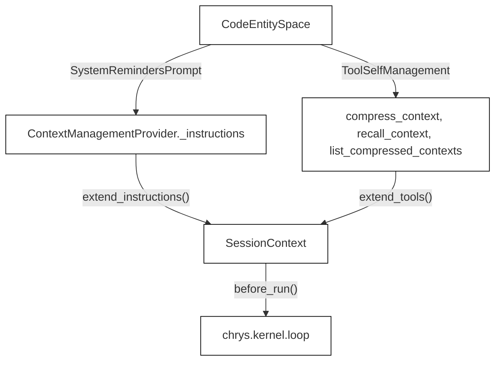
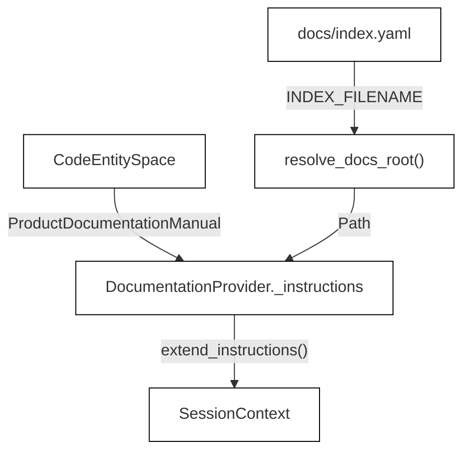
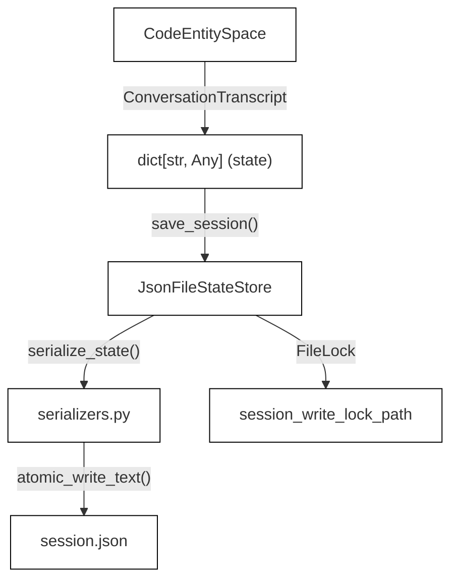
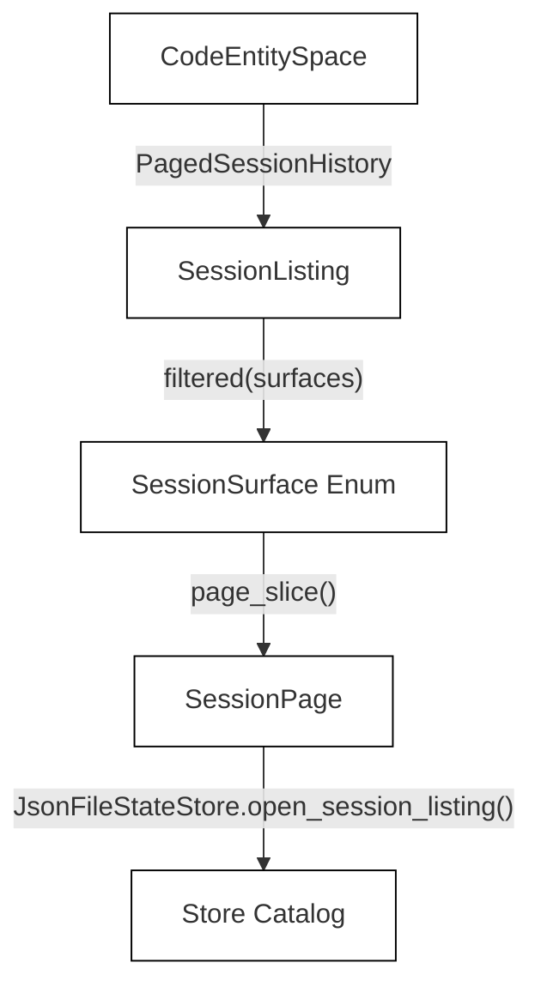
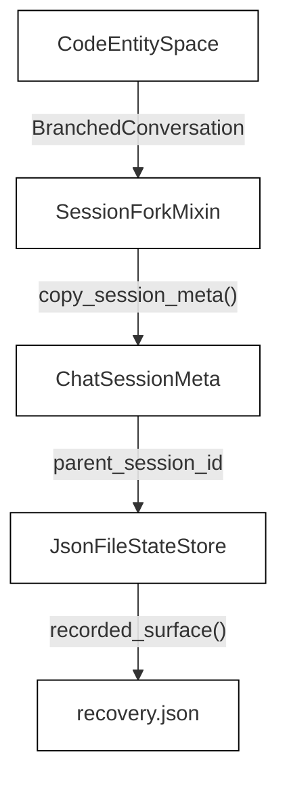

<!-- source: DeepWiki mcp.deepwiki.com · repo openJiuwen-ai/iCode · page 7.4 Context Providers and Session State · fetched 2026-11-02 -->

# Context Providers and Session State

Relevant source files

The following files were used as context for generating this wiki page:

- [src/chrys/app/tui/screens/guides/index.py](src/chrys/app/tui/screens/guides/index.py)
- [src/chrys/app/tui/screens/guides/screen.py](src/chrys/app/tui/screens/guides/screen.py)
- [src/chrys/foundation/documentation.py](src/chrys/foundation/documentation.py)
- [src/chrys/orchestration/invoker/runtime.py](src/chrys/orchestration/invoker/runtime.py)
- [src/chrys/service/context/providers/context_management.py](src/chrys/service/context/providers/context_management.py)
- [src/chrys/service/context/providers/documentation.py](src/chrys/service/context/providers/documentation.py)
- [src/chrys/service/session/history.py](src/chrys/service/session/history.py)
- [src/chrys/service/state/_fork.py](src/chrys/service/state/_fork.py)
- [src/chrys/service/state/_session_meta.py](src/chrys/service/state/_session_meta.py)
- [src/chrys/service/state/store.py](src/chrys/service/state/store.py)
- [tests/service/context/providers/test_context_management.py](tests/service/context/providers/test_context_management.py)
- [tests/service/context/providers/test_documentation.py](tests/service/context/providers/test_documentation.py)
- [tests/service/session/test_persistence.py](tests/service/session/test_persistence.py)
- [tests/service/state/test_legacy_flat_files.py](tests/service/state/test_legacy_flat_files.py)
- [tests/service/state/test_session_listing.py](tests/service/state/test_session_listing.py)

## Purpose and Scope

This page details the context management infrastructure and session state persistence layer in iCode (`chrys`). It covers the implementation of context providers that inject tools and instructions dynamically into agent sessions (`ContextManagementProvider`, `DocumentationProvider`), the session storage abstraction (`StateStore` and `JsonFileStateStore`), session catalog indexing, surface filtering, pagination, and conversation forking mechanisms.

---

## 1. Context Providers

Context providers inject runtime instructions, capabilities, and self-management mechanisms into an agent's execution context before a conversation turn begins.

### Context Management Provider

`ContextManagementProvider` gives agents self-directed tools to manage their conversation history without relying on prompt edits in user profile YAML files [src/chrys/service/context/providers/context_management.py:3-13](). 

Key classes and functions:
* `ContextManagementProvider`: Inherits from `ContextProvider` and implements `before_run()` to inject system instructions and tools [src/chrys/service/context/providers/context_management.py:7-9]() [src/chrys/kernel/__init__.py:32]().
* Injected Tools: `compress_context`, `recall_context`, and `list_compressed_contexts` [src/chrys/service/context/providers/context_management.py:6-7](). These tools are tagged out-of-band with `KIND_CONTEXT` [src/chrys/foundation/tool_kinds.py:24]().

*Sources: [src/chrys/service/context/providers/context_management.py:3-10](), [src/chrys/kernel/__init__.py:27-36]()*.

### Documentation Provider

`DocumentationProvider` exposes absolute paths to the installed product documentation and topic index without pre-loading file contents or registering execution tools [src/chrys/service/context/providers/documentation.py:15-17]().

* `resolve_docs_root()`: Locates the documentation root by checking environment overrides (`CHRYS_DOCS_ROOT`), bundled package paths (`app/tui/screens/guides/_docs`), or source checkouts [src/chrys/foundation/documentation.py:14-36]().
* Instructions injection: Injects instructions pointing to `index.yaml` and conditional guidance on whether `read_file` is available for direct inspection or delegation [src/chrys/service/context/providers/documentation.py:41-55]().

*Sources: [src/chrys/service/context/providers/documentation.py:15-79](), [src/chrys/foundation/documentation.py:10-36]()*.

---

## 2. Session Store and Persistence

Session persistence handles saving and loading conversation transcripts, recovery states, workflow metadata, and state checkpoints.

### StateStore Protocol and JsonFileStateStore

Persistence operations are defined by the `StateStore` protocol and implemented by `JsonFileStateStore` [src/chrys/service/state/store.py:101-103]() [src/chrys/service/state/store.py:161-163]().

* `session_dir(session_id)`: Resolves the directory path for a given session ID [src/chrys/service/state/store.py:105]() [src/chrys/foundation/config/settings.py:22]().
* `save_session(...)`: Persists session messages, metadata, model configurations, and working directories atomically using file locks and backup rotation [src/chrys/service/state/store.py:106-128]() [src/chrys/foundation/platform/files.py:24]().
* Concurrency Controls: Uses `FileLock`, `session_write_lock_path`, and `session_active_lock_path` to prevent race conditions during multi-process or asynchronous writes [src/chrys/service/state/store.py:30-56]().

*Sources: [src/chrys/service/state/store.py:38-137](), [src/chrys/service/state/serializers.py:68]()*.

---

## 3. Session Listing, Filtering, and Pagination

Session exploration relies on catalog indexing and query filtering.

* `SessionListing` and `SessionListingEntry`: Encapsulate fixed newest-first snapshots of session metadata [tests/service/state/test_session_listing.py:26]() [tests/service/state/test_session_listing.py:44-46]().
* Surface Filtering: Filters sessions by user interface origin via `SessionSurface` (e.g., `SessionSurface.TUI`, `SessionSurface.CLI`, `SessionSurface.ACP`) [tests/service/state/test_session_listing.py:22]() [tests/service/state/test_session_listing.py:36-38]().
* Pagination (`page_slice`): Clamps page numbers and slices entries according to `SESSION_PAGE_SIZE` [tests/service/state/test_session_listing.py:12-127]() [src/chrys/service/state/store.py:78-84]().

*Sources: [tests/service/state/test_session_listing.py:3-128](), [src/chrys/service/state/store.py:78-84]()*.

---

## 4. Session Forking and Metadata Extraction

Session branching allows agents to duplicate historical states into new conversation trees, supported by metadata extraction routines.

* `SessionForkMixin`: Provides session forking logic, copying message trees and setting parent session references [src/chrys/service/state/store.py:26]() [src/chrys/service/state/_fork.py]().
* Metadata Structs (`SessionMeta`): 
  * `ChatSessionMeta`: Tracks agent profile names, profile IDs, model providers, token counts, and message counts [src/chrys/service/state/_session_meta.py:63-84]().
  * `WorkflowSessionMeta`: Tracks workflow IDs, run counts, and run states [src/chrys/service/state/_session_meta.py:87-94]().
* `recorded_surface(...)`: Resolves the surface of the last recorded conversation turn, giving precedence to crash recovery sidecars when newer than primary state files [src/chrys/service/state/_session_meta.py:137-151]().

*Sources: [src/chrys/service/state/store.py:26](), [src/chrys/service/state/_session_meta.py:37-97](), [src/chrys/service/state/_session_meta.py:137-151]()*.

---

