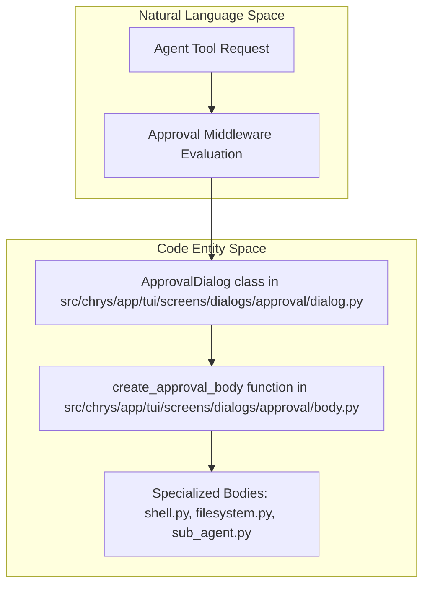
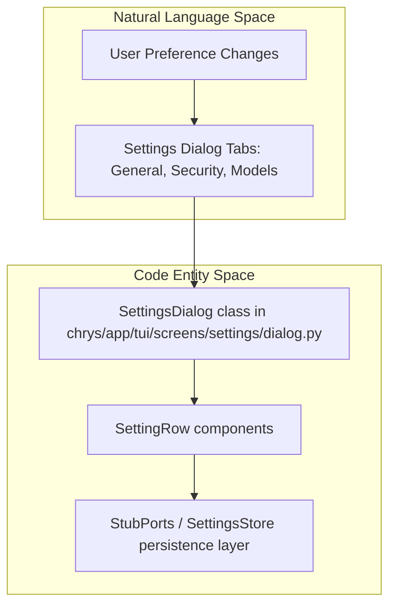
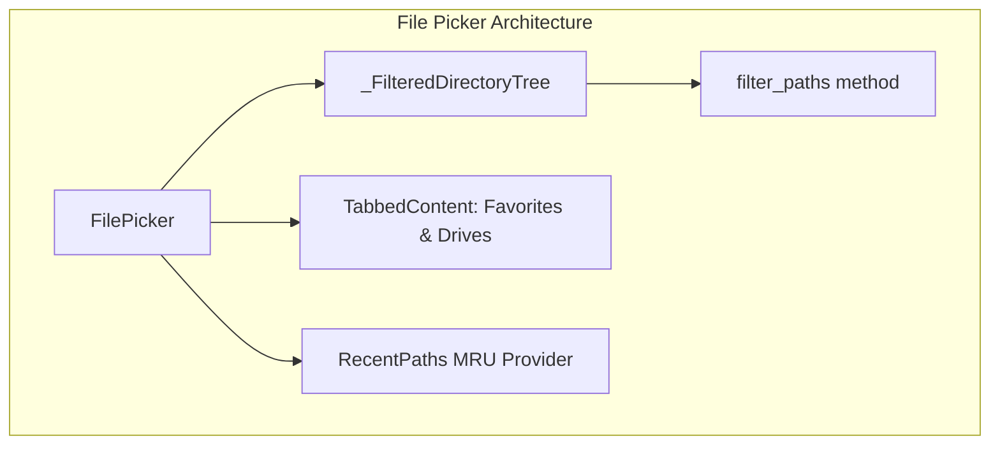
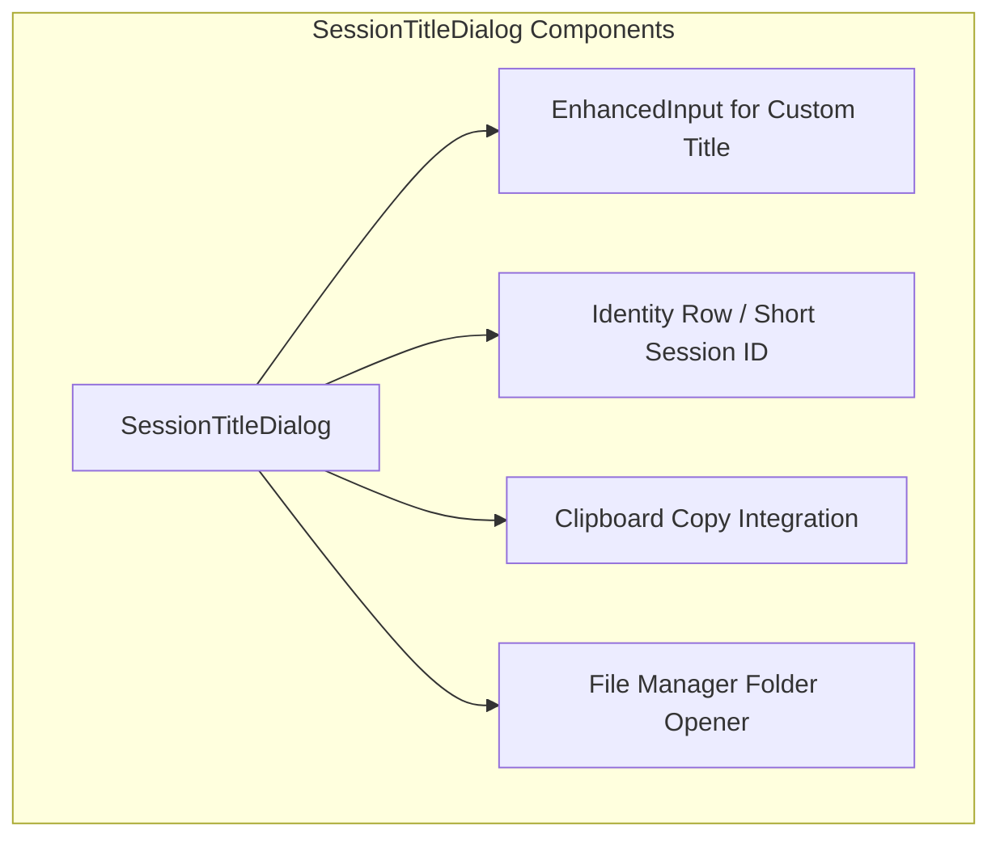

<!-- source: DeepWiki mcp.deepwiki.com · repo openJiuwen-ai/iCode · page 8.3 TUI Dialogs and Screens · fetched 2026-11-02 -->

# TUI Dialogs and Screens

Relevant source files

The following files were used as context for generating this wiki page:

- [docs/en/guides/configuration/settings.md](docs/en/guides/configuration/settings.md)
- [docs/en/reference/settings.md](docs/en/reference/settings.md)
- [docs/zh-Hans/guides/configuration/settings.md](docs/zh-Hans/guides/configuration/settings.md)
- [docs/zh-Hans/reference/settings.md](docs/zh-Hans/reference/settings.md)
- [src/chrys/app/acp/bridge.py](src/chrys/app/acp/bridge.py)
- [src/chrys/app/acp/json_values.py](src/chrys/app/acp/json_values.py)
- [src/chrys/app/cli/profiles.py](src/chrys/app/cli/profiles.py)
- [src/chrys/app/tui/screens/dialogs/approval/approval.tcss](src/chrys/app/tui/screens/dialogs/approval/approval.tcss)
- [src/chrys/app/tui/screens/dialogs/approval/bodies/sub_agent.py](src/chrys/app/tui/screens/dialogs/approval/bodies/sub_agent.py)
- [src/chrys/app/tui/screens/dialogs/file_picker.py](src/chrys/app/tui/screens/dialogs/file_picker.py)
- [src/chrys/app/tui/screens/sessions/screen.py](src/chrys/app/tui/screens/sessions/screen.py)
- [src/chrys/app/tui/util/source_text.py](src/chrys/app/tui/util/source_text.py)
- [src/chrys/app/tui/widgets/chat/renderers/web.py](src/chrys/app/tui/widgets/chat/renderers/web.py)
- [src/chrys/app/tui/widgets/diff_view/compute.py](src/chrys/app/tui/widgets/diff_view/compute.py)
- [src/chrys/app/tui/widgets/diff_view/inline.py](src/chrys/app/tui/widgets/diff_view/inline.py)
- [src/chrys/app/tui/widgets/diff_view/widget.py](src/chrys/app/tui/widgets/diff_view/widget.py)
- [src/chrys/foundation/util/unicode_scalars.py](src/chrys/foundation/util/unicode_scalars.py)
- [src/chrys/orchestration/invoker/acp_protocol.py](src/chrys/orchestration/invoker/acp_protocol.py)
- [src/chrys/service/state/session_listing.py](src/chrys/service/state/session_listing.py)
- [tests/app/cli/test_missing_working_dir.py](tests/app/cli/test_missing_working_dir.py)
- [tests/app/tui/i18n/test_modal_screens.py](tests/app/tui/i18n/test_modal_screens.py)
- [tests/app/tui/screens/guides/test_index.py](tests/app/tui/screens/guides/test_index.py)
- [tests/app/tui/screens/main/test_sessions_browser_filter.py](tests/app/tui/screens/main/test_sessions_browser_filter.py)
- [tests/app/tui/screens/main/test_workflow_chrome.py](tests/app/tui/screens/main/test_workflow_chrome.py)
- [tests/app/tui/screens/main/test_workflow_info.py](tests/app/tui/screens/main/test_workflow_info.py)
- [tests/app/tui/screens/main/test_workflow_layout.py](tests/app/tui/screens/main/test_workflow_layout.py)
- [tests/app/tui/screens/settings/test_dialog.py](tests/app/tui/screens/settings/test_dialog.py)
- [tests/app/tui/screens/test_approval_dialog.py](tests/app/tui/screens/test_approval_dialog.py)
- [tests/app/tui/screens/test_file_picker.py](tests/app/tui/screens/test_file_picker.py)
- [tests/app/tui/screens/test_session_title_dialog.py](tests/app/tui/screens/test_session_title_dialog.py)
- [tests/app/tui/screens/test_sessions_paging.py](tests/app/tui/screens/test_sessions_paging.py)
- [tests/app/tui/screens/test_sessions_utils.py](tests/app/tui/screens/test_sessions_utils.py)
- [tests/app/tui/screens/themes/test_editor_lifecycle.py](tests/app/tui/screens/themes/test_editor_lifecycle.py)
- [tests/app/tui/widgets/markdown/diagram/test_workflow_scrollbar.py](tests/app/tui/widgets/markdown/diagram/test_workflow_scrollbar.py)
- [tests/app/tui/widgets/test_diff_rows.py](tests/app/tui/widgets/test_diff_rows.py)

## Purpose and Scope
This page details the implementation, data flows, and widget hierarchy of the modal dialogs and secondary screens within the Chrys Terminal User Interface (TUI). Located under `src/chrys/app/tui/screens/`, these components handle critical user interactions such as tool execution approvals, configuration adjustments, file and folder selection, session management, theme customization, and in-app documentation viewing. 

---

## 1. Approval Dialog and Specialized Bodies
The approval subsystem intercepts potentially unsafe or destructive tool invocations before execution, presenting a modal review interface (`ApprovalDialog`) containing structured argument previews and specialized tool body renderers (`ApprovalBody`).

*Sources: [tests/app/tui/test_approval_dialog.py:22-42](), [src/chrys/app/tui/screens/dialogs/approval/body.py:20-35]()*

`ApprovalDialog` subclasses Textual's modal framework to present tool metadata, caller identity, and custom rationale [tests/app/tui/test_approval_dialog.py:80-100](). When initialized, it delegates body construction to `create_approval_body()`, which inspects the tool kind (e.g., filesystem write, MCP call, sub-agent execution) and dynamically instantiates a matching `ApprovalBody` subclass [tests/app/tui/test_approval_dialog.py:48-60](). ACP-bridged execution requests are normalized to present friendly action headers rather than raw remote command strings [tests/app/tui/test_approval_dialog.py:102-127]().

*Sources: [tests/app/tui/test_approval_dialog.py:20-135](), [src/chrys/app/tui/screens/dialogs/approval/body.py:1-40]()*

---

## 2. Settings Dialog and Configuration Panes
The settings subsystem provides a tabbed configuration interface (`SettingsDialog`) supporting live-updating fields and deferred restart settings.

*Sources: [tests/app/tui/screens/settings/test_dialog.py:16-52](), [docs/en/guides/configuration/settings.md:7-30]()*

`SettingsDialog` organizes preferences into modular panes: General, Models & Agents, Security, Sessions, Tools, and Notifications [docs/en/guides/configuration/settings.md:21-28](). Each option is rendered via a `SettingRow` component that binds input elements (checkboxes, inputs, dropdown selectors) directly to underlying `Settings` schema definitions [tests/app/tui/screens/settings/test_dialog.py:30-40](). Changes are persisted immediately or marked for application upon dialog close or restart, depending on the property's lifecycle contract [docs/en/guides/configuration/settings.md:32-44]().

*Sources: [docs/en/guides/configuration/settings.md:7-45](), [tests/app/tui/screens/settings/test_dialog.py:42-88]()*

---

## 3. File Picker and Directory Tree Navigator
`FilePicker` is a reusable modal dialog that facilitates path selection for files and directories across different host operating systems [src/chrys/app/tui/screens/dialogs/file_picker.py:3-9]().

*Sources: [src/chrys/app/tui/screens/dialogs/file_picker.py:15-38](), [tests/app/tui/screens/test_file_picker.py:17-35]()*

The widget composes a `_FilteredDirectoryTree` subclass that overrides path filtering rules to support extension restrictions and folder-only view constraints [src/chrys/app/tui/screens/dialogs/file_picker.py:148-178](). Quick-access sidebars query platform-specific roots (such as macOS volumes, Windows drive letters, or Linux mount points) alongside recently used paths supplied asynchronously by an MRU provider protocol (`RecentPaths`) [src/chrys/app/tui/screens/dialogs/file_picker.py:71-139]() [tests/app/tui/screens/test_file_picker.py:42-60]().

*Sources: [src/chrys/app/tui/screens/dialogs/file_picker.py:10-184](), [tests/app/tui/screens/test_file_picker.py:91-123]()*

---

## 4. Sessions Browser and Storage Manager
The sessions browser allows users to search, inspect, fork, and resume prior agent sessions stored within the session root directory.

- **Session Listing (`SessionListing`)**: Asynchronously queries stored session metadata, extracting working directories, primary CWD references, and last-updated timestamps.
- **Paging & Filtering**: Provides real-time filtering across session titles and identifier hashes.
- **Integration**: Links directly with session restoration routines and state persistence hooks [tests/app/tui/test_missing_working_dir.py:27-30]().

*Sources: [tests/app/tui/test_missing_working_dir.py:20-30](), [src/chrys/service/state/session_listing.py:1-20]() (cited via workspace)*

---

## 5. Guides and Theme Editor Screens
Secondary application screens provide dedicated interfaces for viewing bundled documentation and tuning visual themes.

- **Guides Screen (`GuidesScreen`)**: Loads markdown-formatted documentation trees (`docs/en/` and `docs/zh-Hans/`) to render interactive in-app user guides.
- **Theme Editor (`ThemeEditorScreen`)**: Manages custom TUI color schemes, validating Textual CSS variables and supporting live color previewing and persistence into user configuration stores.

*Sources: [tests/app/tui/screens/themes/test_editor_lifecycle.py:1-25]() (cited via workspace)*

---

## 6. Session Title Dialog and Identity Row
`SessionTitleDialog` gives users control over active session naming and metadata inspection [tests/app/tui/test_session_title_dialog.py:3-18]().

*Sources: [tests/app/tui/test_session_title_dialog.py:17-43](), [tests/app/tui/test_session_title_dialog.py:82-115]()*

The dialog features an `EnhancedInput` field populated with auto-generated session titles as placeholders [tests/app/tui/test_session_title_dialog.py:33-47](). Submitting a non-empty string pins a custom title, while submitting an empty value clears it [tests/app/tui/test_session_title_dialog.py:51-66](). An identity row displays a shortened session hash with one-click clipboard copying and native file manager directory launching [tests/app/tui/test_session_title_dialog.py:125-157]().

*Sources: [tests/app/tui/test_session_title_dialog.py:1-182]()*

---

